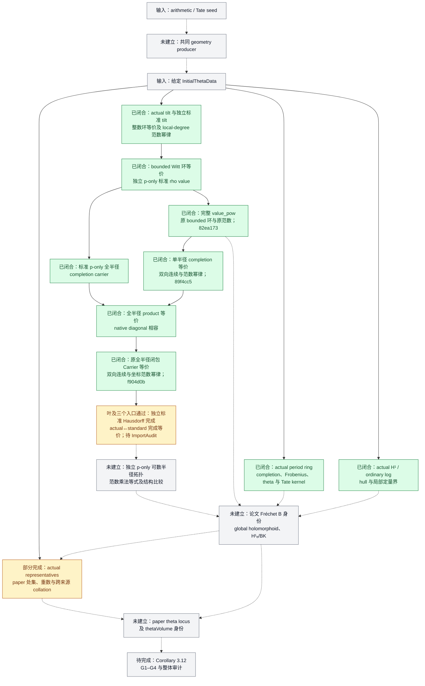

# Scene1 进度总览

### 状态判定

| 标记 | 状态 | 使用条件 |
| --- | --- | --- |
| 🟢 | 已闭合 | 本行精确义务已证明，所需实际输入已落实，相关验收已通过 |
| 🔵 | 条件性完成 | 定理及其显式条件已验证，但条件尚未从目标实际数据全部推出 |
| 🟡 | 部分完成 | 已有可引用子结果，仍缺构造、比较、身份等式或整单验收 |
| ⚪ | 未建立 | 尚无满足本行要求的已验收构造或证明 |
| 🔴 | 路线已排除 | 已证明某条具体路线不成立；必须保留排除范围及所用条件 |

“已闭合”只对该行声明的范围有效。局部构造闭合，不自动关闭所属最终闸门。
给定 `InitialThetaData` 后的实际适配，不等于从 arithmetic seed 构造出完整真实模型；
actual carrier 上的定理，不自动成为论文 carrier 上的定理。
必要充分条件已证明，也不表示实际数据满足该条件。

不按文件数、声明数、S1 编号或复选框数计算总完成百分比。
四个闸门的关闭数只表示验收状态，不表示工作量比例或剩余时间。

## 当前结论

| 项目 | 当前值 |
| --- | --- |
| 更新日期 | 2026-11-04（Asia/Shanghai） |
| 最近完成的数学单元 | 原 actual 与独立标准全半径闭包 `Carrier` 比较：连续环等价、原 diagonal 相容、双向坐标公式和范数幂律 |
| 已提交数学基线 | `f904d0b`；其前置单元为完整 bounded `value_pow`（`82ea173`）、单半径 completion（`89f4cc5`）、全半径 product 等价（`213751d`）和原生 Source/coercion 接口（`f178044`） |
| 最新工作树进展 | 独立标准全半径 Hausdorff completion 及其与 actual Fréchet completion 的比较已通过三个叶模块、Scene1、Checks 和 Axioms；ImportAudit 尚未启动，整个单元尚未完成归档、提交或推送 |
| Scene1 整体 | **未完成；最终闸门关闭 0/4；15 项父义务全部开放** |
| 当前推进位置 | 已从单半径比较接通原全半径闭包，并将两侧 Hausdorff completion 连接起来；下一步完成该工作树单元的剩余验收，再补独立 p-only 可数半径拓扑及后续结构比较 |
| 尚未闭合的比较边界 | 旧 named `ambientInclusion/toAmbient` 方块、原标准 named inclusion 的具体点态恢复包装仍未验收；独立 p-only 可度量性、范数乘法等式、标量/Frobenius/Tate-log 及论文 `B` 身份仍开放 |
| 内存优化结果 | 完整 `value_pow` 峰值约 8.677 GiB，原全半径闭包比较叶约 8.713 GiB，最新完成比较叶约 8.715 GiB；这些具体成功运行均低于 16 GiB |
| 最近完整单元验收 | `f904d0b` 的 Scene1、Checks、Axioms、ImportAudit 均退出 0；四入口最大峰值为 `9555336 KiB`（约 9.113 GiB） |
| 最新工作树验收 | 三个叶和 Scene1、Checks、Axioms 均退出 0；最大峰值为 `9562940 KiB`（约 9.120 GiB）；ImportAudit 待运行 |
| 内存边界 | 单叶验收上限 16 GiB；当前监控停止线 15 GiB，总编译内存上限 100 GiB。低于内存线但超时的构建仍不算通过 |
| 尚未接通的主要连接 | 共同真实 geometry producer、global holomorphoid、论文 Fréchet `B`/ρ-norm、H¹ₑ/BK、paper representatives、跨来源 collation、theta locus/`thetaVolume` 与最终 Corollary 3.12 |
| Prologue 边界 | `R5`；四项 source laws 仍由 Scene1 producer 从共同真实来源证明 |

阅读顺序：先看四个闸门，再看当前路线，最后看最近单元变化与内存记录。
总体义务以[开发计划](开发计划.V1Act1Scene1.md)、[证明义务台账](具有明确参考来源指示的证明义务.md)
和[来源台账](../ArithmeticTeichmullerSpaces/SOURCE_LEDGER.md)为准。已提交单元的资源证据见
[Scene1Witt比较内存.jsonl](Scene1Witt比较内存.jsonl)；尚未归档的六条完成比较记录单列于下文。

## 四个最终验收闸门

G1–G4 对应[开发计划 §3](开发计划.V1Act1Scene1.md#3-未完成义务按最终闸门分解)。
每行的“已有结果”概括子结果，不表示该闸门已经关闭。

| 闸门 | 当前状态 | 已有结果 | 关闭所需的剩余工作 | 证据入口 |
| --- | --- | --- | --- | --- |
| **G1：目标与归一化冻结** | 🟡 部分完成 | raw/degree-normalized 换算、weighted source sum、grouped volume 会计、actual qProduct lower bound 和条件性最终消费者已有 | 在同一 paper carrier 上冻结 q-term、局部/全局次数、`p*`、`2ℓ`、无穷处项和最终目标，证明 paper normalization 身份 | [计划 G1](开发计划.V1Act1Scene1.md#g1目标符号和归一化) |
| **G2：共同真实来源模型装配** | 🟡 部分完成 | 给定 `InitialThetaData` 后，actual Tate/q-root、局部 tilt/Fontaine/Witt、perfectoid 局部法律及实际与标准 carrier 比较已有 | 从同一 arithmetic seed 产生 geometry、完整 `InitialThetaData/TateFamily`、holomorphoid、period/H¹ₑ/BK 和四项 source laws，完成论文 `B` 身份 | [计划 G2](开发计划.V1Act1Scene1.md#g2共同真实来源和-producer)；[父义务台账](具有明确参考来源指示的证明义务.md) |
| **G3：论文处集与重数会计** | 🟡 部分完成 | actual representatives、prime fibers、selected/omitted mass、Galois fiber 权重和 grouped volume 会计已有 | 识别论文处集和 `L'` representatives，闭合 multiplicity、residue/inertia degree、paper weights 与 mixed-moduli descent | [计划 G3](开发计划.V1Act1Scene1.md#g3论文处集代表和重数) |
| **G4：实际 theta-volume 与最终连接** | 🟡 部分完成 | ordinary-log/Kummer hull、Haar/cost、actual volume 比较、period-ring 和 Tate kernel 的局部链已有 | 接通 H¹ₑ/BK、theta-value、不同 untilt/holomorphoid、paper theta locus 与 `thetaVolume`，在同一归一化下完成最终 proof term | [计划 G4](开发计划.V1Act1Scene1.md#g4论文-theta-locusvolume-和最终-corollary) |

qLogTerm 的字面符号问题按既有决定暂作笔误处理，等待作者回复后再讨论。
本总览不把它列为当前停工项；G1 的其他归一化和来源义务仍保留。

四个闸门关闭后，还须通过[计划 §6 的构建与审计](开发计划.V1Act1Scene1.md#6-构建与审计规则)，
才能宣布 Scene1 完成。单个单元的编译、审计或推送通过，不等于最终验收完成。

## 当前证明路线

下图展示当前构造与待完成连接，不是完整 Lean 导入图。
实线表示已有构造或已通过叶编译的连接；虚线表示仍需证明或装配。
绿色只覆盖节点写明的已验收范围；黄色完成比较节点仍缺整单验收。



当前 value 路线已通过局部化 presentation 和系数范数比较证明完整商值幂律。
它没有把旧 named `ambientInclusion` 方块作为已证明前提；该方块仍单独开放。
全半径 product 等价已经限制到两侧原始闭包 `Carrier`，保留完整半径族、原范数和
`ρ ↦ ρ ^ localDeg(w)`。关键是先在 p-only 上游证明标准 diagonal 的全函数身份，
再由具体下游消费原闭包判据；这一连接已验收并提交。

最新工作树进一步构造独立标准 Source 的全半径 Hausdorff completion，并接通 actual
Fréchet completion。三个新模块及三个入口已通过，整单仍待 ImportAudit、归档和提交推送。
其中 `standardCompleted_metrizable` 显式依赖 `D,w`；独立 p-only 可数半径与可度量性证明尚未建立。
这些结果尚未闭合论文 Fréchet `B` 的全部结构和来源身份。

### 关键子结果与缺口

| 路线位置 | 状态 | 已证明范围或验收缺口 | 所属闸门／证据 |
| --- | --- | --- | --- |
| 条件性最终定理 | 🔵 条件性完成 | `cor312_of_scene1_data` 与 canonical actual-hull consumer 已有证明；完整真实输入、来源法律和 paper identity 仍须产生 | G1/G2/G4；[计划 §2.3](开发计划.V1Act1Scene1.md#23-scene1-条件性消费者与会计) |
| Actual Tate/q-root 与局部会计 | 🟢 已闭合 | 给定数据后的 q 参数、q-order、根、有限支撑和 raw/degree-normalized 恒等式已有 | G1/G3；[Scene1 聚合](../ArithmeticTeichmullerSpaces/ArithmeticTeichmullerSpaces/Act1Scene1.lean) |
| Actual representatives 与处集会计 | 🟢 已闭合 | actual carrier 内的 representative image、prime support、finite fibers、omitted mass 和 grouped volume 已有；paper 身份另计 | G3；[计划 §2.3](开发计划.V1Act1Scene1.md#23-scene1-条件性消费者与会计) |
| Actual period-ring 与 Tate kernel | 🟢 已闭合 | actual bounded Witt/ρ-norm、completion、Frobenius、theta、twisted integral representatives、full Tate kernel 与实际正合列已有 | G2/G4；[period-ring 边界](#period-ring-路线的边界) |
| Actual H¹、ordinary log 与 hull | 🟢 已闭合 | actual rational H¹、带 integral 来源的 Kummer 像、ordinary log、tensor hull、Haar/cost 和实际定量界已有 | G4；[父义务台账](具有明确参考来源指示的证明义务.md) |
| 标准 tilt 与 integer-ring bridge | 🟢 已闭合 | 标准 fraction field 的范数、完备性、代数闭性、拓扑比较和整数环 bridge 已有；比较保留 local-degree 范数幂律 | G2；`GeometricTiltNorm.lean`、`IutInitialThetaPadicTiltTopology.lean` |
| 独立标准 bounded Witt rho value | 🟢 已闭合 | 仅依赖 p 的 expansion、localization、presentation-independent value、指定半径范围内有限性、零点分离和素数校准已提交 | G2/G4；`7e40f65`；[标准 value](../ArithmeticTeichmullerSpaces/ArithmeticTeichmullerSpaces/Act1Scene1/PadicWittRhoValue.lean) |
| 标准 p-only 全半径 completion carrier | 🟢 已闭合 | 由单半径标准 completion 组装全半径产品 carrier，含坐标范数、稠密嵌入、分离性和坐标收敛；叶、Scene1、Checks、Axioms、ImportAudit 已通过 | G2/G4；`b2ac96f`；[全半径 carrier](../ArithmeticTeichmullerSpaces/ArithmeticTeichmullerSpaces/Act1Scene1/PadicWittAllRadiusCompletion.lean) |
| 实际↔标准全半径 product 等价 | 🟢 已闭合 | 沿 `ρ ↦ ρ ^ localDeg(w)` 组装各半径 completion 等价，给出全乘积双向连续环等价；原 diagonal 相容随后通过 native 接口接通 | G2/G4；`213751d`、`f904d0b`；[product 等价](../ArithmeticTeichmullerSpaces/ArithmeticTeichmullerSpaces/Act1Scene1/IutInitialThetaPadicWittRhoProductEquiv.lean) |
| 原 actual↔standard 全半径闭包比较 | 🟢 已闭合 | 原 `Carrier` 间的环等价、双向连续、homeomorphism、原 inclusion 的 diagonal 底层值公式、双向 evaluate 与坐标范数幂律均已验收；没有替换共同闭包 | G2/G4；`f904d0b`；[原载体比较](../ArithmeticTeichmullerSpaces/ArithmeticTeichmullerSpaces/Act1Scene1/IutInitialThetaPadicWittAllRadiusComparison.lean) |
| 独立标准全半径 Source 与 Hausdorff completion | 🟡 部分完成 | 仅依赖 p 的原全半径一致结构、分离性、环拓扑、完成与原闭包的一致/环等价、连续环同态延拓及唯一性已通过叶编译和三个入口；整单 ImportAudit 与归档待完成 | G2/G4；工作树 [Source](../ArithmeticTeichmullerSpaces/ArithmeticTeichmullerSpaces/Act1Scene1/PadicWittFrechetSource.lean)、[完成比较](../ArithmeticTeichmullerSpaces/ArithmeticTeichmullerSpaces/Act1Scene1/PadicWittFrechetComparison.lean) |
| Actual↔standard 全半径完成比较 | 🟡 部分完成 | 双向连续环等价、一致等价、homeomorphism、原 inclusion 底层值、半径相容、范数幂律与收敛判据已通过叶编译和三个入口；整单 ImportAudit 与提交待完成 | G2/G4；工作树 [实际完成比较](../ArithmeticTeichmullerSpaces/ArithmeticTeichmullerSpaces/Act1Scene1/IutInitialThetaPadicWittFrechetComparison.lean) |
| 独立 p-only 可度量性及结构身份 | ⚪ 未建立 | 独立可数半径拓扑、范数乘法等式，以及标准标量/Frobenius/Tate-log 比较仍待证明；已有 `D,w` 下的可度量性运输不能替代独立 p-only 结果 | G2/G4；上述完成比较源码的边界说明 |
| 共享 carrier 比较与 `ambientEquiv` | 🟢 局部闭合 | 系数、field-Witt 和 fraction ambient 等价已有 proof term；相关叶有低于 16 GiB 的成功记录，范围不含 bounded ambient inclusion 方块 | G2/G4；`d4a05cd`；[ambient 等价叶](../ArithmeticTeichmullerSpaces/ArithmeticTeichmullerSpaces/Act1Scene1/IutInitialThetaPadicWittRhoAmbientEquiv.lean) |
| 原 inclusion 后的系数范数幂律 | 🟢 叶验收通过 | `coefficient_inclusion_norm_pow` 已在默认预算下通过独立叶编译；新接口直接保存两侧 inclusion 后的系数范数 | G2/G4；[系数范数叶](../ArithmeticTeichmullerSpaces/ArithmeticTeichmullerSpaces/Act1Scene1/IutInitialThetaPadicWittRhoCoefficientNorm.lean) |
| 分子、分母与商值幂律 | 🟢 叶验收通过 | `numerator_value_pow`、`denominator_value_pow`、`quotient_value_pow` 分别通过默认预算叶编译；最终局部化值定理也已在 `82ea173` 通过 | G2/G4；[商值叶](../ArithmeticTeichmullerSpaces/ArithmeticTeichmullerSpaces/Act1Scene1/IutInitialThetaPadicWittRhoQuotientValue.lean) |
| 两侧 localization presentation 值公式 | 🟢 叶验收通过 | actual arbitrary-contraction 与 standard Away presentation 的值公式已有成功编译记录 | G2/G4；[presentation 叶](../ArithmeticTeichmullerSpaces/ArithmeticTeichmullerSpaces/Act1Scene1/IutInitialThetaWittRhoLocalizationPresentation.lean) |
| Actual→standard 完整 rho 幂律 | 🟢 已闭合 | 原 bounded `ringEquiv` 上的 `value_pow` 在默认 heartbeat 下通过，保留原范数、标准独立收缩元和半径 rho^localDeg；聚合、审计和推送已完成 | G2/G4；`82ea173`；[最终值声明](../ArithmeticTeichmullerSpaces/ArithmeticTeichmullerSpaces/Act1Scene1/IutInitialThetaPadicWittRhoValuePow.lean) |
| 旧 named `ambientInclusion` / `toAmbient` 比较 | ⚪ 未建立 | 已测试的具体交换图仍未通过；ambient 环等价和新系数范数叶不能代替该命名映射的相容证明 | G2/G4；[计划中的构建边界](开发计划.V1Act1Scene1.md#2026-11-03named-ambient-inclusion-的内核阻塞已复核) |
| 原标准 named inclusion 的具体恢复包装 | ⚪ 未建立 | 在具体 `ringFun` 像上恢复原标准 named inclusion 的独立点态包装仍有 Kernel timeout；p-only 上游的全函数 diagonal 身份和原闭包比较已经验收，两者范围须区分 | G2/G4；[来源台账](../ArithmeticTeichmullerSpaces/SOURCE_LEDGER.md)的原闭包比较边界 |
| 论文 `B`、H¹ₑ/BK 与 global holomorphoid | ⚪ 未建立 | actual/local 构件尚未识别为论文要求的 carrier、拓扑、子空间及比较映射 | G2/G4；[父义务台账](具有明确参考来源指示的证明义务.md) |
| Paper representatives、theta locus 与 `thetaVolume` | 🟡 部分完成 | actual 会计和 hull 可复用；paper carrier、跨来源 transport、locus/volume 身份及最终共同装配仍缺 | G2/G3/G4；[计划 §3](开发计划.V1Act1Scene1.md#3-未完成义务按最终闸门分解) |

“已闭合”只覆盖本行的精确范围。已提交的 bounded、单半径、全半径 product 和原闭包单元
均有相应聚合与审计证据；最新工作树完成比较仍缺 ImportAudit。这些局部结果不关闭论文 `B` 身份或父义务。
`integralKummerSubmodule` 是带 integral 来源的有理像载体；特定像类非零不表示一般 integral H¹
系数映射单射。actual ordinary log 仍须与论文 Bloch–Kato log 比较。

### Period-ring 路线的边界

| 层次 | 状态 | 已有结果 | 仍保留的目标 |
| --- | --- | --- | --- |
| Actual bounded Witt 与 ρ-norm | 🟢 已闭合 | 有界 Witt ring、半径 norm、乘法性和 completion 构造已有 | 与论文对象、来源及归一化的身份 |
| 全半径 completion、Frobenius 与 theta | 🟢 已闭合 | actual completion、各半径求值、Frobenius、theta、Tate-log 和 principal-unit period 局部链已有 | 论文 `B`/ρ-norm、holomorphoid 与 H¹ₑ/BK 身份 |
| Twisted integral 代表与 Tate kernel | 🟢 已闭合 | 指定实际 twisted 解可缩放到原始 `A_inf`；full Tate kernel、唯一实际 `ℚₚ` 标量分类与正合列已有 | 论文 carrier、topology 及来源比较 |
| Actual ρ=1 `B⁺` candidate | 🟢 已闭合 | actual 单位球 candidate 的 Frobenius 自同构和 `PadicInt` 结构已有 | 论文 `B⁺` 标记、Galois 作用、global holomorphoid 与标量相容 |
| 环带指数延拓 | 🟡 部分完成 | overlap 法律、闭区间有界逼近和条件性消费者已有 | 精确 Witt 代表或全半径延拓；固定正内半径的单位界不足以推出整性 |
| Actual / standard bounded rho 比较 | 🟢 已闭合 | 原环等价上的完整 `value_pow`、单半径 completion、双向连续和完成范数幂律已验收 | 旧 named ambient 方块和具体原 inclusion 包装仍单独开放 |
| 原全半径闭包 carrier 比较 | 🟢 已闭合 | p-only carrier、半径重参数、product 等价、native diagonal 相容及原闭包等价均已验收 | 标量/Frobenius/period transport 和论文 `B` 身份 |
| 全半径 Hausdorff completion 比较 | 🟡 部分完成 | 独立标准完成、通用延拓与 actual 比较已通过三叶和三个入口 | ImportAudit、归档和提交；独立 p-only 可数半径拓扑、乘法范数等式及论文结构身份 |

Joshi II 的原型为 `B_{C_p^flat,ℚₚ}`、`φ=p`；Joshi III 也允许 `B_E`、tensor 和局部化变体。
选择哪一种载体仍须证明它与实际 holomorphoid、theta-value 来源及权重相容。
当前 p-only 链没有自动给出一般 `E` 的 ramified Witt、Lubin–Tate 或 `φ=π` 身份，
也不能因此断言论文只允许一般 `E` 路线。来源见[计划中的论文载体变体边界](开发计划.V1Act1Scene1.md#2026-11-04原生-completion-coe-接口与论文载体变体边界)。

### 已排除路线：避免重复投入

| 具体路线 | 状态与排除范围 | 当前保留方向 | 证据 |
| --- | --- | --- | --- |
| 从任意抽象 AG/TG 接口自动产生 universal geometry producer | 🔴 反模型排除仅凭现有抽象字段无条件产生 witness；不评价真实 orbicurve | 为真实 geometry 证明 cartesian、covering 和 local 来源法律 | [计划 2026-10-23](开发计划.V1Act1Scene1.md#2026-10-23任意无约束-agtg-的统一-producer-反模型) |
| Actual contracting q-root 直接充当旧 theta base | 🔴 q-root 范数小于 1，与旧 period/normalization/transfer 的非负 logVolume 要求冲突 | 另一 theta lift、different untilt 或 negative-log cost | 计划 N1；S1.243/S1.321 |
| Signed Haar log-volume 直接等同旧 `VolumeTransfer` | 🔴 正长度 ordinary-log hull 的 signed log-volume 为负，排除指定直接身份 | 证明 actual `-log(volume)` cost 的 paper identity | 计划 N2；S1.321/S1.322/S1.406 |
| 指定 representative certificates 与 reference q-pilot equality 联合使用 | 🔴 已证明指定证书组合与 selected/reference strict gap 不相容 | 从 paper source 重审 representatives、omitted mass 和 degree/weight | [计划 2026-10-29](开发计划.V1Act1Scene1.md#2026-10-29canonical-degree-one-representative-certificate-的乘积不相容性) |
| 固定正内半径上的单位界直接推出 `A_inf` 整性 | 🔴 实际环带反例排除只凭该单位界取得 integral 代表；不排除附带 Frobenius 方程的识别 | 使用实际 Frobenius 方程，或构造全半径延拓 | [计划 2026-10-30](开发计划.V1Act1Scene1.md#2026-10-30固定环带的双侧单位界不足以推出-a_inf-整性) |

这些结果只排除表中具体路线，不构成 Corollary 3.12 的反例。
内核超时和超内存属于构建失败证据，不标为数学上的“路线已排除”。

## 最近单元变化与内存记录

| 单元 | 新增结果 | 验收状态 | 保留边界 |
| --- | --- | --- | --- |
| `82ea173`：bounded rho 值比较 | 把映射后的系数范数放入上游抽象接口，经 numerator、denominator 和 quotient 推出原环等价上的完整 `value_pow` | 🟢 已验收并推送 | 旧 named ambient 方块仍独立开放 |
| `213751d`、`f178044`：全乘积与原生 coe | 组装全部半径的 product 等价，并建立原 actual inclusion 到标准原生 coe 的相容接口 | 🟢 已验收并推送 | 后续闭包限制另由下一单元证明 |
| `f904d0b`：原全半径闭包比较 | 标准 diagonal 身份上移到 p-only 源叶，证明具体 product transport 限制到两侧原 `Carrier` | 🟢 已验收并推送 | 旧具体 named inclusion 包装及论文结构身份仍开放 |
| 工作树：全半径完成比较 | 独立标准 Source/Hausdorff completion、原闭包比较、通用延拓，以及 actual↔standard 完成等价 | 🟡 三叶及三个入口通过 | 待 ImportAudit、来源/资源归档和提交推送；独立可数半径及论文身份仍开放 |

这两次主要路线调整都把可复用的函数身份提前交给上游载体证明，下游只组合已证法律。
原实际/标准范数、独立 p-only 收缩元、原 bounded 环等价和原共同闭包均保留，没有增加自由比较假设。

已验收的完整值目标为：令 `d = localDeg(w)`、`B = InitialThetaPadicBoundedWittComparison`，
对 `ρ ≠ 0`、`ρ ≠ ⊤` 及原 actual bounded Witt 元素 `x`，证明

```text
PadicWittRhoValue.value p ρ (B.ringEquiv D w x) ^ d
  = InitialThetaWittRhoValue.value D w (ρ ^ d) x
```

原全半径闭包的相应定理已随 `f904d0b` 验收。最新工作树把它延伸到完成上的半径坐标：

```text
‖standardRadiusMap ρ x‖ ^ d = ‖actualRadiusMap (ρ ^ d) x‖
```

这里的两个映射分别是完成比较中的标准坐标和原 actual 坐标；正式声明为
`InitialThetaPadicWittFrechetComparison.norm_radiusMap_pow`，目前已通过叶编译和三个入口。

### 最新受控构建

记录采用 CPU `0-13`、`LEAN_NUM_THREADS=14`、Lean `-j1`、热缓存和默认 heartbeat，
每 0.5 秒采样进程组 RSS；15 GiB 是监控停止线，16 GiB 是单叶验收上限。
下表成功行均退出 0，且无停止原因；GiB 按 `KiB / 1048576` 换算。
资源值属于相应源码版本的那次运行，不表示后来修改源码或依赖后已经自动重验。

已提交单元的代表性记录已归档到[仓库资源 JSONL](Scene1Witt比较内存.jsonl)：

| 构建记录 label | 范围 | 耗时 | 峰值 RSS（KiB / GiB） | 结果 |
| --- | --- | --- | --- | --- |
| `final_named_value_pow` | 最终完整 `value_pow` | 136.3 秒 | `9098108` / 8.677 | 已验收推送 |
| `completion_equiv_coe_ringhom_final` | 单半径 completion 等价与 Source coe 相容 | 134.8 秒 | `9109084` / 8.687 | 已验收推送 |
| `product_equiv_core_final` | 全半径 product 等价 | 119.2 秒 | `9114596` / 8.692 | 已验收推送 |
| `allradius_closure_native_diagonal` | 原全半径闭包比较叶 | 126.9 秒 | `9135892` / 8.713 | 已验收推送 |
| `native_allradius_scene1` | 原闭包比较 Scene1 聚合 | 149.7 秒 | `9443072` / 9.006 | 已验收推送 |
| `native_allradius_checks` | 原闭包比较 Checks | 160.4 秒 | `9555336` / 9.113 | 已验收推送 |
| `native_allradius_axioms` | 原闭包比较 Axioms | 150.8 秒 | `9533224` / 9.092 | 已验收推送 |
| `native_allradius_importaudit` | 原闭包比较 ImportAudit | 134.6 秒 | `9376892` / 8.943 | 已验收推送 |

最新完成比较的六条运行记录仍在本机 `/tmp/abc-rho-builds/resources.jsonl`，
日志及 RSS 样本位于同目录；截至本次更新尚未追加到仓库资源 JSONL 或正式来源台账：

| 构建记录 label | 范围 | 耗时 | 峰值 RSS（KiB / GiB） | 结果 |
| --- | --- | --- | --- | --- |
| `standard_frechet_source` | 独立标准 Source | 76.4 秒 | `5519480` / 5.264 | 叶编译通过 |
| `standard_frechet_completion_comparison` | 标准 Hausdorff completion 与原闭包比较 | 81.4 秒 | `5533976` / 5.278 | 叶编译通过 |
| `actual_standard_frechet_completion_equiv` | Actual↔standard 完成比较 | 134.2 秒 | `9138676` / 8.715 | 叶编译通过 |
| `frechet_completion_scene1` | 最新 Scene1 聚合 | 161.0 秒 | `9365744` / 8.932 | 入口通过 |
| `frechet_completion_checks` | 最新 Checks | 171.9 秒 | `9562940` / 9.120 | 入口通过 |
| `frechet_completion_axioms` | 最新 Axioms | 162.3 秒 | `9540600` / 9.099 | 入口通过 |
| `frechet_completion_importaudit` | 最新 ImportAudit | — | — | 尚未启动，无验收记录 |

最新 Axioms 日志只含 `propext`、`Classical.choice`、`Quot.sound`，没有 `sorryAx` 或错误。
这不替代待执行的 ImportAudit，也不表示整个工作树单元已提交。

### 历史资源边界

| 单元或尝试 | 已记录结果 | 判定 |
| --- | --- | --- |
| 早期整体 rho comparison | `104733916 KiB`，约 99.88 GiB，退出码 137 | 未验收 |
| 早期 field bridge | `111356192 KiB`，约 106.20 GiB，退出码 137 | 未验收 |
| 早期 field-Witt inclusion | `44895852 KiB`，约 42.82 GiB，退出码 137 | 未验收 |
| 拆分和接口调整后的 coefficient、field-Witt、`ambientEquiv` 等叶 | 多个成功运行低于 16 GiB | 对应局部叶通过；完整值定理另由 `82ea173` 验收 |
| 旧 named ambient inclusion | 多次约 11.6 GiB 触发 deterministic timeout；提高预算的受控诊断达到 15 GiB 停止线 | 仍未通过；不由这些日志单独判断数学真伪或具体 Kernel 缺陷 |
| 旧最终值定理的点态 wrapper、等式方向调整和直接 calc 组合 | 多次在约 11.6 GiB 触发 deterministic timeout | 新 presentation/裸函数 transfer 路线已得到最终验收；旧草稿保留为历史失败证据 |

命令、耗时、峰值、退出码、错误和停止原因见[机器可读记录](Scene1Witt比较内存.jsonl)。
人工停止的重复或依赖过期运行明确记为人工停止，不记为自然退出或内存停止；
最新完成比较的六条记录仍待归档，不能把它们写成已存在于仓库资源 JSONL。
早期约 100 GiB 运行的摘要保存在[开发计划](开发计划.V1Act1Scene1.md#2026-11-02rho-比较的-kernel-资源边界与载体接口调整)中；
它们不具备后来受控运行的同等监控条件。一次不限内存诊断授权已使用，后续继续遵守单叶上限。

## 后续顺序

1. 为当前全半径完成比较执行 ImportAudit，归档六条已完成资源及新增验收结果，补齐来源台账和计划动态边界，再提交推送。
2. 证明独立 p-only 可数半径拓扑与可度量性，并补齐标准范数乘法等式；不把显式依赖 `D,w` 的运输定理当作独立证明。
3. 在原载体间接通标量、独立标准 Frobenius、Tate-log 和 period 身份，明确选择的论文 `B`/允许变体及其来源；可继续将编译负荷分配到上下游载体。

旧 named ambient 方块和具体 named inclusion 包装仍单独登记；已通过的原闭包与完成比较
使用已证 native diagonal 路线。继续证明这些包装时仍须满足单叶内存上限，失败记录不得改写成数学反例。

Scene1 总体按[计划 §5](开发计划.V1Act1Scene1.md#5-执行顺序)推进共同真实 geometry producer、
holomorphoid、period/H¹ₑ/BK 和论文 `B`，随后闭合 paper representatives、multiplicity、
mixed-moduli descent、G1 归一化及 G4 theta-volume。
只有同一真实输入上的 G1–G4 与最终整体审计全部通过，才能宣布 Scene1 完成。
