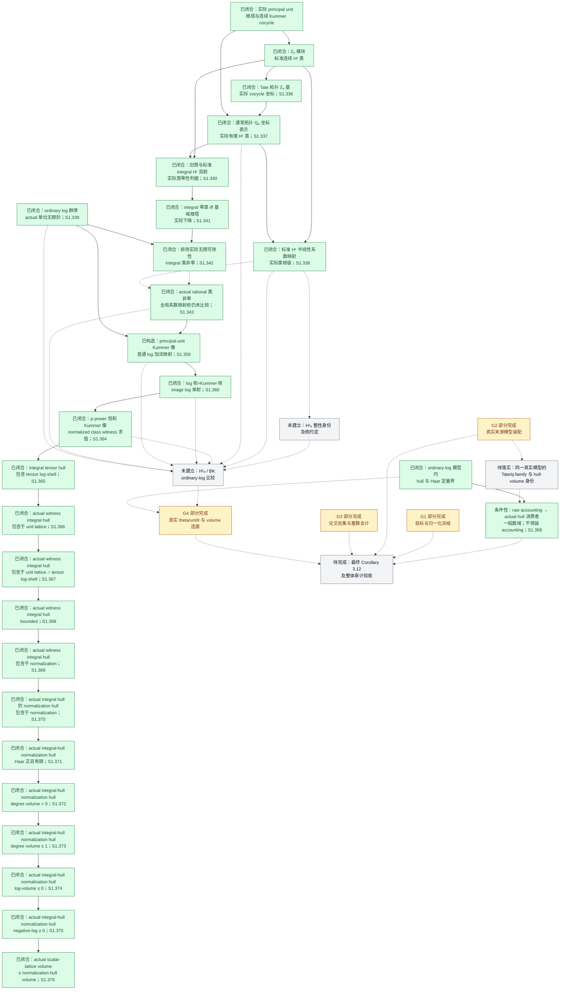

# Scene1 进度总览

## 更新指示：每个逻辑单元结束时执行

本文件回答三个问题：已经证明什么、距离最终目标还缺什么、本单元改变了什么。
更新负责人是完成当前逻辑单元的开发者或智能体。

1. **核对证据。** 阅读当前单元日志、实际声明和来源账本。以精确命题及其输入为准，不能只依据文件名或编译成功。
2. **更新基线。** 修改下方的日期、最近数学单元、证明提交和工作状态。正在验证的结果标为“未验收”；推送后再记录“已推送”。纯文档更新不推进数学基线。
3. **更新四个闸门表。** 对受影响的行，分别修改“已有结果”“关闭所需的剩余工作”和“证据”。未受影响的行保持原状。每个闸门可以关联多个单元，每个单元也可以关联多个闸门。
4. **更新路线和子结果表。** 新结果放到所属路线。写出适用范围和未满足条件。只有连接两端的实际比较或构造已证明，才能把虚线改为实线。
5. **替换最近单元变化卡。** 写明推进哪个闸门、闭合什么、解锁什么、还缺什么，以及信任负担变化。没有关闭最终闸门时，明确写“本轮关闭 0 个”。将旧变化卡及资源表归档到本文件末尾的“历史单元记录”。log5 只追加动态边界和负面证据。
6. **同步验收状态。** 闸门的全部条件满足后，才将其改为“已闭合”，并同步开发计划对应复选框。发现结果失效或路线被排除时，允许退回状态；将原因追加到日志，不覆盖旧证据。
7. **记录工程验证。** 在变化卡中填写检查、公理审计、构建范围、累计耗时和峰值内存。失败尝试计入累计耗时。将数学完成度和工程验证状态分别记录。

更新后检查：四个闸门表、路线图、最近变化卡、开发计划和日志是否一致；相对链接是否有效。
文档更新无需触发 Lean 构建。构建仍遵守开发计划的热构建约束。

### 状态判定

| 标记 | 状态 | 使用条件 |
| --- | --- | --- |
| 🟢 | 已闭合 | 本行精确义务已证明，所需实际输入已落实，相关验收已通过 |
| 🔵 | 条件性完成 | 定理及其显式条件已验证，但条件尚未从目标实际数据全部推出 |
| 🟡 | 部分完成 | 已有可引用子结果，仍缺构造、比较或身份等式 |
| ⚪ | 未建立 | 尚无满足本行要求的已验收构造或证明 |
| 🔴 | 路线已排除 | 已证明某条具体路线不成立；必须写出排除范围及所用条件 |

“已闭合”只对该行声明的范围有效。局部构造闭合，不自动关闭所属最终闸门。
条件性反例不记为无条件反例；一个实际数据适配器不记为完整真实满足模型。
已验证的必要充分条件可以标为已闭合，但不能据此声称实际数据满足该条件。

不按文件数、声明数、S1 编号或所有复选框计算总完成百分比。
四个闸门的关闭数只表示验收状态，不表示工作量比例或剩余时间。

## 当前结论

| 项目 | 当前值 |
| --- | --- |
| 更新日期 | 2026-10-16（Asia/Shanghai） |
| 最近完成的数学单元 | S1.392：actual global volume 的负对数非负性 |
| 数学证明基线 | `3090d33`，S1.392 数学叶子与审计入口已推送；后续纯文档提交不推进数学基线 |
| Scene1 整体 | **未完成；最终闸门关闭 0/4** |
| 数学工作状态 | S1.364 一般饱和 log、单射、normalizedRationalClass 成员和 actual witness 求值通过；H¹ₑ/BK 仍 open |
| 当前推进位置 | G4：p* 除法后的类已进入 p-power 饱和 H¹ 载体并求值为 paper witness；H¹ₑ/BK 等仍 open |
| 尚未接通的主要连接 | revised paper representative carrier/weight semantics、H¹ₑ/BK、真实 theta/untilt 与 volume 身份，以及全局模型装配 |
| Prologue 边界 | R5；S1.363 新增 Core 假设 0，退休 0，转入 0，取出 0 |

阅读顺序：先看四个闸门，再看当前路线，最后查看最近单元变化卡。

## 四个最终验收闸门

G1–G4 依次对应[开发计划 §3](开发计划.V1Act1Scene1.md#3-scene1-形式冻结闸门)的四项要求。
每行的“已有结果”概括子结果，不表示该闸门已经关闭。

| 闸门 | 当前状态 | 已有结果 | 关闭所需的剩余工作 | 证据入口 |
| --- | --- | --- | --- | --- |
| **G1：目标与归一化冻结** | 🟡 部分完成 | raw/degree-normalized 转换、加权公式、严格差额及单向比较已有证明 | 确定论文目标使用的 q-term 和 volume 归一化；统一精确类型、符号、来源与后续消费者 | 计划 §2.2；S1.271、282–283、320、327，见 [log4](开发计划.V1Act1log4.md) |
| **G2：真实来源模型装配** | 🟡 部分完成 | 实际局部完成域、q-root、有限处参数及多项 carrier 适配已存在 | 从同一真实 InitialThetaData/TateFamily 落实 link、参数、j 身份、q-norm 及来源链，构成完整联合满足模型 | 计划 §2.1；S1.270 及 §1.2 已完成基础，见 [计划](开发计划.V1Act1Scene1.md) |
| **G3：论文处集与重数会计** | 🟡 部分完成 | 代表权重、遗漏项判据、完整 odd-support 构造及若干同支撑等式已存在；S1.345 排除当前 mass-one certificate；S1.357 进一步定位 S1.351–352 的 target/未加权 paper-sum 等式输入不相容 | 修订代表 carrier/weight 语义，或证明论文 `L'` representatives 使用不同于当前 mass-one certificate 的 accounting；再闭合重数、residue-degree 和全局求和会计 | 计划 §2.2；S1.272、277、323–327、345，见 [log4](开发计划.V1Act1log4.md)、[log5](开发计划.V1Act1log5.md) |
| **G4：实际 theta-volume 与最终连接** | 🟡 部分完成 | S1.351–352 的旧路线已排除；S1.358 用 raw 次数会计与 actual Haar 界修复消费者，无需预装 accounting 或 degree-one，真实 hull identity 仍为输入；ordinary-log normalization hull、Haar 体积界和 cost 比较已有证明；Kummer 路线已有有理坐标表示、标准 H¹ 系数比较；ordinary log 群律、actual 单位无限阶和 p* 标量会计已证明，实际 integral 零类根塔判据已建立，并已排除该根塔、证明 actual integral 与 rational 类非零及 integral 类无 torsion | 接通真实 BK/theta/different-untilt 身份、witness 成员关系、mixed-moduli descent 和论文 thetaVolume；将同一归一化下的定量结论接入最终目标 | 计划 §2.3；S1.317、326–344，见 [log4](开发计划.V1Act1log4.md)、[log5](开发计划.V1Act1log5.md) |

qLogTerm 符号问题按用户决定暂作笔误处理，等待作者回复后再讨论。
本总览不把该问题列为当前停工项；G1 的其他归一化和来源义务仍保留。

四个闸门关闭后，还须通过[计划 §4 的最终审计和推送验收](开发计划.V1Act1Scene1.md#4-审计和推送验收)，才能宣布 Scene1 完成。
单个单元的检查和推送通过，不等于该最终验收已完成。

## 当前证明路线

下图展示目前选择的推进路线及汇合目标，不是完整 Lean 导入图。
实线表示已有构造连接；虚线表示计划连接，仍需证明或装配。
绿色只表示节点所写的局部结果已闭合。

### 关键子结果与缺口

| 路线位置 | 状态 | 已证明范围或验收缺口 | 所属闸门／证据 |
| --- | --- | --- | --- |
| 条件性最终定理 | 🔵 条件性完成 | `cor312_of_scene1_data` 的证明已存在；完整实际输入及论文身份尚未落实 | G1、G2、G4；计划 §1.2、2.4 |
| 局部范数与权重 | 🟢 已闭合 | S1.237 局部 completion norm 幂律等结构性结果；全局论文身份另见 G1/G3 | G1、G3；计划 §1.2、2.2 |
| 完整支撑 ordinary-log 模型 | 🟢 已闭合 | S1.326–329 所述构造和定量界，在各自归一化及适用条件内成立 | G3、G4；计划 §2.2、2.3 |
| 实际根塔、连续 cocycle、根选择独立性 | 🟢 已闭合 | S1.330–332 从实际数据构造这些对象及其指定性质 | G4；log4 对应单元 |
| 标准连续 H¹ 与 Kummer 群同态 | 🟢 已闭合 | S1.333–334 的标准 ambient 类、根选择独立性及整数标量会计 | G4；log4 对应单元 |
| 连续 ℤₚ 系数结构 | 🟢 已闭合 | S1.335 的模块律、连续标量作用、Galois 相容和标准 ℤₚ H¹ 类 | G4；log4 S1.335 |
| Tate 拓扑 ℤₚ 基 | 🟢 已闭合 | S1.336 的连续线性同构，以及实际 cocycle 的连续坐标和重构 | G4；[log5 S1.336](开发计划.V1Act1log5.md#s1336兼容本原根与-tate-系数的拓扑一维坐标) |
| 分圆特征与有理坐标表示 | 🟢 已闭合 | S1.337 从实际 Tate action 导出连续单位值特征；通常拓扑 ℚₚ 表示及连续、单射、ℤₚ 线性、等变且满 span 的 integral coefficient map 已证明 | G4；[log5 S1.337](开发计划.V1Act1log5.md#s1337-动态边界实际分圆特征与有理-kummer-坐标模型) |
| 实际标准有理 H¹ 类 | 🟢 已闭合 | S1.337 将实际 cocycle 经 coefficient map 推入标准 H¹；坐标与旧 integral 坐标的包含相同，类与根塔选择无关 | G4；log5 S1.337 |
| 标准 H¹ 系数映射与实际类比较 | 🟢 已闭合 | S1.338 从标准 homogeneous cochain 的 homology cokernel 构造连续半线性 H¹ 映射；证明与旧 cocycle 商相容，actual rationalClass 等于 actual padicClass 的像 | G4；[log5 S1.338](开发计划.V1Act1log5.md#s1338-动态边界标准-h¹-半线性系数映射) |
| torsion 的有理像 | 🟢 已闭合 | 非零 ℤₚ 标量消去的类有零 rational 像；若另有非零 torsion 类，则标准映射不单射。未构造 actual D 的非零 torsion 类 | G4；log5 S1.338 条件性负面证据 |
| ordinary log 群律与实际单位无限阶 | 🟢 已闭合 | S1.339 从原级数证明 principal units 上的乘法、幂、逆和单位根消失；实际 log 非零，故实际 principal unit 的任意非零自然数幂不为 1 | G4；[log5 S1.339](开发计划.V1Act1log5.md#s1339-动态边界ordinary-p-adic-log-同态与实际单位幂律) |
| p* 有理标量会计 | 🟢 已闭合 | 明确定义 normalizedRationalClass=(p*)⁻¹•rationalClass 并证明标量还原；未识别该新类与论文 ξ，也未识别其 BK log | G4；log5 S1.339 |
| 旧 Tate cocycle 商与标准 integral H¹ | 🟢 已闭合 | S1.340 从标准 homology quotient 提取连续 cocycle 代表，证明 toPadicH1 的单射和满射；集合 equivalence 不给旧商追加未构造的拓扑/模块 | G4；[log5 S1.340](开发计划.V1Act1log5.md#s1340-动态边界标准-h1-代表与实际-kummer-零性判据) |
| 实际 integral/rational 类零性判据 | 🟢 已闭合 | S1.340 证明类为零当且仅当实际 cocycle 满足具体 coboundary 方程；要证明类非零仍须排除该方程有解 | G4；log5 S1.340 |
| integral 零类与基域根塔下降 | 🟢 已闭合 | S1.341 类零 iff 基域存在同一个 compatible p-power tower；actual local-field 适配已完成，类零推出每一有限层有根 | G4；[log5 S1.341](开发计划.V1Act1log5.md#s1341-动态边界integral-kummer-零类与基域兼容根塔) |
| 实际无限可除性排除与 integral 类非零 | 🟢 已闭合 | S1.342 从实际非零 log 与 principal-unit log 一致有界，证明某层无 p-power 根、无 compatible base tower，actual standard padicClass 非零 | G4；[log5 S1.342](开发计划.V1Act1log5.md#s1342-动态边界离散局部域根排除与实际-integral-类非零) |
| rational 类非零及系数映射核 | 🟢 已闭合（actual 范围） | S1.343 通过清除 rational coboundary 的 p-adic 分母，将 rational 类为零降到某个 integral p-power 类为零，再与 S1.342 的非零 log 矛盾；actual `rationalClass` 与 `normalizedRationalClass` 均非零。全局 integral→rational H¹ 映射单射仍未证明 | G4；[log5 S1.343](开发计划.V1Act1log5.md#s1343-动态边界actual-rational-kummer-类非零) |
| mass-one paper representative certificate | 🔴 当前形式已排除 | S1.345：canonical actual source 下，若同时给出 degree-one canonical Scene1 bundle、mass-one source-to-representative certificate 和 section-link certificate，则得到 `False`；原因是 S1.344 前的 actual strict ramification gap `reference absLogQ < selected paper sum` 与 certificate equality 冲突 | 修订 certificate 的质量条件或 paper carrier/term 语义；不能在未修订前继续把该 certificate 接入最终 Corollary 3.12 | G3；[log5 S1.345](开发计划.V1Act1log5.md#s1345-canonical-actual-source-与-mass-one-paper-representative-certificate-不相容) |
| canonical actual subprobability bound | 🟢 已闭合 | S1.346 在 degree-one canonical Scene1 bundle 中证明 q-pilot `absLogQ < selectedPaperSum`；依赖的实际 fiber-mass `≤ 1` 上界已在早先单元建立 | 将 revised representative accounting 和 theta-volume 消费者接入最终目标 | G3、G4；[log5 S1.346](开发计划.V1Act1log5.md#s1346-canonical-actual-q-pilot-strict-subprobability-bound) |
| canonical actual VBad representative bound | 🟢 已闭合（VBad carrier） | S1.347 将 canonical degree-one Scene1 q-pilot 严格界于 `VBadSelectedPaper.paperSum`；消费实际 VBad 系数加权和及其 strict ramification gap，不扩展到 full odd support 或论文 `L'` | 修订 paper representative 语义并接 packet/hull/thetaVolume | G3、G4；[log5 S1.347](开发计划.V1Act1log5.md#s1347-canonical-actual-q-pilot-vbad-strict-bound) |
| canonical actual VBad coefficient accounting | 🟢 已闭合（VBad carrier） | S1.348 精确证明 canonical q-pilot `absLogQ = ∑ coefficient(v) * VBadSelectedPaper.paperTerm(v)`；保留真实 ramification coefficients，不要求 mass-one | 将该 weighted sum 接入 revised paper accounting 和 theta-volume consumer | G3、G4；[log5 S1.348](开发计划.V1Act1log5.md#s1348-canonical-actual-vbad-coefficient-weighted-accounting) |
| canonical actual VBad generated-hull cost bridge | 🟢 已闭合（ordinary-log hull） | S1.349 证明 canonical q-pilot `absLogQ = cost / n`，其中 cost 是 actual VBad ordinary-log generated hull 的 negative-log volume | 将该 cost 与修订后的 thetaVolume/packet accounting 比较；不能把它直接命名为 Core `thetaVolume` | G4；[log5 S1.349](开发计划.V1Act1log5.md#s1349-canonical-actual-vbad-generated-hull-cost-bridge) |
| canonical actual thetaVolume exponential bridge | 🔵 条件性完成 | S1.350 在 `thetaVolume = actual hull volume` 与显式 normalization 条件下证明 `thetaVolume = exp (-(n * canonicalAbsLogQ))` | 从真实 theta/different-untilt 模型推出 actual hull volume 条件，并接入最终目标 | G4；[log5 S1.350](开发计划.V1Act1log5.md#s1350-canonical-actual-q-pilot-与-thetavolume-指数桥) |
| canonical actual qProduct exponential lower bound | 🔴 输入不相容 | S1.351 的公开定理可编译，但其 canonical degree-one 条件推出 `qLogSum < selectedPaperSum`，与必需的 `hq` 等式冲突；不再计为有效装配。后续须保留真实系数，重建加权会计及 hull/volume 比较；保留历史签名 | G3、G4；S1.357；原记录见 [log5 S1.351](开发计划.V1Act1log5.md#s1351-canonical-q-pilot-指数到-qproduct-下界) |
| 条件性 canonical Corollary 3.12 消费者 | 🔴 输入不相容 | S1.352 继承同一不可能的 `hq`；定理仍可编译，但没有满足全部参数的模型，不能据此称已接通论文目标。修订消费者后须重新审查联合满足性；完整 `base` 已含 accounting，不能把最终定理包装视作来源模型构造 | G1、G2、G3、G4；S1.357；原记录见 [log5 S1.352](开发计划.V1Act1log5.md#s1352-条件性-canonical-corollary-312-消费者) |
| canonical Tate q-pilot bundle | 🔵 条件性完成 | S1.353 仅用 link Tate family 与实际 `iutInitialThetaTateParameterData` 等式派生 q-pilot source、carrier 和 degree-one normalization | 构造真实 Tate family 等式，并补齐 analytic Scene1 base、packet/hull、volume/accounting | G2、G4；[log5 S1.353](开发计划.V1Act1log5.md#s1353-canonical-tate-q-pilot-bundle) |
| canonical Tate q-order alignment | 🟢 已闭合（Tate-only source 范围） | S1.354 逐处证明 Tate-only q-pilot source 的 q-order 等于 actual admissible-prime q-order | 将局部 q-order 等式接入 reference absLogQ 总和，并继续补齐真实 carrier 与 analytic base | G2、G3；[log5 S1.354](开发计划.V1Act1log5.md#s1354-canonical-tate-only-q-order-对齐) |
| Tate-only reference absLogQ bridge | 🟢 已闭合（Tate-only source 范围） | S1.355 证明 Tate-only Scene1 q-pilot `absLogQ` 等于 actual reference q-pilot `absLogQ` | 将 reference q-pilot 接入 paper representative/target qLogSum accounting | G2、G3；[log5 S1.355](开发计划.V1Act1log5.md#s1355-tate-only-q-pilot-到-reference-abslogq) |
| Tate-only target qLogSum accounting | 🟢 已闭合（给定 base 与来源条件） | S1.356：target `qLogSum = qPilot.absLogQ = referenceAbsLogQ`；结合严格差额排除 target 等于未加权 selectedPaperSum | G2、G3；S1.356–357；不构造真实 base |
| canonical raw accounting / actual hull consumer | 🔵 条件性完成 | S1.358：一般数域 raw 次数会计与不接收完整 base/accounting 的 actual Haar 消费者已编译通过；实际 hull identity 和论文目标身份仍未落实 | G2、G3、G4；log5 S1-BND-358 |
| actual integral 类无 torsion | 🟢 已闭合（actual 范围） | S1.344 将非零 `ℤₚ` 标量作用后的 integral 类映到 rational 类；标量在 `ℚₚ` 中非零，结合 actual rational 类非零得到 `r • padicClass ≠ 0`。这不是全局 H¹ 无 torsion 或系数映射单射 | G4；[log5 S1.344](开发计划.V1Act1log5.md#s1344-actual-integral-kummer-类无-torsion) |
| principal-unit rational Kummer 像上的普通 log | 🟢 已闭合（指定像范围） | S1.359：普通 log 下降为实际 principal-unit rational Kummer 像上的加法同态；actual rationalClass 的像成员及 log 值=p*·ordinary witness 已证明 | G4；log5 S1-BND-359；尚无 H¹ₑ/BK 身份 |
| principal-unit log / rational Kummer 核 | 🟢 已闭合（指定像范围） | S1.360 证明 log 零 iff 某个 p-power 为 1，rational Kummer 核与 log 核相等，image log 单射；范围限于 principal-unit 像 | G4；log5 S1-BND-360 |
| p* 除法后的 Kummer 类与 log | 🟢 已闭合（饱和载体范围） | S1.364 证明 normalizedRationalClass 的 saturated-log graph，并求值为 `PaperLogWitnessHull.value`；不声称原 principal-unit 像除法封闭，也不建立 H¹ₑ/BK | G4；log5 S1-BND-364 |
| H¹ₑ 整性身份与核约定 | ⚪ 未建立 | 需审查 integral H¹ₑ 使用原类、去 torsion 商或有理像的约定；不能把系数层单射自动提升为 H¹ 单射 | G4；log5 S1.338 边界 |
| paper-normalized witness → ordinary log-shell | 🟢 已闭合（局部 carrier） | S1.361 证明 actual paper-normalized value 属于 existing ordinary `logShell`；不识别 H¹ₑ/BK 或 paper theta locus | G4；log5 S1-BND-361 |
| paper witness → tensor log-shell | 🟢 已闭合（tensor carrier） | S1.362 证明 actual pure tensor witness 属于 ordinary tensor `tensorLogShell`；不识别 H¹ₑ/BK 或 theta locus | G4；log5 S1-BND-362 |
| integral tensor hull → tensor log-shell | 🟢 已闭合（carrier inclusion） | S1.365 证明任意 `integralHull U` 在 `U ⊆ tensorLogShell` 时仍包含于 `tensorLogShell`，并接入 actual singleton witness hull；不识别 normalization hull 或 volume | G4；log5 S1-BND-365 |
| actual paper witness integral hull → unit lattice | 🟢 已闭合（carrier inclusion） | S1.366 用实际 `‖paperNormalizedLog‖ = ‖qroot‖ < 1` 将 singleton `integralHull` 放入 `unitLattice`；不识别 normalization hull、thetaVolume 或 BK | G4；log5 S1-BND-366 |
| actual paper witness integral hull → unit lattice ∩ tensor log-shell | 🟢 已闭合（交集 carrier） | S1.367 合并 S1.365 与 S1.366，得到 singleton `integralHull ≤ unitLattice ⊓ tensorLogShell`；不识别 normalization hull、thetaVolume 或 BK | G4；log5 S1-BND-367 |
| actual paper witness integral hull boundedness | 🟢 已闭合（bounded carrier） | S1.368 由 `integralHull ≤ unitLattice` 和实际 `unitLattice_isBounded` 得到 boundedness；不声称 compact、normalization hull 或 volume | G4；log5 S1-BND-368 |
| actual paper witness integral hull → normalization | 🟢 已闭合（normalization carrier） | S1.369 组合 S1.366 的 unit-lattice inclusion 与 `unitLattice_le_normalization`；不识别 normalization hull、thetaVolume 或 BK | G4；log5 S1-BND-369 |
| actual integral hull normalization-hull → normalization | 🟢 已闭合（hull containment） | S1.370 将 S1.369 的 actual integral-hull normalization inclusion 消费到 `normalizationHull_subset_normalization`；不识别 hull 等式、thetaVolume 或 BK | G4；log5 S1-BND-370 |
| actual integral-hull normalization-hull Haar bounds | 🟢 已闭合（measure input） | S1.371 由 actual nonzero pure witness、normalization containment 和 bounded hull API 得到 normalization Haar `0 < μ < ⊤`；不识别 paper thetaVolume 或 BK | G4；log5 S1-BND-371 |
| actual integral-hull normalization-hull degree volume positivity | 🟢 已闭合（volume input） | S1.372 将 S1.371 的正有限 Haar 通过 `normalizationDegreeVolume` 得到严格正的 actual degree volume；不识别 paper thetaVolume 或 BK | G4；log5 S1-BND-372 |
| actual integral-hull normalization-hull degree volume upper bound | 🟢 已闭合（volume input） | S1.373 消费 S1.370 的 normalization containment 和 `normalizationDegreeVolume_le_one`，得到 actual degree volume `≤ 1`；不识别 paper thetaVolume 或 BK | G4；log5 S1-BND-373 |
| actual integral-hull normalization-hull log-volume sign | 🟢 已闭合（actual sign input） | S1.374 由 S1.372–373 得到 `Real.log(actualDegreeVolume) ≤ 0`；这是 actual normalization-hull 的结果，与暂按笔误处理的论文 qLogTerm 问题分开 | G4；log5 S1-BND-374 |
| actual integral-hull normalization-hull negative-log sign | 🟢 已闭合（actual sign input） | S1.375 将 S1.374 改写为 `0 ≤ -Real.log(actualDegreeVolume)`；仍只描述 actual volume，不裁决论文 qLogTerm | G4；log5 S1-BND-375 |
| actual scalar-lattice degree volume → normalization-hull degree volume | 🟢 已闭合（volume lower bound） | S1.376 由 pure-witness hull consumer 得到 scalar lattice 的 degree volume 不超过 actual normalization-hull degree volume；不识别 paper thetaVolume 或 BK | G4；log5 S1-BND-376 |
| H¹ₑ、crystalline/Frobenius 与 BK/log | ⚪ 未建立 | 标准 ambient H¹ 类尚未被识别为所需子空间中的类，BK 与 ordinary-log 比较尚未闭合 | G4；log5 剩余义务 |
| 不同 untilt、论文 thetaVolume 与联合模型 | 🟡 部分完成 | 已有 ordinary-log 定量构件；真实身份、descent 及最终共同装配仍缺失 | G2、G4；计划 §2.3、log5 剩余义务 |

### 已排除路线：避免重复投入

| 具体路线 | 状态与排除范围 | 当前应保留的工作方向 | 证据 |
| --- | --- | --- | --- |
| 用旧 weighted normalization 直接覆盖一般数域 | 🔴 当前装配要求 finrank=1，不能据此完成一般数域模型 | 来源驱动的归一化复审与真实模型装配 | S1.270 |
| 把 VBad 上的去权系数直接补成 1 | 🔴 在 S1.283 的实际条件下，系数严格小于 1 | 保留已证比较界，复审目标与 volume 的统一归一化 | S1.282–283、320 |
| canonical degree-one 下令 target qLogSum 等于未加权 selectedPaperSum | 🔴 S1.356 与 S1.283 已推出严格小于；S1.351–352 的 `hq` 不可满足 | 使用实际系数加权会计，重审 hull/volume 比较和下游消费者 | S1.357 独立审计 |
| 将 signed Haar logMeasure 直接等同旧 link.logVolume | 🔴 S1.321 排除其指定身份；没有排除 negative-log cost 路线 | 继续核查 S1.322 的 cost 身份及联合模型 | S1.321–322 |

这些结果排除的是表中具体装配路径，不是 Corollary 3.12 本身。
对应完整类型、条件和来源见[计划中的负面证据](开发计划.V1Act1Scene1.md)及 [log4](开发计划.V1Act1log4.md)。

## 最近单元变化卡：S1.392

| 项目 | 变化 |
| --- | --- |
| 推进位置 | G4：actual global volume log → nonnegative negative-log |
| 实际闭合 | `witness_integralHull_globalVolume_negLog_nonneg` 已通过热构建 |
| 未闭合 | H¹ₑ/BK 身份、论文 theta/untilt/volume 身份、真实联合模型和最终 accounting |
| 解决的输入 | S1.391 actual global volume log nonpositivity 与 `neg_nonneg.mpr` |
| 最终闸门变化 | 本轮关闭 **0 个**；总数 **0/4** |
| 信任负担变化 | Prologue R5→R5；Core 假设/退休/转入/取出增量均 0 |
| 工程验收 | Checks.SceneBounds 1149/1149、Axioms.SceneBounds 946/946 与 trace 逐名匹配；Scene1 聚合通过；公理仅为 `propext`、`Classical.choice`、`Quot.sound` |
| 累计资源 | 本单元一次热构建成功 222.46 秒；峰值 RSS 8,296,312 kB |
| 资源口径 | CPU 0–13、LEAN_NUM_THREADS=10、Lean `-j1`；9420 个 Lake 任务；未冷建、清缓存或重编 Mathlib |
| 交付 | 数学提交 `3090d33` 已推送；`docs/Email.txt` 保持未跟踪且不纳入提交 |
| 证据 | [paper witness bridge](../ArithmeticTeichmullerSpaces/ArithmeticTeichmullerSpaces/Act1Scene1/IutInitialThetaPaperWitnessTensorLogShell.lean)；log5 S1-BND-392 |

### S1.392 交付构建

| 目标 | 结果 | 耗时（秒） | Lake 图任务数 | 最大 RSS（kB） |
| --- | --- | ---: | ---: | ---: |
| 叶文件、SceneBounds checks/axioms 与 Scene1 聚合 | 成功 | 222.46 | 9420 | 8,296,312 |

## 历史单元变化卡：S1.391

| 项目 | 变化 |
| --- | --- |
| 推进位置 | G4：actual global volume → nonpositive logarithm |
| 实际闭合 | `witness_integralHull_globalVolume_log_nonpos` 已通过热构建 |
| 未闭合 | H¹ₑ/BK 身份、论文 theta/untilt/volume 身份、真实联合模型和最终 accounting |
| 解决的输入 | S1.389 actual global volume positivity 与 S1.390 `≤ 1` 上界 |
| 最终闸门变化 | 本轮关闭 **0 个**；总数 **0/4** |
| 信任负担变化 | Prologue R5→R5；Core 假设/退休/转入/取出增量均 0 |
| 工程验收 | Checks.SceneBounds 1148/1148、Axioms.SceneBounds 945/945 与 trace 逐名匹配；Scene1 聚合通过；公理仅为 `propext`、`Classical.choice`、`Quot.sound` |
| 累计资源 | 本单元一次热构建成功 213.47 秒；峰值 RSS 8,296,780 kB |
| 资源口径 | CPU 0–13、LEAN_NUM_THREADS=10、Lean `-j1`；9420 个 Lake 任务；未冷建、清缓存或重编 Mathlib |
| 交付 | 数学提交 `1fce4fe` 已推送；`docs/Email.txt` 保持未跟踪且不纳入提交 |
| 证据 | [paper witness bridge](../ArithmeticTeichmullerSpaces/ArithmeticTeichmullerSpaces/Act1Scene1/IutInitialThetaPaperWitnessTensorLogShell.lean)；log5 S1-BND-391 |

### S1.391 交付构建

| 目标 | 结果 | 耗时（秒） | Lake 图任务数 | 最大 RSS（kB） |
| --- | --- | ---: | ---: | ---: |
| 叶文件、SceneBounds checks/axioms 与 Scene1 聚合 | 成功 | 213.47 | 9420 | 8,296,780 |

## 历史单元变化卡：S1.390

| 项目 | 变化 |
| --- | --- |
| 推进位置 | G4：actual global volume upper bound |
| 实际闭合 | `witness_integralHull_globalVolume_le_one` 已通过热构建 |
| 未闭合 | H¹ₑ/BK 身份、论文 theta/untilt/volume 身份、真实联合模型和最终 accounting |
| 解决的输入 | S1.383 actual/full-support global volume identity 与 `FullSupportThetaLogHull.volume_le_one` |
| 最终闸门变化 | 本轮关闭 **0 个**；总数 **0/4** |
| 信任负担变化 | Prologue R5→R5；Core 假设/退休/转入/取出增量均 0 |
| 工程验收 | Checks.SceneBounds 1147/1147、Axioms.SceneBounds 944/944 与 trace 逐名匹配；Scene1 聚合通过；公理仅为 `propext`、`Classical.choice`、`Quot.sound` |
| 累计资源 | 本单元一次热构建成功 212.45 秒；峰值 RSS 8,296,200 kB |
| 资源口径 | CPU 0–13、LEAN_NUM_THREADS=10、Lean `-j1`；9420 个 Lake 任务；未冷建、清缓存或重编 Mathlib |
| 交付 | 数学提交 `0f67fcc` 已推送；`docs/Email.txt` 保持未跟踪且不纳入提交 |
| 证据 | [paper witness bridge](../ArithmeticTeichmullerSpaces/ArithmeticTeichmullerSpaces/Act1Scene1/IutInitialThetaPaperWitnessTensorLogShell.lean)；log5 S1-BND-390 |

### S1.390 交付构建

| 目标 | 结果 | 耗时（秒） | Lake 图任务数 | 最大 RSS（kB） |
| --- | --- | ---: | ---: | ---: |
| 叶文件、SceneBounds checks/axioms 与 Scene1 聚合 | 成功 | 212.45 | 9420 | 8,296,200 |

## 历史单元变化卡：S1.389

| 项目 | 变化 |
| --- | --- |
| 推进位置 | G4：actual global volume positivity |
| 实际闭合 | `witness_integralHull_globalVolume_pos` 已通过热构建 |
| 未闭合 | H¹ₑ/BK 身份、论文 theta/untilt/volume 身份、真实联合模型和最终 accounting |
| 解决的输入 | S1.383 actual/full-support global volume identity 与 `FullSupportThetaLogHull.volume_pos` |
| 最终闸门变化 | 本轮关闭 **0 个**；总数 **0/4** |
| 信任负担变化 | Prologue R5→R5；Core 假设/退休/转入/取出增量均 0 |
| 工程验收 | Checks.SceneBounds 1146/1146、Axioms.SceneBounds 943/943 与 trace 逐名匹配；Scene1 聚合通过；公理仅为 `propext`、`Classical.choice`、`Quot.sound` |
| 累计资源 | 本单元一次热构建成功 221.24 秒；峰值 RSS 8,296,188 kB |
| 资源口径 | CPU 0–13、LEAN_NUM_THREADS=10、Lean `-j1`；9420 个 Lake 任务；未冷建、清缓存或重编 Mathlib |
| 交付 | 数学提交 `e36b943` 已推送；`docs/Email.txt` 保持未跟踪且不纳入提交 |
| 证据 | [paper witness bridge](../ArithmeticTeichmullerSpaces/ArithmeticTeichmullerSpaces/Act1Scene1/IutInitialThetaPaperWitnessTensorLogShell.lean)；log5 S1-BND-389 |

### S1.389 交付构建

| 目标 | 结果 | 耗时（秒） | Lake 图任务数 | 最大 RSS（kB） |
| --- | --- | ---: | ---: | ---: |
| 叶文件、SceneBounds checks/axioms 与 Scene1 聚合 | 成功 | 221.24 | 9420 | 8,296,188 |

## 历史单元变化卡：S1.388

| 项目 | 变化 |
| --- | --- |
| 推进位置 | G4：selected paper root-product power → actual global volume |
| 实际闭合 | `witness_integralHull_globalVolume_selectedPaperRootProduct_pow_lt` 已通过热构建 |
| 未闭合 | H¹ₑ/BK 身份、论文 theta/untilt/volume 身份、真实联合模型和最终 accounting |
| 解决的输入 | S1.383 actual/full-support volume identity 与 `FullSupportThetaLogHull.selectedPaperRootProduct_pow_lt_volume` |
| 最终闸门变化 | 本轮关闭 **0 个**；总数 **0/4** |
| 信任负担变化 | Prologue R5→R5；Core 假设/退休/转入/取出增量均 0 |
| 工程验收 | Checks.SceneBounds 1145/1145、Axioms.SceneBounds 942/942 与 trace 逐名匹配；Scene1 聚合通过；公理仅为 `propext`、`Classical.choice`、`Quot.sound` |
| 累计资源 | 首次精确导入遗漏失败 129.53 秒；修正后三目标热构建 226.52 秒；本单元总计 356.05 秒；峰值 RSS 8,296,116 kB |
| 资源口径 | CPU 0–13、LEAN_NUM_THREADS=10、Lean `-j1`；9420 个 Lake 任务；未冷建、清缓存或重编 Mathlib |
| 交付 | 数学提交 `429aff6` 已推送；`docs/Email.txt` 保持未跟踪且不纳入提交 |
| 证据 | [paper witness bridge](../ArithmeticTeichmullerSpaces/ArithmeticTeichmullerSpaces/Act1Scene1/IutInitialThetaPaperWitnessTensorLogShell.lean)；log5 S1-BND-388 |

### S1.388 交付构建

| 目标 | 结果 | 耗时（秒） | Lake 图任务数 | 最大 RSS（kB） |
| --- | --- | ---: | ---: | ---: |
| 叶文件、SceneBounds checks/axioms 与 Scene1 聚合（修正后） | 成功 | 226.52 | 9420 | 8,296,116 |

## 历史单元变化卡：S1.387

| 项目 | 变化 |
| --- | --- |
| 推进位置 | G4：actual global negative-log → selected paper sum strict upper bound |
| 实际闭合 | `witness_integralHull_globalVolume_negLog_lt_mul_selectedPaperSum` 已通过热构建 |
| 未闭合 | qLogSum/target consumer 连接、H¹ₑ/BK 身份、论文 theta/untilt/volume 身份、真实联合模型和最终 accounting |
| 解决的输入 | S1.384 actual negative-log identity、S1.387 full-base strict gap `iutInitialThetaFullBaseQPilotLogSum_lt_selectedPaperSum` 与 `0 < n` |
| 最终闸门变化 | 本轮关闭 **0 个**；总数 **0/4** |
| 信任负担变化 | Prologue R5→R5；Core 假设/退休/转入/取出增量均 0 |
| 工程验收 | Checks.SceneBounds 1144/1144、Axioms.SceneBounds 941/941 与 trace 逐名匹配；Scene1 聚合通过；公理仅为 `propext`、`Classical.choice`、`Quot.sound` |
| 累计资源 | 首次类型不匹配失败 136.01 秒；修正后三目标热构建 220.64 秒；本单元总计 356.65 秒；峰值 RSS 8,296,100 kB |
| 资源口径 | CPU 0–13、LEAN_NUM_THREADS=10、Lean `-j1`；9420 个 Lake 任务；未冷建、清缓存或重编 Mathlib |
| 交付 | 数学提交 `5f6893e` 已推送；`docs/Email.txt` 保持未跟踪且不纳入提交 |
| 证据 | [paper witness bridge](../ArithmeticTeichmullerSpaces/ArithmeticTeichmullerSpaces/Act1Scene1/IutInitialThetaPaperWitnessTensorLogShell.lean)；log5 S1-BND-387 |

### S1.387 交付构建

| 目标 | 结果 | 耗时（秒） | Lake 图任务数 | 最大 RSS（kB） |
| --- | --- | ---: | ---: | ---: |
| 叶文件、SceneBounds checks/axioms 与 Scene1 聚合（修正后） | 成功 | 220.64 | 9420 | 8,296,100 |

## 历史单元变化卡：S1.386

| 项目 | 变化 |
| --- | --- |
| 推进位置 | G4：actual global negative-log → reference q-pilot lower bound |
| 实际闭合 | `witness_integralHull_globalVolume_negLog_ge_mul_referenceAbsLogQ` 已证明 |
| 未闭合 | qLogSum/target consumer 连接、H¹ₑ/BK 身份、论文 theta/untilt/volume 身份、真实联合模型和最终 accounting |
| 解决的输入 | S1.384 actual negative-log identity、`iutInitialThetaReferenceAbsLogQ_le_fullBaseSum` 与非负自然数倍 |
| 最终闸门变化 | 本轮关闭 **0 个**；总数 **0/4** |
| 信任负担变化 | Prologue R5→R5；Core 假设/退休/转入/取出增量均 0 |
| 工程验收 | Checks.SceneBounds 1143/1143、Axioms.SceneBounds 940/940 与 trace 逐名匹配；Scene1 聚合通过；公理仅为 `propext`、`Classical.choice`、`Quot.sound`；`git diff --check` 通过 |
| 累计资源 | 本单元失败尝试 270.47 秒；修正后三目标热构建 217.85 秒；本单元总计 488.32 秒；峰值 RSS 8,296,220 kB |
| 资源口径 | CPU 0–13、LEAN_NUM_THREADS=10、Lean `-j1`；9420 个 Lake 任务；未冷建、清缓存或重编 Mathlib |
| 交付 | 数学提交 `23d1b2d` 已推送；`docs/Email.txt` 保持未跟踪且不纳入提交 |
| 证据 | [paper witness bridge](../ArithmeticTeichmullerSpaces/ArithmeticTeichmullerSpaces/Act1Scene1/IutInitialThetaPaperWitnessTensorLogShell.lean)；log5 S1-BND-386 |

### S1.386 交付构建

| 目标 | 结果 | 耗时（秒） | Lake 图任务数 | 最大 RSS（kB） |
| --- | --- | ---: | ---: | ---: |
| 叶文件、SceneBounds checks/axioms 与 Scene1 聚合（修正后） | 成功 | 217.85 | 9420 | 8,296,220 |

## 历史单元变化卡：S1.385

| 项目 | 变化 |
| --- | --- |
| 推进位置 | G4：actual global volume → absolute-log full-base q-pilot expression |
| 实际闭合 | `witness_integralHull_globalVolume_absLog_eq_mul_fullBaseSum` 已证明 |
| 未闭合 | qLogSum/target consumer 连接、H¹ₑ/BK 身份、论文 theta/untilt/volume 身份、真实联合模型和最终 accounting |
| 解决的输入 | S1.383 actual/full-support volume alignment 与 `FullSupportThetaLogHull.absLog_volume_eq_mul_fullBaseSum` |
| 最终闸门变化 | 本轮关闭 **0 个**；总数 **0/4** |
| 信任负担变化 | Prologue R5→R5；Core 假设/退休/转入/取出增量均 0 |
| 工程验收 | Checks.SceneBounds 1142/1142、Axioms.SceneBounds 939/939 与 trace 逐名匹配；Scene1 聚合通过；公理仅为 `propext`、`Classical.choice`、`Quot.sound`；`git diff --check` 通过 |
| 累计资源 | 本单元三目标热构建耗时 221.22 秒；本单元峰值 RSS 8,296,000 kB |
| 资源口径 | CPU 0–13、LEAN_NUM_THREADS=10、Lean `-j1`；9420 个 Lake 任务；未冷建、清缓存或重编 Mathlib |
| 交付 | 数学提交 `9493a1e` 已推送；`docs/Email.txt` 保持未跟踪且不纳入提交 |
| 证据 | [paper witness bridge](../ArithmeticTeichmullerSpaces/ArithmeticTeichmullerSpaces/Act1Scene1/IutInitialThetaPaperWitnessTensorLogShell.lean)；log5 S1-BND-385 |

### S1.385 交付构建

| 目标 | 结果 | 耗时（秒） | Lake 图任务数 | 最大 RSS（kB） |
| --- | --- | ---: | ---: | ---: |
| 叶文件、SceneBounds checks/axioms 与 Scene1 聚合 | 成功 | 221.22 | 9420 | 8,296,000 |

## 历史单元变化卡：S1.384

| 项目 | 变化 |
| --- | --- |
| 推进位置 | G4：actual full-support volume → full-base q-pilot log sum |
| 实际闭合 | `witness_integralHull_globalVolume_negLog_eq_mul_fullBaseSum` 已证明 |
| 未闭合 | qLogSum/target consumer 连接、H¹ₑ/BK 身份、论文 theta/untilt/volume 身份、真实联合模型和最终 accounting |
| 解决的输入 | S1.383 actual/full-support volume alignment 与 `FullSupportThetaLogHull.negLog_volume_eq_mul_fullBaseSum` |
| 最终闸门变化 | 本轮关闭 **0 个**；总数 **0/4** |
| 信任负担变化 | Prologue R5→R5；Core 假设/退休/转入/取出增量均 0 |
| 工程验收 | Checks.SceneBounds 1141/1141、Axioms.SceneBounds 938/938 与 trace 逐名匹配；Scene1 聚合通过；公理仅为 `propext`、`Classical.choice`、`Quot.sound`；`git diff --check` 通过 |
| 累计资源 | 本单元三目标热构建耗时 212.96 秒；本单元峰值 RSS 8,296,440 kB |
| 资源口径 | CPU 0–13、LEAN_NUM_THREADS=10、Lean `-j1`；9420 个 Lake 任务；未冷建、清缓存或重编 Mathlib |
| 交付 | 数学提交 `6f8aa58` 已推送；`docs/Email.txt` 保持未跟踪且不纳入提交 |
| 证据 | [paper witness bridge](../ArithmeticTeichmullerSpaces/ArithmeticTeichmullerSpaces/Act1Scene1/IutInitialThetaPaperWitnessTensorLogShell.lean)；log5 S1-BND-384 |

### S1.384 交付构建

| 目标 | 结果 | 耗时（秒） | Lake 图任务数 | 最大 RSS（kB） |
| --- | --- | ---: | ---: | ---: |
| 叶文件、SceneBounds checks/axioms 与 Scene1 聚合 | 成功 | 212.96 | 9420 | 8,296,440 |

## 历史单元变化卡：S1.383

| 项目 | 变化 |
| --- | --- |
| 推进位置 | G4：actual global normalized volume → full-support global volume |
| 实际闭合 | `witness_integralHull_globalVolume_eq_fullSupport_volume` 已证明 |
| 未闭合 | full-support volume 的 log/q-sum 消费、H¹ₑ/BK 身份、论文 theta/untilt/volume 身份、真实联合模型和最终 accounting |
| 解决的输入 | S1.382 的 normalized relative product 等式与 `FullSupportThetaLogHull.volume_eq_normalizedFullRootProduct_pow` |
| 最终闸门变化 | 本轮关闭 **0 个**；总数 **0/4** |
| 信任负担变化 | Prologue R5→R5；Core 假设/退休/转入/取出增量均 0 |
| 工程验收 | Checks.SceneBounds 1140/1140、Axioms.SceneBounds 937/937 与 trace 逐名匹配；Scene1 聚合通过；公理仅为 `propext`、`Classical.choice`、`Quot.sound`；`git diff --check` 通过 |
| 累计资源 | 本单元三目标热构建耗时 216.76 秒；本单元峰值 RSS 8,296,428 kB |
| 资源口径 | CPU 0–13、LEAN_NUM_THREADS=10、Lean `-j1`；9420 个 Lake 任务；未冷建、清缓存或重编 Mathlib |
| 交付 | 数学提交 `b2dec8e` 已推送；`docs/Email.txt` 保持未跟踪且不纳入提交 |
| 证据 | [paper witness bridge](../ArithmeticTeichmullerSpaces/ArithmeticTeichmullerSpaces/Act1Scene1/IutInitialThetaPaperWitnessTensorLogShell.lean)；log5 S1-BND-383 |

### S1.383 交付构建

| 目标 | 结果 | 耗时（秒） | Lake 图任务数 | 最大 RSS（kB） |
| --- | --- | ---: | ---: | ---: |
| 叶文件、SceneBounds checks/axioms 与 Scene1 聚合 | 成功 | 216.76 | 9420 | 8,296,428 |

## 历史单元变化卡：S1.382

| 项目 | 变化 |
| --- | --- |
| 推进位置 | G4：raw full-support product → global degree-normalized volume |
| 实际闭合 | `witness_integralHull_globalVolume_eq_normalizedRelativeQRootProduct_pow` 已证明 |
| 未闭合 | full-support volume API 的最终消费、H¹ₑ/BK 身份、论文 theta/untilt/volume 身份、真实联合模型和最终 accounting |
| 解决的输入 | S1.381 raw product、`iutInitialThetaNormalizedRelativeQRootProduct` 定义与 `Real.rpow_pow_comm` |
| 最终闸门变化 | 本轮关闭 **0 个**；总数 **0/4** |
| 信任负担变化 | Prologue R5→R5；Core 假设/退休/转入/取出增量均 0 |
| 工程验收 | Checks.SceneBounds 1139/1139、Axioms.SceneBounds 936/936 与 trace 逐名匹配；Scene1 聚合通过；公理仅为 `propext`、`Classical.choice`、`Quot.sound`；`git diff --check` 通过 |
| 累计资源 | 本单元失败尝试 131.67 秒；修正后三目标热构建 216.49 秒；本单元总计 348.16 秒；峰值 RSS 8,295,832 kB |
| 资源口径 | CPU 0–13、LEAN_NUM_THREADS=10、Lean `-j1`；9420 个 Lake 任务；未冷建、清缓存或重编 Mathlib |
| 交付 | 数学提交 `ac5bcb2` 已推送；`docs/Email.txt` 保持未跟踪且不纳入提交 |
| 证据 | [paper witness bridge](../ArithmeticTeichmullerSpaces/ArithmeticTeichmullerSpaces/Act1Scene1/IutInitialThetaPaperWitnessTensorLogShell.lean)；log5 S1-BND-382 |

### S1.382 交付构建

| 目标 | 结果 | 耗时（秒） | Lake 图任务数 | 最大 RSS（kB） |
| --- | --- | ---: | ---: | ---: |
| 叶文件、SceneBounds checks/axioms 与 Scene1 聚合（修正后） | 成功 | 216.49 | 9420 | 8,295,832 |

## 历史单元变化卡：S1.381

| 项目 | 变化 |
| --- | --- |
| 推进位置 | G4：actual local volume factors → raw full-support product |
| 实际闭合 | `witness_integralHull_localVolume_product_eq_relativeQRootProduct_pow` 已证明 |
| 未闭合 | 全局 degree normalization、H¹ₑ/BK 身份、论文 theta/untilt/volume 身份、真实联合模型和最终 accounting |
| 解决的输入 | S1.380 的逐 block 幂等式、`Finset.prod_pow` 和 `iutInitialThetaRelativeQRootProduct` 定义 |
| 最终闸门变化 | 本轮关闭 **0 个**；总数 **0/4** |
| 信任负担变化 | Prologue R5→R5；Core 假设/退休/转入/取出增量均 0 |
| 工程验收 | Checks.SceneBounds 1138/1138、Axioms.SceneBounds 935/935 与 trace 逐名匹配；Scene1 聚合通过；公理仅为 `propext`、`Classical.choice`、`Quot.sound`；`git diff --check` 通过 |
| 累计资源 | 本单元三目标热构建耗时 214.48 秒；本单元峰值 RSS 8,295,760 kB |
| 资源口径 | CPU 0–13、LEAN_NUM_THREADS=10、Lean `-j1`；9420 个 Lake 任务；未冷建、清缓存或重编 Mathlib |
| 交付 | 数学提交 `73849fa` 已推送；`docs/Email.txt` 保持未跟踪且不纳入提交 |
| 证据 | [paper witness bridge](../ArithmeticTeichmullerSpaces/ArithmeticTeichmullerSpaces/Act1Scene1/IutInitialThetaPaperWitnessTensorLogShell.lean)；log5 S1-BND-381 |

### S1.381 交付构建

| 目标 | 结果 | 耗时（秒） | Lake 图任务数 | 最大 RSS（kB） |
| --- | --- | ---: | ---: | ---: |
| 叶文件、SceneBounds checks/axioms 与 Scene1 聚合 | 成功 | 214.48 | 9420 | 8,295,760 |

## 历史单元变化卡：S1.380

| 项目 | 变化 |
| --- | --- |
| 推进位置 | G4：actual local volume identity → relative q-root factor |
| 实际闭合 | `witness_integralHull_localVolume_eq_relativeFactor_pow` 已证明 |
| 未闭合 | H¹ₑ/BK 身份、论文 theta/untilt/volume 身份、真实联合模型和最终 accounting |
| 解决的输入 | S1.379 的 normalization degree-volume 等式与 `FullSupportThetaLogHull.localVolume_eq_relativeFactor_pow` |
| 最终闸门变化 | 本轮关闭 **0 个**；总数 **0/4** |
| 信任负担变化 | Prologue R5→R5；Core 假设/退休/转入/取出增量均 0 |
| 工程验收 | Checks.SceneBounds 1137/1137、Axioms.SceneBounds 934/934 与 trace 逐名匹配；Scene1 聚合通过；公理仅为 `propext`、`Classical.choice`、`Quot.sound`；`git diff --check` 通过 |
| 累计资源 | 本单元三目标热构建耗时 207.39 秒；本单元峰值 RSS 8,295,684 kB |
| 资源口径 | CPU 0–13、LEAN_NUM_THREADS=10、Lean `-j1`；9420 个 Lake 任务；未冷建、清缓存或重编 Mathlib |
| 交付 | 数学提交 `cb0ba35` 已推送；`docs/Email.txt` 保持未跟踪且不纳入提交 |
| 证据 | [paper witness bridge](../ArithmeticTeichmullerSpaces/ArithmeticTeichmullerSpaces/Act1Scene1/IutInitialThetaPaperWitnessTensorLogShell.lean)；log5 S1-BND-380 |

### S1.380 交付构建

| 目标 | 结果 | 耗时（秒） | Lake 图任务数 | 最大 RSS（kB） |
| --- | --- | ---: | ---: | ---: |
| 叶文件、SceneBounds checks/axioms 与 Scene1 聚合 | 成功 | 207.39 | 9420 | 8,295,684 |

## 历史单元变化卡：S1.379

| 项目 | 变化 |
| --- | --- |
| 推进位置 | G4：actual hull carrier identity → normalization degree volume identity |
| 实际闭合 | `witness_integralHull_normalizationDegreeVolume_eq_base` 已证明 |
| 未闭合 | H¹ₑ/BK 身份、论文 theta/untilt/volume 身份、真实联合模型和最终 accounting |
| 解决的输入 | S1.378 的集合等式通过 `rw` 直接消费到 `normalizationDegreeVolume` |
| 最终闸门变化 | 本轮关闭 **0 个**；总数 **0/4** |
| 信任负担变化 | Prologue R5→R5；Core 假设/退休/转入/取出增量均 0 |
| 工程验收 | Checks.SceneBounds 1136/1136、Axioms.SceneBounds 933/933 与 trace 逐名匹配；Scene1 聚合通过；公理仅为 `propext`、`Classical.choice`、`Quot.sound`；`git diff --check` 通过 |
| 累计资源 | 本单元三目标热构建耗时 206.74 秒；本单元峰值 RSS 8,295,616 kB |
| 资源口径 | CPU 0–13、LEAN_NUM_THREADS=10、Lean `-j1`；9420 个 Lake 任务；未冷建、清缓存或重编 Mathlib |
| 交付 | 数学提交 `f0c4722` 已推送；`docs/Email.txt` 保持未跟踪且不纳入提交 |
| 证据 | [paper witness bridge](../ArithmeticTeichmullerSpaces/ArithmeticTeichmullerSpaces/Act1Scene1/IutInitialThetaPaperWitnessTensorLogShell.lean)；log5 S1-BND-379 |

### S1.379 交付构建

| 目标 | 结果 | 耗时（秒） | Lake 图任务数 | 最大 RSS（kB） |
| --- | --- | ---: | ---: | ---: |
| 叶文件、SceneBounds checks/axioms 与 Scene1 聚合 | 成功 | 206.74 | 9420 | 8,295,616 |

## 历史单元变化卡：S1.378

| 项目 | 变化 |
| --- | --- |
| 推进位置 | G4：actual integral-hull normalization-hull → full-support region |
| 实际闭合 | `witness_integralHull_normalizationHull_eq_base` 已证明 |
| 未闭合 | H¹ₑ/BK 身份、论文 theta/untilt/volume 身份、真实联合模型和最终 accounting |
| 解决的输入 | `normalizationHull_integralHull` 的幂等性与既有 `witness_hull_eq_base` 精确组合 |
| 最终闸门变化 | 本轮关闭 **0 个**；总数 **0/4** |
| 信任负担变化 | Prologue R5→R5；Core 假设/退休/转入/取出增量均 0 |
| 工程验收 | Checks.SceneBounds 1135/1135、Axioms.SceneBounds 932/932 与 trace 逐名匹配；Scene1 聚合通过；公理仅为 `propext`、`Classical.choice`、`Quot.sound`；`git diff --check` 通过 |
| 累计资源 | 本单元三目标热构建耗时 208.14 秒；本单元峰值 RSS 8,295,596 kB |
| 资源口径 | CPU 0–13、LEAN_NUM_THREADS=10、Lean `-j1`；9420 个 Lake 任务；未冷建、清缓存或重编 Mathlib |
| 交付 | 数学提交 `36bcef2` 已推送；`docs/Email.txt` 保持未跟踪且不纳入提交 |
| 证据 | [paper witness bridge](../ArithmeticTeichmullerSpaces/ArithmeticTeichmullerSpaces/Act1Scene1/IutInitialThetaPaperWitnessTensorLogShell.lean)；log5 S1-BND-378 |

### S1.378 交付构建

| 目标 | 结果 | 耗时（秒） | Lake 图任务数 | 最大 RSS（kB） |
| --- | --- | ---: | ---: | ---: |
| 叶文件、SceneBounds checks/axioms 与 Scene1 聚合 | 成功 | 208.14 | 9420 | 8,295,596 |

## 历史单元变化卡：S1.377

| 项目 | 变化 |
| --- | --- |
| 推进位置 | G4：actual normalization-hull degree volume → negative-log comparison |
| 实际闭合 | `witness_integralHull_normalizationHull_negLog_le_scalarLattice_negLog` 已证明 |
| 未闭合 | H¹ₑ/BK 身份、论文 theta/untilt/volume 身份、真实联合模型和最终 accounting |
| 解决的输入 | S1.372 的 actual volume 正性、S1.376 的 degree-volume 下界、`Real.log_le_log` 与 `neg_le_neg` |
| 最终闸门变化 | 本轮关闭 **0 个**；总数 **0/4** |
| 信任负担变化 | Prologue R5→R5；Core 假设/退休/转入/取出增量均 0 |
| 工程验收 | Checks.SceneBounds 1134/1134、Axioms.SceneBounds 931/931 与 trace 逐名匹配；Scene1 聚合通过；公理仅为 `propext`、`Classical.choice`、`Quot.sound`；`git diff --check` 通过 |
| 累计资源 | 本单元失败叶文件尝试 204.34 秒；成功叶文件 101.35 秒；三目标热构建 156.22 秒；本单元总计 461.91 秒 |
| 资源口径 | CPU 0–13、LEAN_NUM_THREADS=10、Lean `-j1`；本单元峰值 RSS 8,296,204 kB；未冷建、清缓存或重编 Mathlib |
| 交付 | 数学提交 `b28926b` 已推送；`docs/Email.txt` 保持未跟踪且不纳入提交 |
| 证据 | [paper witness bridge](../ArithmeticTeichmullerSpaces/ArithmeticTeichmullerSpaces/Act1Scene1/IutInitialThetaPaperWitnessTensorLogShell.lean)；log5 S1-BND-377 |

### S1.377 交付构建

| 目标 | 结果 | 耗时（秒） | Lake 图任务数 | 最大 RSS（kB） |
| --- | --- | ---: | ---: | ---: |
| 叶文件 `IutInitialThetaPaperWitnessTensorLogShell` | 成功 | 101.35 | 热构建叶目标 | 8,279,716 |
| SceneBounds checks、axioms 与 Scene1 聚合 | 成功 | 156.22 | 9420 | 8,296,204 |

## 历史单元变化卡：S1.376

| 项目 | 变化 |
| --- | --- |
| 推进位置 | G4：actual paper witness → scalar lattice → normalization hull degree-volume comparison |
| 实际闭合 | `witness_integralHull_degreeVolume_le_normalizationHull_degreeVolume` 已证明 |
| 未闭合 | H¹ₑ/BK 身份、原 principal-unit 像除法封闭、ℚₚ 线性/连续/满射、paper theta/untilt/volume 与联合模型 |
| 解决的输入 | 不外给 p* 次根、log 字段或归一化类的 log 身份；清分母、scalar cancellation 和显式 graph witness 提供连接 |
| 最终闸门变化 | 本轮关闭 **0 个**；总数 **0/4** |
| 信任负担变化 | Prologue R5→R5；Core 假设/退休/转入/取出增量均 0 |
| 工程验收 | Checks.SceneBounds 1133/1133、Axioms.SceneBounds 930/930 与 trace 逐名匹配；Scene1 聚合通过；公理仅为 `propext`、`Classical.choice`、`Quot.sound`；`git diff --check` 通过 |
| 累计资源 | S1.363 历史尝试合计 1139.892 秒；S1.364 三目标热构建耗时 222.35 秒；S1.364 最大进程组 RSS 8,427,528 kB |
| 资源口径 | CPU 0–13、LEAN_NUM_THREADS=10、Lean `-j1`；局部 theorem heartbeat 1,000,000；未冷建、清缓存或重编 Mathlib |
| 交付 | 数学提交 `3d0242b` 已推送；本单元记录随文档提交同步 |
| 证据 | [paper witness bridge](../ArithmeticTeichmullerSpaces/ArithmeticTeichmullerSpaces/Act1Scene1/IutInitialThetaPaperWitnessTensorLogShell.lean)；log5 S1-BND-376 |

### S1.376 交付构建

| 目标 | 结果 | 耗时（秒） | Lake 图任务数 | 最大 RSS（kB） |
| --- | --- | ---: | ---: | ---: |
| SceneBounds checks、axioms 与 Scene1 聚合 | 成功 | 158.00 | 9420 | 8,295,432 |

### S1.363 构建尝试明细（历史）

| 尝试 | 结果及范围 | 耗时（秒） | Lake 图任务数 | 进程组峰值 RSS（KiB） | 采样单进程峰值（KiB） | 同时 Lean worker 峰值 |
| --- | --- | ---: | ---: | ---: | ---: | ---: |
| s1363-1 | 失败：子群成员方法记号和 ambient 类型 | 70.485 | 9403 | 5,293,580 | 4,211,996 | 1 |
| s1363-2 | 失败：local actual log API 类型转换 | 70.226 | 9403 | 5,308,100 | 4,218,460 | 1 |
| s1363-3 | 失败：subtype coercion 及实际求值展开 | 140.410 | 9403 | 9,489,772 | 8,383,500 | 1 |
| s1363-4 | 失败：dependent tuple elaboration 超时 | 112.465 | 9403 | 9,491,432 | 8,384,500 | 1 |
| s1363-5 | 失败：显式依赖仍超时 | 111.716 | 9403 | 9,486,072 | 8,383,532 | 1 |
| s1363-6 | 失败：hya 展开超时 | 107.531 | 9403 | 9,447,772 | 8,336,476 | 1 |
| s1363-7 | 失败：paperScale 幂身份展开超时 | 118.313 | 9403 | 9,460,448 | 8,355,468 | 1 |
| s1363-8 | 失败：hya target isDefEq 超时 | 110.608 | 9403 | 9,460,708 | 8,355,800 | 1 |
| s1363-9 | 失败：a subtype 展开超时 | 105.526 | 9403 | 9,464,720 | 8,355,016 | 1 |
| s1363-10 | 成功：checks 通过 | 92.894 | 9403 | 9,403,656 | 8,294,064 | 1 |
| s1363-11 | 成功：axioms 与聚合 | 99.718 | 9418 | 17,662,448 | 8,285,976 | 2 |

推送后重验 `s1363-12` 同时构建上述三个目标并成功：耗时 `43.710` 秒、`9419` 个任务；
`/usr/bin/time -v` 报告单进程最大 RSS `1,083,868 kB`。该次未启用进程组采样，故不把
单进程数值冒充进程组峰值；此前 `s1363-11` 的进程组峰值仍是本单元审计资源记录。

## 历史单元记录：S1.362

| 项目 | 变化 |
| --- | --- |
| 推进位置 | G4：paper witness → tensor log-shell |
| 实际闭合 | actual full-support pure tensor paper witness 属于 ordinary tensorLogShell |
| 剩余义务 | H¹ₑ/BK、paper theta/different-untilt、volume 和联合模型 |
| 最终闸门变化 | 本轮关闭 **0 个**；总数 **0/4** |
| 信任负担变化 | Prologue R5→R5；Core 假设/退休/转入/取出增量均 0 |
| 验证 | 1108 checks / 905 公理报告逐名匹配；Scene1 聚合通过；公理仅为 `propext`、`Classical.choice`、`Quot.sound` |
| 交付 | 数学提交 `bf98799` 已推送 |

累计 419.135 秒；进程组 RSS 峰值 17,663,892 KiB。CPU 0–13、LEAN_NUM_THREADS=10、Lean -j1；0.5 秒采样、85 GiB 停止保护；未重编 Mathlib。

### S1.362 构建尝试明细

| 尝试 | 结果及范围 | 耗时（秒） | Lake 图任务数 | 进程组峰值 RSS（KiB） | 采样单进程峰值（KiB） | 同时 Lean worker 峰值 |
| --- | --- | ---: | ---: | ---: | ---: | ---: |
| s1362-1 | 失败：重复 packet 声明和 residueChar 不匹配 | 87.312 | 9401 | 9,355,544 | 8,245,816 | 1 |
| s1362-2 | 失败：residueChar 重写方向 | 91.574 | 9401 | 9,349,092 | 8,237,484 | 1 |
| s1362-3 | 成功：actual tensor witness 和 checks | 144.137 | 9401 | 9,403,520 | 8,292,496 | 1 |
| s1362-4 | 成功：axioms 与聚合 | 96.112 | 9416 | 17,663,892 | 8,284,656 | 2 |

## 历史单元记录：S1.361

| 项目 | 变化 |
| --- | --- |
| 推进位置 | G4：paper-normalized value → ordinary log-shell |
| 实际闭合 | p=2 直接化简，奇 p 用 principal unit 平方对齐 p* 与 2p；actual value 的成员定理 |
| 剩余义务 | H¹ₑ/BK、paper theta/different-untilt、volume 和联合模型 |
| 最终闸门变化 | 本轮关闭 **0 个**；总数 **0/4** |
| 信任负担变化 | Prologue R5→R5；Core 假设/退休/转入/取出增量均 0 |
| 验证 | 1107 checks / 904 公理报告逐名匹配；Scene1 聚合通过；公理仅为 `propext`、`Classical.choice`、`Quot.sound` |
| 交付 | 数学提交 `b6cd6cd` 已推送 |

累计 656.610 秒；进程组 RSS 峰值 17,638,696 KiB。CPU 0–13、LEAN_NUM_THREADS=10、Lean -j1；0.5 秒采样、85 GiB 停止保护；未重编 Mathlib。

### S1.361 构建尝试明细

| 尝试 | 结果及范围 | 耗时（秒） | Lake 图任务数 | 进程组峰值 RSS（KiB） | 采样单进程峰值（KiB） | 同时 Lean worker 峰值 |
| --- | --- | ---: | ---: | ---: | ---: | ---: |
| s1361-1 | 失败：p=2 化简与缺少 log 乘法导入 | 93.741 | 9400 | 9,353,068 | 8,246,728 | 1 |
| s1361-2 | 失败：展开后 log 重写 | 97.154 | 9400 | 9,344,008 | 8,236,864 | 1 |
| s1361-3 | 失败：change 未展开 paperScale | 94.481 | 9400 | 9,351,528 | 8,243,588 | 1 |
| s1361-4 | 失败：principal-unit 等式与多余 tactic | 92.033 | 9400 | 9,358,880 | 8,248,540 | 1 |
| s1361-5 | 成功：叶子和 checks | 144.827 | 9400 | 9,403,788 | 8,292,756 | 1 |
| s1361-6 | 成功：axioms 与聚合 | 134.374 | 9415 | 17,638,696 | 8,283,272 | 2 |

## 历史单元记录：S1.360

| 项目 | 变化 |
| --- | --- |
| 推进位置 | G4：principal-unit 普通 log 与 rational Kummer 核比较 |
| 主要变化 | p-power 趋于 1，小球 log 保范数将零 log 降为实际 p-power torsion；在 rational H¹ 消去 torsion，证明 image log 单射；附自然数倍及 actual 求值会计 |
| 剩余义务 | H¹ₑ/BK 身份、连续/满射/ℚₚ 线性、normalized class 的像成员与 paper ξ 身份、真实 theta/untilt/volume |
| 最终闸门变化 | 本轮关闭 **0 个**；总数 **0/4** |
| 信任负担变化 | Prologue R5→R5；Core 假设/退休/转入/取出增量均 0 |
| 工程验收 | Checks.SceneBounds 1105/1105、Axioms.SceneBounds 902/902 与 trace 逐名顺序匹配；Scene1 聚合通过；仅使用 `propext`、`Classical.choice`、`Quot.sound`；`git diff --check` 通过 |
| 累计资源 | 四次热构建合计 526.461 秒（含一次失败）；最大进程组 RSS 17,657,000 KiB（16.84 GiB），采样单进程峰值 8,292,448 KiB；实际 Lean worker 同时峰值 2 |
| 资源口径 | 每 0.5 秒采样进程组 RSS，85 GiB 停止保护；CPU 0–13，LEAN_NUM_THREADS=10，Lean `-j1`；未改 heartbeat、冷建、清缓存或重编 Mathlib |
| 交付 | 数学提交 `c4ab12b` |
| 证据 | [核比较](../ArithmeticTeichmullerSpaces/ArithmeticTeichmullerSpaces/Act1Scene1/LocalKummerImageLogKernel.lean)；log5 S1-BND-360 |

### S1.360 构建尝试明细

| 尝试 | 结果及范围 | 耗时（秒） | Lake 图任务数 | 进程组峰值 RSS（KiB） | 采样单进程峰值（KiB） | 同时 Lean worker 峰值 |
| --- | --- | ---: | ---: | ---: | ---: | ---: |
| s1360-1 | 失败：map_nsmul 参数顺序错误 | 74.617 | 9398 | 5,279,980 | 4,200,484 | 1 |
| s1360-2 | 失败：核证明半径推断及多余 tactic | 167.609 | 9399 | 9,625,580 | 8,277,896 | 2 |
| s1360-3 | 成功：核叶子、actual 适配与 Checks.SceneBounds | 184.805 | 9399 | 9,670,612 | 8,292,448 | 2 |
| s1360-4 | 成功：Axioms.SceneBounds 与 Scene1 聚合 | 99.430 | 9414 | 17,657,000 | 8,284,332 | 2 |

## 历史单元记录：S1.359

| 项目 | 变化 |
| --- | --- |
| 推进位置 | G4：从单位和 cocycle 推进到 standard rational Kummer 像上的普通 log |
| 主要变化 | 构造实际 principal-unit 像子群；类相等推出普通 log 相等，再将 log 下降为像上的加法同态；实际类求值接入，十二个声明及 check 已通过 |
| 剩余义务 | H¹ₑ/BK 身份、连续与 ℚₚ 线性、integral/rational 核约定、normalized class 与 paper ξ 身份、真实 theta/untilt 与 volume |
| 最终闸门变化 | 本轮关闭 **0 个**；总数 **0/4** |
| 信任负担变化 | Prologue R5→R5；Core 假设/退休/转入/取出增量均 0 |
| 工程验收 | Checks.SceneBounds 1099/1099、Axioms.SceneBounds 896/896 与 trace 逐名顺序匹配；Scene1 聚合通过；仅使用 `propext`、`Classical.choice`、`Quot.sound`；`git diff --check` 通过 |
| 累计资源 | 五次热构建合计 537.302 秒（含三次失败）；最大进程组 RSS 17,623,044 KiB（16.81 GiB），采样单进程峰值 8,370,868 KiB；实际 Lean worker 同时峰值 2 |
| 资源口径 | 每 0.5 秒采样进程组 RSS，85 GiB 停止保护；CPU 0–13，LEAN_NUM_THREADS=10，Lean `-j1`；`-Kjobs=10` 未控制实际调度；未改 heartbeat、冷建、清缓存或重编 Mathlib |
| 交付 | 数学提交 `71406a8`；与维护文档一并推送 |
| 证据 | [一般 Kummer image log](../ArithmeticTeichmullerSpaces/ArithmeticTeichmullerSpaces/Act1Scene1/LocalKummerImageLogarithm.lean)；[actual image log](../ArithmeticTeichmullerSpaces/ArithmeticTeichmullerSpaces/Act1Scene1/IutInitialThetaKummerImageLogarithm.lean)；log5 S1-BND-359 |

### S1.359 构建尝试明细

| 尝试 | 结果及范围 | 耗时（秒） | Lake 图任务数 | 进程组峰值 RSS（KiB） | 采样单进程峰值（KiB） | 同时 Lean worker 峰值 |
| --- | --- | ---: | ---: | ---: | ---: | ---: |
| s1359-1 | 失败：dependent cocycle rewrite 及单位逆元强制转换 | 74.856 | 9398 | 5,277,364 | 4,197,524 | 1 |
| s1359-2 | 失败：逆元成员判定未展开 | 72.780 | 9398 | 5,282,536 | 4,199,256 | 1 |
| s1359-3 | 部分成功：一般 image log 通过；actual 求值定义展开 heartbeat 超时 | 139.654 | 9398 | 9,480,640 | 8,370,868 | 1 |
| s1359-4 | 成功：显式像成员等式避免超时；actual 适配与 Checks.SceneBounds 通过 | 153.442 | 9398 | 9,395,996 | 8,291,736 | 1 |
| s1359-5 | 成功：Axioms.SceneBounds 与 Scene1 聚合 | 96.570 | 9413 | 17,623,044 | 8,290,092 | 2 |

## 历史单元记录：S1.358

| 项目 | 变化 |
| --- | --- |
| 推进位置 | G2/G3/G4：一般数域 raw 会计与 actual hull 消费者 |
| 主要变化 | 来源/reference 等式无需完整 base 与 degree-one；从实际 Haar 界派生 raw target transfer、qProduct 界和最终不等式；五个公开声明已编译并逐名核对 |
| 输入削减 | 不接收 `Corollary312Scene1Data.accounting`、错误的 `hq` 或 degree-one 证书；保留真实 Tate q-family 与 hull identity 等输入 |
| 剩余义务 | 来源联合模型、论文 carrier/norm、真实 theta/BK/different-untilt 与 volume identity；raw 目标未冻结为论文目标 |
| 最终闸门变化 | 本轮关闭 **0 个**；总数 **0/4** |
| 信任负担变化 | Prologue R5→R5；Core 假设/退休/转入/取出增量均 0 |
| 工程验收 | Checks.SceneBounds 1087/1087、Axioms.SceneBounds 884/884 与 trace 逐名顺序匹配；Scene1 聚合通过；仅使用 `propext`、`Classical.choice`、`Quot.sound`；`git diff --check` 通过 |
| 累计资源 | 四次热构建合计 628.951 秒（含两次失败）；最大进程组 RSS 17,659,624 KiB（16.84 GiB），采样单进程峰值 8,291,204 KiB；实际 Lean worker 同时峰值 2 |
| 资源口径 | 每 0.5 秒采样进程组 RSS，85 GiB 停止保护；CPU 0–13，LEAN_NUM_THREADS=10，Lean `-j1`；`-Kjobs=10` 未控制实际调度；未冷建、清缓存或重编 Mathlib |
| 交付 | 数学提交 `c335975`；与维护文档一并推送 |
| 证据 | [raw accounting](../ArithmeticTeichmullerSpaces/ArithmeticTeichmullerSpaces/Act1Scene1/IutInitialThetaCanonicalRawTargetAccounting.lean)；[raw hull consumer](../ArithmeticTeichmullerSpaces/ArithmeticTeichmullerSpaces/Act1Scene1/IutInitialThetaCanonicalRawHullConsumer.lean)；log5 S1-BND-358 |

### S1.358 构建尝试明细

| 尝试 | 结果及范围 | 耗时（秒） | Lake 图任务数 | 进程组峰值 RSS（KiB） | 采样单进程峰值（KiB） | 同时 Lean worker 峰值 |
| --- | --- | ---: | ---: | ---: | ---: | ---: |
| s1358-1 | 失败：raw source 定理字段访问的换行语法错误 | 134.814 | 9396 | 9,275,936 | 8,170,400 | 1 |
| s1358-2 | 部分成功：raw accounting 通过；消费者缺少显式 include 参数 | 145.461 | 9396 | 9,353,388 | 8,250,708 | 1 |
| s1358-3 | 成功：修复 section 参数，新消费者及 Checks.SceneBounds 通过 | 191.360 | 9396 | 9,405,968 | 8,291,204 | 1 |
| s1358-4 | 成功：Axioms.SceneBounds 与 Scene1 聚合 | 157.316 | 9411 | 17,659,624 | 8,282,448 | 2 |

## 历史单元记录：S1.357

| 项目 | 变化 |
| --- | --- |
| 推进位置 | G3/G4：排除不相容输入，纠正 S1.351–352 进度 |
| 已知证据 | 同一 canonical degree-one 条件下 `qLogSum = referenceAbsLogQ < selectedPaperSum`；三个独立审计声明已验收 |
| 错误归属 | 实现编码问题：适配层要求加权 target sum 等于未加权 selected sum；不据此判定原论文错误 |
| 进度回退 | S1.351–352 从“条件性完成”改为“输入不相容”；公开签名及历史日志保留 |
| 剩余义务 | 真实系数加权会计、下游 hull/volume 比较、联合模型与 G1–G4 身份 |
| 最终闸门变化 | 本轮关闭 **0 个**；总数 **0/4** |
| 信任负担变化 | Prologue R5→R5；Core 假设/退休/转入/取出增量均 0 |
| 工程验收 | Checks.SceneBounds 1082/1082、Axioms.SceneBounds 879/879 与缓存 trace 逐名顺序匹配；Scene1 聚合通过；公理仅含 `propext`、`Classical.choice`、`Quot.sound`；`git diff --check` 通过 |
| 累计资源 | 三次热构建合计 590.594 秒，含一次失败；最大进程组 RSS 17,567,148 KiB（16.75 GiB），采样单进程峰值 8,289,972 KiB；实际 Lean worker 同时峰值 2 |
| 资源口径 | 每 0.5 秒采样进程组 RSS，85 GiB 停止保护；CPU 0–13，LEAN_NUM_THREADS=10，项目 Lean `-j1`；`-Kjobs=10` 不是实际调度上限；未清缓存、未冷建或重编 Mathlib |
| 交付 | 数学提交 `824a5a2`；与维护文档一并推送 |
| 证据 | [不相容性审计](../ArithmeticTeichmullerSpaces/ArithmeticTeichmullerSpaces/Act1Scene1/IutInitialThetaCanonicalTargetPaperSumAudit.lean)；计划 S1.357 |

### S1.357 构建尝试明细

| 尝试 | 结果及范围 | 耗时（秒） | 进程组峰值 RSS（KiB） | 采样单进程峰值（KiB） | 同时 Lean worker 峰值 |
| --- | --- | ---: | ---: | ---: | ---: |
| s1357-1 | 成功：新审计叶子及 Checks.SceneBounds | 266.924 | 9,398,000 | 8,289,972 | 1 |
| s1357-2 | 部分成功：Axioms.SceneBounds 通过；Scene1 聚合因 import 位于模块文档之后失败 | 187.915 | 17,567,148 | 8,288,652 | 2 |
| s1357-3 | 成功：将 import 移回导入区，仅重建 Scene1 聚合 | 135.755 | 9,342,912 | 8,235,596 | 1 |

## 历史单元记录：S1.356

| 项目 | 变化 |
| --- | --- |
| 推进位置 | G2/G3：Tate-only reference absLogQ → target qLogSum |
| 实际闭合 | bundle target `qLogSum = qPilot.absLogQ`；Tate-only degree-one 时进一步等于 reference absLogQ |
| 剩余义务 | paper representative accounting、真实 analytic base、theta/BK/different-untilt 身份 |
| 最终闸门变化 | 本轮关闭 **0 个**；总数 **0/4** |
| 信任负担变化 | Prologue R5→R5；Core 假设/退休/转入/取出增量均 0 |
| 验证 | Checks 1079/1079、Axioms 876/876；Scene1 聚合通过；2 个新增声明 |
| 公理结果 | `propext`、`Classical.choice`、`Quot.sound` |
| 资源 | 窄叶 110.50 秒、单进程 RSS 8169276 KiB；统一构建 174.84 秒、9409 jobs、单进程 RSS 8291056 KiB；合计 285.34 秒 |
| 测量范围 | 本单元未采集进程组 RSS 与实际 worker 峰值，单进程 RSS 不代表进程组峰值 |
| 交付 | 数学提交 `eb46941` 已推送 |
| 证据 | [生产证明](../ArithmeticTeichmullerSpaces/ArithmeticTeichmullerSpaces/Act1Scene1/IutInitialThetaCanonicalTateQPilotTargetAccounting.lean)；log5 S1-BND-356 |

## 历史单元记录：S1.355

| 项目 | 变化 |
| --- | --- |
| 推进位置 | G2/G3 的 Tate-only q-order alignment → full reference q-pilot absLogQ |
| 实际闭合 | Tate-only Scene1 q-pilot 的完整有限加权和等于 actual reference `InitialThetaData` q-pilot 的 `absLogQ` |
| 后续获得的前提 | 后续 accounting 可以直接以 reference absLogQ 为中间量，不再依赖整条 link equality |
| 尚未接通 | reference-to-paper representative/target qLogSum accounting、真实 analytic base、paper theta/BK/different-untilt 仍未建立 |
| 最终闸门变化 | 本轮关闭 **0 个**；总数保持 **0/4** |
| 信任负担变化 | Prologue R5→R5；新增 Core 假设 0，新增外部证明证书 0，退休／转入／取出均 0 |
| 来源与依赖 | 消费 S1.353 Tate-only bundle 和 S1.354 q-order alignment；新增叶子为原创适配 |
| 工程验证范围 | Checks.SceneBounds 1077 条 check、Axioms.SceneBounds 874 条公理报告逐名匹配；Scene1 聚合通过；1 个新增公共声明覆盖 |
| 公理结果 | 仅含 `propext`、`Classical.choice`、`Quot.sound` |
| 构建资源 | 统一 Lake 构建 187.36 秒（3分07.36秒），峰值 RSS 8,289,540 KiB；窄叶 110.29 秒，峰值 8,174,736 KiB；未重编 Mathlib |
| 交付状态 | `4dcd2e3` 已推送；已核对该证明提交与 `origin/main` 一致 |
| 完整边界 | [log5 S1-BND-355](开发计划.V1Act1log5.md#s1355-tate-only-q-pilot-到-reference-abslogq) |
| 生产证明 | [Tate-only reference bridge](../ArithmeticTeichmullerSpaces/ArithmeticTeichmullerSpaces/Act1Scene1/IutInitialThetaCanonicalTateQPilotReferenceBridge.lean) |

## 历史单元记录：S1.354

| 项目 | 变化 |
| --- | --- |
| 推进位置 | G2/G3 的 Tate-only q-pilot source → actual q-order alignment |
| 实际闭合 | 对 Tate-only source 的每个 bad-place q-order，证明其等于 actual `InitialThetaData.prime.qOrder` |
| 后续获得的前提 | 后续 reference absLogQ finite-sum bridge 可以直接消费 actual q-order，不需整条 link equality |
| 尚未接通 | reference 总和、真实 Tate family 等式、analytic packet/hull/volume/accounting、paper carrier 和 theta/BK/different-untilt 仍未建立 |
| 最终闸门变化 | 本轮关闭 **0 个**；总数保持 **0/4** |
| 信任负担变化 | Prologue R5→R5；新增 Core 假设 0，新增外部证明证书 0，退休／转入／取出均 0 |
| 来源与依赖 | 消费 S1.353 Tate-only source、actual place theorem、canonical parameter theorem 和 completion q-order theorem；新增叶子为原创适配 |
| 工程验证范围 | Checks.SceneBounds 1076 条 check、Axioms.SceneBounds 873 条公理报告逐名匹配；Scene1 聚合通过；1 个新增公共声明覆盖 |
| 公理结果 | 仅含 `propext`、`Classical.choice`、`Quot.sound` |
| 构建资源 | 统一 Lake 构建 220.80 秒（3分40.80秒），峰值 RSS 8,289,556 KiB；窄叶 109.93 秒，峰值 8,177,568 KiB；未重编 Mathlib |
| 交付状态 | `d88a1fe` 已推送；已核对该证明提交与 `origin/main` 一致 |
| 完整边界 | [log5 S1-BND-354](开发计划.V1Act1log5.md#s1354-canonical-tate-only-q-order-对齐) |
| 生产证明 | [Tate-only q-order bridge](../ArithmeticTeichmullerSpaces/ArithmeticTeichmullerSpaces/Act1Scene1/IutInitialThetaCanonicalTateQPilotData.lean) |

## 历史单元记录：S1.353

| 项目 | 变化 |
| --- | --- |
| 推进位置 | G2 的 canonical link equality → Tate-family-only q-pilot source alignment |
| 实际闭合 | 在 `hTate : link.tate = iutInitialThetaTateParameterData D` 下派生 q-pilot source、carrier、q-order compatibility 和 degree-one weighted normalization |
| 后续获得的前提 | 真实来源链的 q-pilot 对齐条件更窄；整条 link equality 不再是该构造的必要输入 |
| 尚未接通 | 真实 Tate family 等式本身、analytic Scene1 base、packet/hull/volume/accounting、paper carrier 和 theta/BK/different-untilt 仍未建立 |
| 最终闸门变化 | 本轮关闭 **0 个**；总数保持 **0/4** |
| 信任负担变化 | Prologue R5→R5；新增 Core 假设 0，新增外部证明证书 0，退休／转入／取出均 0 |
| 来源与依赖 | 消费 actual Tate family adapter 与 normalization audit；新增叶子为原创适配 |
| 工程验证范围 | Checks.SceneBounds 1075 条 check、Axioms.SceneBounds 872 条公理报告逐名匹配；Scene1 聚合通过；1 个新增公共声明覆盖 |
| 公理结果 | 仅含 `propext`、`Classical.choice`、`Quot.sound` |
| 构建资源 | 统一 Lake 构建 180.77 秒（3分00.77秒），峰值 RSS 8,289,436 KiB；窄叶 105.82 秒，峰值 8,170,776 KiB；未重编 Mathlib |
| 交付状态 | `abb5cd5` 已推送；已核对该证明提交与 `origin/main` 一致 |
| 完整边界 | [log5 S1-BND-353](开发计划.V1Act1log5.md#s1353-canonical-tate-q-pilot-bundle) |
| 生产证明 | [canonical Tate q-pilot bundle](../ArithmeticTeichmullerSpaces/ArithmeticTeichmullerSpaces/Act1Scene1/IutInitialThetaCanonicalTateQPilotData.lean) |

## 历史单元记录：S1.352

| 项目 | 变化 |
| --- | --- |
| 推进位置 | G4 的 qProduct exponential lower bound → conditional Corollary 3.12 consumer |
| 实际闭合 | 在显式 actual hull、q-family、q-sum、normalization 和四个 side conditions 下得到 `Corollary312 p base.target` |
| 后续获得的前提 | 最终目标已有完整条件性消费者；剩余工作集中在真实来源模型、paper carrier/weight 和 theta/BK/different-untilt 身份 |
| 尚未接通 | 真实模型满足条件、G1/G2/G3/G4 最终闸门和最终审计仍未闭合 |
| 最终闸门变化 | 本轮关闭 **0 个**；总数保持 **0/4** |
| 信任负担变化 | Prologue R5→R5；新增 Core 假设 0，新增外部证明证书 0，退休／转入／取出均 0 |
| 来源与依赖 | 消费 S1.351 qProduct bridge 与 existing normalized q-family consumer；新增叶子为原创条件装配 |
| 工程验证范围 | Checks.SceneBounds 1074 条 check、Axioms.SceneBounds 871 条公理报告逐名匹配；Scene1 聚合通过；1 个新增公共声明覆盖 |
| 公理结果 | 仅含 `propext`、`Classical.choice`、`Quot.sound` |
| 构建资源 | 统一 Lake 构建 184.80 秒（3分04.80秒），峰值 RSS 8,289,632 KiB；窄叶 107.32 秒，峰值 8,255,280 KiB；未重编 Mathlib |
| 交付状态 | `e349ee0` 已推送；已核对该证明提交与 `origin/main` 一致 |
| 完整边界 | [log5 S1-BND-352](开发计划.V1Act1log5.md#s1352-条件性-canonical-corollary-312-消费者) |
| 生产证明 | [conditional Corollary bridge](../ArithmeticTeichmullerSpaces/ArithmeticTeichmullerSpaces/Act1Scene1/IutInitialThetaCanonicalCorollary312Bridge.lean) |

## 历史单元记录：S1.351

| 项目 | 变化 |
| --- | --- |
| 推进位置 | G4 的 normalized thetaVolume exponential form → qProduct lower bound |
| 实际闭合 | 在 actual hull volume、显式 q-family、`ellStar = n` 和 selected q-sum accounting 条件下，证明 `exp (-(n * canonicalAbsLogQ)) ≥ qProduct` |
| 后续获得的前提 | canonical q-pilot 已可作为目标 qProduct 的指数下界；仍须从真实 theta/different-untilt 模型提供这些条件 |
| 尚未接通 | paper carrier、真实 thetaVolume 身份、H¹ₑ/BK、different-untilt 和最终联合模型仍未识别 |
| 最终闸门变化 | 本轮关闭 **0 个**；总数保持 **0/4** |
| 信任负担变化 | Prologue R5→R5；新增 Core 假设 0，新增外部证明证书 0，退休／转入／取出均 0 |
| 来源与依赖 | 消费 S1.350 指数桥、actual VBad collation coverage/normalization 与 q-family lower-bound consumer；新增叶子为原创适配 |
| 工程验证范围 | Checks.SceneBounds 1073 条 check、Axioms.SceneBounds 870 条公理报告逐名匹配；Scene1 聚合通过；1 个新增公共声明覆盖 |
| 公理结果 | 仅含 `propext`、`Classical.choice`、`Quot.sound` |
| 构建资源 | 统一 Lake 构建 285.42 秒（4分45.42秒），峰值 RSS 8,290,752 KiB；窄叶 109.97 秒，峰值 8,261,532 KiB；未重编 Mathlib |
| 交付状态 | `e599709` 已推送；已核对该证明提交与 `origin/main` 一致 |
| 完整边界 | [log5 S1-BND-351](开发计划.V1Act1log5.md#s1351-canonical-q-pilot-指数到-qproduct-下界) |
| 生产证明 | [qProduct bridge](../ArithmeticTeichmullerSpaces/ArithmeticTeichmullerSpaces/Act1Scene1/IutInitialThetaCanonicalVBadQProductBridge.lean) |

## 历史单元记录：S1.350

| 项目 | 变化 |
| --- | --- |
| 推进位置 | G4 的 actual generated-hull cost → normalized thetaVolume exponential form |
| 实际闭合 | 在显式 `thetaVolume = actual VBad collated hull volume` 条件下，证明 `thetaVolume = exp (-(n * canonicalAbsLogQ))` |
| 后续获得的前提 | 目标消费者可以直接使用 canonical q-pilot 表示体积；仍须证明 actual hull volume 条件来自真实 theta/untilt 模型 |
| 尚未接通 | actual hull 到 Core `thetaVolume` 的来源身份、paper theta/BK/different-untilt、最终联合模型仍未识别 |
| 最终闸门变化 | 本轮关闭 **0 个**；总数保持 **0/4** |
| 信任负担变化 | Prologue R5→R5；新增 Core 假设 0，新增外部证明证书 0，退休／转入／取出均 0 |
| 来源与依赖 | 消费 S1.349 cost bridge 与 explicit volume normalization；新增叶子为原创条件桥 |
| 工程验证范围 | Checks.SceneBounds 1072 条 check、Axioms.SceneBounds 869 条公理报告逐名匹配；Scene1 聚合通过；1 个新增公共声明覆盖 |
| 公理结果 | 仅含 `propext`、`Classical.choice`、`Quot.sound` |
| 构建资源 | 已测成功构建累计 534.49 秒（8分54.49秒），成功峰值最高 8,289,960 KiB；另有 3 次未计时裸 Lean 修正尝试。未重编 Mathlib |
| 交付状态 | `79c41a1` 已推送；已核对该证明提交与 `origin/main` 一致 |
| 完整边界 | [log5 S1-BND-350](开发计划.V1Act1log5.md#s1350-canonical-actual-q-pilot-与-thetavolume-指数桥) |
| 生产证明 | [thetaVolume bridge](../ArithmeticTeichmullerSpaces/ArithmeticTeichmullerSpaces/Act1Scene1/IutInitialThetaCanonicalVBadThetaVolumeBridge.lean) |

### S1.350 构建资源

结束时间使用完整 CST 日期；成功构建记录使用 `/usr/bin/time -v`，RSS 单位为 KiB。

| label | 结果 | jobs | time-v wall | 峰值 RSS | 说明 |
| --- | ---: | ---: | ---: | ---: | --- |
| s1350-1 | 1 | - | 未采集 | 未采集 | 错误工作目录导致路径重复 |
| s1350-2 | 1 | - | 未采集 | 未采集 | 字段投影括号解析错误 |
| s1350-3 | 1 | - | 未采集 | 未采集 | `rw` 后多余 `rfl` |
| s1350-4 | 0 | - | 1:49.31 | 8261080 | 窄叶直接 Lean 检查 |
| s1350-5 | 1 | 9387/9387 | 2:08.28 | 7874532 | 裸 Checks 无新叶 `.olean` |
| s1350-6 | 0 | 9387/9387 | 3:07.83 | 8289044 | `lake build` 叶模块 + Checks |
| s1350-7 | 0 | 9387/9387 | 1:49.07 | 8289960 | `lake build` Axioms |
| s1350-8 | 0 | 9402/9402 | 1:49.22 | 8277004 | `lake build` Scene1 聚合 |

构建遵守 CPU 0–13、LEAN_NUM_THREADS=10、每个 Lean 进程 `-j1`；未冷建、未清缓存、
未并发 Lake，未修改 Mathlib、工具链、依赖或默认 heartbeat。已测成功尝试累计
534.49 秒；前三次修正尝试未采集 `/usr/bin/time`，因此不虚构其耗时。

## 历史单元记录：S1.349

| 项目 | 变化 |
| --- | --- |
| 推进位置 | G4 的 canonical VBad weighted q-sum → actual generated-hull negative-log cost |
| 实际闭合 | 对任意正 procession length `n` 和合法 VBad log collation，canonical q-pilot `absLogQ` 等于 generated hull cost 除以 `n` |
| 后续获得的前提 | 可把 canonical q-sum 作为 actual ordinary-log hull 的 per-procession cost 消费；不需要独立 q-sum certificate |
| 尚未接通 | actual hull 与 Core `thetaVolume`、paper thetaVolume、BK/theta/different-untilt 和最终联合模型仍未识别 |
| 最终闸门变化 | 本轮关闭 **0 个**；总数保持 **0/4** |
| 信任负担变化 | Prologue R5→R5；新增 Core 假设 0，新增外部证明证书 0，退休／转入／取出均 0 |
| 来源与依赖 | 消费 canonical reference equality 与 VBad generated-hull ordinary cost equality；新增叶子为原创适配 |
| 工程验证范围 | Checks.SceneBounds 1071 条 check、Axioms.SceneBounds 868 条公理报告逐名匹配；Scene1 聚合通过；1 个新增公共声明覆盖 |
| 公理结果 | 仅含 `propext`、`Classical.choice`、`Quot.sound` |
| 构建资源 | 4 次尝试累计 542.764 秒（9分02.764秒），含 2 次修正失败；收尾构建组RSS峰值 16.794 GiB，单进程最大 7.898 GiB；未重编 Mathlib |
| 交付状态 | `55de57b` 已推送；已核对该证明提交与 `origin/main` 一致 |
| 完整边界 | [log5 S1-BND-349](开发计划.V1Act1log5.md#s1349-canonical-actual-vbad-generated-hull-cost-bridge) |
| 生产证明 | [VBad cost bridge](../ArithmeticTeichmullerSpaces/ArithmeticTeichmullerSpaces/Act1Scene1/IutInitialThetaCanonicalVBadCostBridge.lean) |

### S1.349 构建资源

结束时间使用完整 CST 日期，RSS 单位为 KiB；失败尝试也计入累计耗时。

| label | 结束时间（CST） | exit | jobs | time-v wall | monitor秒 | 组RSS峰值 | time-v单进程最大 | worker峰值 | affinity修正 |
| --- | --- | ---: | --- | --- | ---: | ---: | ---: | ---: | ---: |
| s1349-1 | 2026-10-15 03:45:39 | 1 | 9386/9386 | 2:03.60 | 123.847 | 9360796 | 8253120 | 1 | 33 |
| s1349-2 | 2026-10-15 03:49:03 | 1 | 9386/9386 | 2:12.69 | 133.157 | 9361380 | 8253300 | 1 | 29 |
| s1349-3 | 2026-10-15 03:57:04 | 0 | 9386/9386 | 2:49.57 | 169.573 | 9397348 | 8288912 | 1 | 33 |
| s1349-4 | 2026-10-15 03:59:25 | 0 | 9402/9402 | 1:56.19 | 116.187 | 17609368 | 8281244 | 2 | 47 |

前两次失败分别是 `let C` 未先 `change` 目标以及误传 ordinary-cost theorem
参数；修正后 `s1349-3` 窄 check、`s1349-4` 公理和聚合收尾通过。CPU 0–13，
LEAN_NUM_THREADS=10，每个 Lean 编译进程 -j1；未冷建、未清缓存、未并发 Lake，
未修改 Mathlib、工具链、依赖或默认 heartbeat。

## 历史单元记录：S1.348

| 项目 | 变化 |
| --- | --- |
| 推进位置 | G3 的 VBad strict bound → VBad coefficient-weighted exact accounting |
| 实际闭合 | canonical degree-one q-pilot `absLogQ` 精确等于 actual VBad selected paper terms 按 `iutInitialThetaRepresentativeCoefficient` 加权的有限和 |
| 后续获得的前提 | 修订后的 representative accounting 可以消费实际系数，不需要或不允许把每个 fiber mass 强制设为 1 |
| 尚未接通 | VBad carrier 与论文 `V_p^oss/L'` 的来源身份、weighted sum 到 thetaVolume 的连接、H¹ₑ/BK 与联合模型仍 open |
| 最终闸门变化 | 本轮关闭 **0 个**；总数保持 **0/4** |
| 信任负担变化 | Prologue R5→R5；新增 Core 假设 0，新增外部证明证书 0，退休／转入／取出均 0 |
| 来源与依赖 | 消费 S1.347 canonical VBad strict bridge 与 actual VBad coefficient theorem；新增叶子为原创适配 |
| 工程验证范围 | Checks.SceneBounds 1070 条 check、Axioms.SceneBounds 867 条公理报告逐名匹配；Scene1 聚合通过；1 个新增公共声明覆盖 |
| 公理结果 | 仅含 `propext`、`Classical.choice`、`Quot.sound` |
| 构建资源 | 2 次尝试累计 483.851 秒（8分03.851秒）；收尾构建组RSS峰值 16.847 GiB，单进程最大 7.895 GiB；未重编 Mathlib |
| 交付状态 | `35bbfdd` 已推送；已核对该证明提交与 `origin/main` 一致 |
| 完整边界 | [log5 S1-BND-348](开发计划.V1Act1log5.md#s1348-canonical-actual-vbad-coefficient-weighted-accounting) |
| 生产证明 | [VBad coefficient accounting](../ArithmeticTeichmullerSpaces/ArithmeticTeichmullerSpaces/Act1Scene1/IutInitialThetaCanonicalVBadCoefficientAccounting.lean) |

### S1.348 构建资源

结束时间使用完整 CST 日期，RSS 单位为 KiB。

| label | 结束时间（CST） | exit | jobs | time-v wall | monitor秒 | 组RSS峰值 | time-v单进程最大 | worker峰值 | affinity修正 |
| --- | --- | ---: | --- | --- | ---: | ---: | ---: | ---: | ---: |
| s1348-1 | 2026-10-15 03:37:08 | 0 | 9401/9401 | 5:23.58 | 323.584 | 9393904 | 8288320 | 1 | 26 |
| s1348-2 | 2026-10-15 03:40:10 | 0 | 9401/9401 | 2:40.09 | 160.267 | 17665272 | 8279024 | 2 | 31 |

两次均成功；第一次为窄 check，第二次为公理家族和 Scene1 聚合收尾。
CPU 0–13，LEAN_NUM_THREADS=10，每个 Lean 编译进程 -j1；未冷建、未清缓存、
未并发 Lake，未修改 Mathlib、工具链、依赖或默认 heartbeat。

## 历史单元记录：S1.347

| 项目 | 变化 |
| --- | --- |
| 推进位置 | G3 的 generic selected-paper strict bound → actual `VBad` carrier strict bound |
| 实际闭合 | 对 degree-one canonical Scene1 bundle 证明 `absLogQ < VBadSelectedPaper.paperSum`；通过 reference q-pilot 等式消费 VBad selected paper accounting 的 coefficient-weighted identity 和 strict gap |
| 后续获得的前提 | 可在精确 `VBad` carrier 上使用严格 q-sum 上界，不需要 mass-one certificate，也不把 full odd support 当作纸面 `L'` carrier |
| 尚未接通 | VBad selected carrier 与论文 `V_p^oss/L'` 的来源身份、revised representative accounting、packet/hull/thetaVolume 和 H¹ₑ/BK 仍 open |
| 最终闸门变化 | 本轮关闭 **0 个**；总数保持 **0/4** |
| 信任负担变化 | Prologue R5→R5；新增 Core 假设 0，新增外部证明证书 0，退休／转入／取出均 0 |
| 来源与依赖 | 消费 S1.345 certificate 排除后的 actual VBad coefficient-weighted theorem 和 canonical q-pilot/reference equality；新增叶子为原创适配 |
| 工程验证范围 | Checks.SceneBounds 1069 条 check、Axioms.SceneBounds 866 条公理报告逐名匹配；Scene1 聚合通过；1 个新增公共声明覆盖 |
| 公理结果 | 仅含 `propext`、`Classical.choice`、`Quot.sound` |
| 构建资源 | 2 次尝试累计 337.314 秒（5分37.314秒）；收尾构建组RSS峰值 16.816 GiB，单进程最大 7.897 GiB；未重编 Mathlib |
| 交付状态 | `f3395ee` 已推送；已核对该证明提交与 `origin/main` 一致 |
| 完整边界 | [log5 S1-BND-347](开发计划.V1Act1log5.md#s1347-canonical-actual-q-pilot-vbad-strict-bound) |
| 生产证明 | [canonical VBad strict bound](../ArithmeticTeichmullerSpaces/ArithmeticTeichmullerSpaces/Act1Scene1/IutInitialThetaCanonicalVBadSubprobabilityBound.lean) |

### S1.347 构建资源

结束时间使用完整 CST 日期，RSS 单位为 KiB。

| label | 结束时间（CST） | exit | jobs | time-v wall | monitor秒 | 组RSS峰值 | time-v单进程最大 | worker峰值 | affinity修正 |
| --- | --- | ---: | --- | --- | ---: | ---: | ---: | ---: | ---: |
| s1347-1 | 2026-10-15 03:24:54 | 0 | 9400/9400 | 2:45.42 | 165.420 | 9397860 | 8288544 | 1 | 56 |
| s1347-2 | 2026-10-15 03:28:07 | 0 | 9400/9400 | 2:51.67 | 171.894 | 17632884 | 8280756 | 2 | 32 |

两次均成功；第一次为窄 check，第二次为公理家族和 Scene1 聚合收尾。
CPU 0–13，LEAN_NUM_THREADS=10，每个 Lean 编译进程 -j1；未冷建、未清缓存、
未并发 Lake，未修改 Mathlib、工具链、依赖或默认 heartbeat。

## 历史单元记录：S1.346

| 项目 | 变化 |
| --- | --- |
| 推进位置 | G3 的 S1.345 mass-one certificate 排除 → 可消费的 canonical strict subprobability bound |
| 实际闭合 | 在 degree-one canonical Scene1 bundle 中，从其 `absLogQ` 等于参考 actual q-pilot 的等式和已有 strict ramification gap，推出 `absLogQ < selectedPaperSum` |
| 后续获得的前提 | 下游可直接使用 canonical Scene1 bundle 上的严格和式上界，不需要外部给出等式型 mass-one paper certificate |
| 尚未接通 | 该严格 q-sum 上界仍未识别为论文完整 `V_p^oss/L'` 目标，也未接 packet/hull/thetaVolume；H¹ₑ/BK 与 untilt 连接仍 open |
| 最终闸门变化 | 本轮关闭 **0 个**；总数保持 **0/4** |
| 信任负担变化 | Prologue R5→R5；新增 Core 假设 0，新增外部证明证书 0，退休／转入／取出均 0 |
| 来源与依赖 | 消费 S1.345 后保留的 actual strict gap、canonical q-pilot/reference equality；新增叶子为原创适配，无参考源码复制/import |
| 工程验证范围 | Checks.SceneBounds 1068 条 check、Axioms.SceneBounds 865 条公理报告逐名匹配；Scene1 聚合通过；1 个新增公共声明覆盖 |
| 公理结果 | 仅含 `propext`、`Classical.choice`、`Quot.sound` |
| 构建资源 | 3 次尝试累计 393.193 秒（6分33.193秒），含 1 次窄检查失败；收尾进程组峰值 RSS 16.794 GiB，单进程最大 7.898 GiB；未重编 Mathlib |
| 交付状态 | `9a791ea` 已推送；已核对该证明提交与 `origin/main` 一致 |
| 完整边界 | [log5 S1-BND-346](开发计划.V1Act1log5.md#s1346-canonical-actual-q-pilot-strict-subprobability-bound) |
| 生产证明 | [canonical strict bound](../ArithmeticTeichmullerSpaces/ArithmeticTeichmullerSpaces/Act1Scene1/IutInitialThetaCanonicalSubprobabilityBound.lean) |

### S1.346 构建资源

结束时间使用完整 CST 日期，RSS 单位为 KiB；失败尝试也计入累计耗时。

| label | 结束时间（CST） | exit | jobs | time-v wall | monitor秒 | 组RSS峰值 | time-v单进程最大 | worker峰值 | affinity修正 |
| --- | --- | ---: | --- | --- | ---: | ---: | ---: | ---: | ---: |
| s1346-1 | 2026-10-15 03:12:09 | 1 | 9383/9383 | 1:46.31 | 106.725 | 9314372 | 8203176 | 1 | 44 |
| s1346-2 | 2026-10-15 03:15:20 | 0 | 9383/9383 | 2:46.70 | 166.969 | 9401628 | 8287928 | 1 | 41 |
| s1346-3 | 2026-10-15 03:17:46 | 0 | 9399/9399 | 1:59.28 | 119.499 | 17609544 | 8280468 | 2 | 37 |

`s1346-1` 首次失败于严格 gap 叶子未直接导入；修正后 `s1346-2` 的 1068
个 `#check` 通过，`s1346-3` 完成公理和聚合收尾。CPU 0–13，LEAN_NUM_THREADS=10，
每个 Lean 编译进程 -j1；未冷建、未清缓存、未并发 Lake，未修改 Mathlib、
工具链、依赖或默认 heartbeat。

## 历史单元记录：S1.345

| 项目 | 变化 |
| --- | --- |
| 推进位置 | G3 的 actual representative coefficient accounting → paper representative certificate 审计 |
| 实际闭合 | 在 canonical actual `InitialThetaData`、degree-one、canonical link、mass-one source-to-representative accounting 和 section-link accounting 同时给定时证明 `False` |
| 负面证据 | S1.283/S1.344 前的 actual strict gap `reference absLogQ < selected paper sum` 与 mass-one certificate 传出的 `reference absLogQ = selected paper sum` 矛盾 |
| 后续获得的前提 | 明确当前 certificate 不能作为论文 `L'` representative 的忠实模型；下一步必须修订 carrier、weight 或 term 的来源语义 |
| 尚未接通 | G3 完整论文 representative identity、H¹ₑ/BK、真实 theta/untilt/volume 和最终联合模型仍缺失 |
| 最终闸门变化 | 本轮关闭 **0 个**；总数保持 **0/4** |
| 信任负担变化 | Prologue R5→R5；新增 Core 假设 0，新增外部证明证书 0，退休／转入／取出均 0 |
| 来源与依赖 | 消费 actual canonical q-pilot bridge、selected q-root paper sum、S1.283 strict ramification gap；原创冲突适配，无参考源码复制/import |
| 工程验证范围 | Checks.SceneBounds 1067 条 check、Axioms.SceneBounds 864 条公理报告逐名匹配；Scene1 聚合构建通过；1 个新增公共声明覆盖 |
| 公理结果 | 仅含 `propext`、`Classical.choice`、`Quot.sound` |
| 构建资源 | 3 次尝试累计 408.184 秒（6分48.184秒），含 1 次窄检查失败；收尾构建组RSS峰值 16.844 GiB，单进程最大 7.898 GiB；未重编 Mathlib |
| 交付状态 | `9a791ea` 已推送；已核对该证明提交与 `origin/main` 一致 |
| 完整边界 | [log5 S1-BND-345](开发计划.V1Act1log5.md#s1345-canonical-actual-source-与-mass-one-paper-representative-certificate-不相容) |
| 生产证明 | [certificate 冲突](../ArithmeticTeichmullerSpaces/ArithmeticTeichmullerSpaces/Act1Scene1/IutInitialThetaPaperRepresentativeNonexistence.lean) |

### S1.345 构建资源

结束时间使用完整 CST 日期，RSS 单位为 KiB；失败尝试也计入累计耗时。

| label | 结束时间（CST） | exit | jobs | time-v wall | monitor秒 | 组RSS峰值 | time-v单进程最大 | worker峰值 | affinity修正 |
| --- | --- | ---: | --- | --- | ---: | ---: | ---: | ---: | ---: |
| s1345-1 | 2026-10-15 03:00:40 | 1 | 9382/9382 | 1:49.38 | 109.911 | 9338812 | 8231712 | 1 | 36 |
| s1345-2 | 2026-10-15 03:04:20 | 0 | 9382/9382 | 2:53.05 | 173.359 | 9397412 | 8288344 | 1 | 51 |
| s1345-3 | 2026-10-15 03:06:44 | 0 | 9398/9398 | 2:04.57 | 124.914 | 17661980 | 8281560 | 2 | 39 |

`s1345-1` 首次失败于新定理缺少显式 `Fintype` 绑定；修正后 `s1345-2`
的 1067 个 `#check` 通过，`s1345-3` 完成公理与聚合收尾。CPU 0–13，
LEAN_NUM_THREADS=10，每个 Lean 编译进程 -j1；未冷建、未清缓存、未并发 Lake，
未修改 Mathlib、工具链、依赖或默认 heartbeat。

## 历史单元记录：S1.344

| 项目 | 变化 |
| --- | --- |
| 推进位置 | G4 的 actual rational Kummer 非零 → actual integral 类无 torsion |
| 实际闭合 | 对任意 actual bad place 和任意非零 `r : ℤₚ`，`r • padicClass D s ≠ 0`；证明消费 rational coefficient-change 等式、`ℤₚ → ℚₚ` 标量非零和 S1.343 rational 类非零 |
| 后续获得的前提 | actual integral 类没有由非零 `ℤₚ` 标量杀死的 torsion；H¹ₑ 整性/核约定可以在此 actual 输入上继续审查 |
| 尚未接通 | 全局 H¹ 无 torsion与系数映射单射、H¹ₑ/crystalline/Frobenius、BK/log、different untilts、mixed-moduli descent、论文 volume 与联合模型仍缺失 |
| 最终闸门变化 | 本轮关闭 **0 个**；总数保持 **0/4** |
| 信任负担变化 | Prologue R5→R5；新增 Core 假设 0，新增外部证明证书 0，退休／转入／取出均 0 |
| 来源与依赖 | 消费 S1.338 coefficient change 与 S1.343 actual rational nonvanishing；新增叶子为原创 actual 适配，无参考源码复制/import |
| 工程验证范围 | Checks.SceneBounds 1066 条 check、Axioms.SceneBounds 863 条公理报告逐名匹配；Scene1 聚合构建通过；1 个新增公共声明覆盖 |
| 公理结果 | 仅含 `propext`、`Classical.choice`、`Quot.sound` |
| 构建资源 | 3 次尝试累计 474.031 秒（7分54.031秒），含 1 次窄检查失败；收尾构建组RSS峰值 16.836 GiB，单进程最大 7.903 GiB；未重编 Mathlib |
| 交付状态 | `2708a65` 已推送；已核对该证明提交与 `origin/main` 一致 |
| 完整边界 | [log5 S1-BND-344](开发计划.V1Act1log5.md#s1344-actual-integral-kummer-类无-torsion) |
| 生产证明 | [actual integral 类无 torsion](../ArithmeticTeichmullerSpaces/ArithmeticTeichmullerSpaces/Act1Scene1/IutInitialThetaIntegralKummerNonTorsion.lean) |

### S1.344 构建资源

结束时间使用完整 CST 日期，RSS 单位为 KiB；失败尝试也计入累计耗时。

| label | 结束时间（CST） | exit | jobs | time-v wall | monitor秒 | 组RSS峰值 | time-v单进程最大 | worker峰值 | affinity修正 |
| --- | --- | ---: | --- | --- | ---: | ---: | ---: | ---: | ---: |
| s1344-1 | 2026-10-15 02:37:29 | 1 | 9375/9375 | 2:20.19 | 140.312 | 9365600 | 8258588 | 1 | 24 |
| s1344-2 | 2026-10-15 02:41:47 | 0 | 9375/9375 | 3:35.39 | 215.755 | 9393944 | 8285748 | 1 | 41 |
| s1344-3 | 2026-10-15 02:44:18 | 0 | 9397/9397 | 1:57.62 | 117.964 | 17653736 | 8277932 | 2 | 32 |

`s1344-1` 的唯一错误是新定理最后一步未先重写 coefficient-change 等式；
修正后 `s1344-2` 的 1066 个 `#check` 通过，`s1344-3` 完成公理和聚合收尾。
CPU 0–13，LEAN_NUM_THREADS=10，每个 Lean 编译进程 -j1；进程组 RSS 每 0.5
秒采样，85 GiB 停止线低于用户 90 GiB 上限。未冷建、未清缓存、未并发 Lake，
未修改 Mathlib、工具链、依赖或默认 heartbeat。

## 历史单元记录：S1.343

| 项目 | 变化 |
| --- | --- |
| 推进位置 | G4 的 actual integral Kummer 非零 → actual rational Kummer 非零 |
| 实际闭合 | rational coboundary 的有限 p-adic 分母可清除为 integral p-power 类；与 S1.342 的非零 log 矛盾，得到 actual `rationalClass` 与 `normalizedRationalClass` 非零 |
| 后续获得的前提 | actual standard rational 类已排除落入 S1.338 系数映射核；后续可以审查 H¹ₑ/BK 身份，但不把该结果提升为全局 H¹ 单射 |
| 尚未接通 | H¹ₑ/crystalline/Frobenius、BK/log、different untilts、mixed-moduli descent、论文 volume 与联合模型仍缺失 |
| 最终闸门变化 | 本轮关闭 **0 个**；总数保持 **0/4** |
| 信任负担变化 | Prologue R5→R5；新增 Core 假设 0，新增外部证明证书 0，退休／转入／取出均 0 |
| 来源与依赖 | 消费 S1.338 coefficient map 与 S1.342 integral nonvanishing；四个新增叶子为原创连接，无参考源码复制/import |
| 工程验证范围 | Checks.SceneBounds 1065 条 check、Axioms.SceneBounds 862 条公理报告逐名匹配；Scene1 聚合构建通过；8 个新增公共声明全部覆盖 |
| 公理结果 | 仅含 `propext`、`Classical.choice`、`Quot.sound` |
| 构建资源 | 22 次尝试累计 2206.335 秒（36分46.335秒），含 20 次窄检查失败；收尾构建组RSS峰值 16.747 GiB，单进程最大 7.895 GiB；未重编 Mathlib |
| 交付状态 | `8d73c99` 已推送；已核对该证明提交与 `origin/main` 一致 |
| 完整边界 | [log5 S1-BND-343](开发计划.V1Act1log5.md#s1343-动态边界actual-rational-kummer-类非零) |
| 生产证明 | [根塔幂](../ArithmeticTeichmullerSpaces/ArithmeticTeichmullerSpaces/Act1Scene1/LocalKummerTowerPowers.lean)、[分母清除](../ArithmeticTeichmullerSpaces/ArithmeticTeichmullerSpaces/Act1Scene1/LocalKummerRationalDenominator.lean)、[rational 非零](../ArithmeticTeichmullerSpaces/ArithmeticTeichmullerSpaces/Act1Scene1/LocalPadicRationalKummerNonvanishing.lean)、[实际数据适配](../ArithmeticTeichmullerSpaces/ArithmeticTeichmullerSpaces/Act1Scene1/IutInitialThetaRationalKummerNonzero.lean) |

### S1.343 构建资源

结束时间使用完整 CST 日期，RSS 单位为 KiB；失败尝试也计入累计耗时。

| label | 结束时间（CST） | exit | jobs | time-v wall | monitor秒 | 组RSS峰值 | time-v单进程最大 | worker峰值 | affinity修正 |
| --- | --- | ---: | --- | --- | ---: | ---: | ---: | ---: | ---: |
| s1343-21 | 2026-10-15 02:16:27 | 0 | 9374/9374 | 4:00.56 | 240.936 | 9402368 | 8285512 | 1 | 55 |
| s1343-22 | 2026-10-15 02:20:38 | 0 | 9396/9396 | 1:56.93 | 117.294 | 17565772 | 8282572 | 2 | 33 |

上表中的 `s1343-21` 为窄 Checks.SceneBounds 成功构建；`s1343-22` 为
Axioms.SceneBounds 与 Act1Scene1 聚合收尾构建。两次成功，窄检查前的
20 次失败尝试另见下方详细记录；CPU 0–13，LEAN_NUM_THREADS=10，每个 Lean
编译进程 -j1。没有可用 memory cgroup；每 0.5 秒采样进程组 RSS，85 GiB
停止线低于用户 90 GiB 上限。两次 stop_reason 均为 null，未冷建、未清缓存、
未并发 Lake，未修改 Mathlib、工具链、依赖或默认 heartbeat。

## 历史单元记录：S1.342

| 项目 | 变化 |
| --- | --- |
| 推进位置 | G4 的根塔下降 → 实际无限可除性排除 → integral Kummer 类非零 |
| 实际闭合 | p-power roots 的 principal-unit smallness；离散局部域全部 principal-unit logs 一致有界；任意深度根强迫 log=0；actual 某层无根、无 compatible base tower、standard integral padicClass 非零 |
| 后续获得的前提 | 实际 integral 类已有无额外证书的非零证明，后续可审查其 rational 像及 H¹ₑ/BK 身份 |
| 尚未接通 | integral 非零不能直接推出 rational 非零；系数映射核、H¹ₑ/BK、different untilts、mixed-moduli descent、论文 volume 与联合模型仍缺失 |
| 最终闸门变化 | 本轮关闭 **0 个**；总数保持 **0/4** |
| 信任负担变化 | Prologue R5→R5；新增 Core 假设 0，新增外部证明证书 0，退休／转入／取出均 0 |
| 来源与依赖 | 仅离散 norm gap 和 uniform log bound 移植参考 PadicLog.lean，保留已核查的 Apache-2.0 来源；residue-field/根排除/actual 非零证明原创，精确 Mathlib imports 读取匹配缓存 |
| 工程验证范围 | SceneBounds 1057 条 check、854 条公理报告逐名匹配；Scene1 聚合构建通过；9 个新公共声明全部覆盖 |
| 公理结果 | 仅含 `propext`、`Classical.choice`、`Quot.sound` |
| 构建资源 | 两次构建均成功，累计 332.967 秒（5分32.967秒）；进程组峰值 RSS 16.802 GiB；未重编 Mathlib |
| 交付状态 | `0825892` 已推送；已核对该证明提交与 origin/main 一致 |
| 完整边界 | [log5 S1-BND-342](开发计划.V1Act1log5.md#s1342-动态边界离散局部域根排除与实际-integral-类非零) |
| 生产证明 | [统一对数界](../ArithmeticTeichmullerSpaces/ArithmeticTeichmullerSpaces/Act1Scene1/LocalPadicLogBounded.lean)、[局部根排除](../ArithmeticTeichmullerSpaces/ArithmeticTeichmullerSpaces/Act1Scene1/LocalPadicKummerNonvanishing.lean)、[实际 integral 类非零](../ArithmeticTeichmullerSpaces/ArithmeticTeichmullerSpaces/Act1Scene1/IutInitialThetaIntegralKummerNonzero.lean) |

### S1.342 构建资源

结束时间使用完整 CST 日期，包含跨午夜的收尾。RSS 单位为 KiB。
尝试 1 仅构建 Checks.SceneBounds；尝试 2 仅构建 Axioms.SceneBounds 与 Act1Scene1 聚合。

| label | 结束时间（CST） | exit | jobs | time-v wall | monitor秒 | 组RSS峰值 | time-v单进程最大 | worker峰值 | affinity修正 |
| --- | --- | ---: | --- | --- | ---: | ---: | ---: | ---: | ---: |
| s1342-1 | 2026-10-14 23:55:37 | 0 | 9370/9370 | 3:38.84 | 219.035 | 9396776 | 8287092 | 1 | 52 |
| s1342-2 | 2026-10-15 00:01:03 | 0 | 9392/9392 | 1:53.43 | 113.932 | 17617728 | 8281724 | 2 | 30 |

两次均一次通过，无失败尝试。累计时间不代表一次构建耗时。
CPU 0–13，LEAN_NUM_THREADS=10，每个 Lean 编译进程 -j1。Lake 的 -Kjobs=10
是未消费配置项，实际并发 worker 峰值为 2。没有可用 memory cgroup；每 0.5 秒
采样进程组 RSS，85 GiB 停止线低于用户 90 GiB 上限。两次 stop_reason 均为 null。
未冷建、未清缓存、未并发 Lake，未修改 Mathlib、工具链、依赖或默认 heartbeat。
原始日志与指标为 `/tmp/import-audit-s1342-N-build.log` 和 `-metrics.json`；上表保留汇总证据。

## 文档分工

| 文档 | 维护内容 |
| --- | --- |
| 本总览 | 当前状态、已完成子结果、剩余连接、最近单元贡献 |
| [Scene1 开发计划](开发计划.V1Act1Scene1.md) | 精确验收标准、工作约束、动态边界及负面证据 |
| [log5](开发计划.V1Act1log5.md) | 从 S1.337 起只追加动态边界和负面证据；既有历史不改写 |
| 本文件的变化卡与历史单元记录 | 每单元的进度变化、工程验收、构建耗时与峰值内存 |
| [log4](开发计划.V1Act1log4.md)等此前日志 | 保留旧单元的完整历史证据 |
| [SOURCE_LEDGER](../ArithmeticTeichmullerSpaces/SOURCE_LEDGER.md) | 来源、忠实度、移植范围及验证记录 |

发现总览与证明证据不一致时，先按实际声明及其条件修正总览；不要通过放宽验收标准来维持状态。

## 历史单元记录

S1.336：Tate 拓扑 ℤₚ 基与实际 cocycle 坐标

### S1.336：Tate 拓扑 ℤₚ 基（历史记录）

| 项目 | 变化 |
| --- | --- |
| 推进位置 | G4 的 Kummer → BK → theta-volume 路线 |
| 实际闭合 | Tate inverse limit 的拓扑一维 ℤₚ 基；实际 principal-unit cocycle 的连续 ℤₚ 坐标与重构 |
| 后续获得的前提 | 拓扑正确 ℚₚ(1) 构造可使用已证明的 ℤₚ 基，无须外给 basis certificate |
| 最终闸门变化 | 本轮关闭 **0 个**；总数保持 **0/4** |
| 尚未接通 | ℚₚ(1)、H¹ₑ/crystalline/Frobenius、BK/log、different untilts、论文 volume 身份和联合模型 |
| 信任负担变化 | Prologue R5→R5；新增 Core 假设 0，新增外部证明证书 0，退休／转入／取出均 0 |
| 工程验证范围 | SceneBounds 936 条 check、733 条公理报告逐名匹配；Scene1 聚合构建通过 |
| 公理结果 | 仅含 `propext`、`Classical.choice`、`Quot.sound` |
| 构建资源 | 六次构建累计 708.411 秒，含四次失败；进程组峰值 RSS 16.747 GiB；未重编 Mathlib |
| 交付状态 | `6f0d2be` 已推送；数学工作暂停 |
| 完整证据 | [log5 的收尾验收与资源](开发计划.V1Act1log5.md#s1336-收尾验收与资源)、[来源账本](../ArithmeticTeichmullerSpaces/SOURCE_LEDGER.md) |

S1.337：分圆特征、有理坐标表示及实际 H¹ 类

### S1.337：分圆特征与有理 Kummer 类（历史记录）

| 项目 | 变化 |
| --- | --- |
| 推进位置 | G4 的 Kummer → 有理系数 → BK → theta-volume 路线 |
| 实际闭合 | 从实际 Tate action 导出的连续分圆特征；通常拓扑 ℚₚ 上的坐标表示及 integral coefficient map；实际标准有理 H¹ 类和根塔选择独立性 |
| 后续获得的前提 | BK/H¹ₑ 比较已有实际 rational ambient class；有理 cocycle 坐标明确等于旧 integral 坐标的包含 |
| 最终闸门变化 | 本轮关闭 **0 个**；总数保持 **0/4** |
| 尚未接通 | 标准 H¹ 系数变换函子及其单射性、H¹ₑ/crystalline/Frobenius、BK/log、different untilts、mixed-moduli descent、论文 volume 身份及联合模型 |
| 信任负担变化 | Prologue R5→R5；新增 Core 假设 0，新增外部证明证书 0，退休／转入／取出均 0 |
| 工程验证范围 | SceneBounds 970 条 check、767 条公理报告逐名匹配；Scene1 聚合构建通过；34 个新公共声明全部覆盖 |
| 公理结果 | 仅含 `propext`、`Classical.choice`、`Quot.sound` |
| 构建资源 | 六次构建累计 772.747 秒（12分52.747秒），含四次失败；进程组峰值 RSS 16.837 GiB；未重编 Mathlib |
| 交付状态 | `2985e9f` 已推送；已核对该证明提交与 origin/main 一致 |
| 完整边界 | [log5 S1-BND-337](开发计划.V1Act1log5.md#s1337-动态边界实际分圆特征与有理-kummer-坐标模型) |
| 生产证明 | [分圆特征](../ArithmeticTeichmullerSpaces/ArithmeticTeichmullerSpaces/Act1Scene1/LocalKummerCyclotomicCharacter.lean)、[有理表示及上同调](../ArithmeticTeichmullerSpaces/ArithmeticTeichmullerSpaces/Act1Scene1/LocalKummerRationalCohomology.lean)、[实际数据适配](../ArithmeticTeichmullerSpaces/ArithmeticTeichmullerSpaces/Act1Scene1/IutInitialThetaRationalKummer.lean) |

### S1.337 构建资源与失败定位

时间为 2026-10-14 CST 的结束时间；RSS 单位为 KiB。尝试 1–5 只构建
`Checks.SceneBounds`；尝试 6 只构建 `Axioms.SceneBounds` 和 `Act1Scene1` 聚合。

| label | 结束时间 | exit | jobs | time-v wall | monitor秒 | 组RSS峰值 | time-v单进程最大 | worker峰值 | affinity修正 |
| --- | --- | ---: | --- | --- | ---: | ---: | ---: | ---: | ---: |
| s1337-1 | 21:30:32 | 1 | 失败 | 1:23.45 | 83.717 | 5264344 | 4186952 | 1 | 34 |
| s1337-2 | 21:33:12 | 1 | 失败 | 2:00.99 | 121.450 | 5274456 | 4195120 | 1 | 39 |
| s1337-3 | 21:36:58 | 1 | 失败 | 1:52.79 | 113.039 | 5296400 | 4216296 | 1 | 44 |
| s1337-4 | 21:40:05 | 1 | 失败 | 1:46.75 | 106.934 | 5308324 | 4230152 | 1 | 27 |
| s1337-5 | 21:45:30 | 0 | 9357/9357 | 3:49.04 | 229.448 | 9384288 | 8278916 | 1 | 47 |
| s1337-6 | 21:47:46 | 0 | 9379/9379 | 1:57.64 | 118.159 | 17655152 | 8275180 | 2 | 38 |

- 尝试 1：坐标作用证明的 congrArg 缺少 action 复合函数；已显式补齐。
- 尝试 2：修正 ext 自动按 scalar-domain 的值 1 消去变量，以及 cocycle 比较的加法载体；标准 cochain complex 的 universe 要求通过连续线性等价 ULift 搬运满足。
- 尝试 3–4：连续性复合在表示定义展开时触及默认 200000 heartbeat。单纯显式 K/Ω 未解决；最后按有明确类型的分圆特征、ℚₚ 乘法和 ULift 连续性拆开，保持 heartbeat 不变。
- 尝试 5–6：名称检查与收尾审计成功。上表包括所有失败尝试，不把累计时间当作一次成功构建耗时。

CPU 0–13，LEAN_NUM_THREADS=10，每个 Lean 编译进程 -j1。Lake 的 -Kjobs=10
是未消费配置项，实际并发 worker 峰值为 2。没有可用 memory cgroup；每 0.5 秒
采样进程组 RSS，85 GiB 停止线低于用户 90 GiB 上限。六次 stop_reason 均为 null。
未冷建、未清缓存、未并发 Lake，未修改 Mathlib、工具链、依赖或默认 heartbeat。
原始日志与指标为 `/tmp/import-audit-s1337-N-build.log` 和 `-metrics.json`；上表保留汇总证据。

S1.338：标准 integral/rational H¹ 系数比较

### S1.338：标准 H¹ 系数比较（历史记录）

| 项目 | 变化 |
| --- | --- |
| 推进位置 | G4 的标准 integral H¹ → rational H¹ → H¹ₑ/BK 路线 |
| 实际闭合 | 标准 H¹ 的连续半线性系数映射；与旧 explicit cocycle 商相容；actual rationalClass 等于 actual padicClass 的像 |
| 后续获得的前提 | integral 与 rational 类已由标准 cohomology 层映射连接，后续 H¹ₑ/BK 比较可以引用同一实际类的来源 |
| 条件性负面证据 | 若存在被非零 ℤₚ scalar 消去的非零 H¹ 类，则系数映射不单射；actual D 的此类尚未构造，不能记作无条件反例 |
| 最终闸门变化 | 本轮关闭 **0 个**；总数保持 **0/4** |
| 尚未接通 | H¹ₑ 的整性及核约定、crystalline/Frobenius、BK/log、different untilts、mixed-moduli descent、论文 volume 身份及联合模型 |
| 信任负担变化 | Prologue R5→R5；新增 Core 假设 0，新增外部证明证书 0，退休／转入／取出均 0 |
| 工程验证范围 | SceneBounds 995 条 check、792 条公理报告逐名匹配；Scene1 聚合构建通过；25 个新公共声明全部覆盖 |
| 公理结果 | 仅含 `propext`、`Classical.choice`、`Quot.sound` |
| 构建资源 | 四次构建累计 558.348 秒（9分18.348秒），含两次失败；进程组峰值 RSS 16.828 GiB；未重编 Mathlib |
| 交付状态 | `d13ce04` 已推送；已核对该证明提交与 origin/main 一致 |
| 完整边界 | [log5 S1-BND-338](开发计划.V1Act1log5.md#s1338-动态边界标准-h¹-半线性系数映射) |
| 生产证明 | [标准半线性 H¹](../ArithmeticTeichmullerSpaces/ArithmeticTeichmullerSpaces/Act1Scene1/ContinuousH1Semilinear.lean)、[Tate 系数比较](../ArithmeticTeichmullerSpaces/ArithmeticTeichmullerSpaces/Act1Scene1/LocalKummerCoefficientChange.lean)、[实际类相容](../ArithmeticTeichmullerSpaces/ArithmeticTeichmullerSpaces/Act1Scene1/IutInitialThetaCoefficientChange.lean) |

### S1.338 构建资源与失败定位

时间为 2026-10-14 CST 的结束时间；RSS 单位为 KiB。尝试 1–3 只构建
`Checks.SceneBounds`；尝试 4 只构建 `Axioms.SceneBounds` 和 `Act1Scene1` 聚合。

| label | 结束时间 | exit | jobs | time-v wall | monitor秒 | 组RSS峰值 | time-v单进程最大 | worker峰值 | affinity修正 |
| --- | --- | ---: | --- | --- | ---: | ---: | ---: | ---: | ---: |
| s1338-1 | 22:02:15 | 1 | 失败 | 1:40.99 | 101.066 | 4541232 | 3459820 | 1 | 43 |
| s1338-2 | 22:06:32 | 1 | 失败 | 2:21.59 | 141.984 | 5265084 | 4183588 | 1 | 40 |
| s1338-3 | 22:10:29 | 0 | 9360/9360 | 3:22.70 | 203.088 | 9390956 | 8282304 | 1 | 49 |
| s1338-4 | 22:14:00 | 0 | 9382/9382 | 1:51.81 | 112.210 | 17645224 | 8282580 | 2 | 49 |

- 尝试 1：两处 rewrite 先显式展开 cochain/CLM composition；ComplexShape 的 prev 1=0 使用 simp。未改变数学假设。
- 尝试 2：通用 H¹ 映射已完整编译；具体半线性 ringHom 缺少显式素数参数，补齐 (p := p)。其他报错为级联。
- 尝试 3–4：995 条名称检查和 792 条公理报告逐名匹配，收尾成功。保留全部失败尝试，不把累计时间当作一次成功构建耗时。

CPU 0–13，LEAN_NUM_THREADS=10，每个 Lean 编译进程 -j1。Lake 的 -Kjobs=10
是未消费配置项，实际并发 worker 峰值为 2。没有可用 memory cgroup；每 0.5 秒
采样进程组 RSS，85 GiB 停止线低于用户 90 GiB 上限。四次 stop_reason 均为 null。
未冷建、未清缓存、未并发 Lake，未修改 Mathlib、工具链、依赖或默认 heartbeat。
原始日志与指标为 `/tmp/import-audit-s1338-N-build.log` 和 `-metrics.json`；上表保留汇总证据。

S1.339：ordinary log 群律、实际单位幂律及无限阶

### S1.339：ordinary log 群律与实际单位幂律（历史记录）

| 项目 | 变化 |
| --- | --- |
| 推进位置 | G4 的 ordinary log → H¹ₑ/BK 比较路线 |
| 实际闭合 | ordinary log 在 principal units 上的乘法、幂、逆、单位根消失；actual principal unit 的 log 非零、归一化幂律和无限乘法阶；原 rationalClass 除以 p* 后的标量还原 |
| 后续获得的前提 | 后续 BK/log 比较可使用已证 ordinary log 群律、actual 非 torsion 单位和明确 p* 标量；不再需要外给这几项证明 |
| 尚未接通 | unit 无限阶不等于 cohomology 类非零；H¹ₑ/BK、normalizedRationalClass 与论文 ξ 的身份、different untilts、mixed-moduli descent、论文 volume 和联合模型仍缺失 |
| 最终闸门变化 | 本轮关闭 **0 个**；总数保持 **0/4** |
| 信任负担变化 | Prologue R5→R5；新增 Core 假设 0，新增外部证明证书 0，退休／转入／取出均 0 |
| 来源审查 | 仅移植参考 PadicLog.lean 的 Limit 段；核对原提交、作者、快照和双方 Apache-2.0 LICENSE，保留通知；未导入参考工程 |
| 工程验证范围 | SceneBounds 1016 条 check、813 条公理报告逐名匹配；Scene1 聚合构建通过；21 个新公共声明全部覆盖 |
| 公理结果 | 仅含 `propext`、`Classical.choice`、`Quot.sound` |
| 构建资源 | 五次构建累计 624.594 秒（10分24.594秒），含两次失败；进程组峰值 RSS 16.794 GiB；未重编 Mathlib |
| 交付状态 | `0eadf99` 已推送；已核对该证明提交与 origin/main 一致 |
| 完整边界 | [log5 S1-BND-339](开发计划.V1Act1log5.md#s1339-动态边界ordinary-p-adic-log-同态与实际单位幂律) |
| 生产证明 | [ordinary log 同态](../ArithmeticTeichmullerSpaces/ArithmeticTeichmullerSpaces/Act1Scene1/LocalPadicLogHomomorphism.lean)、[实际单位和标量公式](../ArithmeticTeichmullerSpaces/ArithmeticTeichmullerSpaces/Act1Scene1/IutInitialThetaPrincipalUnitLogLaws.lean) |

### S1.339 构建资源与失败定位

时间为 2026-10-14 CST 的结束时间；RSS 单位为 KiB。表中数值从原始
metrics/time-v 提取，包含全部失败尝试。尝试 1–4 只构建 Checks.SceneBounds；
尝试 5 只构建 Axioms.SceneBounds 和 Act1Scene1 聚合。

| label | 结束时间 | exit | jobs | time-v wall | monitor秒 | 组RSS峰值 | time-v单进程最大 | worker峰值 | affinity修正 |
| --- | --- | ---: | --- | --- | ---: | ---: | ---: | ---: | ---: |
| s1339-1 | 22:30:51 | 1 | 失败 | 1:45.13 | 105.621 | 4817804 | 3733200 | 1 | 22 |
| s1339-2 | 22:34:58 | 1 | 失败 | 1:34.40 | 94.557 | 4587476 | 3509404 | 1 | 35 |
| s1339-3 | 22:41:27 | 0 | 9361/9361 | 2:22.25 | 142.422 | 9387592 | 8283060 | 1 | 47 |
| s1339-4 | 22:46:27 | 0 | 9362/9362 | 2:48.59 | 168.931 | 9391368 | 8283768 | 1 | 51 |
| s1339-5 | 22:49:58 | 0 | 9384/9384 | 1:52.77 | 113.063 | 17609680 | 8275624 | 2 | 41 |

- 尝试 1：移植遗漏 principal-unit 封闭性辅助段和多项式连续性精确导入；已补齐。
- 尝试 2：唯一剩余错误为缺少 Algebra.BigOperators.Field 提供的 Finset.sum_div，已补入；Pochhammer 导入同时收窄至 RingTheory.Polynomial.Pochhammer。
- 尝试 3：log 同态模块与首批 6 条审计成功；当时实际消费者尚未纳入。尝试 4 完成全部 21 条新增声明和 actual 叶子的家族检查。
- 尝试 5：813 条公理报告逐名匹配，聚合构建成功。累计时间包含中间成功与失败，不代表一次构建耗时。

CPU 0–13，LEAN_NUM_THREADS=10，每个 Lean 编译进程 -j1。Lake 的 -Kjobs=10
是未消费配置项，实际并发 worker 峰值为 2。没有可用 memory cgroup；每 0.5 秒
采样进程组 RSS，85 GiB 停止线低于用户 90 GiB 上限。五次 stop_reason 均为 null。
未冷建、未清缓存、未并发 Lake，未修改 Mathlib、工具链、依赖或默认 heartbeat。
原始日志与指标为 `/tmp/import-audit-s1339-N-build.log` 和 `-metrics.json`；上表保留汇总证据。

S1.340：标准 H¹ 代表与 actual 零性判据

### S1.340：标准 H¹ 识别与实际零性判据（历史记录）

| 项目 | 变化 |
| --- | --- |
| 推进位置 | G4 的标准 Kummer H¹ → 类非零/H¹ₑ/BK 识别路线 |
| 实际闭合 | 标准 H¹ 的连续 crossed-homomorphism 代表与 coboundary 等价判据；旧 Tate cocycle 商与标准 integral H¹ 的集合双射；actual integral/rational 类的零性判据 |
| 后续获得的前提 | 类为零能提取具体 coboundary 方程，为后续根塔下降与非零证明提供接口 |
| 尚未接通 | 尚未排除 actual coboundary 方程有解；双射不代表 integral→rational H¹ 单射；H¹ₑ/BK、different untilts、mixed-moduli descent、论文 volume 与联合模型仍缺失 |
| 最终闸门变化 | 本轮关闭 **0 个**；总数保持 **0/4** |
| 信任负担变化 | Prologue R5→R5；新增 Core 假设 0，新增外部证明证书 0，退休／转入／取出均 0 |
| 来源与依赖 | 原创，使用已有标准 homology cokernel；只导入已验证本地叶子，无新增 Mathlib 导入，无参考源码复制/import |
| 工程验证范围 | SceneBounds 1037 条 check、834 条公理报告逐名匹配；Scene1 聚合构建通过；21 个新公共声明全部覆盖 |
| 公理结果 | 仅含 `propext`、`Classical.choice`、`Quot.sound` |
| 构建资源 | 三次构建累计 436.873 秒（7分16.873秒），含一次失败；进程组峰值 RSS 16.841 GiB；未重编 Mathlib |
| 交付状态 | `5cfb6da` 已推送；已核对该证明提交与 origin/main 一致 |
| 完整边界 | [log5 S1-BND-340](开发计划.V1Act1log5.md#s1340-动态边界标准-h1-代表与实际-kummer-零性判据) |
| 生产证明 | [H¹ 代表识别](../ArithmeticTeichmullerSpaces/ArithmeticTeichmullerSpaces/Act1Scene1/ContinuousH1Recognition.lean)、[Tate 商双射](../ArithmeticTeichmullerSpaces/ArithmeticTeichmullerSpaces/Act1Scene1/LocalKummerH1Equivalence.lean)、[实际零性判据](../ArithmeticTeichmullerSpaces/ArithmeticTeichmullerSpaces/Act1Scene1/IutInitialThetaKummerZeroCriteria.lean) |

### S1.340 构建资源与失败定位

时间为 2026-10-14 CST 的结束时间；RSS 单位为 KiB。尝试 1–2 仅构建
Checks.SceneBounds；尝试 3 仅构建 Axioms.SceneBounds 和 Act1Scene1 聚合。

| label | 结束时间 | exit | jobs | time-v wall | monitor秒 | 组RSS峰值 | time-v单进程最大 | worker峰值 | affinity修正 |
| --- | --- | ---: | --- | --- | ---: | ---: | ---: | ---: | ---: |
| s1340-1 | 23:08:38 | 1 | 失败 | 1:27.49 | 87.774 | 4519900 | 3448780 | 1 | 34 |
| s1340-2 | 23:14:13 | 0 | 9365/9365 | 3:53.38 | 233.629 | 9396980 | 8285668 | 1 | 55 |
| s1340-3 | 23:17:22 | 0 | 9387/9387 | 1:55.14 | 115.470 | 17659256 | 8280400 | 2 | 38 |

- 尝试 1：代表提取与恢复无报错。map_one 误匹配连续映射 f，改为显式作用于 X.ρ；零 cocycle law 命名并显式标注类型；toCycles 的 hom coercion 对齐；classOf_sub 改写补齐 law 参数。公开零 law 增加对应 check/axiom。
- 尝试 2–3：三个生产叶子、1037 条名称检查与 834 条公理报告通过，收尾成功。上表包含失败尝试；累计时间不代表一次构建耗时。

CPU 0–13，LEAN_NUM_THREADS=10，每个 Lean 编译进程 -j1。Lake 的 -Kjobs=10
是未消费配置项，实际并发 worker 峰值为 2。没有可用 memory cgroup；每 0.5 秒
采样进程组 RSS，85 GiB 停止线低于用户 90 GiB 上限。三次 stop_reason 均为 null。
未冷建、未清缓存、未并发 Lake，未修改 Mathlib、工具链、依赖或默认 heartbeat。
原始日志与指标为 `/tmp/import-audit-s1340-N-build.log` 和 `-metrics.json`；上表保留汇总证据。

S1.341：integral 零类与基域兼容根塔下降

### S1.341：integral 零类与根塔下降（历史记录）

| 项目 | 变化 |
| --- | --- |
| 推进位置 | G4 的 integral Kummer 类零性 → 基域根塔下降 → 非零证明路线 |
| 实际闭合 | integral Kummer 类零 iff 基域存在 compatible p-power tower；actual local-field 适配；类零给每一有限层根，某层无根时推出类非零 |
| 后续获得的前提 | 类非零可通过实际局部域中的根或无限可除性约束证明；不再需要额外 Galois descent/兼容性证书 |
| 尚未接通 | 尚未给出 actual 某层无根或排除 compatible tower；每层分别有根未被当作兼容塔；rational 类非零、H¹ₑ/BK、different untilts、descent、论文 volume 和联合模型仍缺失 |
| 最终闸门变化 | 本轮关闭 **0 个**；总数保持 **0/4** |
| 信任负担变化 | Prologue R5→R5；新增 Core 假设 0，新增外部证明证书 0，退休／转入／取出均 0 |
| 来源与依赖 | 原创，消费 InfiniteGalois fixed-field theorem；精确 Mathlib.FieldTheory.Galois.Infinite 使用匹配缓存，无参考源码复制/import |
| 工程验证范围 | SceneBounds 1048 条 check、845 条公理报告逐名匹配；Scene1 聚合构建通过；11 个新公共声明全部覆盖 |
| 公理结果 | 仅含 `propext`、`Classical.choice`、`Quot.sound` |
| 构建资源 | 三次构建累计 431.577 秒（7分11.577秒），含一次失败；进程组峰值 RSS 16.832 GiB；未重编 Mathlib |
| 交付状态 | `0b01b2a` 已推送；已核对该证明提交与 origin/main 一致 |
| 完整边界 | [log5 S1-BND-341](开发计划.V1Act1log5.md#s1341-动态边界integral-kummer-零类与基域兼容根塔) |
| 生产证明 | [通用根塔下降](../ArithmeticTeichmullerSpaces/ArithmeticTeichmullerSpaces/Act1Scene1/LocalKummerRootDescent.lean)、[实际局部域根塔判据](../ArithmeticTeichmullerSpaces/ArithmeticTeichmullerSpaces/Act1Scene1/IutInitialThetaKummerRootDescent.lean) |

### S1.341 构建资源与失败定位

时间为 2026-10-14 CST 的结束时间；RSS 单位为 KiB。尝试 1–2 仅构建
Checks.SceneBounds；尝试 3 仅构建 Axioms.SceneBounds 和 Act1Scene1 聚合。

| label | 结束时间 | exit | jobs | time-v wall | monitor秒 | 组RSS峰值 | time-v单进程最大 | worker峰值 | affinity修正 |
| --- | --- | ---: | --- | --- | ---: | ---: | ---: | ---: | ---: |
| s1341-1 | 23:27:17 | 1 | 失败 | 1:29.87 | 90.060 | 5051956 | 3968928 | 1 | 45 |
| s1341-2 | 23:32:06 | 0 | 9367/9367 | 3:47.90 | 228.226 | 9396856 | 8283656 | 1 | 38 |
| s1341-3 | 23:36:37 | 0 | 9389/9389 | 1:53.00 | 113.291 | 17649852 | 8285480 | 2 | 40 |

- 尝试 1：唯一错误为 corrected_fixed 中单位群除法 coercion 并非 definitionally equal；先用 Subgroup/Pi/Units division coercion lemmas 展开再 change。数学假设和 heartbeat 不变。
- 尝试 2–3：两个生产叶子、1048 条名称检查与 845 条公理报告通过，收尾成功。上表保留失败尝试；累计时间不代表一次构建耗时。

CPU 0–13，LEAN_NUM_THREADS=10，每个 Lean 编译进程 -j1。Lake 的 -Kjobs=10
是未消费配置项，实际并发 worker 峰值为 2。没有可用 memory cgroup；每 0.5 秒
采样进程组 RSS，85 GiB 停止线低于用户 90 GiB 上限。三次 stop_reason 均为 null。
未冷建、未清缓存、未并发 Lake，未修改 Mathlib、工具链、依赖或默认 heartbeat。
原始日志与指标为 `/tmp/import-audit-s1341-N-build.log` 和 `-metrics.json`；上表保留汇总证据。

## S1.343 失败尝试与收尾验证记录

目标是清除 rational coboundary 的 p-adic 分母，将其转成 integral p-power
Kummer 类，再用 S1.342 的非零 log 矛盾，证明 actual rationalClass 非零。
首次仅 Checks.SceneBounds，label=s1343-1。

- s1343-1：失败，monitor 146.674 秒，组 RSS 峰值 5273840 KiB，time-v wall
  2:26.56，单进程最大 4191816 KiB；worker 峰值 1，affinity 修正 31 次。
  Tower powers 与分母清除主体已编译；唯一错误是 `R.pow` 的 base-field
  非零实例推断卡在 `continuousCocycleValue`，已显式指定 `a := a ^ p^n`
  并给出 `pow_ne_zero`。未改数学假设、heartbeat 或 Mathlib。
- 下一次仅 Checks.SceneBounds，label=s1343-2。

- s1343-2：失败，monitor 90.895 秒，组 RSS 峰值 5260968 KiB，time-v wall
  1:30.57，单进程最大 4191292 KiB；worker 峰值 1，affinity 修正 31 次。
  同一 `pow_ne_zero` 隐式底数仍未由命名参数解决，已改为显式
  `pow_ne_zero (p ^ n) ha`；其余 rational denominator/nonzero 模块无报错。
- 下一次仍仅 Checks.SceneBounds，label=s1343-3。

- s1343-3：失败，monitor 88.749 秒，组 RSS 峰值 5270380 KiB，time-v wall
  1:28.53，单进程最大 4191476 KiB；worker 峰值 1，affinity 修正 24 次。
  `pow_ne_zero` 的显式指数仍在 dependent argument 中留下 base metavariable，
  改为局部 `by exact pow_ne_zero (p ^ n) ha`，其余模块无报错。
- 下一次仍仅 Checks.SceneBounds，label=s1343-4。

- s1343-4：失败，monitor 90.284 秒，组 RSS 峰值 5264480 KiB，time-v wall
  1:30.23，单进程最大 4191320 KiB；worker 峰值 1，affinity 修正 25 次。
  dependent base remained unresolved even with local exact term; introduced a
  named local `hpow : a ^ (p ^ n) ≠ 0` before passing the proof.
- 下一次仍仅 Checks.SceneBounds，label=s1343-5。

- s1343-5：失败，monitor 88.901 秒，组 RSS 峰值 5267020 KiB，time-v wall
  1:28.43，单进程最大 4191292 KiB；worker 峰值 1，affinity 修正 22 次。
  dependent elaboration persisted at the theorem result argument; named the
  powered root tower `Rp`, its base element and nonzero proof, then applied the
  zero-class criterion in two explicit steps.
- 下一次仍仅 Checks.SceneBounds，label=s1343-6。

- s1343-6：失败，monitor 86.474 秒，组 RSS 峰值 5279340 KiB，time-v wall
  1:26.34，单进程最大 4191216 KiB；worker 峰值 1，affinity 修正 41 次。
  `Rp` 定义引入 proof-irrelevant dependent equality，Exists 目标仍显示原始
  tower expression；改为先 `change` 规范化 Exists 目标，再显式 refine。
- 下一次仍仅 Checks.SceneBounds，label=s1343-7。

- s1343-7：失败，monitor 107.735 秒，组 RSS 峰值 5274312 KiB，time-v wall
  1:47.43，单进程最大 4193320 KiB；worker 峰值 1，affinity 修正 21 次。
  结果类型内的 dependent proof 仍展开原始 lambda，故移除外层显式 proof
  参数，将 `pow_ne_zero (p ^ n) ha` 直接作为 theorem result 的 proof。
- 下一次仍仅 Checks.SceneBounds，label=s1343-8。

- s1343-8：失败，monitor 93.421 秒，组 RSS 峰值 5270912 KiB，time-v wall
  1:33.32，单进程最大 4190628 KiB；worker 峰值 22，affinity 修正 22 次。
  将 powered class 结论改为嵌套 `∃ n, ∃ hpow, class = 0`，把 dependent
  nonzero proof 显式绑定为数据，避免 tower coercion proof mismatch。
- 下一次仍仅 Checks.SceneBounds，label=s1343-9。

- s1343-9：失败，monitor 93.421 秒，组 RSS 峰值 5270912 KiB，time-v wall 1:33.32，
  单进程最大 4190628 KiB；worker 峰值 1，affinity 修正 22 次。
  proof-irrelevant tower base annotation remained unresolved; explicit K parameter
  and `(a := a ^ p^n)` were added to the local tower and cocycle value.
- 下一次仍仅 Checks.SceneBounds，label=s1343-10。

- s1343-10：失败，monitor 87.513 秒，组 RSS 峰值 5271624 KiB，time-v wall 1:27.36，
  单进程最大 4190752 KiB；worker 峰值 29，affinity 修正 29 次。
  explicit K/a annotations did not resolve the dependent proof. Introduced a
  generic local helper `hzero` over any powered root tower and its nonzero proof,
  then applied it to `Rp`; this isolates proof irrelevance from the Exists target.
- 下一次仍仅 Checks.SceneBounds，label=s1343-11。

- s1343-11：失败，monitor 88.901 秒，组 RSS 峰值 5279340 KiB，time-v wall 1:28.73，
  单进程最大 4190752 KiB；worker 峰值 29，affinity 修正 29 次。
  generic hzero 接下来需要任意 powered tower 与 R.pow 的 root-tower choice
  independence；replaced definitional change with existing `kummerCocycle_eq_of_rootTower`
  equality before applying the power cocycle law.
- 下一次仍仅 Checks.SceneBounds，label=s1343-12。

- s1343-12：失败，monitor 89.785 秒，组 RSS 峰值 5270952 KiB，time-v wall 1:29.42，
  单进程最大 4191556 KiB；worker 峰值 26，affinity 修正 26 次。
  attempted root-tower choice theorem name did not exist; replaced it by direct
  construction on `R.pow` in the zero-class criterion, with explicit base element.
- 下一次仍仅 Checks.SceneBounds，label=s1343-13。

- s1343-13：失败，monitor 87.838 秒，组 RSS 峰值 5262044 KiB，time-v wall 1:27.65，
  单进程最大 4173920 KiB；worker 峰值 1，affinity 修正 40 次。
  powered theorem statement itself lacked explicit `(a := a ^ p^n)` in the
  nested hpow result, so elaboration requested `a ≠ 0`; restored the explicit
  dependent argument in the theorem type.
- 下一次仍仅 Checks.SceneBounds，label=s1343-14。

- s1343-14：失败，monitor 88.707 秒，组 RSS 峰值 5258416 KiB，time-v wall 1:28.45，
  单进程最大 4179304 KiB；worker 峰值 32，affinity 修正 32 次。
  base parameter remained stuck even with explicit result annotation; introduced
  a typed local `Rp` and called `RootTower.continuousCocycleValue (R := Rp)`,
  then normalized the final result with `simpa [Rp]`.
- 下一次仍仅 Checks.SceneBounds，label=s1343-15。

- s1343-15：失败，monitor 92.540 秒，组 RSS 峰值 5263436 KiB，time-v wall 1:32.18，
  单进程最大 4192880 KiB；worker 峰值 26，affinity 修正 26 次。
  Even typed Rp left RootTower.continuousCocycleValue's implicit base parameter
  at original a; added explicit `(a := a ^ (p ^ n))` to the fully qualified call.
- 下一次仍仅 Checks.SceneBounds，label=s1343-16。

- s1343-16：失败，monitor 85.696 秒，组 RSS 峰值 5282392 KiB，time-v wall 1:25.51，
  单进程最大 4192240 KiB；worker 峰值 31，affinity 修正 31 次。
  Explicit a parameter remained stuck inside the continuousCocycleValue application;
  introduced a typed local `fp : continuousCocycles` to fix all dependent parameters
  before invoking the zero-class criterion.
- 下一次仍仅 Checks.SceneBounds，label=s1343-17。

- s1343-17：失败，monitor 84.787 秒，组 RSS 峰值 5264188 KiB，time-v wall 1:24.48，
  单进程最大 4181780 KiB；worker 峰值 24，affinity 修正 24 次。
  Typed `fp` still needed namespace qualification at the standard class term;
  changed to `LocalKummer.padicClassOfCocycle p fp`.
- 下一次仍仅 Checks.SceneBounds，label=s1343-18。

- s1343-18：失败，monitor 85.647 秒，组 RSS 峰值 5260816 KiB，time-v wall 1:25.37，
  单进程最大 4180000 KiB；worker 峰值 32，affinity 修正 32 次。
  Namespace qualification alone was insufficient; the RootTower constructor now
  receives explicit `(K := K) (Ω := Ω) (a := a ^ p^n)` and the class term explicit
  `(K := K) (Ω := Ω)`.
- 下一次仍仅 Checks.SceneBounds，label=s1343-19。

- s1343-19：失败，monitor 83.293 秒，组 RSS 峰值 5259896 KiB，time-v wall 1:22.88，
  单进程最大 4180016 KiB；worker 峰值 27，affinity 修正 27 次。
  Even explicit continuousCocycleValue left base proof inference stuck; replaced
  it with a fully explicit continuousCocycle/isMulCocycle pair for typed Rp.
- 下一次仍仅 Checks.SceneBounds，label=s1343-20。

- s1343-20：失败，monitor 86.844 秒，组 RSS 峰值 5263436 KiB，time-v wall 1:26.50，
  单进程最大 4180000 KiB；worker 峰值 32，affinity 修正 32 次。
  Explicit cocycle pair compiled, but the criterion still inferred the original
  base parameter and final proof equality did not reduce. Added powered base
  parameter to `change`, explicit `pow_cocycle` arguments, and proof-irrelevance
  `convert ... using 1`.
- 下一次仍仅 Checks.SceneBounds，label=s1343-21。

- s1343-21：成功，monitor 240.936 秒，组 RSS 峰值 9402368 KiB，time-v wall
  4:00.56，单进程最大 8285512 KiB；Checks.SceneBounds 的 1065 个 `#check`
  逐名匹配，未检测到 Mathlib 编译。
- 下一次执行 Axioms.SceneBounds 与 Act1Scene1 聚合收尾构建，label=s1343-22。

- s1343-22：成功，monitor 117.294 秒，组 RSS 峰值 17565772 KiB，time-v wall
  1:56.93，单进程最大 8282572 KiB；Axioms.SceneBounds 的 862 个
  `#print axioms` 逐名匹配，公理白名单仅含 `propext`、`Classical.choice`、
  `Quot.sound`，Act1Scene1 聚合构建通过。

S1-BND-343 最终决定（2026-10-15）：proved / accepted，owner Scene1。
四个新增叶子及两个 SceneBounds 家族、Scene1 聚合通过；actual
`rationalClass` 与 `normalizedRationalClass` 非零均已闭合。该结论只针对
actual standard rational Kummer 类，不证明全局 integral→rational H¹ 单射，
也不识别 H¹ₑ/BK、crystalline/Frobenius、different untilt、paper volume 或
联合真实模型。G1–G4 无闸门关闭；`8d73c99` 已推送并与 `origin/main` 一致。
