# Scene1 进度总览

## 更新指示：每个逻辑单元结束时执行

本文件回答三个问题：已经证明什么、距离最终目标还缺什么、本单元改变了什么。
更新负责人是完成当前逻辑单元的开发者或智能体。

1. **核对证据。** 阅读当前单元日志、实际声明和来源账本。以精确命题及其输入为准，不能只依据文件名或编译成功。
2. **更新基线。** 修改下方的日期、最近数学单元、证明提交和工作状态。正在验证的结果标为“未验收”；推送后再记录“已推送”。纯文档更新不推进数学基线。
3. **更新四个闸门表。** 对受影响的行，分别修改“已有结果”“关闭所需的剩余工作”和“证据”。未受影响的行保持原状。每个闸门可以关联多个单元，每个单元也可以关联多个闸门。
4. **更新路线和子结果表。** 新结果放到所属路线。写出适用范围和未满足条件。只有连接两端的实际比较或构造已证明，才能把虚线改为实线。
5. **替换最近单元变化卡。** 写明推进哪个闸门、闭合什么、解锁什么、还缺什么，以及信任负担变化。没有关闭最终闸门时，明确写“本轮关闭 0 个”。将旧变化卡及资源表归档到本文件末尾的“历史单元记录”。log5 只追加动态边界和负面证据。
6. **同步验收状态。** 闸门的全部条件满足后，才将其改为“已闭合”，并同步开发计划对应复选框。发现结果失效或路线被排除时，允许退回状态；将原因追加到日志，不覆盖旧证据。
7. **记录工程验证。** 在变化卡中填写检查、公理审计、构建范围、累计耗时和峰值内存。失败尝试计入累计耗时。将数学完成度和工程验证状态分别记录。

更新后检查：四个闸门表、路线图、最近变化卡、开发计划和日志是否一致；相对链接是否有效。
文档更新无需触发 Lean 构建。构建仍遵守开发计划的热构建约束。

### 状态判定

| 标记 | 状态 | 使用条件 |
| --- | --- | --- |
| 🟢 | 已闭合 | 本行精确义务已证明，所需实际输入已落实，相关验收已通过 |
| 🔵 | 条件性完成 | 定理及其显式条件已验证，但条件尚未从目标实际数据全部推出 |
| 🟡 | 部分完成 | 已有可引用子结果，仍缺构造、比较或身份等式 |
| ⚪ | 未建立 | 尚无满足本行要求的已验收构造或证明 |
| 🔴 | 路线已排除 | 已证明某条具体路线不成立；必须写出排除范围及所用条件 |

“已闭合”只对该行声明的范围有效。局部构造闭合，不自动关闭所属最终闸门。
条件性反例不记为无条件反例；一个实际数据适配器不记为完整真实满足模型。
已验证的必要充分条件可以标为已闭合，但不能据此声称实际数据满足该条件。

不按文件数、声明数、S1 编号或所有复选框计算总完成百分比。
四个闸门的关闭数只表示验收状态，不表示工作量比例或剩余时间。

## 当前结论

| 项目 | 当前值 |
| --- | --- |
| 更新日期 | 2026-10-16（Asia/Shanghai） |
| 最近完成的数学单元 | S1.442：全部 rational continuous H¹ 的原 integral 清分母 |
| 数学证明基线 | S1.442 已验收并推送，证明提交 `c52fffe`；总览同批推送 |
| Scene1 整体 | **未完成；最终闸门关闭 0/4** |
| 数学工作状态 | 每个 rational H¹ 类的某个 p^n 倍来自原 integral coefficient map；其 image 张成全部 rational H¹。integral Kummer 来源与 H¹ₑ/BK 身份仍待完成 |
| 当前推进位置 | G2/G4：完整 continuous H¹ 的 integral coefficient 来源构造 |
| 尚未接通的主要连接 | revised paper representative carrier/weight semantics、H¹ₑ/BK、真实 theta/untilt 与 volume 身份，以及全局模型装配 |
| Prologue 边界 | R5；S1.442 新增 Core 假设 0，退休 0，转入 0，取出 0 |

阅读顺序：先看四个闸门，再看当前路线，最后查看最近单元变化卡。

## 四个最终验收闸门

G1–G4 依次对应[开发计划 §3](开发计划.V1Act1Scene1.md#3-scene1-形式冻结闸门)的四项要求。
每行的“已有结果”概括子结果，不表示该闸门已经关闭。

| 闸门 | 当前状态 | 已有结果 | 关闭所需的剩余工作 | 证据入口 |
| --- | --- | --- | --- | --- |
| **G1：目标与归一化冻结** | 🟡 部分完成 | raw/degree-normalized 转换、加权公式、严格差额及单向比较已有证明；S1.416 对齐 principal-log 的 2p/p* carrier，S1.417 进一步证明该 carrier 等于全部 O* 的 p*-scaled 连续 log image；S1.420 排除原 integral ordinary-log image 与 scaled shell 的直接等式，p* 乘回给精确修正，S1.421 计算实际 Haar factor 与 log-volume 差，S1.424 证明原 integral image 经显式 log/p* 连续同构到 shell（BK 身份待证），S1.425 排除它在保留通常小球指数和原类身份时直接作为其逆；S1.426 计算原 ordinary-log tensor/global volume 的 p* correction，S1.427 化为实际算术成本与局部吸收测试；S1.438 接通 canonical qLogSum 与同源加权 paper-normalized sum，一般数域保留 global degree | 确定论文目标使用的 q-term 和 volume 归一化；统一精确类型、符号、来源与后续消费者 | 计划 §2.2；S1.271、282–283、320、327，见 [log4](开发计划.V1Act1log4.md) |
| **G2：真实来源模型装配** | 🟡 部分完成 | 实际局部完成域、q-root、有限处参数及 carrier 适配已存在；S1.407 同源 raw target/q-family 装配已通过；S1.408 数值层只接收 D（analytic laws 留在打包层）；S1.440 从实际 completion 分类单位 Kummer membership，并区分 actual qroot 类和 normalized principal-unit 类；S1.441 构造实际乘法 Kummer span 的单位/prime 分解和 actual qroot 消费者；S1.442 构造全部 rational cocycles/classes 的 p^n 倍 integral lift | 从同一真实 InitialThetaData/TateFamily 落实 link、参数、j 身份、q-norm 及来源链，构成完整联合满足模型；S1.404 排除用 `sorry` obligation 构造器补齐，S1.405 仅排除 signed-log 身份；S1.406 修复 negative-log cost 转移，theta/period 联合装配仍待完成 | 计划 §2.1；S1.270、S1-BND-404–408 及 §1.2 已完成基础，见 [计划](开发计划.V1Act1Scene1.md)；S1.440；S1.441；S1.442 |
| **G3：论文处集与重数会计** | 🟡 部分完成 | 代表权重、遗漏项判据、完整 odd-support 构造及若干同支撑等式已存在；S1.345 排除当前 mass-one certificate；S1.357 进一步定位 S1.351–352 的 target/未加权 paper-sum 等式输入不相容；S1.434 将原覆盖判据与补集 correction cost=0 对齐，并由 maximal-support/large-prime 来源导出该覆盖；S1.439 在 raw-norm 约定下将 selected fibre 的区域函数存在性完整归结为 moduli localDeg 恒定 | 修订代表 carrier/weight 语义，或证明论文 `L'` representatives 使用不同于当前 mass-one certificate 的 accounting；再闭合重数、residue-degree 和全局求和会计 | 计划 §2.2；S1.272、277、323–327、345，见 [log4](开发计划.V1Act1log4.md)、[log5](开发计划.V1Act1log5.md)；S1.439 |
| **G4：实际 theta-volume 与最终连接** | 🟡 部分完成 | S1.351–352 的旧路线已排除；S1.358 用 raw 次数会计与 actual Haar 界修复消费者；S1.406 构造实际成本 transfer；S1.407 固定 target/q-family；S1.408 实际 raw 数值体积界解除 analytic 输入依赖；ordinary-log normalization hull、Haar 体积界和 cost 比较已有证明；Kummer 路线已有有理坐标表示、标准 H¹ 系数比较和 S1.409 ordinary 饱和 log 加法同构及 S1.410 ambient 有理子模/线性 log，S1.411 单位幂极限及 S1.412 compatible roots/cocycle identity 及 S1.413 standard H¹ ℤₚ scalar descent 及 S1.414 原饱和 ℚₚ 子模/linear log、S1.415 原 H¹ Hausdorff 与有限维局部域的 continuous linear log、S1.416 ordinary/Kummer shell 连续 ℤₚ 比较、2p/p* principal carrier 相等及 actual witness consumer，S1.417 全部 O* 的 rational Kummer image 与连续 log/p*-shell、S1.418 完整 coefficient kernel / torsion quotient / actual normalized lift 判据、S1.419 有限根下降和原饱和子空间 integral-image intersection、S1.420 unscaled integral log 与 shell 的严格差异及 p* scale correction、S1.421 原 integral image/log 紧开拓扑与 actual Haar factor/log-volume correction、S1.422 actual normalized class 的显式赋值条件 lift 和最终高次幂 membership、S1.423 原 Tate q-order 阈值与同域有限幂 H¹ lifts、S1.424 原 integral image 的 normalized ordinary log/shell 同构及 actual witness 无条件求值、S1.425 小球校准唯一性与 actual 原类的归一化差异、S1.426 原 ordinary-log hull 的实际 volume correction 和 collation bounds、S1.427 来源成本公式/局部吸收测试和 selected-paper-sum 消费者、S1.428 actual VBad ℓ 倍次数下界及放宽吸收条件、S1.429 全局 margin / actual singleton 精确判据、S1.430 六阶 torsion 的 actual selected Tate 六次根及 q-root 三整除下界、S1.431 原 base Tate 六次根/六整除与 VBad 低 ramification 吸收、S1.432 保留 base/moduli 分歧因子的更强 degree bound 和 moduli 低 ramification 消费者、S1.433 全处亏损/VBad 正余量估计与跨处来源成本补偿、S1.434 成本覆盖/遗漏项等价和大素数来源路线严格消费者、S1.435 reference-margin target 判据、S1.436 reference/ordinary 系数比例与条件性负面证据、S1.437 全局 reference margin 负面消费者；ordinary log 群律、actual 单位无限阶和 p* 标量会计已证明，实际 integral 零类根塔判据已建立，并已排除该根塔、证明 actual integral 与 rational 类非零及 integral 类无 torsion；S1.439 扩展实际 Haar 公式至全部非零因子，并构造相容权重的区域函数，给完整 raw-norm descent 判定；S1.440 证明实际 qroot 的非零 Kummer 类在单位饱和空间之外，H¹ₑ 身份仍须独立比较；S1.441 在原 H¹ 上给 unit saturation 与 prime line 的零交分解，尚缺 ambient H¹/H¹ₑ 身份；S1.442 证明原 integral coefficient image 张成完整 rational H¹，integral Kummer 来源仍缺 | 接通真实 BK/theta/different-untilt 身份、witness 成员关系、论文范数下的 mixed-moduli descent 和 thetaVolume；将同一归一化下的定量结论接入最终目标 | 计划 §2.3；S1.317、326–344，见 [log4](开发计划.V1Act1log4.md)、[log5](开发计划.V1Act1log5.md)；S1.439；S1.440；S1.441；S1.442 |

qLogTerm 符号问题按用户决定暂作笔误处理，等待作者回复后再讨论。
本总览不把该问题列为当前停工项；G1 的其他归一化和来源义务仍保留。

四个闸门关闭后，还须通过[计划 §4 的最终审计和推送验收](开发计划.V1Act1Scene1.md#4-审计和推送验收)，才能宣布 Scene1 完成。
单个单元的检查和推送通过，不等于该最终验收已完成。

## 当前证明路线

下图展示目前选择的推进路线及汇合目标，不是完整 Lean 导入图。
实线表示已有构造连接；虚线表示计划连接，仍需证明或装配。
绿色只表示节点所写的局部结果已闭合。

```mermaid
flowchart TD
    K["已闭合：实际 principal unit<br/>根塔与连续 Kummer cocycle"]
    Z["已闭合：ℤₚ 模块<br/>标准连续 H¹ 类"]
    T["已闭合：Tate 拓扑 ℤₚ 基<br/>实际 cocycle 坐标；S1.336"]
    Q["已闭合：通常拓扑 ℚₚ 坐标表示<br/>实际有理 H¹ 类；S1.337"]
    I["已闭合：标准 H¹ 半线性系数映射<br/>实际类相容；S1.338"]
    J["未建立：H¹ₑ 整性身份<br/>及核约定"]
    C0["已闭合：旧商与标准 integral H¹ 双射<br/>实际类零性判据；S1.340"]
    R0["已闭合：integral 零类 iff 基域根塔<br/>实际下降；S1.341"]
    N0["已闭合：排除实际无限可除性<br/>integral 类非零；S1.342"]
    NQ["已闭合：actual rational 类非零<br/>全局系数映射核仍未比较；S1.343"]
    KL["已构造：principal-unit Kummer 像<br/>普通 log 加法映射；S1.359"]
    KK["已闭合：log 核=Kummer 核<br/>image log 单射；S1.360"]
    KS["已闭合：p-power 饱和 Kummer 像<br/>normalized class witness 求值；S1.364"]
    KE["已闭合：饱和 ordinary-log 加法同构<br/>全域满射及 actual witness 逆映射；S1.409"]
    KQ["已闭合：ambient H¹ 有理子模<br/>原有理标量 closure 与线性 log；S1.410"]
    KP["已闭合：actual 单位 p-adic 幂<br/>log 连续性及标量极限；S1.411"]
    KT["已闭合：compatible roots/cocycle<br/>原 Tate padicPower 比较；S1.412"]
    TS["已闭合：integral tensor hull<br/>包含 tensor log-shell；S1.365"]
    TU["已闭合：actual witness integral hull<br/>包含于 unit lattice；S1.366"]
    TI["已闭合：actual witness integral hull<br/>包含于 unit lattice ∩ tensor log-shell；S1.367"]
    TB["已闭合：actual witness integral hull<br/>bounded；S1.368"]
    TN["已闭合：actual witness integral hull<br/>包含于 normalization；S1.369"]
    TH["已闭合：actual integral hull 的 normalization hull<br/>包含于 normalization；S1.370"]
    HV["已闭合：actual integral-hull normalization hull<br/>Haar 正且有限；S1.371"]
    VP["已闭合：actual integral-hull normalization hull<br/>degree volume > 0；S1.372"]
    VU["已闭合：actual integral-hull normalization hull<br/>degree volume ≤ 1；S1.373"]
    VL["已闭合：actual integral-hull normalization hull<br/>log-volume ≤ 0；S1.374"]
    VN["已闭合：actual integral-hull normalization hull<br/>negative-log ≥ 0；S1.375"]
    LB["已闭合：actual scalar-lattice volume<br/>≤ normalization-hull volume；S1.376"]
    B["未建立：H¹ₑ / BK<br/>ordinary-log 比较"]
    H["已闭合：ordinary-log 模型内<br/>hull 与 Haar 定量界"]
    L["已闭合：ordinary log 群律<br/>actual 单位无限阶；S1.339"]
    V["G4 部分完成<br/>真实 theta/untilt 与 volume 连接"]
    G1["G1 部分完成<br/>目标与归一化冻结"]
    G2["G2 部分完成<br/>真实来源模型装配"]
    G3["G3 部分完成<br/>论文处集与重数会计"]
    AC["已闭合：实际负对数成本<br/>有限 VolumeTransfer 生产者；S1.406"]
    RN["已闭合：actual raw q-sum/Haar 数值界<br/>只接收 D；S1.408"]
    RH["条件性：同源 target/q-family 装配<br/>AnalyticInput 用于 Scene1 打包；S1.407"]
    VH["待落实：论文 theta/untilt 及<br/>analytic laws 的真实联合满足模型"]
    WRV["已构造：actual Haar 加权区域函数<br/>raw-norm descent iff weighted degree 恒定；S1.439"]
    WRV -.-> G3
    WRV -.-> V
    KVAL["已闭合：Kummer(a)∈单位饱和空间 iff norm(a)=1<br/>actual qroot 类与 normalized principal-unit 类不同；S1.440"]
    KVAL -.-> B
    KVAL -.-> G2
    KVS["已构造：原 Kummer span=单位部分+primeLine，交为零<br/>actual qroot 的 prime coefficient=qOrder/ramIdx；S1.441"]
    KVAL --> KVS
    KVS -.-> B
    KVS -.-> G2
    H1DEN["已构造：所有 rational H¹ 的 p^n 倍 integral lift<br/>原 integral coefficient image 张成全部 H¹；S1.442"]
    H1DEN -.-> KVS
    H1DEN -.-> B
    C["待完成：最终 Corollary 3.12<br/>及整体审计验收"]

    K --> Z
    Z --> T
    T --> Q
    K --> Q
    Z --> I
    Q --> I
    I -.-> J
    J -.-> B
    I -.-> B
    Q -.-> B
    Z --> C0
    Q --> C0
    C0 --> R0
    R0 --> N0
    L --> N0
    N0 -.-> NQ
    I -.-> NQ
    NQ --> KL
    L --> KL
    KL --> KK
    KK --> KS
    KS --> KE
    KE --> KQ
    KQ -.-> B
    KQ --> KP
    KP --> KT
    KH["已闭合：standard H¹ ℤₚ scalar descent<br/>actual principal image closure；S1.413"]
    KT --> KH
    KLP["已闭合：原 H¹ ℚₚ 子模<br/>ordinary-log 线性同构；S1.414"]
    KH --> KLP
    KTOP["已闭合：原 H¹ Hausdorff<br/>饱和 log 连续线性同构；S1.415"]
    KLP --> KTOP
    KSH["已闭合：normalized actual Kummer shell<br/>原 log-shell 的连续 ℤₚ 比较；S1.416"]
    KTOP --> KSH
    KSU["已闭合：全部 O* 的连续 log<br/>全单位 / principal rational image 相等；S1.417"]
    KSH --> KSU
    KER["已闭合：完整 coefficient kernel = p-power torsion<br/>actual normalized lift iff divisibility mod torsion；S1.418"]
    KSU --> KER
    KIR["已闭合：integral image ∩ saturated Kummer<br/>= principal image；actual root/lift criterion；S1.419"]
    KER --> KIR
    ILOG["已闭合：integral log image ⊊ scaled shell<br/>p* 乘回恢复；actual value criterion；S1.420"]
    KIR --> ILOG
    IVOL["已闭合：原 integral image/log 紧开<br/>μ(L)=‖p*‖ μ(shell)；S1.421"]
    ILOG --> IVOL
    SLIFT["已闭合：小球原 integral lift<br/>order≥ramIdx 的 actual class lift；S1.422"]
    EVPOW["已闭合：q-root 高次幂最终 integral<br/>原 j=1 与有限指标仍待证明"]
    IVOL --> SLIFT
    SLIFT --> EVPOW
    FINLIFT["条件性：原 Tate q-order 阈值<br/>同域有限幂 H¹ lifts；S1.423"]
    SLIFT --> FINLIFT
    NORMLOG["已闭合：原 integral image 经 log/p* 到 shell<br/>actual 原类无条件求值；S1.424"]
    IVOL --> NORMLOG
    CALIB["已闭合：ordinary 小球指数唯一校准<br/>log/p* 非同一逆；S1.425"]
    NORMLOG --> CALIB
    OVC["已闭合：原 ordinary-log hull volume=C_n*normalizedVolume<br/>C_n=C_1^n；collation corrected bound；S1.426"]
    CALIB --> OVC
    ABSORB["条件性：d_v*(T+q)≤d_s*q<br/>原 ordinary collation selected-paper 界；S1.427"]
    OVC --> ABSORB
    VBABS["已闭合：VBad 来源 d_s≥ℓ*d_v<br/>条件性：T≤(ℓ−1)*q 给吸收；S1.428"]
    ABSORB --> VBABS
    MARG["已闭合：全局 margin / actual singleton 精确判据<br/>M≥0 的实际来源证明仍待完成；S1.429"]
    VBABS --> MARG
    SIX["已闭合：actual selected Tate 六次根<br/>q-root order≥3 / paperTerm≥3log p；S1.430"]
    MARG --> SIX
    BASESIX["已闭合：原 base Tate 六次根 / order≥6<br/>条件性：VBad e_base≤2 给局部吸收；S1.431"]
    SIX --> BASESIX
    MODABS["条件性：moduli e≤2 给吸收<br/>保留 relative ramification，基域分歧不限；S1.432"]
    BASESIX --> MODABS
    BUDGET["条件性：来源成本跨处补偿<br/>5M≥C_V−5C_other；S1.433"]
    MODABS --> BUDGET
    COVB["条件性：maximal VBad + large ell → coverage<br/>moduli e≤2 给 M>0 / ordinary strict bound；S1.434"]
    BUDGET --> COVB
    QAC["已闭合：canonical target 同源 q-term 会计<br/>weighted paper factors / raw global degree；S1.438"]
    COVB -.-> B
    QAC -.-> G1
    QAC -.-> G3
    KS --> TS
    TS --> TU
    TU --> TI
    TI --> TB
    TB --> TN
    TN --> TH
    TH --> HV
    HV --> VP
    VP --> VU
    VU --> VL
    VL --> VN
    VN --> LB
    KK -.-> B
    KL -.-> B
    NQ -.-> B
    L -.-> B
    B -.-> V
    H -.-> V
    H --> AC
    AC --> RN
    RN --> RH
    G2 -.-> VH
    VH -.-> RH
    RH -.-> C
    G1 -.-> C
    G2 -.-> C
    G3 -.-> C
    V -.-> C

    classDef done fill:#dcfce7,stroke:#15803d,color:#14532d;
    classDef partial fill:#fef3c7,stroke:#b45309,color:#78350f;
    classDef open fill:#f3f4f6,stroke:#6b7280,color:#111827;
    class K,Z,T,Q,H,I,L,C0,R0,N0 done;
    class G1,G2,G3,V partial;
    class J,B,C,VH open;
    class RH,KS,TS,TU,TI,TB,TN,TH,HV,VP,VU,VL,VN,LB done;
    class KK done;
    class KL done;
    class NQ done;
    class NORMLOG,CALIB,OVC done;
```

### 关键子结果与缺口

| 路线位置 | 状态 | 已证明范围或验收缺口 | 所属闸门／证据 |
| --- | --- | --- | --- |
| 条件性最终定理 | 🔵 条件性完成 | `cor312_of_scene1_data` 的证明已存在；完整实际输入及论文身份尚未落实 | G1、G2、G4；计划 §1.2、2.4 |
| 局部范数与权重 | 🟢 已闭合 | S1.237 局部 completion norm 幂律等结构性结果；全局论文身份另见 G1/G3 | G1、G3；计划 §1.2、2.2 |
| 完整支撑 ordinary-log 模型 | 🟢 已闭合 | S1.326–329 所述构造和定量界，在各自归一化及适用条件内成立 | G3、G4；计划 §2.2、2.3 |
| 实际根塔、连续 cocycle、根选择独立性 | 🟢 已闭合 | S1.330–332 从实际数据构造这些对象及其指定性质 | G4；log4 对应单元 |
| 标准连续 H¹ 与 Kummer 群同态 | 🟢 已闭合 | S1.333–334 的标准 ambient 类、根选择独立性及整数标量会计 | G4；log4 对应单元 |
| 连续 ℤₚ 系数结构 | 🟢 已闭合 | S1.335 的模块律、连续标量作用、Galois 相容和标准 ℤₚ H¹ 类 | G4；log4 S1.335 |
| Tate 拓扑 ℤₚ 基 | 🟢 已闭合 | S1.336 的连续线性同构，以及实际 cocycle 的连续坐标和重构 | G4；[log5 S1.336](开发计划.V1Act1log5.md#s1336兼容本原根与-tate-系数的拓扑一维坐标) |
| 分圆特征与有理坐标表示 | 🟢 已闭合 | S1.337 从实际 Tate action 导出连续单位值特征；通常拓扑 ℚₚ 表示及连续、单射、ℤₚ 线性、等变且满 span 的 integral coefficient map 已证明 | G4；[log5 S1.337](开发计划.V1Act1log5.md#s1337-动态边界实际分圆特征与有理-kummer-坐标模型) |
| 实际标准有理 H¹ 类 | 🟢 已闭合 | S1.337 将实际 cocycle 经 coefficient map 推入标准 H¹；坐标与旧 integral 坐标的包含相同，类与根塔选择无关 | G4；log5 S1.337 |
| 标准 H¹ 系数映射与实际类比较 | 🟢 已闭合 | S1.338 从标准 homogeneous cochain 的 homology cokernel 构造连续半线性 H¹ 映射；证明与旧 cocycle 商相容，actual rationalClass 等于 actual padicClass 的像 | G4；[log5 S1.338](开发计划.V1Act1log5.md#s1338-动态边界标准-h¹-半线性系数映射) |
| torsion 的有理像 | 🟢 已闭合 | 非零 ℤₚ 标量消去的类有零 rational 像；若另有非零 torsion 类，则标准映射不单射。未构造 actual D 的非零 torsion 类 | G4；log5 S1.338 条件性负面证据 |
| ordinary log 群律与实际单位无限阶 | 🟢 已闭合 | S1.339 从原级数证明 principal units 上的乘法、幂、逆和单位根消失；实际 log 非零，故实际 principal unit 的任意非零自然数幂不为 1 | G4；[log5 S1.339](开发计划.V1Act1log5.md#s1339-动态边界ordinary-p-adic-log-同态与实际单位幂律) |
| p* 有理标量会计 | 🟢 已闭合 | 明确定义 normalizedRationalClass=(p*)⁻¹•rationalClass 并证明标量还原；未识别该新类与论文 ξ，也未识别其 BK log | G4；log5 S1.339 |
| 旧 Tate cocycle 商与标准 integral H¹ | 🟢 已闭合 | S1.340 从标准 homology quotient 提取连续 cocycle 代表，证明 toPadicH1 的单射和满射；集合 equivalence 不给旧商追加未构造的拓扑/模块 | G4；[log5 S1.340](开发计划.V1Act1log5.md#s1340-动态边界标准-h1-代表与实际-kummer-零性判据) |
| 实际 integral/rational 类零性判据 | 🟢 已闭合 | S1.340 证明类为零当且仅当实际 cocycle 满足具体 coboundary 方程；要证明类非零仍须排除该方程有解 | G4；log5 S1.340 |
| integral 零类与基域根塔下降 | 🟢 已闭合 | S1.341 类零 iff 基域存在同一个 compatible p-power tower；actual local-field 适配已完成，类零推出每一有限层有根 | G4；[log5 S1.341](开发计划.V1Act1log5.md#s1341-动态边界integral-kummer-零类与基域兼容根塔) |
| 实际无限可除性排除与 integral 类非零 | 🟢 已闭合 | S1.342 从实际非零 log 与 principal-unit log 一致有界，证明某层无 p-power 根、无 compatible base tower，actual standard padicClass 非零 | G4；[log5 S1.342](开发计划.V1Act1log5.md#s1342-动态边界离散局部域根排除与实际-integral-类非零) |
| rational 类非零及系数映射核 | 🟢 已闭合（actual 范围） | S1.343 通过清除 rational coboundary 的 p-adic 分母，将 rational 类为零降到某个 integral p-power 类为零，再与 S1.342 的非零 log 矛盾；actual `rationalClass` 与 `normalizedRationalClass` 均非零。全局 integral→rational H¹ 映射单射仍未证明 | G4；[log5 S1.343](开发计划.V1Act1log5.md#s1343-动态边界actual-rational-kummer-类非零) |
| mass-one paper representative certificate | 🔴 当前形式已排除 | S1.345：canonical actual source 下，若同时给出 degree-one canonical Scene1 bundle、mass-one source-to-representative certificate 和 section-link certificate，则得到 `False`；原因是 S1.344 前的 actual strict ramification gap `reference absLogQ < selected paper sum` 与 certificate equality 冲突 | 修订 certificate 的质量条件或 paper carrier/term 语义；不能在未修订前继续把该 certificate 接入最终 Corollary 3.12 | G3；[log5 S1.345](开发计划.V1Act1log5.md#s1345-canonical-actual-source-与-mass-one-paper-representative-certificate-不相容) |
| canonical actual subprobability bound | 🟢 已闭合 | S1.346 在 degree-one canonical Scene1 bundle 中证明 q-pilot `absLogQ < selectedPaperSum`；依赖的实际 fiber-mass `≤ 1` 上界已在早先单元建立 | 将 revised representative accounting 和 theta-volume 消费者接入最终目标 | G3、G4；[log5 S1.346](开发计划.V1Act1log5.md#s1346-canonical-actual-q-pilot-strict-subprobability-bound) |
| canonical actual VBad representative bound | 🟢 已闭合（VBad carrier） | S1.347 将 canonical degree-one Scene1 q-pilot 严格界于 `VBadSelectedPaper.paperSum`；消费实际 VBad 系数加权和及其 strict ramification gap，不扩展到 full odd support 或论文 `L'` | 修订 paper representative 语义并接 packet/hull/thetaVolume | G3、G4；[log5 S1.347](开发计划.V1Act1log5.md#s1347-canonical-actual-q-pilot-vbad-strict-bound) |
| canonical actual VBad coefficient accounting | 🟢 已闭合（VBad carrier） | S1.348 精确证明 canonical q-pilot `absLogQ = ∑ coefficient(v) * VBadSelectedPaper.paperTerm(v)`；保留真实 ramification coefficients，不要求 mass-one | 将该 weighted sum 接入 revised paper accounting 和 theta-volume consumer | G3、G4；[log5 S1.348](开发计划.V1Act1log5.md#s1348-canonical-actual-vbad-coefficient-weighted-accounting) |
| canonical actual VBad generated-hull cost bridge | 🟢 已闭合（ordinary-log hull） | S1.349 证明 canonical q-pilot `absLogQ = cost / n`，其中 cost 是 actual VBad ordinary-log generated hull 的 negative-log volume | 将该 cost 与修订后的 thetaVolume/packet accounting 比较；不能把它直接命名为 Core `thetaVolume` | G4；[log5 S1.349](开发计划.V1Act1log5.md#s1349-canonical-actual-vbad-generated-hull-cost-bridge) |
| canonical actual thetaVolume exponential bridge | 🔵 条件性完成 | S1.350 在 `thetaVolume = actual hull volume` 与显式 normalization 条件下证明 `thetaVolume = exp (-(n * canonicalAbsLogQ))` | 从真实 theta/different-untilt 模型推出 actual hull volume 条件，并接入最终目标 | G4；[log5 S1.350](开发计划.V1Act1log5.md#s1350-canonical-actual-q-pilot-与-thetavolume-指数桥) |
| canonical actual qProduct exponential lower bound | 🔴 输入不相容 | S1.351 的公开定理可编译，但其 canonical degree-one 条件推出 `qLogSum < selectedPaperSum`，与必需的 `hq` 等式冲突；不再计为有效装配。后续须保留真实系数，重建加权会计及 hull/volume 比较；保留历史签名 | G3、G4；S1.357；原记录见 [log5 S1.351](开发计划.V1Act1log5.md#s1351-canonical-q-pilot-指数到-qproduct-下界) |
| 条件性 canonical Corollary 3.12 消费者 | 🔴 输入不相容 | S1.352 继承同一不可能的 `hq`；定理仍可编译，但没有满足全部参数的模型，不能据此称已接通论文目标。修订消费者后须重新审查联合满足性；完整 `base` 已含 accounting，不能把最终定理包装视作来源模型构造 | G1、G2、G3、G4；S1.357；原记录见 [log5 S1.352](开发计划.V1Act1log5.md#s1352-条件性-canonical-corollary-312-消费者) |
| canonical Tate q-pilot bundle | 🔵 条件性完成 | S1.353 仅用 link Tate family 与实际 `iutInitialThetaTateParameterData` 等式派生 q-pilot source、carrier 和 degree-one normalization | 构造真实 Tate family 等式，并补齐 analytic Scene1 base、packet/hull、volume/accounting | G2、G4；[log5 S1.353](开发计划.V1Act1log5.md#s1353-canonical-tate-q-pilot-bundle) |
| canonical Tate q-order alignment | 🟢 已闭合（Tate-only source 范围） | S1.354 逐处证明 Tate-only q-pilot source 的 q-order 等于 actual admissible-prime q-order | 将局部 q-order 等式接入 reference absLogQ 总和，并继续补齐真实 carrier 与 analytic base | G2、G3；[log5 S1.354](开发计划.V1Act1log5.md#s1354-canonical-tate-only-q-order-对齐) |
| Tate-only reference absLogQ bridge | 🟢 已闭合（Tate-only source 范围） | S1.355 证明 Tate-only Scene1 q-pilot `absLogQ` 等于 actual reference q-pilot `absLogQ` | 将 reference q-pilot 接入 paper representative/target qLogSum accounting | G2、G3；[log5 S1.355](开发计划.V1Act1log5.md#s1355-tate-only-q-pilot-到-reference-abslogq) |
| Tate-only target qLogSum accounting | 🟢 已闭合（给定 base 与来源条件） | S1.356：target `qLogSum = qPilot.absLogQ = referenceAbsLogQ`；结合严格差额排除 target 等于未加权 selectedPaperSum | G2、G3；S1.356–357；不构造真实 base |
| canonical raw accounting / actual hull consumer | 🔵 条件性完成 | S1.407 从同一 D 构造 target、q-family、actual hull volume/cost，并推出 raw Corollary312；AnalyticInput 法律和论文身份仍未落实 | G2、G3、G4；log5 S1-BND-358、406–407 |
| actual raw 数值界 | 🟢 已闭合（actual ordinary 模型范围） | S1.408 从实际 D 的 Tate norm/order 和 ordinary-log Haar identity 独立推出 raw q-sum、product 下界与负平均 log 界；不接收 AnalyticInput | 仍需论文 theta/BK/untilt 与代表处/volume 身份；G2/G4；log5 S1-BND-408 |
| actual integral 类无 torsion | 🟢 已闭合（actual 范围） | S1.344 将非零 `ℤₚ` 标量作用后的 integral 类映到 rational 类；标量在 `ℚₚ` 中非零，结合 actual rational 类非零得到 `r • padicClass ≠ 0`。这不是全局 H¹ 无 torsion 或系数映射单射 | G4；[log5 S1.344](开发计划.V1Act1log5.md#s1344-actual-integral-kummer-类无-torsion) |
| principal-unit rational Kummer 像上的普通 log | 🟢 已闭合（指定像范围） | S1.359：普通 log 下降为实际 principal-unit rational Kummer 像上的加法同态；actual rationalClass 的像成员及 log 值=p*·ordinary witness 已证明 | G4；log5 S1-BND-359；尚无 H¹ₑ/BK 身份 |
| principal-unit log / rational Kummer 核 | 🟢 已闭合（指定像范围） | S1.360 证明 log 零 iff 某个 p-power 为 1，rational Kummer 核与 log 核相等，image log 单射；范围限于 principal-unit 像 | G4；log5 S1-BND-360 |
| p* 除法后的 Kummer 类与 log | 🟢 已闭合（饱和载体范围） | S1.364 证明 normalizedRationalClass 的 saturated-log graph，并求值为 `PaperLogWitnessHull.value`；不声称原 principal-unit 像除法封闭，也不建立 H¹ₑ/BK | G4；log5 S1-BND-364 |
| p-power 饱和 ordinary-log 加法同构 | 🟢 已闭合（ordinary 饱和像范围） | S1.409 用小球满射与 p-power division 构造全局 preimage、加法同构及逆映射 actual 求值 | H¹ₑ/BK、ℚₚ scalar closure、拓扑比较仍 open；G4；log5 S1-BND-409 |
| 饱和 Kummer 像的 ambient 有理子模 | 🟢 已闭合（有理 restriction 范围） | S1.410 的 linear range 与旧饱和 carrier 相等；原 H¹ 有理标量 closure 与 linear log 同值性 | 非有理 ℚₚ scalar closure、拓扑/BK 身份仍 open；G4；log5 S1-BND-410 |
| principal-unit p-adic 幂与 log | 🟢 已闭合（单位侧） | S1.411 用 actual integer-power limit 构造 principal unit 并证明 log scalar-limit formula | 仍需 root-tower/cocycle 的 ℤₚ 比较及 H¹/BK 身份；G4；log5 S1-BND-411 |
| p-adic 幂的 Kummer 根塔/cocycle | 🟢 已闭合（cocycle 范围） | S1.412 base correction limits 构造 compatible roots，ratio/cocycle 等于原 Tate padicPower | H¹ scalar descent、ℚₚ closure 和 BK 身份仍 open；G4；log5 S1-BND-412 |
| actual Kummer H¹ 的 ℤₚ scalar identity | 🟢 已闭合（principal image） | S1.413 standard integral/rational scalar descent 与 chosen principal KummerHom scalar law，principal image closure | ℚₚ closure、linear log、拓扑/BK 仍 open；G4；log5 S1-BND-413 |
| saturated Kummer ℚₚ 子模/linear log | 🟢 已闭合（原饱和像） | S1.414 在原 ambient action 下证明 scalar closure，原 ordinary log 升为 ℚₚ linear equivalence | H¹ₑ/BK 和拓扑身份仍 open；G4；log5 S1-BND-414 |
| 原 H¹ Hausdorff / saturated log topology | 🟢 已闭合（有限维局部域范围） | 原 boundary range 闭合与 actual rational H¹ Hausdorff；有限维局部域的既有 log 升为 continuous linear equivalence | H¹ₑ/BK、论文 theta/untilt/period 身份仍 open；G4；log5 S1-BND-415 |
| ordinary log-shell / normalized actual Kummer shell | 🟢 已闭合（principal shell 范围） | ℤₚ closure、2p/p* principal carrier 相等、归一化 principal-class 成员判据与原 topology 上的连续比较；actual normalized class 与 witness 相容 | integral H¹ intersection、H¹ₑ/BK 与 period/untilt 身份仍 open；G4；log5 S1-BND-416 |
| 全部 O* 的 log / rational Kummer image | 🟢 已闭合（全单位 branch 范围） | N=#κ−1 的 prime-to-p reduction；原 rational image 相等、log 幂公式与连续性、全部 O* 的 p*-shell carrier 等式 | integral H¹、H¹ₑ/BK、period/theta/untilt 身份仍 open；G1/G4；log5 S1-BND-417 |
| 完整 coefficient kernel / actual integral lift criterion | 🟢 已闭合（kernel / criterion 范围） | kernel 恰为 p-power torsion；torsion quotient 单射；actual normalized lift iff p*-divisibility modulo torsion | 未断言 lift 存在或原映射单射；交集比较已由 S1.419 闭合，H¹ₑ/BK 等仍 open；G4；log5 S1-BND-418 |
| 原 saturated / integral-image intersection | 🟢 已闭合（原 saturated carrier 范围） | 在原饱和子空间中，integral coefficient image 恰为原 principal image；actual normalized lift iff 基域具体根方程 | 未断言 actual root 存在；H¹ₑ/BK、period/theta/untilt 仍 open；G4；log5 S1-BND-419 |
| 原 integral log / scaled shell normalization | 🟢 已闭合（原 ordinary-log normalization 范围） | unscaled principal-log image 严格小于 shell；p* 乘回恢复载体；actual completion 有 nonintegral shell class；actual value lift 判据 | actual witness membership、H¹ₑ/BK 与 period/theta/untilt 仍 open；G1/G4；log5 S1-BND-420 |
| 原 integral-log/H¹ topology / actual Haar correction | 🟢 已闭合（原 ordinary local carrier 范围） | 开 ℤₚ 子模、满 ℚₚ span、原 H¹ log 同构；actual completion 的 compact/open 和 Haar 正有限；p* volume/log-volume correction | ordinary carrier 范围；actual witness membership、H¹ₑ/BK、paper thetaVolume 仍 open；G1/G4；log5 S1-BND-421 |
| actual normalized class 的小球 integral lift | 🔵 条件性完成 | 小球内构造原 integral Kummer lift；actual odd support 下，order≥ramIdx 的显式充分条件给旧 normalized class lift；高次 q-root powers 最终满足 membership | 原 j=1 和论文有限指标未证；阈值不是 lift 必要条件；G4；log5 S1-BND-422 |
| 原 Tate q-order 阈值 / 同域有限幂类 | 🔵 条件性完成 | 正 n 小球 iff 2ell*e_base≤n*baseQOrder；原线性幂 finitePowerClass 的 log / j=1 identity 与 coefficient integral criterion；原阈值给有限全族 lifts | 阈值未从 D 推出；不同 untilt 身份未证；G4；log5 S1-BND-423 |
| 原 integral image / normalized ordinary log | 🟢 已闭合（显式 ordinary log/p* 范围） | 原 integral image 连续 ℤₚ 同构到旧 shell，actual 原 integral class 与同域线性幂类无条件有 normalized-log witness；与 divided class 的 log 精确相等 | 不识别 BK/H¹ₑ，不断言 divided class integral；G1/G4；log5 S1-BND-424 |
| 小球指数/log 校准 | 🟢 已闭合（显式小球条件范围） | 原 linear log 由 smallLogUnit 求值唯一决定；线性指数满足该公式则逆=ordinary log；log/p* 不相容，actual 原类 ordinary log≠witness | actual BK 的指数/class/map 身份未证；G1/G4；log5 S1-BND-425 |
| 原 ordinary-log tensor/global volume | 🟢 已闭合（当前同源重复 block） | ordinaryVolume=C_n*旧 normalizedVolume；C_n=C_1^n；actual ordinary witness collation 的 corrected product 下界、固定成本平均 log 上界 | 不同 untilt/j-族与 paper thetaVolume 身份仍 open；G1/G4；log5 S1-BND-426 |
| correction cost 算术 / 目标余量吸收 | 🔵 条件性完成 | 单块成本=d_v/f_s*log p，局部吸收 iff d_v*(T+q)≤d_s*q；逐处测试给 ordinary collation selected-paper-sum 界 | actual 测试未证；局部 iff / 全局充分范围；G1/G4；log5 S1-BND-427 |
| VBad actual degree / relaxed absorption | 🔵 条件性完成 | actual VBad 的 d_s≥ℓ*d_v 无新增数值条件；T≤(ℓ−1)*q 给局部吸收和全局消费者 | VBad degree 子义务已闭合；一般 q-order/补集测试未证；e_base≤2 子范围由 S1.431 闭合；G4；log5 S1-BND-428、431 |
| 全局 margin / actual singleton | 🔵 条件性完成 | 算术总余量 M=paperSum−correctedCost；合法 singleton 精确求值，bound iff M≥0；允许跨处补偿 | actual M 符号未证；当前 ordinary block 范围；G4；log5 S1-BND-429 |
| actual 六阶 torsion / selected q-root | 🟢 已闭合（离散阶数下界） | 36 个 rational 六阶点给 selected Tate 六次根；q-root order 三整除/≥3，selected paper term≥3log p | 不等同 absolute ramIdx 下界或 global margin 符号；G4；log5 S1-BND-430 |
| actual base Tate 六次根 / 六整除 | 🟢 已闭合（完整 odd support） | 三阶点驱动 split Tate 构造，j 唯一性及次数一完成映射满射下降六次根；6∣baseQOrder、baseQOrder≥6 | 不等同 2ell*e_base 阈值；G4；log5 S1-BND-431 |
| VBad 低 ramification 吸收 | 🔵 条件性完成 | actual baseQOrder≥6 和 ell≥5，给 e_base≤2 时的 arithmeticAbsorption / correctedLocalCost≤selectedPaperTerm；全局保留补集测试 | ramification 条件未普遍证明；高 ramification / 补集及一般 margin sign 仍 open；G4；log5 S1-BND-431 |
| VBad 实际次数塔 / moduli 低 ramification 吸收 | 🔵 条件性完成 | source degree≥ell*base degree≥ell*r*moduli degree；保留 r 给 moduli e≤2 时的局部吸收、M≥0 和 collation 界，基域相对分歧不再受限 | moduli 条件/补集测试未普遍证明；一般 margin sign 仍 open；G4；log5 S1-BND-432 |
| 全处局部亏损 / 次数相等障碍 | 🟢 已闭合（指定局部条件范围） | 全处 M_v≥−C_v；d_source=d_moduli 给 M_v=−C_v<0，测试失败且不在 VBad | 未构造 actual 度数相等处或全局负 margin 数据；G4；log5 S1-BND-433 |
| VBad 正余量 / 跨处成本补偿 | 🔵 条件性完成 | e_moduli≤2 给 VBad M_v≥C_v/5；5M≥C_V−5C_other；5C_other≤C_V 替代补集逐处测试并给 collation 界 | 实际成本比较及 moduli 条件未普遍证明；仅作充分条件，未证明必要性；G4；log5 S1-BND-433 |
| correction cost 覆盖 / 大素数严格界 | 🔵 条件性完成 | C_other=0 iff full VBad coverage iff omittedPaperSum=0；maximal-support/large-prime 来源给 coverage，moduli e≤2 给 M>0 和 strict ordinary collation bound | 不推一般 D 满足 maximal/large-prime/低分歧；不同 untilt/目标身份仍缺；G3/G4；log5 S1-BND-434 |
| ordinary correctedCost / reference q-term 判据 | 🔵 条件性完成 | target volume/qLogSum 显式识别下，Corollary iff correctedCost≤referenceAbsLogQ；负 margin 给 target 负面消费者 | reference margin 符号和 target identities 未证明；G1/G4；log5 S1-BND-435 |
| reference 系数 / ordinary 权重比例 | 🔵 条件性完成 | 精确比例为 sourceInertDeg/moduliGlobalDegree；degree≤ 时局部 reference margin<0 | 一般 residue-degree 比较与 global margin 未证明；G1/G4；log5 S1-BND-436 |
| 全局 reference margin 负面证据 | 🔵 条件性完成 | full coverage + source residue degree≤moduli degree 给 referenceAbsLogQ<correctedCost，接 S1.435 得当前 ordinary singleton target 条件性失败 | coverage/degree 条件未由一般 D 推出；其它 normalization/BK/thetaVolume 路线仍 open；G1/G4；log5 S1-BND-437 |
| canonical target / 加权 paper-normalized q-term | 🟢 已闭合（原 carrier 会计） | qLogSum 与同一 q-pilot 的加权 paper-normalized factor 和连接；一般版保留 [F:ℚ]，无需 degree-one/full-link | 不等同 unweighted representatives；无新体积结论或 BK 身份；G1/G3；log5 S1-BND-438 |
| actual weighted region volume / raw-norm descent | 🟢 已闭合（精确约定范围） | 任意非零因子的实际 Haar 公式；weighted degree 恒定时构造区域函数；actual inverse relative weight 的 descent iff moduli localDeg 恒定 | 一般 D 的恒定条件及 paper norm/theta 身份未证明；G3/G4；S1.439 |
| actual multiplicative Kummer 单位判据 | 🟢 已闭合（实际 completion 来源） | Kummer(a)∈单位饱和空间 iff norm(a)=1；actual contracting qroot 类非零、在该空间之外且不同于 normalized principal-unit 类 | 不识别 H¹ₑ/BK 或 ambient H¹ 完整分解；G2/G4；S1.440 |
| actual multiplicative Kummer 赋值分解 | 🟢 已闭合（原 Kummer span） | span=unit saturation+primeLine 且 Disjoint；构造 correction=a^e*p^r；actual qroot 的 prime coefficient=qOrder/ramIdx | 未证明 span=ambient H¹、H¹ₑ/BK 或 period 身份；G2/G4；S1.441 |
| 全 rational H¹ 的 integral 清分母 | 🟢 已闭合（原 coefficient map） | 任意 rational cocycle/class 乘某个 p^n 后连续来自 integral Tate 系数；原 integral coefficient image 的 Q_p-span=⊤ | 不等同 field-element Kummer image 张成；integral Kummer 来源/H¹ₑ/BK 未证；G2/G4；S1.442 |
| H¹ₑ 整性身份与核约定 | ⚪ 未建立 | 需审查 integral H¹ₑ 使用原类、去 torsion 商或有理像的约定；不能把系数层单射自动提升为 H¹ 单射 | G4；log5 S1.338 边界 |
| paper-normalized witness → ordinary log-shell | 🟢 已闭合（局部 carrier） | S1.361 证明 actual paper-normalized value 属于 existing ordinary `logShell`；不识别 H¹ₑ/BK 或 paper theta locus | G4；log5 S1-BND-361 |
| paper witness → tensor log-shell | 🟢 已闭合（tensor carrier） | S1.362 证明 actual pure tensor witness 属于 ordinary tensor `tensorLogShell`；不识别 H¹ₑ/BK 或 theta locus | G4；log5 S1-BND-362 |
| integral tensor hull → tensor log-shell | 🟢 已闭合（carrier inclusion） | S1.365 证明任意 `integralHull U` 在 `U ⊆ tensorLogShell` 时仍包含于 `tensorLogShell`，并接入 actual singleton witness hull；不识别 normalization hull 或 volume | G4；log5 S1-BND-365 |
| actual paper witness integral hull → unit lattice | 🟢 已闭合（carrier inclusion） | S1.366 用实际 `‖paperNormalizedLog‖ = ‖qroot‖ < 1` 将 singleton `integralHull` 放入 `unitLattice`；不识别 normalization hull、thetaVolume 或 BK | G4；log5 S1-BND-366 |
| actual paper witness integral hull → unit lattice ∩ tensor log-shell | 🟢 已闭合（交集 carrier） | S1.367 合并 S1.365 与 S1.366，得到 singleton `integralHull ≤ unitLattice ⊓ tensorLogShell`；不识别 normalization hull、thetaVolume 或 BK | G4；log5 S1-BND-367 |
| actual paper witness integral hull boundedness | 🟢 已闭合（bounded carrier） | S1.368 由 `integralHull ≤ unitLattice` 和实际 `unitLattice_isBounded` 得到 boundedness；不声称 compact、normalization hull 或 volume | G4；log5 S1-BND-368 |
| actual paper witness integral hull → normalization | 🟢 已闭合（normalization carrier） | S1.369 组合 S1.366 的 unit-lattice inclusion 与 `unitLattice_le_normalization`；不识别 normalization hull、thetaVolume 或 BK | G4；log5 S1-BND-369 |
| actual integral hull normalization-hull → normalization | 🟢 已闭合（hull containment） | S1.370 将 S1.369 的 actual integral-hull normalization inclusion 消费到 `normalizationHull_subset_normalization`；不识别 hull 等式、thetaVolume 或 BK | G4；log5 S1-BND-370 |
| actual integral-hull normalization-hull Haar bounds | 🟢 已闭合（measure input） | S1.371 由 actual nonzero pure witness、normalization containment 和 bounded hull API 得到 normalization Haar `0 < μ < ⊤`；不识别 paper thetaVolume 或 BK | G4；log5 S1-BND-371 |
| actual integral-hull normalization-hull degree volume positivity | 🟢 已闭合（volume input） | S1.372 将 S1.371 的正有限 Haar 通过 `normalizationDegreeVolume` 得到严格正的 actual degree volume；不识别 paper thetaVolume 或 BK | G4；log5 S1-BND-372 |
| actual integral-hull normalization-hull degree volume upper bound | 🟢 已闭合（volume input） | S1.373 消费 S1.370 的 normalization containment 和 `normalizationDegreeVolume_le_one`，得到 actual degree volume `≤ 1`；不识别 paper thetaVolume 或 BK | G4；log5 S1-BND-373 |
| actual integral-hull normalization-hull log-volume sign | 🟢 已闭合（actual sign input） | S1.374 由 S1.372–373 得到 `Real.log(actualDegreeVolume) ≤ 0`；这是 actual normalization-hull 的结果，与暂按笔误处理的论文 qLogTerm 问题分开 | G4；log5 S1-BND-374 |
| actual integral-hull normalization-hull negative-log sign | 🟢 已闭合（actual sign input） | S1.375 将 S1.374 改写为 `0 ≤ -Real.log(actualDegreeVolume)`；仍只描述 actual volume，不裁决论文 qLogTerm | G4；log5 S1-BND-375 |
| actual scalar-lattice degree volume → normalization-hull degree volume | 🟢 已闭合（volume lower bound） | S1.376 由 pure-witness hull consumer 得到 scalar lattice 的 degree volume 不超过 actual normalization-hull degree volume；不识别 paper thetaVolume 或 BK | G4；log5 S1-BND-376 |
| H¹ₑ、crystalline/Frobenius 与 BK/log | ⚪ 未建立 | 标准 ambient H¹ 类尚未被识别为所需子空间中的类，BK 与 ordinary-log 比较尚未闭合；S1.403 确认参考 Lean 工程没有可直接移植的对应声明 | G4；log5 S1-BND-403 及剩余义务 |
| 不同 untilt、论文 thetaVolume 与联合模型 | 🟡 部分完成 | 已有 ordinary-log 定量构件；真实身份、descent 及最终共同装配仍缺失 | G2、G4；计划 §2.3、log5 剩余义务 |

### 已排除路线：避免重复投入

| 具体路线 | 状态与排除范围 | 当前应保留的工作方向 | 证据 |
| --- | --- | --- | --- |
| 用旧 weighted normalization 直接覆盖一般数域 | 🔴 当前装配要求 finrank=1，不能据此完成一般数域模型 | 来源驱动的归一化复审与真实模型装配 | S1.270 |
| 把 VBad 上的去权系数直接补成 1 | 🔴 在 S1.283 的实际条件下，系数严格小于 1 | 保留已证比较界，复审目标与 volume 的统一归一化 | S1.282–283、320 |
| canonical degree-one 下令 target qLogSum 等于未加权 selectedPaperSum | 🔴 S1.356 与 S1.283 已推出严格小于；S1.351–352 的 `hq` 不可满足 | 使用实际系数加权会计，重审 hull/volume 比较和下游消费者 | S1.357 独立审计 |
| 将 signed Haar logMeasure 直接等同旧 link.logVolume | 🔴 S1.321 排除其指定身份；没有排除 negative-log cost 路线 | S1.406 构造实际成本 carrier/transfer；继续完成 theta/period 联合模型与论文 volume 身份 | S1.321–322 |
| 在原 ordinary-log normalization 下将整个 p*-scaled shell 等同 integral coefficient image 的 log | 🔴 S1.420：原像有界非零，scaled shell 严格更大，并有不可 integral-lift 的 shell 类 | p* 乘回精确恢复原像；特定 actual witness 仍须检验 unscaled-image membership；不涉及 qLogTerm 符号 | log5 S1-BND-420 |
| 保留通常小球 Kummer 指数与原 class identification，又令其逆等于 ordinary log/p* | 🔴 S1.425：小球公式和 ℚₚ-linearity 唯一强制逆=ordinary log；actual 原类的 ordinary log=p*·witness≠witness | 对实际 BK 的指数/class/map normalization 做来源比较；保留 S1.424 显式 normalized ordinary map，不直接改名 BK | log5 S1-BND-425 |

这些结果排除的是表中具体装配路径，不是 Corollary 3.12 本身。
对应完整类型、条件和来源见[计划中的负面证据](开发计划.V1Act1Scene1.md)及 [log4](开发计划.V1Act1log4.md)。

## 最近单元变化卡：S1.442（已推送）

| 项目 | 变化 |
| --- | --- |
| 推进位置 | G2/G4：全部 rational continuous H¹ 到原 integral coefficient 来源 |
| 实际闭合 | 任意 rational continuous cocycle 有 p^n 倍原 integral Tate cocycle lift；任意 rational H¹ 类有 p^n 倍 integral class lift；原 integral coefficient image 的 Q_p-span=⊤ |
| 实际消费者 | 标准 H¹ 的 crossed representative + 构造的 continuous integral cocycle + 原 semilinear coefficient map + classOf_smul |
| 解决的输入 | compact Galois group 自动给统一 bound；使用单个 n，保持原 Tate 坐标、原 H¹、原 scalar action；无需 caller lift/bound 证书 |
| 未闭合 | integral H¹ 的 Kummer 来源、S1.441 multiplicativeSpan=ambient H¹、H¹ₑ/BK、period/different untilts、paper volume 和真实联合模型 |
| 精确范围 | coefficient image 张成全部 rational H¹，不等同乘法 Kummer image 张成；未假设原 coefficient map 单射或满射 |
| 最终闸门变化 | 本轮关闭 **0 个**；总数 **0/4** |
| 信任负担变化 | R5→R5；Core 假设/退休/转入/取出均 0；原创，无参考源码复制，旧公开类型保持 |
| 工程验收 | 两新叶模块、Checks.SceneBounds 1637/1637、Axioms.SceneBounds 1434/1434 与 Scene1 聚合通过；公理仅含 propext、Classical.choice、Quot.sound |
| 累计资源 | 成功累计 325.631 秒，失败累计 0.000 秒，总计 325.631 秒；进程组峰值 RSS 25,966,172 KiB（24.763 GiB），单进程采样峰值 8,344,524 KiB，GNU time 最大 RSS 8,344,552 KiB |
| 资源口径 | CPU 0–13、LEAN_NUM_THREADS=10、Lean -j1；0.5 秒进程组 RSS 采样，85 GiB 停止，用户上限 90 GiB |
| 交付 | 证明提交 `c52fffe`，总览同批推送；Scene1 整体未完成 |
| 证据 | [统一连续清分母](../ArithmeticTeichmullerSpaces/ArithmeticTeichmullerSpaces/Act1Scene1/PadicCompactDenominator.lean)；[完整 H¹ integral lift](../ArithmeticTeichmullerSpaces/ArithmeticTeichmullerSpaces/Act1Scene1/LocalKummerH1Denominator.lean)；log5 S1-BND-442 |

### S1.442 交付构建

目标：两个新增叶模块、Checks.SceneBounds、Axioms.SceneBounds 和 Scene1 聚合。
本单元完成全部 rational H¹ 的来源清分母，作一次里程碑公理审计。
`-Kjobs` 未被配置读取；窄构建实际 worker 峰值 1，交付审计峰值 3；每个 Lean worker -j1。
新增 Mathlib 精确 import 的 .olean 在构建前确认存在；未冷建、清缓存、修改或重编 Mathlib；无新增 heartbeat 覆盖。

| 尝试与目标 | 结果 | 耗时（秒） | Lake 任务数 | 进程组峰值 RSS（KiB） |
| --- | --- | ---: | ---: | ---: |
| s1442 | 成功（退出 0） | 119.249 | 3170 | 5,231,076 |
| s1442audit | 成功（退出 0） | 206.382 | 9492 | 25,966,172 |

本轮无失败尝试。指标：`/tmp/import-audit-s1442*-metrics.json` 及对应 build.log。

## 历史单元变化卡：S1.402（资源/计数补正，已推送）

| 项目 | 变化 |
| --- | --- |
| 推进位置 | G4：actual rational Kummer-class integer nontorsion |
| 实际闭合 | `rationalClass_zsmul_ne_zero` 已通过叶文件热构建 |
| 未闭合 | qLogSum/target consumer 连接、H¹ₑ/BK 身份、论文 theta/untilt/volume 身份、真实联合模型和最终 accounting |
| 解决的输入 | S1.401 normalized rational-class integer nontorsion、`scale_normalizedRationalClass` 与 nonzero paper scale |
| 最终闸门变化 | 本轮关闭 **0 个**；总数 **0/4** |
| 信任负担变化 | Prologue R5→R5；Core 假设/退休/转入/取出增量均 0 |
| 工程验收 | Checks.SceneBounds 1161/1161、Axioms.SceneBounds 958/958 与 Scene1 聚合热构建通过；公理仅为 `propext`、`Classical.choice`、`Quot.sound` |
| 累计资源 | 窄构建累计 575.212 秒（含两次失败）；完整审计 152.127 秒；总计 727.339 秒；过程组峰值 RSS 25,833,348 KiB，单进程采样峰值 8,432,724 KiB |
| 资源口径 | CPU 0–13、LEAN_NUM_THREADS=10、Lean `-j1`；完整审计 9420 个 Lake 任务；未冷建、清缓存或重编 Mathlib |
| 交付 | 数学、审计和记录变更已推送为 `d2e5bf2`；`docs/Email.txt` 保持未跟踪且不纳入提交 |
| 证据 | [saturated Kummer log](../ArithmeticTeichmullerSpaces/ArithmeticTeichmullerSpaces/Act1Scene1/IutInitialThetaSaturatedKummerLog.lean)；log5 S1-BND-402 |

### S1.402 交付构建

| 目标 | 结果 | 耗时（秒） | Lake 图任务数 | 最大 RSS（kB） |
| --- | --- | ---: | ---: | ---: |
| 叶文件：未知 `smul_zsmul` | 失败 | 191.957 | — | 9,536,400 KiB（过程组） |
| 叶文件：缺少显式标量环 | 失败 | 186.946 | — | 9,540,424 KiB（过程组） |
| 叶文件 | 成功 | 196.309 | 9313 | 9,538,604 KiB（过程组；单进程 8,432,724 KiB） |
| SceneBounds check/axioms 与 Scene1 聚合 | 成功 | 152.127 | 9420 | 25,833,348 KiB（过程组） |

## 历史单元变化卡：S1.401

| 项目 | 变化 |
| --- | --- |
| 推进位置 | G4：actual normalized rational-class integer nontorsion |
| 实际闭合 | `normalizedRationalClass_zsmul_ne_zero` |
| 最终闸门变化 | 本轮关闭 **0 个**；总数 **0/4** |
| 工程验收 | Checks.SceneBounds 1160/1160、Axioms.SceneBounds 957/957 与 Scene1 聚合通过 |
| 交付 | 数学提交 `ce347a9` 已推送；总览基线提交 `2318d9b` |
| 资源 | 窄构建 191.314 秒；完整审计 157.303 秒；成功审计过程组峰值 25,867,356 KiB |
| 证据 | log5 S1-BND-401；[saturated Kummer log](../ArithmeticTeichmullerSpaces/ArithmeticTeichmullerSpaces/Act1Scene1/IutInitialThetaSaturatedKummerLog.lean) |

## 历史单元变化卡：S1.400

| 项目 | 变化 |
| --- | --- |
| 推进位置 | G4：actual normalized saturated-class integer nontorsion |
| 实际闭合 | `normalizedSaturatedClass_zsmul_ne_zero` |
| 最终闸门变化 | 本轮关闭 **0 个**；总数 **0/4** |
| 工程验收 | Checks.SceneBounds 1159/1159、Axioms.SceneBounds 956/956 与 Scene1 聚合通过 |
| 交付 | 数学提交 `700dbbd` 已推送；总览基线提交 `4b2a5c6` |
| 资源 | 窄构建 176.695 秒；完整审计 151.117 秒；成功审计过程组峰值 25,953,220 KiB |
| 证据 | log5 S1-BND-400；[saturated Kummer log](../ArithmeticTeichmullerSpaces/ArithmeticTeichmullerSpaces/Act1Scene1/IutInitialThetaSaturatedKummerLog.lean) |

## 历史单元变化卡：S1.399

| 项目 | 变化 |
| --- | --- |
| 推进位置 | G4：actual normalized saturated-class nontorsion |
| 实际闭合 | `normalizedSaturatedClass_nsmul_ne_zero` |
| 最终闸门变化 | 本轮关闭 **0 个**；总数 **0/4** |
| 工程验收 | Checks.SceneBounds 1158/1158、Axioms.SceneBounds 955/955 与 Scene1 聚合通过 |
| 交付 | 数学提交 `12534ce` 已推送；总览基线提交 `2879a4f` |
| 资源 | 窄构建累计 521.722 秒；完整审计 154.146 秒；成功审计过程组峰值 25,956,860 KiB |
| 证据 | log5 S1-BND-399；[saturated Kummer log](../ArithmeticTeichmullerSpaces/ArithmeticTeichmullerSpaces/Act1Scene1/IutInitialThetaSaturatedKummerLog.lean) |

## 历史单元变化卡：S1.398

| 项目 | 变化 |
| --- | --- |
| 推进位置 | G4：actual normalized saturated-class nonzero |
| 实际闭合 | `normalizedSaturatedClass_ne_zero` 与 `normalizedSaturatedClass_saturatedImageLog_ne_zero` |
| 最终闸门变化 | 本轮关闭 **0 个**；总数 **0/4** |
| 工程验收 | Checks.SceneBounds 1157/1157、Axioms.SceneBounds 954/954 与 Scene1 聚合通过 |
| 交付 | 数学提交 `18145f4` 已推送；总览基线提交 `652a8b7` |
| 资源 | 260.405 秒；过程组峰值 RSS 25,957,360 KiB，单进程峰值 8,431,948 KiB；9420 个 Lake 任务 |
| 证据 | log5 S1-BND-398；[saturated Kummer log](../ArithmeticTeichmullerSpaces/ArithmeticTeichmullerSpaces/Act1Scene1/IutInitialThetaSaturatedKummerLog.lean) |

## 历史单元变化卡：S1.397

| 项目 | 变化 |
| --- | --- |
| 推进位置 | G4：actual global negative-average normalization |
| 实际闭合 | `witness_integralHull_globalVolume_negAverageAbsLog_le_neg_referenceAbsLogQ` 与 `witness_integralHull_globalVolume_negAverageAbsLog_gt_neg_selectedPaperSum` |
| 最终闸门变化 | 本轮关闭 **0 个**；总数 **0/4** |
| 工程验收 | Checks.SceneBounds 1155/1155、Axioms.SceneBounds 952/952 与 Scene1 聚合通过 |
| 交付 | 数学提交 `4088d09` 已推送；后续总览基线提交为 `cc2d0a6` |
| 资源 | 243.717 秒；过程组峰值 RSS 25,894,920 KiB，单进程峰值 8,296,536 KiB；9420 个 Lake 任务 |
| 证据 | log5 S1-BND-397；[paper witness bridge](../ArithmeticTeichmullerSpaces/ArithmeticTeichmullerSpaces/Act1Scene1/IutInitialThetaPaperWitnessTensorLogShell.lean) |

## 历史单元变化卡：S1.392

| 项目 | 变化 |
| --- | --- |
| 推进位置 | G4：actual global volume log → nonnegative negative-log |
| 实际闭合 | `witness_integralHull_globalVolume_negLog_nonneg` 已通过热构建 |
| 未闭合 | H¹ₑ/BK 身份、论文 theta/untilt/volume 身份、真实联合模型和最终 accounting |
| 解决的输入 | S1.391 actual global volume log nonpositivity 与 `neg_nonneg.mpr` |
| 最终闸门变化 | 本轮关闭 **0 个**；总数 **0/4** |
| 信任负担变化 | Prologue R5→R5；Core 假设/退休/转入/取出增量均 0 |
| 工程验收 | Checks.SceneBounds 1149/1149、Axioms.SceneBounds 946/946 与 trace 逐名匹配；Scene1 聚合通过；公理仅为 `propext`、`Classical.choice`、`Quot.sound` |
| 累计资源 | 本单元一次热构建成功 222.46 秒；峰值 RSS 8,296,312 kB |
| 资源口径 | CPU 0–13、LEAN_NUM_THREADS=10、Lean `-j1`；9420 个 Lake 任务；未冷建、清缓存或重编 Mathlib |
| 交付 | 数学提交 `3090d33` 已推送；`docs/Email.txt` 保持未跟踪且不纳入提交 |
| 证据 | [paper witness bridge](../ArithmeticTeichmullerSpaces/ArithmeticTeichmullerSpaces/Act1Scene1/IutInitialThetaPaperWitnessTensorLogShell.lean)；log5 S1-BND-392 |

### S1.392 交付构建

| 目标 | 结果 | 耗时（秒） | Lake 图任务数 | 最大 RSS（kB） |
| --- | --- | ---: | ---: | ---: |
| 叶文件、SceneBounds checks/axioms 与 Scene1 聚合 | 成功 | 222.46 | 9420 | 8,296,312 |

## 历史单元变化卡：S1.391

| 项目 | 变化 |
| --- | --- |
| 推进位置 | G4：actual global volume → nonpositive logarithm |
| 实际闭合 | `witness_integralHull_globalVolume_log_nonpos` 已通过热构建 |
| 未闭合 | H¹ₑ/BK 身份、论文 theta/untilt/volume 身份、真实联合模型和最终 accounting |
| 解决的输入 | S1.389 actual global volume positivity 与 S1.390 `≤ 1` 上界 |
| 最终闸门变化 | 本轮关闭 **0 个**；总数 **0/4** |
| 信任负担变化 | Prologue R5→R5；Core 假设/退休/转入/取出增量均 0 |
| 工程验收 | Checks.SceneBounds 1148/1148、Axioms.SceneBounds 945/945 与 trace 逐名匹配；Scene1 聚合通过；公理仅为 `propext`、`Classical.choice`、`Quot.sound` |
| 累计资源 | 本单元一次热构建成功 213.47 秒；峰值 RSS 8,296,780 kB |
| 资源口径 | CPU 0–13、LEAN_NUM_THREADS=10、Lean `-j1`；9420 个 Lake 任务；未冷建、清缓存或重编 Mathlib |
| 交付 | 数学提交 `1fce4fe` 已推送；`docs/Email.txt` 保持未跟踪且不纳入提交 |
| 证据 | [paper witness bridge](../ArithmeticTeichmullerSpaces/ArithmeticTeichmullerSpaces/Act1Scene1/IutInitialThetaPaperWitnessTensorLogShell.lean)；log5 S1-BND-391 |

### S1.391 交付构建

| 目标 | 结果 | 耗时（秒） | Lake 图任务数 | 最大 RSS（kB） |
| --- | --- | ---: | ---: | ---: |
| 叶文件、SceneBounds checks/axioms 与 Scene1 聚合 | 成功 | 213.47 | 9420 | 8,296,780 |

## 历史单元变化卡：S1.390

| 项目 | 变化 |
| --- | --- |
| 推进位置 | G4：actual global volume upper bound |
| 实际闭合 | `witness_integralHull_globalVolume_le_one` 已通过热构建 |
| 未闭合 | H¹ₑ/BK 身份、论文 theta/untilt/volume 身份、真实联合模型和最终 accounting |
| 解决的输入 | S1.383 actual/full-support global volume identity 与 `FullSupportThetaLogHull.volume_le_one` |
| 最终闸门变化 | 本轮关闭 **0 个**；总数 **0/4** |
| 信任负担变化 | Prologue R5→R5；Core 假设/退休/转入/取出增量均 0 |
| 工程验收 | Checks.SceneBounds 1147/1147、Axioms.SceneBounds 944/944 与 trace 逐名匹配；Scene1 聚合通过；公理仅为 `propext`、`Classical.choice`、`Quot.sound` |
| 累计资源 | 本单元一次热构建成功 212.45 秒；峰值 RSS 8,296,200 kB |
| 资源口径 | CPU 0–13、LEAN_NUM_THREADS=10、Lean `-j1`；9420 个 Lake 任务；未冷建、清缓存或重编 Mathlib |
| 交付 | 数学提交 `0f67fcc` 已推送；`docs/Email.txt` 保持未跟踪且不纳入提交 |
| 证据 | [paper witness bridge](../ArithmeticTeichmullerSpaces/ArithmeticTeichmullerSpaces/Act1Scene1/IutInitialThetaPaperWitnessTensorLogShell.lean)；log5 S1-BND-390 |

### S1.390 交付构建

| 目标 | 结果 | 耗时（秒） | Lake 图任务数 | 最大 RSS（kB） |
| --- | --- | ---: | ---: | ---: |
| 叶文件、SceneBounds checks/axioms 与 Scene1 聚合 | 成功 | 212.45 | 9420 | 8,296,200 |

## 历史单元变化卡：S1.389

| 项目 | 变化 |
| --- | --- |
| 推进位置 | G4：actual global volume positivity |
| 实际闭合 | `witness_integralHull_globalVolume_pos` 已通过热构建 |
| 未闭合 | H¹ₑ/BK 身份、论文 theta/untilt/volume 身份、真实联合模型和最终 accounting |
| 解决的输入 | S1.383 actual/full-support global volume identity 与 `FullSupportThetaLogHull.volume_pos` |
| 最终闸门变化 | 本轮关闭 **0 个**；总数 **0/4** |
| 信任负担变化 | Prologue R5→R5；Core 假设/退休/转入/取出增量均 0 |
| 工程验收 | Checks.SceneBounds 1146/1146、Axioms.SceneBounds 943/943 与 trace 逐名匹配；Scene1 聚合通过；公理仅为 `propext`、`Classical.choice`、`Quot.sound` |
| 累计资源 | 本单元一次热构建成功 221.24 秒；峰值 RSS 8,296,188 kB |
| 资源口径 | CPU 0–13、LEAN_NUM_THREADS=10、Lean `-j1`；9420 个 Lake 任务；未冷建、清缓存或重编 Mathlib |
| 交付 | 数学提交 `e36b943` 已推送；`docs/Email.txt` 保持未跟踪且不纳入提交 |
| 证据 | [paper witness bridge](../ArithmeticTeichmullerSpaces/ArithmeticTeichmullerSpaces/Act1Scene1/IutInitialThetaPaperWitnessTensorLogShell.lean)；log5 S1-BND-389 |

### S1.389 交付构建

| 目标 | 结果 | 耗时（秒） | Lake 图任务数 | 最大 RSS（kB） |
| --- | --- | ---: | ---: | ---: |
| 叶文件、SceneBounds checks/axioms 与 Scene1 聚合 | 成功 | 221.24 | 9420 | 8,296,188 |

## 历史单元变化卡：S1.388

| 项目 | 变化 |
| --- | --- |
| 推进位置 | G4：selected paper root-product power → actual global volume |
| 实际闭合 | `witness_integralHull_globalVolume_selectedPaperRootProduct_pow_lt` 已通过热构建 |
| 未闭合 | H¹ₑ/BK 身份、论文 theta/untilt/volume 身份、真实联合模型和最终 accounting |
| 解决的输入 | S1.383 actual/full-support volume identity 与 `FullSupportThetaLogHull.selectedPaperRootProduct_pow_lt_volume` |
| 最终闸门变化 | 本轮关闭 **0 个**；总数 **0/4** |
| 信任负担变化 | Prologue R5→R5；Core 假设/退休/转入/取出增量均 0 |
| 工程验收 | Checks.SceneBounds 1145/1145、Axioms.SceneBounds 942/942 与 trace 逐名匹配；Scene1 聚合通过；公理仅为 `propext`、`Classical.choice`、`Quot.sound` |
| 累计资源 | 首次精确导入遗漏失败 129.53 秒；修正后三目标热构建 226.52 秒；本单元总计 356.05 秒；峰值 RSS 8,296,116 kB |
| 资源口径 | CPU 0–13、LEAN_NUM_THREADS=10、Lean `-j1`；9420 个 Lake 任务；未冷建、清缓存或重编 Mathlib |
| 交付 | 数学提交 `429aff6` 已推送；`docs/Email.txt` 保持未跟踪且不纳入提交 |
| 证据 | [paper witness bridge](../ArithmeticTeichmullerSpaces/ArithmeticTeichmullerSpaces/Act1Scene1/IutInitialThetaPaperWitnessTensorLogShell.lean)；log5 S1-BND-388 |

### S1.388 交付构建

| 目标 | 结果 | 耗时（秒） | Lake 图任务数 | 最大 RSS（kB） |
| --- | --- | ---: | ---: | ---: |
| 叶文件、SceneBounds checks/axioms 与 Scene1 聚合（修正后） | 成功 | 226.52 | 9420 | 8,296,116 |

## 历史单元变化卡：S1.387

| 项目 | 变化 |
| --- | --- |
| 推进位置 | G4：actual global negative-log → selected paper sum strict upper bound |
| 实际闭合 | `witness_integralHull_globalVolume_negLog_lt_mul_selectedPaperSum` 已通过热构建 |
| 未闭合 | qLogSum/target consumer 连接、H¹ₑ/BK 身份、论文 theta/untilt/volume 身份、真实联合模型和最终 accounting |
| 解决的输入 | S1.384 actual negative-log identity、S1.387 full-base strict gap `iutInitialThetaFullBaseQPilotLogSum_lt_selectedPaperSum` 与 `0 < n` |
| 最终闸门变化 | 本轮关闭 **0 个**；总数 **0/4** |
| 信任负担变化 | Prologue R5→R5；Core 假设/退休/转入/取出增量均 0 |
| 工程验收 | Checks.SceneBounds 1144/1144、Axioms.SceneBounds 941/941 与 trace 逐名匹配；Scene1 聚合通过；公理仅为 `propext`、`Classical.choice`、`Quot.sound` |
| 累计资源 | 首次类型不匹配失败 136.01 秒；修正后三目标热构建 220.64 秒；本单元总计 356.65 秒；峰值 RSS 8,296,100 kB |
| 资源口径 | CPU 0–13、LEAN_NUM_THREADS=10、Lean `-j1`；9420 个 Lake 任务；未冷建、清缓存或重编 Mathlib |
| 交付 | 数学提交 `5f6893e` 已推送；`docs/Email.txt` 保持未跟踪且不纳入提交 |
| 证据 | [paper witness bridge](../ArithmeticTeichmullerSpaces/ArithmeticTeichmullerSpaces/Act1Scene1/IutInitialThetaPaperWitnessTensorLogShell.lean)；log5 S1-BND-387 |

### S1.387 交付构建

| 目标 | 结果 | 耗时（秒） | Lake 图任务数 | 最大 RSS（kB） |
| --- | --- | ---: | ---: | ---: |
| 叶文件、SceneBounds checks/axioms 与 Scene1 聚合（修正后） | 成功 | 220.64 | 9420 | 8,296,100 |

## 历史单元变化卡：S1.386

| 项目 | 变化 |
| --- | --- |
| 推进位置 | G4：actual global negative-log → reference q-pilot lower bound |
| 实际闭合 | `witness_integralHull_globalVolume_negLog_ge_mul_referenceAbsLogQ` 已证明 |
| 未闭合 | qLogSum/target consumer 连接、H¹ₑ/BK 身份、论文 theta/untilt/volume 身份、真实联合模型和最终 accounting |
| 解决的输入 | S1.384 actual negative-log identity、`iutInitialThetaReferenceAbsLogQ_le_fullBaseSum` 与非负自然数倍 |
| 最终闸门变化 | 本轮关闭 **0 个**；总数 **0/4** |
| 信任负担变化 | Prologue R5→R5；Core 假设/退休/转入/取出增量均 0 |
| 工程验收 | Checks.SceneBounds 1143/1143、Axioms.SceneBounds 940/940 与 trace 逐名匹配；Scene1 聚合通过；公理仅为 `propext`、`Classical.choice`、`Quot.sound`；`git diff --check` 通过 |
| 累计资源 | 本单元失败尝试 270.47 秒；修正后三目标热构建 217.85 秒；本单元总计 488.32 秒；峰值 RSS 8,296,220 kB |
| 资源口径 | CPU 0–13、LEAN_NUM_THREADS=10、Lean `-j1`；9420 个 Lake 任务；未冷建、清缓存或重编 Mathlib |
| 交付 | 数学提交 `23d1b2d` 已推送；`docs/Email.txt` 保持未跟踪且不纳入提交 |
| 证据 | [paper witness bridge](../ArithmeticTeichmullerSpaces/ArithmeticTeichmullerSpaces/Act1Scene1/IutInitialThetaPaperWitnessTensorLogShell.lean)；log5 S1-BND-386 |

### S1.386 交付构建

| 目标 | 结果 | 耗时（秒） | Lake 图任务数 | 最大 RSS（kB） |
| --- | --- | ---: | ---: | ---: |
| 叶文件、SceneBounds checks/axioms 与 Scene1 聚合（修正后） | 成功 | 217.85 | 9420 | 8,296,220 |

## 历史单元变化卡：S1.385

| 项目 | 变化 |
| --- | --- |
| 推进位置 | G4：actual global volume → absolute-log full-base q-pilot expression |
| 实际闭合 | `witness_integralHull_globalVolume_absLog_eq_mul_fullBaseSum` 已证明 |
| 未闭合 | qLogSum/target consumer 连接、H¹ₑ/BK 身份、论文 theta/untilt/volume 身份、真实联合模型和最终 accounting |
| 解决的输入 | S1.383 actual/full-support volume alignment 与 `FullSupportThetaLogHull.absLog_volume_eq_mul_fullBaseSum` |
| 最终闸门变化 | 本轮关闭 **0 个**；总数 **0/4** |
| 信任负担变化 | Prologue R5→R5；Core 假设/退休/转入/取出增量均 0 |
| 工程验收 | Checks.SceneBounds 1142/1142、Axioms.SceneBounds 939/939 与 trace 逐名匹配；Scene1 聚合通过；公理仅为 `propext`、`Classical.choice`、`Quot.sound`；`git diff --check` 通过 |
| 累计资源 | 本单元三目标热构建耗时 221.22 秒；本单元峰值 RSS 8,296,000 kB |
| 资源口径 | CPU 0–13、LEAN_NUM_THREADS=10、Lean `-j1`；9420 个 Lake 任务；未冷建、清缓存或重编 Mathlib |
| 交付 | 数学提交 `9493a1e` 已推送；`docs/Email.txt` 保持未跟踪且不纳入提交 |
| 证据 | [paper witness bridge](../ArithmeticTeichmullerSpaces/ArithmeticTeichmullerSpaces/Act1Scene1/IutInitialThetaPaperWitnessTensorLogShell.lean)；log5 S1-BND-385 |

### S1.385 交付构建

| 目标 | 结果 | 耗时（秒） | Lake 图任务数 | 最大 RSS（kB） |
| --- | --- | ---: | ---: | ---: |
| 叶文件、SceneBounds checks/axioms 与 Scene1 聚合 | 成功 | 221.22 | 9420 | 8,296,000 |

## 历史单元变化卡：S1.384

| 项目 | 变化 |
| --- | --- |
| 推进位置 | G4：actual full-support volume → full-base q-pilot log sum |
| 实际闭合 | `witness_integralHull_globalVolume_negLog_eq_mul_fullBaseSum` 已证明 |
| 未闭合 | qLogSum/target consumer 连接、H¹ₑ/BK 身份、论文 theta/untilt/volume 身份、真实联合模型和最终 accounting |
| 解决的输入 | S1.383 actual/full-support volume alignment 与 `FullSupportThetaLogHull.negLog_volume_eq_mul_fullBaseSum` |
| 最终闸门变化 | 本轮关闭 **0 个**；总数 **0/4** |
| 信任负担变化 | Prologue R5→R5；Core 假设/退休/转入/取出增量均 0 |
| 工程验收 | Checks.SceneBounds 1141/1141、Axioms.SceneBounds 938/938 与 trace 逐名匹配；Scene1 聚合通过；公理仅为 `propext`、`Classical.choice`、`Quot.sound`；`git diff --check` 通过 |
| 累计资源 | 本单元三目标热构建耗时 212.96 秒；本单元峰值 RSS 8,296,440 kB |
| 资源口径 | CPU 0–13、LEAN_NUM_THREADS=10、Lean `-j1`；9420 个 Lake 任务；未冷建、清缓存或重编 Mathlib |
| 交付 | 数学提交 `6f8aa58` 已推送；`docs/Email.txt` 保持未跟踪且不纳入提交 |
| 证据 | [paper witness bridge](../ArithmeticTeichmullerSpaces/ArithmeticTeichmullerSpaces/Act1Scene1/IutInitialThetaPaperWitnessTensorLogShell.lean)；log5 S1-BND-384 |

### S1.384 交付构建

| 目标 | 结果 | 耗时（秒） | Lake 图任务数 | 最大 RSS（kB） |
| --- | --- | ---: | ---: | ---: |
| 叶文件、SceneBounds checks/axioms 与 Scene1 聚合 | 成功 | 212.96 | 9420 | 8,296,440 |

## 历史单元变化卡：S1.383

| 项目 | 变化 |
| --- | --- |
| 推进位置 | G4：actual global normalized volume → full-support global volume |
| 实际闭合 | `witness_integralHull_globalVolume_eq_fullSupport_volume` 已证明 |
| 未闭合 | full-support volume 的 log/q-sum 消费、H¹ₑ/BK 身份、论文 theta/untilt/volume 身份、真实联合模型和最终 accounting |
| 解决的输入 | S1.382 的 normalized relative product 等式与 `FullSupportThetaLogHull.volume_eq_normalizedFullRootProduct_pow` |
| 最终闸门变化 | 本轮关闭 **0 个**；总数 **0/4** |
| 信任负担变化 | Prologue R5→R5；Core 假设/退休/转入/取出增量均 0 |
| 工程验收 | Checks.SceneBounds 1140/1140、Axioms.SceneBounds 937/937 与 trace 逐名匹配；Scene1 聚合通过；公理仅为 `propext`、`Classical.choice`、`Quot.sound`；`git diff --check` 通过 |
| 累计资源 | 本单元三目标热构建耗时 216.76 秒；本单元峰值 RSS 8,296,428 kB |
| 资源口径 | CPU 0–13、LEAN_NUM_THREADS=10、Lean `-j1`；9420 个 Lake 任务；未冷建、清缓存或重编 Mathlib |
| 交付 | 数学提交 `b2dec8e` 已推送；`docs/Email.txt` 保持未跟踪且不纳入提交 |
| 证据 | [paper witness bridge](../ArithmeticTeichmullerSpaces/ArithmeticTeichmullerSpaces/Act1Scene1/IutInitialThetaPaperWitnessTensorLogShell.lean)；log5 S1-BND-383 |

### S1.383 交付构建

| 目标 | 结果 | 耗时（秒） | Lake 图任务数 | 最大 RSS（kB） |
| --- | --- | ---: | ---: | ---: |
| 叶文件、SceneBounds checks/axioms 与 Scene1 聚合 | 成功 | 216.76 | 9420 | 8,296,428 |

## 历史单元变化卡：S1.382

| 项目 | 变化 |
| --- | --- |
| 推进位置 | G4：raw full-support product → global degree-normalized volume |
| 实际闭合 | `witness_integralHull_globalVolume_eq_normalizedRelativeQRootProduct_pow` 已证明 |
| 未闭合 | full-support volume API 的最终消费、H¹ₑ/BK 身份、论文 theta/untilt/volume 身份、真实联合模型和最终 accounting |
| 解决的输入 | S1.381 raw product、`iutInitialThetaNormalizedRelativeQRootProduct` 定义与 `Real.rpow_pow_comm` |
| 最终闸门变化 | 本轮关闭 **0 个**；总数 **0/4** |
| 信任负担变化 | Prologue R5→R5；Core 假设/退休/转入/取出增量均 0 |
| 工程验收 | Checks.SceneBounds 1139/1139、Axioms.SceneBounds 936/936 与 trace 逐名匹配；Scene1 聚合通过；公理仅为 `propext`、`Classical.choice`、`Quot.sound`；`git diff --check` 通过 |
| 累计资源 | 本单元失败尝试 131.67 秒；修正后三目标热构建 216.49 秒；本单元总计 348.16 秒；峰值 RSS 8,295,832 kB |
| 资源口径 | CPU 0–13、LEAN_NUM_THREADS=10、Lean `-j1`；9420 个 Lake 任务；未冷建、清缓存或重编 Mathlib |
| 交付 | 数学提交 `ac5bcb2` 已推送；`docs/Email.txt` 保持未跟踪且不纳入提交 |
| 证据 | [paper witness bridge](../ArithmeticTeichmullerSpaces/ArithmeticTeichmullerSpaces/Act1Scene1/IutInitialThetaPaperWitnessTensorLogShell.lean)；log5 S1-BND-382 |

### S1.382 交付构建

| 目标 | 结果 | 耗时（秒） | Lake 图任务数 | 最大 RSS（kB） |
| --- | --- | ---: | ---: | ---: |
| 叶文件、SceneBounds checks/axioms 与 Scene1 聚合（修正后） | 成功 | 216.49 | 9420 | 8,295,832 |

## 历史单元变化卡：S1.381

| 项目 | 变化 |
| --- | --- |
| 推进位置 | G4：actual local volume factors → raw full-support product |
| 实际闭合 | `witness_integralHull_localVolume_product_eq_relativeQRootProduct_pow` 已证明 |
| 未闭合 | 全局 degree normalization、H¹ₑ/BK 身份、论文 theta/untilt/volume 身份、真实联合模型和最终 accounting |
| 解决的输入 | S1.380 的逐 block 幂等式、`Finset.prod_pow` 和 `iutInitialThetaRelativeQRootProduct` 定义 |
| 最终闸门变化 | 本轮关闭 **0 个**；总数 **0/4** |
| 信任负担变化 | Prologue R5→R5；Core 假设/退休/转入/取出增量均 0 |
| 工程验收 | Checks.SceneBounds 1138/1138、Axioms.SceneBounds 935/935 与 trace 逐名匹配；Scene1 聚合通过；公理仅为 `propext`、`Classical.choice`、`Quot.sound`；`git diff --check` 通过 |
| 累计资源 | 本单元三目标热构建耗时 214.48 秒；本单元峰值 RSS 8,295,760 kB |
| 资源口径 | CPU 0–13、LEAN_NUM_THREADS=10、Lean `-j1`；9420 个 Lake 任务；未冷建、清缓存或重编 Mathlib |
| 交付 | 数学提交 `73849fa` 已推送；`docs/Email.txt` 保持未跟踪且不纳入提交 |
| 证据 | [paper witness bridge](../ArithmeticTeichmullerSpaces/ArithmeticTeichmullerSpaces/Act1Scene1/IutInitialThetaPaperWitnessTensorLogShell.lean)；log5 S1-BND-381 |

### S1.381 交付构建

| 目标 | 结果 | 耗时（秒） | Lake 图任务数 | 最大 RSS（kB） |
| --- | --- | ---: | ---: | ---: |
| 叶文件、SceneBounds checks/axioms 与 Scene1 聚合 | 成功 | 214.48 | 9420 | 8,295,760 |

## 历史单元变化卡：S1.380

| 项目 | 变化 |
| --- | --- |
| 推进位置 | G4：actual local volume identity → relative q-root factor |
| 实际闭合 | `witness_integralHull_localVolume_eq_relativeFactor_pow` 已证明 |
| 未闭合 | H¹ₑ/BK 身份、论文 theta/untilt/volume 身份、真实联合模型和最终 accounting |
| 解决的输入 | S1.379 的 normalization degree-volume 等式与 `FullSupportThetaLogHull.localVolume_eq_relativeFactor_pow` |
| 最终闸门变化 | 本轮关闭 **0 个**；总数 **0/4** |
| 信任负担变化 | Prologue R5→R5；Core 假设/退休/转入/取出增量均 0 |
| 工程验收 | Checks.SceneBounds 1137/1137、Axioms.SceneBounds 934/934 与 trace 逐名匹配；Scene1 聚合通过；公理仅为 `propext`、`Classical.choice`、`Quot.sound`；`git diff --check` 通过 |
| 累计资源 | 本单元三目标热构建耗时 207.39 秒；本单元峰值 RSS 8,295,684 kB |
| 资源口径 | CPU 0–13、LEAN_NUM_THREADS=10、Lean `-j1`；9420 个 Lake 任务；未冷建、清缓存或重编 Mathlib |
| 交付 | 数学提交 `cb0ba35` 已推送；`docs/Email.txt` 保持未跟踪且不纳入提交 |
| 证据 | [paper witness bridge](../ArithmeticTeichmullerSpaces/ArithmeticTeichmullerSpaces/Act1Scene1/IutInitialThetaPaperWitnessTensorLogShell.lean)；log5 S1-BND-380 |

### S1.380 交付构建

| 目标 | 结果 | 耗时（秒） | Lake 图任务数 | 最大 RSS（kB） |
| --- | --- | ---: | ---: | ---: |
| 叶文件、SceneBounds checks/axioms 与 Scene1 聚合 | 成功 | 207.39 | 9420 | 8,295,684 |

## 历史单元变化卡：S1.379

| 项目 | 变化 |
| --- | --- |
| 推进位置 | G4：actual hull carrier identity → normalization degree volume identity |
| 实际闭合 | `witness_integralHull_normalizationDegreeVolume_eq_base` 已证明 |
| 未闭合 | H¹ₑ/BK 身份、论文 theta/untilt/volume 身份、真实联合模型和最终 accounting |
| 解决的输入 | S1.378 的集合等式通过 `rw` 直接消费到 `normalizationDegreeVolume` |
| 最终闸门变化 | 本轮关闭 **0 个**；总数 **0/4** |
| 信任负担变化 | Prologue R5→R5；Core 假设/退休/转入/取出增量均 0 |
| 工程验收 | Checks.SceneBounds 1136/1136、Axioms.SceneBounds 933/933 与 trace 逐名匹配；Scene1 聚合通过；公理仅为 `propext`、`Classical.choice`、`Quot.sound`；`git diff --check` 通过 |
| 累计资源 | 本单元三目标热构建耗时 206.74 秒；本单元峰值 RSS 8,295,616 kB |
| 资源口径 | CPU 0–13、LEAN_NUM_THREADS=10、Lean `-j1`；9420 个 Lake 任务；未冷建、清缓存或重编 Mathlib |
| 交付 | 数学提交 `f0c4722` 已推送；`docs/Email.txt` 保持未跟踪且不纳入提交 |
| 证据 | [paper witness bridge](../ArithmeticTeichmullerSpaces/ArithmeticTeichmullerSpaces/Act1Scene1/IutInitialThetaPaperWitnessTensorLogShell.lean)；log5 S1-BND-379 |

### S1.379 交付构建

| 目标 | 结果 | 耗时（秒） | Lake 图任务数 | 最大 RSS（kB） |
| --- | --- | ---: | ---: | ---: |
| 叶文件、SceneBounds checks/axioms 与 Scene1 聚合 | 成功 | 206.74 | 9420 | 8,295,616 |

## 历史单元变化卡：S1.378

| 项目 | 变化 |
| --- | --- |
| 推进位置 | G4：actual integral-hull normalization-hull → full-support region |
| 实际闭合 | `witness_integralHull_normalizationHull_eq_base` 已证明 |
| 未闭合 | H¹ₑ/BK 身份、论文 theta/untilt/volume 身份、真实联合模型和最终 accounting |
| 解决的输入 | `normalizationHull_integralHull` 的幂等性与既有 `witness_hull_eq_base` 精确组合 |
| 最终闸门变化 | 本轮关闭 **0 个**；总数 **0/4** |
| 信任负担变化 | Prologue R5→R5；Core 假设/退休/转入/取出增量均 0 |
| 工程验收 | Checks.SceneBounds 1135/1135、Axioms.SceneBounds 932/932 与 trace 逐名匹配；Scene1 聚合通过；公理仅为 `propext`、`Classical.choice`、`Quot.sound`；`git diff --check` 通过 |
| 累计资源 | 本单元三目标热构建耗时 208.14 秒；本单元峰值 RSS 8,295,596 kB |
| 资源口径 | CPU 0–13、LEAN_NUM_THREADS=10、Lean `-j1`；9420 个 Lake 任务；未冷建、清缓存或重编 Mathlib |
| 交付 | 数学提交 `36bcef2` 已推送；`docs/Email.txt` 保持未跟踪且不纳入提交 |
| 证据 | [paper witness bridge](../ArithmeticTeichmullerSpaces/ArithmeticTeichmullerSpaces/Act1Scene1/IutInitialThetaPaperWitnessTensorLogShell.lean)；log5 S1-BND-378 |

### S1.378 交付构建

| 目标 | 结果 | 耗时（秒） | Lake 图任务数 | 最大 RSS（kB） |
| --- | --- | ---: | ---: | ---: |
| 叶文件、SceneBounds checks/axioms 与 Scene1 聚合 | 成功 | 208.14 | 9420 | 8,295,596 |

## 历史单元变化卡：S1.377

| 项目 | 变化 |
| --- | --- |
| 推进位置 | G4：actual normalization-hull degree volume → negative-log comparison |
| 实际闭合 | `witness_integralHull_normalizationHull_negLog_le_scalarLattice_negLog` 已证明 |
| 未闭合 | H¹ₑ/BK 身份、论文 theta/untilt/volume 身份、真实联合模型和最终 accounting |
| 解决的输入 | S1.372 的 actual volume 正性、S1.376 的 degree-volume 下界、`Real.log_le_log` 与 `neg_le_neg` |
| 最终闸门变化 | 本轮关闭 **0 个**；总数 **0/4** |
| 信任负担变化 | Prologue R5→R5；Core 假设/退休/转入/取出增量均 0 |
| 工程验收 | Checks.SceneBounds 1134/1134、Axioms.SceneBounds 931/931 与 trace 逐名匹配；Scene1 聚合通过；公理仅为 `propext`、`Classical.choice`、`Quot.sound`；`git diff --check` 通过 |
| 累计资源 | 本单元失败叶文件尝试 204.34 秒；成功叶文件 101.35 秒；三目标热构建 156.22 秒；本单元总计 461.91 秒 |
| 资源口径 | CPU 0–13、LEAN_NUM_THREADS=10、Lean `-j1`；本单元峰值 RSS 8,296,204 kB；未冷建、清缓存或重编 Mathlib |
| 交付 | 数学提交 `b28926b` 已推送；`docs/Email.txt` 保持未跟踪且不纳入提交 |
| 证据 | [paper witness bridge](../ArithmeticTeichmullerSpaces/ArithmeticTeichmullerSpaces/Act1Scene1/IutInitialThetaPaperWitnessTensorLogShell.lean)；log5 S1-BND-377 |

### S1.377 交付构建

| 目标 | 结果 | 耗时（秒） | Lake 图任务数 | 最大 RSS（kB） |
| --- | --- | ---: | ---: | ---: |
| 叶文件 `IutInitialThetaPaperWitnessTensorLogShell` | 成功 | 101.35 | 热构建叶目标 | 8,279,716 |
| SceneBounds checks、axioms 与 Scene1 聚合 | 成功 | 156.22 | 9420 | 8,296,204 |

## 历史单元变化卡：S1.376

| 项目 | 变化 |
| --- | --- |
| 推进位置 | G4：actual paper witness → scalar lattice → normalization hull degree-volume comparison |
| 实际闭合 | `witness_integralHull_degreeVolume_le_normalizationHull_degreeVolume` 已证明 |
| 未闭合 | H¹ₑ/BK 身份、原 principal-unit 像除法封闭、ℚₚ 线性/连续/满射、paper theta/untilt/volume 与联合模型 |
| 解决的输入 | 不外给 p* 次根、log 字段或归一化类的 log 身份；清分母、scalar cancellation 和显式 graph witness 提供连接 |
| 最终闸门变化 | 本轮关闭 **0 个**；总数 **0/4** |
| 信任负担变化 | Prologue R5→R5；Core 假设/退休/转入/取出增量均 0 |
| 工程验收 | Checks.SceneBounds 1133/1133、Axioms.SceneBounds 930/930 与 trace 逐名匹配；Scene1 聚合通过；公理仅为 `propext`、`Classical.choice`、`Quot.sound`；`git diff --check` 通过 |
| 累计资源 | S1.363 历史尝试合计 1139.892 秒；S1.364 三目标热构建耗时 222.35 秒；S1.364 最大进程组 RSS 8,427,528 kB |
| 资源口径 | CPU 0–13、LEAN_NUM_THREADS=10、Lean `-j1`；局部 theorem heartbeat 1,000,000；未冷建、清缓存或重编 Mathlib |
| 交付 | 数学提交 `3d0242b` 已推送；本单元记录随文档提交同步 |
| 证据 | [paper witness bridge](../ArithmeticTeichmullerSpaces/ArithmeticTeichmullerSpaces/Act1Scene1/IutInitialThetaPaperWitnessTensorLogShell.lean)；log5 S1-BND-376 |

### S1.376 交付构建

| 目标 | 结果 | 耗时（秒） | Lake 图任务数 | 最大 RSS（kB） |
| --- | --- | ---: | ---: | ---: |
| SceneBounds checks、axioms 与 Scene1 聚合 | 成功 | 158.00 | 9420 | 8,295,432 |

### S1.363 构建尝试明细（历史）

| 尝试 | 结果及范围 | 耗时（秒） | Lake 图任务数 | 进程组峰值 RSS（KiB） | 采样单进程峰值（KiB） | 同时 Lean worker 峰值 |
| --- | --- | ---: | ---: | ---: | ---: | ---: |
| s1363-1 | 失败：子群成员方法记号和 ambient 类型 | 70.485 | 9403 | 5,293,580 | 4,211,996 | 1 |
| s1363-2 | 失败：local actual log API 类型转换 | 70.226 | 9403 | 5,308,100 | 4,218,460 | 1 |
| s1363-3 | 失败：subtype coercion 及实际求值展开 | 140.410 | 9403 | 9,489,772 | 8,383,500 | 1 |
| s1363-4 | 失败：dependent tuple elaboration 超时 | 112.465 | 9403 | 9,491,432 | 8,384,500 | 1 |
| s1363-5 | 失败：显式依赖仍超时 | 111.716 | 9403 | 9,486,072 | 8,383,532 | 1 |
| s1363-6 | 失败：hya 展开超时 | 107.531 | 9403 | 9,447,772 | 8,336,476 | 1 |
| s1363-7 | 失败：paperScale 幂身份展开超时 | 118.313 | 9403 | 9,460,448 | 8,355,468 | 1 |
| s1363-8 | 失败：hya target isDefEq 超时 | 110.608 | 9403 | 9,460,708 | 8,355,800 | 1 |
| s1363-9 | 失败：a subtype 展开超时 | 105.526 | 9403 | 9,464,720 | 8,355,016 | 1 |
| s1363-10 | 成功：checks 通过 | 92.894 | 9403 | 9,403,656 | 8,294,064 | 1 |
| s1363-11 | 成功：axioms 与聚合 | 99.718 | 9418 | 17,662,448 | 8,285,976 | 2 |

推送后重验 `s1363-12` 同时构建上述三个目标并成功：耗时 `43.710` 秒、`9419` 个任务；
`/usr/bin/time -v` 报告单进程最大 RSS `1,083,868 kB`。该次未启用进程组采样，故不把
单进程数值冒充进程组峰值；此前 `s1363-11` 的进程组峰值仍是本单元审计资源记录。

## 历史单元记录：S1.362

| 项目 | 变化 |
| --- | --- |
| 推进位置 | G4：paper witness → tensor log-shell |
| 实际闭合 | actual full-support pure tensor paper witness 属于 ordinary tensorLogShell |
| 剩余义务 | H¹ₑ/BK、paper theta/different-untilt、volume 和联合模型 |
| 最终闸门变化 | 本轮关闭 **0 个**；总数 **0/4** |
| 信任负担变化 | Prologue R5→R5；Core 假设/退休/转入/取出增量均 0 |
| 验证 | 1108 checks / 905 公理报告逐名匹配；Scene1 聚合通过；公理仅为 `propext`、`Classical.choice`、`Quot.sound` |
| 交付 | 数学提交 `bf98799` 已推送 |

累计 419.135 秒；进程组 RSS 峰值 17,663,892 KiB。CPU 0–13、LEAN_NUM_THREADS=10、Lean -j1；0.5 秒采样、85 GiB 停止保护；未重编 Mathlib。

### S1.362 构建尝试明细

| 尝试 | 结果及范围 | 耗时（秒） | Lake 图任务数 | 进程组峰值 RSS（KiB） | 采样单进程峰值（KiB） | 同时 Lean worker 峰值 |
| --- | --- | ---: | ---: | ---: | ---: | ---: |
| s1362-1 | 失败：重复 packet 声明和 residueChar 不匹配 | 87.312 | 9401 | 9,355,544 | 8,245,816 | 1 |
| s1362-2 | 失败：residueChar 重写方向 | 91.574 | 9401 | 9,349,092 | 8,237,484 | 1 |
| s1362-3 | 成功：actual tensor witness 和 checks | 144.137 | 9401 | 9,403,520 | 8,292,496 | 1 |
| s1362-4 | 成功：axioms 与聚合 | 96.112 | 9416 | 17,663,892 | 8,284,656 | 2 |

## 历史单元记录：S1.361

| 项目 | 变化 |
| --- | --- |
| 推进位置 | G4：paper-normalized value → ordinary log-shell |
| 实际闭合 | p=2 直接化简，奇 p 用 principal unit 平方对齐 p* 与 2p；actual value 的成员定理 |
| 剩余义务 | H¹ₑ/BK、paper theta/different-untilt、volume 和联合模型 |
| 最终闸门变化 | 本轮关闭 **0 个**；总数 **0/4** |
| 信任负担变化 | Prologue R5→R5；Core 假设/退休/转入/取出增量均 0 |
| 验证 | 1107 checks / 904 公理报告逐名匹配；Scene1 聚合通过；公理仅为 `propext`、`Classical.choice`、`Quot.sound` |
| 交付 | 数学提交 `b6cd6cd` 已推送 |

累计 656.610 秒；进程组 RSS 峰值 17,638,696 KiB。CPU 0–13、LEAN_NUM_THREADS=10、Lean -j1；0.5 秒采样、85 GiB 停止保护；未重编 Mathlib。

### S1.361 构建尝试明细

| 尝试 | 结果及范围 | 耗时（秒） | Lake 图任务数 | 进程组峰值 RSS（KiB） | 采样单进程峰值（KiB） | 同时 Lean worker 峰值 |
| --- | --- | ---: | ---: | ---: | ---: | ---: |
| s1361-1 | 失败：p=2 化简与缺少 log 乘法导入 | 93.741 | 9400 | 9,353,068 | 8,246,728 | 1 |
| s1361-2 | 失败：展开后 log 重写 | 97.154 | 9400 | 9,344,008 | 8,236,864 | 1 |
| s1361-3 | 失败：change 未展开 paperScale | 94.481 | 9400 | 9,351,528 | 8,243,588 | 1 |
| s1361-4 | 失败：principal-unit 等式与多余 tactic | 92.033 | 9400 | 9,358,880 | 8,248,540 | 1 |
| s1361-5 | 成功：叶子和 checks | 144.827 | 9400 | 9,403,788 | 8,292,756 | 1 |
| s1361-6 | 成功：axioms 与聚合 | 134.374 | 9415 | 17,638,696 | 8,283,272 | 2 |

## 历史单元记录：S1.360

| 项目 | 变化 |
| --- | --- |
| 推进位置 | G4：principal-unit 普通 log 与 rational Kummer 核比较 |
| 主要变化 | p-power 趋于 1，小球 log 保范数将零 log 降为实际 p-power torsion；在 rational H¹ 消去 torsion，证明 image log 单射；附自然数倍及 actual 求值会计 |
| 剩余义务 | H¹ₑ/BK 身份、连续/满射/ℚₚ 线性、normalized class 的像成员与 paper ξ 身份、真实 theta/untilt/volume |
| 最终闸门变化 | 本轮关闭 **0 个**；总数 **0/4** |
| 信任负担变化 | Prologue R5→R5；Core 假设/退休/转入/取出增量均 0 |
| 工程验收 | Checks.SceneBounds 1105/1105、Axioms.SceneBounds 902/902 与 trace 逐名顺序匹配；Scene1 聚合通过；仅使用 `propext`、`Classical.choice`、`Quot.sound`；`git diff --check` 通过 |
| 累计资源 | 四次热构建合计 526.461 秒（含一次失败）；最大进程组 RSS 17,657,000 KiB（16.84 GiB），采样单进程峰值 8,292,448 KiB；实际 Lean worker 同时峰值 2 |
| 资源口径 | 每 0.5 秒采样进程组 RSS，85 GiB 停止保护；CPU 0–13，LEAN_NUM_THREADS=10，Lean `-j1`；未改 heartbeat、冷建、清缓存或重编 Mathlib |
| 交付 | 数学提交 `c4ab12b` |
| 证据 | [核比较](../ArithmeticTeichmullerSpaces/ArithmeticTeichmullerSpaces/Act1Scene1/LocalKummerImageLogKernel.lean)；log5 S1-BND-360 |

### S1.360 构建尝试明细

| 尝试 | 结果及范围 | 耗时（秒） | Lake 图任务数 | 进程组峰值 RSS（KiB） | 采样单进程峰值（KiB） | 同时 Lean worker 峰值 |
| --- | --- | ---: | ---: | ---: | ---: | ---: |
| s1360-1 | 失败：map_nsmul 参数顺序错误 | 74.617 | 9398 | 5,279,980 | 4,200,484 | 1 |
| s1360-2 | 失败：核证明半径推断及多余 tactic | 167.609 | 9399 | 9,625,580 | 8,277,896 | 2 |
| s1360-3 | 成功：核叶子、actual 适配与 Checks.SceneBounds | 184.805 | 9399 | 9,670,612 | 8,292,448 | 2 |
| s1360-4 | 成功：Axioms.SceneBounds 与 Scene1 聚合 | 99.430 | 9414 | 17,657,000 | 8,284,332 | 2 |

## 历史单元记录：S1.359

| 项目 | 变化 |
| --- | --- |
| 推进位置 | G4：从单位和 cocycle 推进到 standard rational Kummer 像上的普通 log |
| 主要变化 | 构造实际 principal-unit 像子群；类相等推出普通 log 相等，再将 log 下降为像上的加法同态；实际类求值接入，十二个声明及 check 已通过 |
| 剩余义务 | H¹ₑ/BK 身份、连续与 ℚₚ 线性、integral/rational 核约定、normalized class 与 paper ξ 身份、真实 theta/untilt 与 volume |
| 最终闸门变化 | 本轮关闭 **0 个**；总数 **0/4** |
| 信任负担变化 | Prologue R5→R5；Core 假设/退休/转入/取出增量均 0 |
| 工程验收 | Checks.SceneBounds 1099/1099、Axioms.SceneBounds 896/896 与 trace 逐名顺序匹配；Scene1 聚合通过；仅使用 `propext`、`Classical.choice`、`Quot.sound`；`git diff --check` 通过 |
| 累计资源 | 五次热构建合计 537.302 秒（含三次失败）；最大进程组 RSS 17,623,044 KiB（16.81 GiB），采样单进程峰值 8,370,868 KiB；实际 Lean worker 同时峰值 2 |
| 资源口径 | 每 0.5 秒采样进程组 RSS，85 GiB 停止保护；CPU 0–13，LEAN_NUM_THREADS=10，Lean `-j1`；`-Kjobs=10` 未控制实际调度；未改 heartbeat、冷建、清缓存或重编 Mathlib |
| 交付 | 数学提交 `71406a8`；与维护文档一并推送 |
| 证据 | [一般 Kummer image log](../ArithmeticTeichmullerSpaces/ArithmeticTeichmullerSpaces/Act1Scene1/LocalKummerImageLogarithm.lean)；[actual image log](../ArithmeticTeichmullerSpaces/ArithmeticTeichmullerSpaces/Act1Scene1/IutInitialThetaKummerImageLogarithm.lean)；log5 S1-BND-359 |

### S1.359 构建尝试明细

| 尝试 | 结果及范围 | 耗时（秒） | Lake 图任务数 | 进程组峰值 RSS（KiB） | 采样单进程峰值（KiB） | 同时 Lean worker 峰值 |
| --- | --- | ---: | ---: | ---: | ---: | ---: |
| s1359-1 | 失败：dependent cocycle rewrite 及单位逆元强制转换 | 74.856 | 9398 | 5,277,364 | 4,197,524 | 1 |
| s1359-2 | 失败：逆元成员判定未展开 | 72.780 | 9398 | 5,282,536 | 4,199,256 | 1 |
| s1359-3 | 部分成功：一般 image log 通过；actual 求值定义展开 heartbeat 超时 | 139.654 | 9398 | 9,480,640 | 8,370,868 | 1 |
| s1359-4 | 成功：显式像成员等式避免超时；actual 适配与 Checks.SceneBounds 通过 | 153.442 | 9398 | 9,395,996 | 8,291,736 | 1 |
| s1359-5 | 成功：Axioms.SceneBounds 与 Scene1 聚合 | 96.570 | 9413 | 17,623,044 | 8,290,092 | 2 |

## 历史单元记录：S1.358

| 项目 | 变化 |
| --- | --- |
| 推进位置 | G2/G3/G4：一般数域 raw 会计与 actual hull 消费者 |
| 主要变化 | 来源/reference 等式无需完整 base 与 degree-one；从实际 Haar 界派生 raw target transfer、qProduct 界和最终不等式；五个公开声明已编译并逐名核对 |
| 输入削减 | 不接收 `Corollary312Scene1Data.accounting`、错误的 `hq` 或 degree-one 证书；保留真实 Tate q-family 与 hull identity 等输入 |
| 剩余义务 | 来源联合模型、论文 carrier/norm、真实 theta/BK/different-untilt 与 volume identity；raw 目标未冻结为论文目标 |
| 最终闸门变化 | 本轮关闭 **0 个**；总数 **0/4** |
| 信任负担变化 | Prologue R5→R5；Core 假设/退休/转入/取出增量均 0 |
| 工程验收 | Checks.SceneBounds 1087/1087、Axioms.SceneBounds 884/884 与 trace 逐名顺序匹配；Scene1 聚合通过；仅使用 `propext`、`Classical.choice`、`Quot.sound`；`git diff --check` 通过 |
| 累计资源 | 四次热构建合计 628.951 秒（含两次失败）；最大进程组 RSS 17,659,624 KiB（16.84 GiB），采样单进程峰值 8,291,204 KiB；实际 Lean worker 同时峰值 2 |
| 资源口径 | 每 0.5 秒采样进程组 RSS，85 GiB 停止保护；CPU 0–13，LEAN_NUM_THREADS=10，Lean `-j1`；`-Kjobs=10` 未控制实际调度；未冷建、清缓存或重编 Mathlib |
| 交付 | 数学提交 `c335975`；与维护文档一并推送 |
| 证据 | [raw accounting](../ArithmeticTeichmullerSpaces/ArithmeticTeichmullerSpaces/Act1Scene1/IutInitialThetaCanonicalRawTargetAccounting.lean)；[raw hull consumer](../ArithmeticTeichmullerSpaces/ArithmeticTeichmullerSpaces/Act1Scene1/IutInitialThetaCanonicalRawHullConsumer.lean)；log5 S1-BND-358 |

### S1.358 构建尝试明细

| 尝试 | 结果及范围 | 耗时（秒） | Lake 图任务数 | 进程组峰值 RSS（KiB） | 采样单进程峰值（KiB） | 同时 Lean worker 峰值 |
| --- | --- | ---: | ---: | ---: | ---: | ---: |
| s1358-1 | 失败：raw source 定理字段访问的换行语法错误 | 134.814 | 9396 | 9,275,936 | 8,170,400 | 1 |
| s1358-2 | 部分成功：raw accounting 通过；消费者缺少显式 include 参数 | 145.461 | 9396 | 9,353,388 | 8,250,708 | 1 |
| s1358-3 | 成功：修复 section 参数，新消费者及 Checks.SceneBounds 通过 | 191.360 | 9396 | 9,405,968 | 8,291,204 | 1 |
| s1358-4 | 成功：Axioms.SceneBounds 与 Scene1 聚合 | 157.316 | 9411 | 17,659,624 | 8,282,448 | 2 |

## 历史单元记录：S1.357

| 项目 | 变化 |
| --- | --- |
| 推进位置 | G3/G4：排除不相容输入，纠正 S1.351–352 进度 |
| 已知证据 | 同一 canonical degree-one 条件下 `qLogSum = referenceAbsLogQ < selectedPaperSum`；三个独立审计声明已验收 |
| 错误归属 | 实现编码问题：适配层要求加权 target sum 等于未加权 selected sum；不据此判定原论文错误 |
| 进度回退 | S1.351–352 从“条件性完成”改为“输入不相容”；公开签名及历史日志保留 |
| 剩余义务 | 真实系数加权会计、下游 hull/volume 比较、联合模型与 G1–G4 身份 |
| 最终闸门变化 | 本轮关闭 **0 个**；总数 **0/4** |
| 信任负担变化 | Prologue R5→R5；Core 假设/退休/转入/取出增量均 0 |
| 工程验收 | Checks.SceneBounds 1082/1082、Axioms.SceneBounds 879/879 与缓存 trace 逐名顺序匹配；Scene1 聚合通过；公理仅含 `propext`、`Classical.choice`、`Quot.sound`；`git diff --check` 通过 |
| 累计资源 | 三次热构建合计 590.594 秒，含一次失败；最大进程组 RSS 17,567,148 KiB（16.75 GiB），采样单进程峰值 8,289,972 KiB；实际 Lean worker 同时峰值 2 |
| 资源口径 | 每 0.5 秒采样进程组 RSS，85 GiB 停止保护；CPU 0–13，LEAN_NUM_THREADS=10，项目 Lean `-j1`；`-Kjobs=10` 不是实际调度上限；未清缓存、未冷建或重编 Mathlib |
| 交付 | 数学提交 `824a5a2`；与维护文档一并推送 |
| 证据 | [不相容性审计](../ArithmeticTeichmullerSpaces/ArithmeticTeichmullerSpaces/Act1Scene1/IutInitialThetaCanonicalTargetPaperSumAudit.lean)；计划 S1.357 |

### S1.357 构建尝试明细

| 尝试 | 结果及范围 | 耗时（秒） | 进程组峰值 RSS（KiB） | 采样单进程峰值（KiB） | 同时 Lean worker 峰值 |
| --- | --- | ---: | ---: | ---: | ---: |
| s1357-1 | 成功：新审计叶子及 Checks.SceneBounds | 266.924 | 9,398,000 | 8,289,972 | 1 |
| s1357-2 | 部分成功：Axioms.SceneBounds 通过；Scene1 聚合因 import 位于模块文档之后失败 | 187.915 | 17,567,148 | 8,288,652 | 2 |
| s1357-3 | 成功：将 import 移回导入区，仅重建 Scene1 聚合 | 135.755 | 9,342,912 | 8,235,596 | 1 |

## 历史单元记录：S1.356

| 项目 | 变化 |
| --- | --- |
| 推进位置 | G2/G3：Tate-only reference absLogQ → target qLogSum |
| 实际闭合 | bundle target `qLogSum = qPilot.absLogQ`；Tate-only degree-one 时进一步等于 reference absLogQ |
| 剩余义务 | paper representative accounting、真实 analytic base、theta/BK/different-untilt 身份 |
| 最终闸门变化 | 本轮关闭 **0 个**；总数 **0/4** |
| 信任负担变化 | Prologue R5→R5；Core 假设/退休/转入/取出增量均 0 |
| 验证 | Checks 1079/1079、Axioms 876/876；Scene1 聚合通过；2 个新增声明 |
| 公理结果 | `propext`、`Classical.choice`、`Quot.sound` |
| 资源 | 窄叶 110.50 秒、单进程 RSS 8169276 KiB；统一构建 174.84 秒、9409 jobs、单进程 RSS 8291056 KiB；合计 285.34 秒 |
| 测量范围 | 本单元未采集进程组 RSS 与实际 worker 峰值，单进程 RSS 不代表进程组峰值 |
| 交付 | 数学提交 `eb46941` 已推送 |
| 证据 | [生产证明](../ArithmeticTeichmullerSpaces/ArithmeticTeichmullerSpaces/Act1Scene1/IutInitialThetaCanonicalTateQPilotTargetAccounting.lean)；log5 S1-BND-356 |

## 历史单元记录：S1.355

| 项目 | 变化 |
| --- | --- |
| 推进位置 | G2/G3 的 Tate-only q-order alignment → full reference q-pilot absLogQ |
| 实际闭合 | Tate-only Scene1 q-pilot 的完整有限加权和等于 actual reference `InitialThetaData` q-pilot 的 `absLogQ` |
| 后续获得的前提 | 后续 accounting 可以直接以 reference absLogQ 为中间量，不再依赖整条 link equality |
| 尚未接通 | reference-to-paper representative/target qLogSum accounting、真实 analytic base、paper theta/BK/different-untilt 仍未建立 |
| 最终闸门变化 | 本轮关闭 **0 个**；总数保持 **0/4** |
| 信任负担变化 | Prologue R5→R5；新增 Core 假设 0，新增外部证明证书 0，退休／转入／取出均 0 |
| 来源与依赖 | 消费 S1.353 Tate-only bundle 和 S1.354 q-order alignment；新增叶子为原创适配 |
| 工程验证范围 | Checks.SceneBounds 1077 条 check、Axioms.SceneBounds 874 条公理报告逐名匹配；Scene1 聚合通过；1 个新增公共声明覆盖 |
| 公理结果 | 仅含 `propext`、`Classical.choice`、`Quot.sound` |
| 构建资源 | 统一 Lake 构建 187.36 秒（3分07.36秒），峰值 RSS 8,289,540 KiB；窄叶 110.29 秒，峰值 8,174,736 KiB；未重编 Mathlib |
| 交付状态 | `4dcd2e3` 已推送；已核对该证明提交与 `origin/main` 一致 |
| 完整边界 | [log5 S1-BND-355](开发计划.V1Act1log5.md#s1355-tate-only-q-pilot-到-reference-abslogq) |
| 生产证明 | [Tate-only reference bridge](../ArithmeticTeichmullerSpaces/ArithmeticTeichmullerSpaces/Act1Scene1/IutInitialThetaCanonicalTateQPilotReferenceBridge.lean) |

## 历史单元记录：S1.354

| 项目 | 变化 |
| --- | --- |
| 推进位置 | G2/G3 的 Tate-only q-pilot source → actual q-order alignment |
| 实际闭合 | 对 Tate-only source 的每个 bad-place q-order，证明其等于 actual `InitialThetaData.prime.qOrder` |
| 后续获得的前提 | 后续 reference absLogQ finite-sum bridge 可以直接消费 actual q-order，不需整条 link equality |
| 尚未接通 | reference 总和、真实 Tate family 等式、analytic packet/hull/volume/accounting、paper carrier 和 theta/BK/different-untilt 仍未建立 |
| 最终闸门变化 | 本轮关闭 **0 个**；总数保持 **0/4** |
| 信任负担变化 | Prologue R5→R5；新增 Core 假设 0，新增外部证明证书 0，退休／转入／取出均 0 |
| 来源与依赖 | 消费 S1.353 Tate-only source、actual place theorem、canonical parameter theorem 和 completion q-order theorem；新增叶子为原创适配 |
| 工程验证范围 | Checks.SceneBounds 1076 条 check、Axioms.SceneBounds 873 条公理报告逐名匹配；Scene1 聚合通过；1 个新增公共声明覆盖 |
| 公理结果 | 仅含 `propext`、`Classical.choice`、`Quot.sound` |
| 构建资源 | 统一 Lake 构建 220.80 秒（3分40.80秒），峰值 RSS 8,289,556 KiB；窄叶 109.93 秒，峰值 8,177,568 KiB；未重编 Mathlib |
| 交付状态 | `d88a1fe` 已推送；已核对该证明提交与 `origin/main` 一致 |
| 完整边界 | [log5 S1-BND-354](开发计划.V1Act1log5.md#s1354-canonical-tate-only-q-order-对齐) |
| 生产证明 | [Tate-only q-order bridge](../ArithmeticTeichmullerSpaces/ArithmeticTeichmullerSpaces/Act1Scene1/IutInitialThetaCanonicalTateQPilotData.lean) |

## 历史单元记录：S1.353

| 项目 | 变化 |
| --- | --- |
| 推进位置 | G2 的 canonical link equality → Tate-family-only q-pilot source alignment |
| 实际闭合 | 在 `hTate : link.tate = iutInitialThetaTateParameterData D` 下派生 q-pilot source、carrier、q-order compatibility 和 degree-one weighted normalization |
| 后续获得的前提 | 真实来源链的 q-pilot 对齐条件更窄；整条 link equality 不再是该构造的必要输入 |
| 尚未接通 | 真实 Tate family 等式本身、analytic Scene1 base、packet/hull/volume/accounting、paper carrier 和 theta/BK/different-untilt 仍未建立 |
| 最终闸门变化 | 本轮关闭 **0 个**；总数保持 **0/4** |
| 信任负担变化 | Prologue R5→R5；新增 Core 假设 0，新增外部证明证书 0，退休／转入／取出均 0 |
| 来源与依赖 | 消费 actual Tate family adapter 与 normalization audit；新增叶子为原创适配 |
| 工程验证范围 | Checks.SceneBounds 1075 条 check、Axioms.SceneBounds 872 条公理报告逐名匹配；Scene1 聚合通过；1 个新增公共声明覆盖 |
| 公理结果 | 仅含 `propext`、`Classical.choice`、`Quot.sound` |
| 构建资源 | 统一 Lake 构建 180.77 秒（3分00.77秒），峰值 RSS 8,289,436 KiB；窄叶 105.82 秒，峰值 8,170,776 KiB；未重编 Mathlib |
| 交付状态 | `abb5cd5` 已推送；已核对该证明提交与 `origin/main` 一致 |
| 完整边界 | [log5 S1-BND-353](开发计划.V1Act1log5.md#s1353-canonical-tate-q-pilot-bundle) |
| 生产证明 | [canonical Tate q-pilot bundle](../ArithmeticTeichmullerSpaces/ArithmeticTeichmullerSpaces/Act1Scene1/IutInitialThetaCanonicalTateQPilotData.lean) |

## 历史单元记录：S1.352

| 项目 | 变化 |
| --- | --- |
| 推进位置 | G4 的 qProduct exponential lower bound → conditional Corollary 3.12 consumer |
| 实际闭合 | 在显式 actual hull、q-family、q-sum、normalization 和四个 side conditions 下得到 `Corollary312 p base.target` |
| 后续获得的前提 | 最终目标已有完整条件性消费者；剩余工作集中在真实来源模型、paper carrier/weight 和 theta/BK/different-untilt 身份 |
| 尚未接通 | 真实模型满足条件、G1/G2/G3/G4 最终闸门和最终审计仍未闭合 |
| 最终闸门变化 | 本轮关闭 **0 个**；总数保持 **0/4** |
| 信任负担变化 | Prologue R5→R5；新增 Core 假设 0，新增外部证明证书 0，退休／转入／取出均 0 |
| 来源与依赖 | 消费 S1.351 qProduct bridge 与 existing normalized q-family consumer；新增叶子为原创条件装配 |
| 工程验证范围 | Checks.SceneBounds 1074 条 check、Axioms.SceneBounds 871 条公理报告逐名匹配；Scene1 聚合通过；1 个新增公共声明覆盖 |
| 公理结果 | 仅含 `propext`、`Classical.choice`、`Quot.sound` |
| 构建资源 | 统一 Lake 构建 184.80 秒（3分04.80秒），峰值 RSS 8,289,632 KiB；窄叶 107.32 秒，峰值 8,255,280 KiB；未重编 Mathlib |
| 交付状态 | `e349ee0` 已推送；已核对该证明提交与 `origin/main` 一致 |
| 完整边界 | [log5 S1-BND-352](开发计划.V1Act1log5.md#s1352-条件性-canonical-corollary-312-消费者) |
| 生产证明 | [conditional Corollary bridge](../ArithmeticTeichmullerSpaces/ArithmeticTeichmullerSpaces/Act1Scene1/IutInitialThetaCanonicalCorollary312Bridge.lean) |

## 历史单元记录：S1.351

| 项目 | 变化 |
| --- | --- |
| 推进位置 | G4 的 normalized thetaVolume exponential form → qProduct lower bound |
| 实际闭合 | 在 actual hull volume、显式 q-family、`ellStar = n` 和 selected q-sum accounting 条件下，证明 `exp (-(n * canonicalAbsLogQ)) ≥ qProduct` |
| 后续获得的前提 | canonical q-pilot 已可作为目标 qProduct 的指数下界；仍须从真实 theta/different-untilt 模型提供这些条件 |
| 尚未接通 | paper carrier、真实 thetaVolume 身份、H¹ₑ/BK、different-untilt 和最终联合模型仍未识别 |
| 最终闸门变化 | 本轮关闭 **0 个**；总数保持 **0/4** |
| 信任负担变化 | Prologue R5→R5；新增 Core 假设 0，新增外部证明证书 0，退休／转入／取出均 0 |
| 来源与依赖 | 消费 S1.350 指数桥、actual VBad collation coverage/normalization 与 q-family lower-bound consumer；新增叶子为原创适配 |
| 工程验证范围 | Checks.SceneBounds 1073 条 check、Axioms.SceneBounds 870 条公理报告逐名匹配；Scene1 聚合通过；1 个新增公共声明覆盖 |
| 公理结果 | 仅含 `propext`、`Classical.choice`、`Quot.sound` |
| 构建资源 | 统一 Lake 构建 285.42 秒（4分45.42秒），峰值 RSS 8,290,752 KiB；窄叶 109.97 秒，峰值 8,261,532 KiB；未重编 Mathlib |
| 交付状态 | `e599709` 已推送；已核对该证明提交与 `origin/main` 一致 |
| 完整边界 | [log5 S1-BND-351](开发计划.V1Act1log5.md#s1351-canonical-q-pilot-指数到-qproduct-下界) |
| 生产证明 | [qProduct bridge](../ArithmeticTeichmullerSpaces/ArithmeticTeichmullerSpaces/Act1Scene1/IutInitialThetaCanonicalVBadQProductBridge.lean) |

## 历史单元记录：S1.350

| 项目 | 变化 |
| --- | --- |
| 推进位置 | G4 的 actual generated-hull cost → normalized thetaVolume exponential form |
| 实际闭合 | 在显式 `thetaVolume = actual VBad collated hull volume` 条件下，证明 `thetaVolume = exp (-(n * canonicalAbsLogQ))` |
| 后续获得的前提 | 目标消费者可以直接使用 canonical q-pilot 表示体积；仍须证明 actual hull volume 条件来自真实 theta/untilt 模型 |
| 尚未接通 | actual hull 到 Core `thetaVolume` 的来源身份、paper theta/BK/different-untilt、最终联合模型仍未识别 |
| 最终闸门变化 | 本轮关闭 **0 个**；总数保持 **0/4** |
| 信任负担变化 | Prologue R5→R5；新增 Core 假设 0，新增外部证明证书 0，退休／转入／取出均 0 |
| 来源与依赖 | 消费 S1.349 cost bridge 与 explicit volume normalization；新增叶子为原创条件桥 |
| 工程验证范围 | Checks.SceneBounds 1072 条 check、Axioms.SceneBounds 869 条公理报告逐名匹配；Scene1 聚合通过；1 个新增公共声明覆盖 |
| 公理结果 | 仅含 `propext`、`Classical.choice`、`Quot.sound` |
| 构建资源 | 已测成功构建累计 534.49 秒（8分54.49秒），成功峰值最高 8,289,960 KiB；另有 3 次未计时裸 Lean 修正尝试。未重编 Mathlib |
| 交付状态 | `79c41a1` 已推送；已核对该证明提交与 `origin/main` 一致 |
| 完整边界 | [log5 S1-BND-350](开发计划.V1Act1log5.md#s1350-canonical-actual-q-pilot-与-thetavolume-指数桥) |
| 生产证明 | [thetaVolume bridge](../ArithmeticTeichmullerSpaces/ArithmeticTeichmullerSpaces/Act1Scene1/IutInitialThetaCanonicalVBadThetaVolumeBridge.lean) |

### S1.350 构建资源

结束时间使用完整 CST 日期；成功构建记录使用 `/usr/bin/time -v`，RSS 单位为 KiB。

| label | 结果 | jobs | time-v wall | 峰值 RSS | 说明 |
| --- | ---: | ---: | ---: | ---: | --- |
| s1350-1 | 1 | - | 未采集 | 未采集 | 错误工作目录导致路径重复 |
| s1350-2 | 1 | - | 未采集 | 未采集 | 字段投影括号解析错误 |
| s1350-3 | 1 | - | 未采集 | 未采集 | `rw` 后多余 `rfl` |
| s1350-4 | 0 | - | 1:49.31 | 8261080 | 窄叶直接 Lean 检查 |
| s1350-5 | 1 | 9387/9387 | 2:08.28 | 7874532 | 裸 Checks 无新叶 `.olean` |
| s1350-6 | 0 | 9387/9387 | 3:07.83 | 8289044 | `lake build` 叶模块 + Checks |
| s1350-7 | 0 | 9387/9387 | 1:49.07 | 8289960 | `lake build` Axioms |
| s1350-8 | 0 | 9402/9402 | 1:49.22 | 8277004 | `lake build` Scene1 聚合 |

构建遵守 CPU 0–13、LEAN_NUM_THREADS=10、每个 Lean 进程 `-j1`；未冷建、未清缓存、
未并发 Lake，未修改 Mathlib、工具链、依赖或默认 heartbeat。已测成功尝试累计
534.49 秒；前三次修正尝试未采集 `/usr/bin/time`，因此不虚构其耗时。

## 历史单元记录：S1.349

| 项目 | 变化 |
| --- | --- |
| 推进位置 | G4 的 canonical VBad weighted q-sum → actual generated-hull negative-log cost |
| 实际闭合 | 对任意正 procession length `n` 和合法 VBad log collation，canonical q-pilot `absLogQ` 等于 generated hull cost 除以 `n` |
| 后续获得的前提 | 可把 canonical q-sum 作为 actual ordinary-log hull 的 per-procession cost 消费；不需要独立 q-sum certificate |
| 尚未接通 | actual hull 与 Core `thetaVolume`、paper thetaVolume、BK/theta/different-untilt 和最终联合模型仍未识别 |
| 最终闸门变化 | 本轮关闭 **0 个**；总数保持 **0/4** |
| 信任负担变化 | Prologue R5→R5；新增 Core 假设 0，新增外部证明证书 0，退休／转入／取出均 0 |
| 来源与依赖 | 消费 canonical reference equality 与 VBad generated-hull ordinary cost equality；新增叶子为原创适配 |
| 工程验证范围 | Checks.SceneBounds 1071 条 check、Axioms.SceneBounds 868 条公理报告逐名匹配；Scene1 聚合通过；1 个新增公共声明覆盖 |
| 公理结果 | 仅含 `propext`、`Classical.choice`、`Quot.sound` |
| 构建资源 | 4 次尝试累计 542.764 秒（9分02.764秒），含 2 次修正失败；收尾构建组RSS峰值 16.794 GiB，单进程最大 7.898 GiB；未重编 Mathlib |
| 交付状态 | `55de57b` 已推送；已核对该证明提交与 `origin/main` 一致 |
| 完整边界 | [log5 S1-BND-349](开发计划.V1Act1log5.md#s1349-canonical-actual-vbad-generated-hull-cost-bridge) |
| 生产证明 | [VBad cost bridge](../ArithmeticTeichmullerSpaces/ArithmeticTeichmullerSpaces/Act1Scene1/IutInitialThetaCanonicalVBadCostBridge.lean) |

### S1.349 构建资源

结束时间使用完整 CST 日期，RSS 单位为 KiB；失败尝试也计入累计耗时。

| label | 结束时间（CST） | exit | jobs | time-v wall | monitor秒 | 组RSS峰值 | time-v单进程最大 | worker峰值 | affinity修正 |
| --- | --- | ---: | --- | --- | ---: | ---: | ---: | ---: | ---: |
| s1349-1 | 2026-10-15 03:45:39 | 1 | 9386/9386 | 2:03.60 | 123.847 | 9360796 | 8253120 | 1 | 33 |
| s1349-2 | 2026-10-15 03:49:03 | 1 | 9386/9386 | 2:12.69 | 133.157 | 9361380 | 8253300 | 1 | 29 |
| s1349-3 | 2026-10-15 03:57:04 | 0 | 9386/9386 | 2:49.57 | 169.573 | 9397348 | 8288912 | 1 | 33 |
| s1349-4 | 2026-10-15 03:59:25 | 0 | 9402/9402 | 1:56.19 | 116.187 | 17609368 | 8281244 | 2 | 47 |

前两次失败分别是 `let C` 未先 `change` 目标以及误传 ordinary-cost theorem
参数；修正后 `s1349-3` 窄 check、`s1349-4` 公理和聚合收尾通过。CPU 0–13，
LEAN_NUM_THREADS=10，每个 Lean 编译进程 -j1；未冷建、未清缓存、未并发 Lake，
未修改 Mathlib、工具链、依赖或默认 heartbeat。

## 历史单元记录：S1.348

| 项目 | 变化 |
| --- | --- |
| 推进位置 | G3 的 VBad strict bound → VBad coefficient-weighted exact accounting |
| 实际闭合 | canonical degree-one q-pilot `absLogQ` 精确等于 actual VBad selected paper terms 按 `iutInitialThetaRepresentativeCoefficient` 加权的有限和 |
| 后续获得的前提 | 修订后的 representative accounting 可以消费实际系数，不需要或不允许把每个 fiber mass 强制设为 1 |
| 尚未接通 | VBad carrier 与论文 `V_p^oss/L'` 的来源身份、weighted sum 到 thetaVolume 的连接、H¹ₑ/BK 与联合模型仍 open |
| 最终闸门变化 | 本轮关闭 **0 个**；总数保持 **0/4** |
| 信任负担变化 | Prologue R5→R5；新增 Core 假设 0，新增外部证明证书 0，退休／转入／取出均 0 |
| 来源与依赖 | 消费 S1.347 canonical VBad strict bridge 与 actual VBad coefficient theorem；新增叶子为原创适配 |
| 工程验证范围 | Checks.SceneBounds 1070 条 check、Axioms.SceneBounds 867 条公理报告逐名匹配；Scene1 聚合通过；1 个新增公共声明覆盖 |
| 公理结果 | 仅含 `propext`、`Classical.choice`、`Quot.sound` |
| 构建资源 | 2 次尝试累计 483.851 秒（8分03.851秒）；收尾构建组RSS峰值 16.847 GiB，单进程最大 7.895 GiB；未重编 Mathlib |
| 交付状态 | `35bbfdd` 已推送；已核对该证明提交与 `origin/main` 一致 |
| 完整边界 | [log5 S1-BND-348](开发计划.V1Act1log5.md#s1348-canonical-actual-vbad-coefficient-weighted-accounting) |
| 生产证明 | [VBad coefficient accounting](../ArithmeticTeichmullerSpaces/ArithmeticTeichmullerSpaces/Act1Scene1/IutInitialThetaCanonicalVBadCoefficientAccounting.lean) |

### S1.348 构建资源

结束时间使用完整 CST 日期，RSS 单位为 KiB。

| label | 结束时间（CST） | exit | jobs | time-v wall | monitor秒 | 组RSS峰值 | time-v单进程最大 | worker峰值 | affinity修正 |
| --- | --- | ---: | --- | --- | ---: | ---: | ---: | ---: | ---: |
| s1348-1 | 2026-10-15 03:37:08 | 0 | 9401/9401 | 5:23.58 | 323.584 | 9393904 | 8288320 | 1 | 26 |
| s1348-2 | 2026-10-15 03:40:10 | 0 | 9401/9401 | 2:40.09 | 160.267 | 17665272 | 8279024 | 2 | 31 |

两次均成功；第一次为窄 check，第二次为公理家族和 Scene1 聚合收尾。
CPU 0–13，LEAN_NUM_THREADS=10，每个 Lean 编译进程 -j1；未冷建、未清缓存、
未并发 Lake，未修改 Mathlib、工具链、依赖或默认 heartbeat。

## 历史单元记录：S1.347

| 项目 | 变化 |
| --- | --- |
| 推进位置 | G3 的 generic selected-paper strict bound → actual `VBad` carrier strict bound |
| 实际闭合 | 对 degree-one canonical Scene1 bundle 证明 `absLogQ < VBadSelectedPaper.paperSum`；通过 reference q-pilot 等式消费 VBad selected paper accounting 的 coefficient-weighted identity 和 strict gap |
| 后续获得的前提 | 可在精确 `VBad` carrier 上使用严格 q-sum 上界，不需要 mass-one certificate，也不把 full odd support 当作纸面 `L'` carrier |
| 尚未接通 | VBad selected carrier 与论文 `V_p^oss/L'` 的来源身份、revised representative accounting、packet/hull/thetaVolume 和 H¹ₑ/BK 仍 open |
| 最终闸门变化 | 本轮关闭 **0 个**；总数保持 **0/4** |
| 信任负担变化 | Prologue R5→R5；新增 Core 假设 0，新增外部证明证书 0，退休／转入／取出均 0 |
| 来源与依赖 | 消费 S1.345 certificate 排除后的 actual VBad coefficient-weighted theorem 和 canonical q-pilot/reference equality；新增叶子为原创适配 |
| 工程验证范围 | Checks.SceneBounds 1069 条 check、Axioms.SceneBounds 866 条公理报告逐名匹配；Scene1 聚合通过；1 个新增公共声明覆盖 |
| 公理结果 | 仅含 `propext`、`Classical.choice`、`Quot.sound` |
| 构建资源 | 2 次尝试累计 337.314 秒（5分37.314秒）；收尾构建组RSS峰值 16.816 GiB，单进程最大 7.897 GiB；未重编 Mathlib |
| 交付状态 | `f3395ee` 已推送；已核对该证明提交与 `origin/main` 一致 |
| 完整边界 | [log5 S1-BND-347](开发计划.V1Act1log5.md#s1347-canonical-actual-q-pilot-vbad-strict-bound) |
| 生产证明 | [canonical VBad strict bound](../ArithmeticTeichmullerSpaces/ArithmeticTeichmullerSpaces/Act1Scene1/IutInitialThetaCanonicalVBadSubprobabilityBound.lean) |

### S1.347 构建资源

结束时间使用完整 CST 日期，RSS 单位为 KiB。

| label | 结束时间（CST） | exit | jobs | time-v wall | monitor秒 | 组RSS峰值 | time-v单进程最大 | worker峰值 | affinity修正 |
| --- | --- | ---: | --- | --- | ---: | ---: | ---: | ---: | ---: |
| s1347-1 | 2026-10-15 03:24:54 | 0 | 9400/9400 | 2:45.42 | 165.420 | 9397860 | 8288544 | 1 | 56 |
| s1347-2 | 2026-10-15 03:28:07 | 0 | 9400/9400 | 2:51.67 | 171.894 | 17632884 | 8280756 | 2 | 32 |

两次均成功；第一次为窄 check，第二次为公理家族和 Scene1 聚合收尾。
CPU 0–13，LEAN_NUM_THREADS=10，每个 Lean 编译进程 -j1；未冷建、未清缓存、
未并发 Lake，未修改 Mathlib、工具链、依赖或默认 heartbeat。

## 历史单元记录：S1.346

| 项目 | 变化 |
| --- | --- |
| 推进位置 | G3 的 S1.345 mass-one certificate 排除 → 可消费的 canonical strict subprobability bound |
| 实际闭合 | 在 degree-one canonical Scene1 bundle 中，从其 `absLogQ` 等于参考 actual q-pilot 的等式和已有 strict ramification gap，推出 `absLogQ < selectedPaperSum` |
| 后续获得的前提 | 下游可直接使用 canonical Scene1 bundle 上的严格和式上界，不需要外部给出等式型 mass-one paper certificate |
| 尚未接通 | 该严格 q-sum 上界仍未识别为论文完整 `V_p^oss/L'` 目标，也未接 packet/hull/thetaVolume；H¹ₑ/BK 与 untilt 连接仍 open |
| 最终闸门变化 | 本轮关闭 **0 个**；总数保持 **0/4** |
| 信任负担变化 | Prologue R5→R5；新增 Core 假设 0，新增外部证明证书 0，退休／转入／取出均 0 |
| 来源与依赖 | 消费 S1.345 后保留的 actual strict gap、canonical q-pilot/reference equality；新增叶子为原创适配，无参考源码复制/import |
| 工程验证范围 | Checks.SceneBounds 1068 条 check、Axioms.SceneBounds 865 条公理报告逐名匹配；Scene1 聚合通过；1 个新增公共声明覆盖 |
| 公理结果 | 仅含 `propext`、`Classical.choice`、`Quot.sound` |
| 构建资源 | 3 次尝试累计 393.193 秒（6分33.193秒），含 1 次窄检查失败；收尾进程组峰值 RSS 16.794 GiB，单进程最大 7.898 GiB；未重编 Mathlib |
| 交付状态 | `9a791ea` 已推送；已核对该证明提交与 `origin/main` 一致 |
| 完整边界 | [log5 S1-BND-346](开发计划.V1Act1log5.md#s1346-canonical-actual-q-pilot-strict-subprobability-bound) |
| 生产证明 | [canonical strict bound](../ArithmeticTeichmullerSpaces/ArithmeticTeichmullerSpaces/Act1Scene1/IutInitialThetaCanonicalSubprobabilityBound.lean) |

### S1.346 构建资源

结束时间使用完整 CST 日期，RSS 单位为 KiB；失败尝试也计入累计耗时。

| label | 结束时间（CST） | exit | jobs | time-v wall | monitor秒 | 组RSS峰值 | time-v单进程最大 | worker峰值 | affinity修正 |
| --- | --- | ---: | --- | --- | ---: | ---: | ---: | ---: | ---: |
| s1346-1 | 2026-10-15 03:12:09 | 1 | 9383/9383 | 1:46.31 | 106.725 | 9314372 | 8203176 | 1 | 44 |
| s1346-2 | 2026-10-15 03:15:20 | 0 | 9383/9383 | 2:46.70 | 166.969 | 9401628 | 8287928 | 1 | 41 |
| s1346-3 | 2026-10-15 03:17:46 | 0 | 9399/9399 | 1:59.28 | 119.499 | 17609544 | 8280468 | 2 | 37 |

`s1346-1` 首次失败于严格 gap 叶子未直接导入；修正后 `s1346-2` 的 1068
个 `#check` 通过，`s1346-3` 完成公理和聚合收尾。CPU 0–13，LEAN_NUM_THREADS=10，
每个 Lean 编译进程 -j1；未冷建、未清缓存、未并发 Lake，未修改 Mathlib、
工具链、依赖或默认 heartbeat。

## 历史单元记录：S1.345

| 项目 | 变化 |
| --- | --- |
| 推进位置 | G3 的 actual representative coefficient accounting → paper representative certificate 审计 |
| 实际闭合 | 在 canonical actual `InitialThetaData`、degree-one、canonical link、mass-one source-to-representative accounting 和 section-link accounting 同时给定时证明 `False` |
| 负面证据 | S1.283/S1.344 前的 actual strict gap `reference absLogQ < selected paper sum` 与 mass-one certificate 传出的 `reference absLogQ = selected paper sum` 矛盾 |
| 后续获得的前提 | 明确当前 certificate 不能作为论文 `L'` representative 的忠实模型；下一步必须修订 carrier、weight 或 term 的来源语义 |
| 尚未接通 | G3 完整论文 representative identity、H¹ₑ/BK、真实 theta/untilt/volume 和最终联合模型仍缺失 |
| 最终闸门变化 | 本轮关闭 **0 个**；总数保持 **0/4** |
| 信任负担变化 | Prologue R5→R5；新增 Core 假设 0，新增外部证明证书 0，退休／转入／取出均 0 |
| 来源与依赖 | 消费 actual canonical q-pilot bridge、selected q-root paper sum、S1.283 strict ramification gap；原创冲突适配，无参考源码复制/import |
| 工程验证范围 | Checks.SceneBounds 1067 条 check、Axioms.SceneBounds 864 条公理报告逐名匹配；Scene1 聚合构建通过；1 个新增公共声明覆盖 |
| 公理结果 | 仅含 `propext`、`Classical.choice`、`Quot.sound` |
| 构建资源 | 3 次尝试累计 408.184 秒（6分48.184秒），含 1 次窄检查失败；收尾构建组RSS峰值 16.844 GiB，单进程最大 7.898 GiB；未重编 Mathlib |
| 交付状态 | `9a791ea` 已推送；已核对该证明提交与 `origin/main` 一致 |
| 完整边界 | [log5 S1-BND-345](开发计划.V1Act1log5.md#s1345-canonical-actual-source-与-mass-one-paper-representative-certificate-不相容) |
| 生产证明 | [certificate 冲突](../ArithmeticTeichmullerSpaces/ArithmeticTeichmullerSpaces/Act1Scene1/IutInitialThetaPaperRepresentativeNonexistence.lean) |

### S1.345 构建资源

结束时间使用完整 CST 日期，RSS 单位为 KiB；失败尝试也计入累计耗时。

| label | 结束时间（CST） | exit | jobs | time-v wall | monitor秒 | 组RSS峰值 | time-v单进程最大 | worker峰值 | affinity修正 |
| --- | --- | ---: | --- | --- | ---: | ---: | ---: | ---: | ---: |
| s1345-1 | 2026-10-15 03:00:40 | 1 | 9382/9382 | 1:49.38 | 109.911 | 9338812 | 8231712 | 1 | 36 |
| s1345-2 | 2026-10-15 03:04:20 | 0 | 9382/9382 | 2:53.05 | 173.359 | 9397412 | 8288344 | 1 | 51 |
| s1345-3 | 2026-10-15 03:06:44 | 0 | 9398/9398 | 2:04.57 | 124.914 | 17661980 | 8281560 | 2 | 39 |

`s1345-1` 首次失败于新定理缺少显式 `Fintype` 绑定；修正后 `s1345-2`
的 1067 个 `#check` 通过，`s1345-3` 完成公理与聚合收尾。CPU 0–13，
LEAN_NUM_THREADS=10，每个 Lean 编译进程 -j1；未冷建、未清缓存、未并发 Lake，
未修改 Mathlib、工具链、依赖或默认 heartbeat。

## 历史单元记录：S1.344

| 项目 | 变化 |
| --- | --- |
| 推进位置 | G4 的 actual rational Kummer 非零 → actual integral 类无 torsion |
| 实际闭合 | 对任意 actual bad place 和任意非零 `r : ℤₚ`，`r • padicClass D s ≠ 0`；证明消费 rational coefficient-change 等式、`ℤₚ → ℚₚ` 标量非零和 S1.343 rational 类非零 |
| 后续获得的前提 | actual integral 类没有由非零 `ℤₚ` 标量杀死的 torsion；H¹ₑ 整性/核约定可以在此 actual 输入上继续审查 |
| 尚未接通 | 全局 H¹ 无 torsion与系数映射单射、H¹ₑ/crystalline/Frobenius、BK/log、different untilts、mixed-moduli descent、论文 volume 与联合模型仍缺失 |
| 最终闸门变化 | 本轮关闭 **0 个**；总数保持 **0/4** |
| 信任负担变化 | Prologue R5→R5；新增 Core 假设 0，新增外部证明证书 0，退休／转入／取出均 0 |
| 来源与依赖 | 消费 S1.338 coefficient change 与 S1.343 actual rational nonvanishing；新增叶子为原创 actual 适配，无参考源码复制/import |
| 工程验证范围 | Checks.SceneBounds 1066 条 check、Axioms.SceneBounds 863 条公理报告逐名匹配；Scene1 聚合构建通过；1 个新增公共声明覆盖 |
| 公理结果 | 仅含 `propext`、`Classical.choice`、`Quot.sound` |
| 构建资源 | 3 次尝试累计 474.031 秒（7分54.031秒），含 1 次窄检查失败；收尾构建组RSS峰值 16.836 GiB，单进程最大 7.903 GiB；未重编 Mathlib |
| 交付状态 | `2708a65` 已推送；已核对该证明提交与 `origin/main` 一致 |
| 完整边界 | [log5 S1-BND-344](开发计划.V1Act1log5.md#s1344-actual-integral-kummer-类无-torsion) |
| 生产证明 | [actual integral 类无 torsion](../ArithmeticTeichmullerSpaces/ArithmeticTeichmullerSpaces/Act1Scene1/IutInitialThetaIntegralKummerNonTorsion.lean) |

### S1.344 构建资源

结束时间使用完整 CST 日期，RSS 单位为 KiB；失败尝试也计入累计耗时。

| label | 结束时间（CST） | exit | jobs | time-v wall | monitor秒 | 组RSS峰值 | time-v单进程最大 | worker峰值 | affinity修正 |
| --- | --- | ---: | --- | --- | ---: | ---: | ---: | ---: | ---: |
| s1344-1 | 2026-10-15 02:37:29 | 1 | 9375/9375 | 2:20.19 | 140.312 | 9365600 | 8258588 | 1 | 24 |
| s1344-2 | 2026-10-15 02:41:47 | 0 | 9375/9375 | 3:35.39 | 215.755 | 9393944 | 8285748 | 1 | 41 |
| s1344-3 | 2026-10-15 02:44:18 | 0 | 9397/9397 | 1:57.62 | 117.964 | 17653736 | 8277932 | 2 | 32 |

`s1344-1` 的唯一错误是新定理最后一步未先重写 coefficient-change 等式；
修正后 `s1344-2` 的 1066 个 `#check` 通过，`s1344-3` 完成公理和聚合收尾。
CPU 0–13，LEAN_NUM_THREADS=10，每个 Lean 编译进程 -j1；进程组 RSS 每 0.5
秒采样，85 GiB 停止线低于用户 90 GiB 上限。未冷建、未清缓存、未并发 Lake，
未修改 Mathlib、工具链、依赖或默认 heartbeat。

## 历史单元记录：S1.343

| 项目 | 变化 |
| --- | --- |
| 推进位置 | G4 的 actual integral Kummer 非零 → actual rational Kummer 非零 |
| 实际闭合 | rational coboundary 的有限 p-adic 分母可清除为 integral p-power 类；与 S1.342 的非零 log 矛盾，得到 actual `rationalClass` 与 `normalizedRationalClass` 非零 |
| 后续获得的前提 | actual standard rational 类已排除落入 S1.338 系数映射核；后续可以审查 H¹ₑ/BK 身份，但不把该结果提升为全局 H¹ 单射 |
| 尚未接通 | H¹ₑ/crystalline/Frobenius、BK/log、different untilts、mixed-moduli descent、论文 volume 与联合模型仍缺失 |
| 最终闸门变化 | 本轮关闭 **0 个**；总数保持 **0/4** |
| 信任负担变化 | Prologue R5→R5；新增 Core 假设 0，新增外部证明证书 0，退休／转入／取出均 0 |
| 来源与依赖 | 消费 S1.338 coefficient map 与 S1.342 integral nonvanishing；四个新增叶子为原创连接，无参考源码复制/import |
| 工程验证范围 | Checks.SceneBounds 1065 条 check、Axioms.SceneBounds 862 条公理报告逐名匹配；Scene1 聚合构建通过；8 个新增公共声明全部覆盖 |
| 公理结果 | 仅含 `propext`、`Classical.choice`、`Quot.sound` |
| 构建资源 | 22 次尝试累计 2206.335 秒（36分46.335秒），含 20 次窄检查失败；收尾构建组RSS峰值 16.747 GiB，单进程最大 7.895 GiB；未重编 Mathlib |
| 交付状态 | `8d73c99` 已推送；已核对该证明提交与 `origin/main` 一致 |
| 完整边界 | [log5 S1-BND-343](开发计划.V1Act1log5.md#s1343-动态边界actual-rational-kummer-类非零) |
| 生产证明 | [根塔幂](../ArithmeticTeichmullerSpaces/ArithmeticTeichmullerSpaces/Act1Scene1/LocalKummerTowerPowers.lean)、[分母清除](../ArithmeticTeichmullerSpaces/ArithmeticTeichmullerSpaces/Act1Scene1/LocalKummerRationalDenominator.lean)、[rational 非零](../ArithmeticTeichmullerSpaces/ArithmeticTeichmullerSpaces/Act1Scene1/LocalPadicRationalKummerNonvanishing.lean)、[实际数据适配](../ArithmeticTeichmullerSpaces/ArithmeticTeichmullerSpaces/Act1Scene1/IutInitialThetaRationalKummerNonzero.lean) |

### S1.343 构建资源

结束时间使用完整 CST 日期，RSS 单位为 KiB；失败尝试也计入累计耗时。

| label | 结束时间（CST） | exit | jobs | time-v wall | monitor秒 | 组RSS峰值 | time-v单进程最大 | worker峰值 | affinity修正 |
| --- | --- | ---: | --- | --- | ---: | ---: | ---: | ---: | ---: |
| s1343-21 | 2026-10-15 02:16:27 | 0 | 9374/9374 | 4:00.56 | 240.936 | 9402368 | 8285512 | 1 | 55 |
| s1343-22 | 2026-10-15 02:20:38 | 0 | 9396/9396 | 1:56.93 | 117.294 | 17565772 | 8282572 | 2 | 33 |

上表中的 `s1343-21` 为窄 Checks.SceneBounds 成功构建；`s1343-22` 为
Axioms.SceneBounds 与 Act1Scene1 聚合收尾构建。两次成功，窄检查前的
20 次失败尝试另见下方详细记录；CPU 0–13，LEAN_NUM_THREADS=10，每个 Lean
编译进程 -j1。没有可用 memory cgroup；每 0.5 秒采样进程组 RSS，85 GiB
停止线低于用户 90 GiB 上限。两次 stop_reason 均为 null，未冷建、未清缓存、
未并发 Lake，未修改 Mathlib、工具链、依赖或默认 heartbeat。

## 历史单元记录：S1.342

| 项目 | 变化 |
| --- | --- |
| 推进位置 | G4 的根塔下降 → 实际无限可除性排除 → integral Kummer 类非零 |
| 实际闭合 | p-power roots 的 principal-unit smallness；离散局部域全部 principal-unit logs 一致有界；任意深度根强迫 log=0；actual 某层无根、无 compatible base tower、standard integral padicClass 非零 |
| 后续获得的前提 | 实际 integral 类已有无额外证书的非零证明，后续可审查其 rational 像及 H¹ₑ/BK 身份 |
| 尚未接通 | integral 非零不能直接推出 rational 非零；系数映射核、H¹ₑ/BK、different untilts、mixed-moduli descent、论文 volume 与联合模型仍缺失 |
| 最终闸门变化 | 本轮关闭 **0 个**；总数保持 **0/4** |
| 信任负担变化 | Prologue R5→R5；新增 Core 假设 0，新增外部证明证书 0，退休／转入／取出均 0 |
| 来源与依赖 | 仅离散 norm gap 和 uniform log bound 移植参考 PadicLog.lean，保留已核查的 Apache-2.0 来源；residue-field/根排除/actual 非零证明原创，精确 Mathlib imports 读取匹配缓存 |
| 工程验证范围 | SceneBounds 1057 条 check、854 条公理报告逐名匹配；Scene1 聚合构建通过；9 个新公共声明全部覆盖 |
| 公理结果 | 仅含 `propext`、`Classical.choice`、`Quot.sound` |
| 构建资源 | 两次构建均成功，累计 332.967 秒（5分32.967秒）；进程组峰值 RSS 16.802 GiB；未重编 Mathlib |
| 交付状态 | `0825892` 已推送；已核对该证明提交与 origin/main 一致 |
| 完整边界 | [log5 S1-BND-342](开发计划.V1Act1log5.md#s1342-动态边界离散局部域根排除与实际-integral-类非零) |
| 生产证明 | [统一对数界](../ArithmeticTeichmullerSpaces/ArithmeticTeichmullerSpaces/Act1Scene1/LocalPadicLogBounded.lean)、[局部根排除](../ArithmeticTeichmullerSpaces/ArithmeticTeichmullerSpaces/Act1Scene1/LocalPadicKummerNonvanishing.lean)、[实际 integral 类非零](../ArithmeticTeichmullerSpaces/ArithmeticTeichmullerSpaces/Act1Scene1/IutInitialThetaIntegralKummerNonzero.lean) |

### S1.342 构建资源

结束时间使用完整 CST 日期，包含跨午夜的收尾。RSS 单位为 KiB。
尝试 1 仅构建 Checks.SceneBounds；尝试 2 仅构建 Axioms.SceneBounds 与 Act1Scene1 聚合。

| label | 结束时间（CST） | exit | jobs | time-v wall | monitor秒 | 组RSS峰值 | time-v单进程最大 | worker峰值 | affinity修正 |
| --- | --- | ---: | --- | --- | ---: | ---: | ---: | ---: | ---: |
| s1342-1 | 2026-10-14 23:55:37 | 0 | 9370/9370 | 3:38.84 | 219.035 | 9396776 | 8287092 | 1 | 52 |
| s1342-2 | 2026-10-15 00:01:03 | 0 | 9392/9392 | 1:53.43 | 113.932 | 17617728 | 8281724 | 2 | 30 |

两次均一次通过，无失败尝试。累计时间不代表一次构建耗时。
CPU 0–13，LEAN_NUM_THREADS=10，每个 Lean 编译进程 -j1。Lake 的 -Kjobs=10
是未消费配置项，实际并发 worker 峰值为 2。没有可用 memory cgroup；每 0.5 秒
采样进程组 RSS，85 GiB 停止线低于用户 90 GiB 上限。两次 stop_reason 均为 null。
未冷建、未清缓存、未并发 Lake，未修改 Mathlib、工具链、依赖或默认 heartbeat。
原始日志与指标为 `/tmp/import-audit-s1342-N-build.log` 和 `-metrics.json`；上表保留汇总证据。

## 文档分工

| 文档 | 维护内容 |
| --- | --- |
| 本总览 | 当前状态、已完成子结果、剩余连接、最近单元贡献 |
| [Scene1 开发计划](开发计划.V1Act1Scene1.md) | 精确验收标准、工作约束、动态边界及负面证据 |
| [log5](开发计划.V1Act1log5.md) | 从 S1.337 起只追加动态边界和负面证据；既有历史不改写 |
| 本文件的变化卡与历史单元记录 | 每单元的进度变化、工程验收、构建耗时与峰值内存 |
| [log4](开发计划.V1Act1log4.md)等此前日志 | 保留旧单元的完整历史证据 |
| [SOURCE_LEDGER](../ArithmeticTeichmullerSpaces/SOURCE_LEDGER.md) | 来源、忠实度、移植范围及验证记录 |

发现总览与证明证据不一致时，先按实际声明及其条件修正总览；不要通过放宽验收标准来维持状态。

## 历史单元记录

S1.336：Tate 拓扑 ℤₚ 基与实际 cocycle 坐标

### S1.336：Tate 拓扑 ℤₚ 基（历史记录）

| 项目 | 变化 |
| --- | --- |
| 推进位置 | G4 的 Kummer → BK → theta-volume 路线 |
| 实际闭合 | Tate inverse limit 的拓扑一维 ℤₚ 基；实际 principal-unit cocycle 的连续 ℤₚ 坐标与重构 |
| 后续获得的前提 | 拓扑正确 ℚₚ(1) 构造可使用已证明的 ℤₚ 基，无须外给 basis certificate |
| 最终闸门变化 | 本轮关闭 **0 个**；总数保持 **0/4** |
| 尚未接通 | ℚₚ(1)、H¹ₑ/crystalline/Frobenius、BK/log、different untilts、论文 volume 身份和联合模型 |
| 信任负担变化 | Prologue R5→R5；新增 Core 假设 0，新增外部证明证书 0，退休／转入／取出均 0 |
| 工程验证范围 | SceneBounds 936 条 check、733 条公理报告逐名匹配；Scene1 聚合构建通过 |
| 公理结果 | 仅含 `propext`、`Classical.choice`、`Quot.sound` |
| 构建资源 | 六次构建累计 708.411 秒，含四次失败；进程组峰值 RSS 16.747 GiB；未重编 Mathlib |
| 交付状态 | `6f0d2be` 已推送；数学工作暂停 |
| 完整证据 | [log5 的收尾验收与资源](开发计划.V1Act1log5.md#s1336-收尾验收与资源)、[来源账本](../ArithmeticTeichmullerSpaces/SOURCE_LEDGER.md) |

S1.337：分圆特征、有理坐标表示及实际 H¹ 类

### S1.337：分圆特征与有理 Kummer 类（历史记录）

| 项目 | 变化 |
| --- | --- |
| 推进位置 | G4 的 Kummer → 有理系数 → BK → theta-volume 路线 |
| 实际闭合 | 从实际 Tate action 导出的连续分圆特征；通常拓扑 ℚₚ 上的坐标表示及 integral coefficient map；实际标准有理 H¹ 类和根塔选择独立性 |
| 后续获得的前提 | BK/H¹ₑ 比较已有实际 rational ambient class；有理 cocycle 坐标明确等于旧 integral 坐标的包含 |
| 最终闸门变化 | 本轮关闭 **0 个**；总数保持 **0/4** |
| 尚未接通 | 标准 H¹ 系数变换函子及其单射性、H¹ₑ/crystalline/Frobenius、BK/log、different untilts、mixed-moduli descent、论文 volume 身份及联合模型 |
| 信任负担变化 | Prologue R5→R5；新增 Core 假设 0，新增外部证明证书 0，退休／转入／取出均 0 |
| 工程验证范围 | SceneBounds 970 条 check、767 条公理报告逐名匹配；Scene1 聚合构建通过；34 个新公共声明全部覆盖 |
| 公理结果 | 仅含 `propext`、`Classical.choice`、`Quot.sound` |
| 构建资源 | 六次构建累计 772.747 秒（12分52.747秒），含四次失败；进程组峰值 RSS 16.837 GiB；未重编 Mathlib |
| 交付状态 | `2985e9f` 已推送；已核对该证明提交与 origin/main 一致 |
| 完整边界 | [log5 S1-BND-337](开发计划.V1Act1log5.md#s1337-动态边界实际分圆特征与有理-kummer-坐标模型) |
| 生产证明 | [分圆特征](../ArithmeticTeichmullerSpaces/ArithmeticTeichmullerSpaces/Act1Scene1/LocalKummerCyclotomicCharacter.lean)、[有理表示及上同调](../ArithmeticTeichmullerSpaces/ArithmeticTeichmullerSpaces/Act1Scene1/LocalKummerRationalCohomology.lean)、[实际数据适配](../ArithmeticTeichmullerSpaces/ArithmeticTeichmullerSpaces/Act1Scene1/IutInitialThetaRationalKummer.lean) |

### S1.337 构建资源与失败定位

时间为 2026-10-14 CST 的结束时间；RSS 单位为 KiB。尝试 1–5 只构建
`Checks.SceneBounds`；尝试 6 只构建 `Axioms.SceneBounds` 和 `Act1Scene1` 聚合。

| label | 结束时间 | exit | jobs | time-v wall | monitor秒 | 组RSS峰值 | time-v单进程最大 | worker峰值 | affinity修正 |
| --- | --- | ---: | --- | --- | ---: | ---: | ---: | ---: | ---: |
| s1337-1 | 21:30:32 | 1 | 失败 | 1:23.45 | 83.717 | 5264344 | 4186952 | 1 | 34 |
| s1337-2 | 21:33:12 | 1 | 失败 | 2:00.99 | 121.450 | 5274456 | 4195120 | 1 | 39 |
| s1337-3 | 21:36:58 | 1 | 失败 | 1:52.79 | 113.039 | 5296400 | 4216296 | 1 | 44 |
| s1337-4 | 21:40:05 | 1 | 失败 | 1:46.75 | 106.934 | 5308324 | 4230152 | 1 | 27 |
| s1337-5 | 21:45:30 | 0 | 9357/9357 | 3:49.04 | 229.448 | 9384288 | 8278916 | 1 | 47 |
| s1337-6 | 21:47:46 | 0 | 9379/9379 | 1:57.64 | 118.159 | 17655152 | 8275180 | 2 | 38 |

- 尝试 1：坐标作用证明的 congrArg 缺少 action 复合函数；已显式补齐。
- 尝试 2：修正 ext 自动按 scalar-domain 的值 1 消去变量，以及 cocycle 比较的加法载体；标准 cochain complex 的 universe 要求通过连续线性等价 ULift 搬运满足。
- 尝试 3–4：连续性复合在表示定义展开时触及默认 200000 heartbeat。单纯显式 K/Ω 未解决；最后按有明确类型的分圆特征、ℚₚ 乘法和 ULift 连续性拆开，保持 heartbeat 不变。
- 尝试 5–6：名称检查与收尾审计成功。上表包括所有失败尝试，不把累计时间当作一次成功构建耗时。

CPU 0–13，LEAN_NUM_THREADS=10，每个 Lean 编译进程 -j1。Lake 的 -Kjobs=10
是未消费配置项，实际并发 worker 峰值为 2。没有可用 memory cgroup；每 0.5 秒
采样进程组 RSS，85 GiB 停止线低于用户 90 GiB 上限。六次 stop_reason 均为 null。
未冷建、未清缓存、未并发 Lake，未修改 Mathlib、工具链、依赖或默认 heartbeat。
原始日志与指标为 `/tmp/import-audit-s1337-N-build.log` 和 `-metrics.json`；上表保留汇总证据。

S1.338：标准 integral/rational H¹ 系数比较

### S1.338：标准 H¹ 系数比较（历史记录）

| 项目 | 变化 |
| --- | --- |
| 推进位置 | G4 的标准 integral H¹ → rational H¹ → H¹ₑ/BK 路线 |
| 实际闭合 | 标准 H¹ 的连续半线性系数映射；与旧 explicit cocycle 商相容；actual rationalClass 等于 actual padicClass 的像 |
| 后续获得的前提 | integral 与 rational 类已由标准 cohomology 层映射连接，后续 H¹ₑ/BK 比较可以引用同一实际类的来源 |
| 条件性负面证据 | 若存在被非零 ℤₚ scalar 消去的非零 H¹ 类，则系数映射不单射；actual D 的此类尚未构造，不能记作无条件反例 |
| 最终闸门变化 | 本轮关闭 **0 个**；总数保持 **0/4** |
| 尚未接通 | H¹ₑ 的整性及核约定、crystalline/Frobenius、BK/log、different untilts、mixed-moduli descent、论文 volume 身份及联合模型 |
| 信任负担变化 | Prologue R5→R5；新增 Core 假设 0，新增外部证明证书 0，退休／转入／取出均 0 |
| 工程验证范围 | SceneBounds 995 条 check、792 条公理报告逐名匹配；Scene1 聚合构建通过；25 个新公共声明全部覆盖 |
| 公理结果 | 仅含 `propext`、`Classical.choice`、`Quot.sound` |
| 构建资源 | 四次构建累计 558.348 秒（9分18.348秒），含两次失败；进程组峰值 RSS 16.828 GiB；未重编 Mathlib |
| 交付状态 | `d13ce04` 已推送；已核对该证明提交与 origin/main 一致 |
| 完整边界 | [log5 S1-BND-338](开发计划.V1Act1log5.md#s1338-动态边界标准-h¹-半线性系数映射) |
| 生产证明 | [标准半线性 H¹](../ArithmeticTeichmullerSpaces/ArithmeticTeichmullerSpaces/Act1Scene1/ContinuousH1Semilinear.lean)、[Tate 系数比较](../ArithmeticTeichmullerSpaces/ArithmeticTeichmullerSpaces/Act1Scene1/LocalKummerCoefficientChange.lean)、[实际类相容](../ArithmeticTeichmullerSpaces/ArithmeticTeichmullerSpaces/Act1Scene1/IutInitialThetaCoefficientChange.lean) |

### S1.338 构建资源与失败定位

时间为 2026-10-14 CST 的结束时间；RSS 单位为 KiB。尝试 1–3 只构建
`Checks.SceneBounds`；尝试 4 只构建 `Axioms.SceneBounds` 和 `Act1Scene1` 聚合。

| label | 结束时间 | exit | jobs | time-v wall | monitor秒 | 组RSS峰值 | time-v单进程最大 | worker峰值 | affinity修正 |
| --- | --- | ---: | --- | --- | ---: | ---: | ---: | ---: | ---: |
| s1338-1 | 22:02:15 | 1 | 失败 | 1:40.99 | 101.066 | 4541232 | 3459820 | 1 | 43 |
| s1338-2 | 22:06:32 | 1 | 失败 | 2:21.59 | 141.984 | 5265084 | 4183588 | 1 | 40 |
| s1338-3 | 22:10:29 | 0 | 9360/9360 | 3:22.70 | 203.088 | 9390956 | 8282304 | 1 | 49 |
| s1338-4 | 22:14:00 | 0 | 9382/9382 | 1:51.81 | 112.210 | 17645224 | 8282580 | 2 | 49 |

- 尝试 1：两处 rewrite 先显式展开 cochain/CLM composition；ComplexShape 的 prev 1=0 使用 simp。未改变数学假设。
- 尝试 2：通用 H¹ 映射已完整编译；具体半线性 ringHom 缺少显式素数参数，补齐 (p := p)。其他报错为级联。
- 尝试 3–4：995 条名称检查和 792 条公理报告逐名匹配，收尾成功。保留全部失败尝试，不把累计时间当作一次成功构建耗时。

CPU 0–13，LEAN_NUM_THREADS=10，每个 Lean 编译进程 -j1。Lake 的 -Kjobs=10
是未消费配置项，实际并发 worker 峰值为 2。没有可用 memory cgroup；每 0.5 秒
采样进程组 RSS，85 GiB 停止线低于用户 90 GiB 上限。四次 stop_reason 均为 null。
未冷建、未清缓存、未并发 Lake，未修改 Mathlib、工具链、依赖或默认 heartbeat。
原始日志与指标为 `/tmp/import-audit-s1338-N-build.log` 和 `-metrics.json`；上表保留汇总证据。

S1.339：ordinary log 群律、实际单位幂律及无限阶

### S1.339：ordinary log 群律与实际单位幂律（历史记录）

| 项目 | 变化 |
| --- | --- |
| 推进位置 | G4 的 ordinary log → H¹ₑ/BK 比较路线 |
| 实际闭合 | ordinary log 在 principal units 上的乘法、幂、逆、单位根消失；actual principal unit 的 log 非零、归一化幂律和无限乘法阶；原 rationalClass 除以 p* 后的标量还原 |
| 后续获得的前提 | 后续 BK/log 比较可使用已证 ordinary log 群律、actual 非 torsion 单位和明确 p* 标量；不再需要外给这几项证明 |
| 尚未接通 | unit 无限阶不等于 cohomology 类非零；H¹ₑ/BK、normalizedRationalClass 与论文 ξ 的身份、different untilts、mixed-moduli descent、论文 volume 和联合模型仍缺失 |
| 最终闸门变化 | 本轮关闭 **0 个**；总数保持 **0/4** |
| 信任负担变化 | Prologue R5→R5；新增 Core 假设 0，新增外部证明证书 0，退休／转入／取出均 0 |
| 来源审查 | 仅移植参考 PadicLog.lean 的 Limit 段；核对原提交、作者、快照和双方 Apache-2.0 LICENSE，保留通知；未导入参考工程 |
| 工程验证范围 | SceneBounds 1016 条 check、813 条公理报告逐名匹配；Scene1 聚合构建通过；21 个新公共声明全部覆盖 |
| 公理结果 | 仅含 `propext`、`Classical.choice`、`Quot.sound` |
| 构建资源 | 五次构建累计 624.594 秒（10分24.594秒），含两次失败；进程组峰值 RSS 16.794 GiB；未重编 Mathlib |
| 交付状态 | `0eadf99` 已推送；已核对该证明提交与 origin/main 一致 |
| 完整边界 | [log5 S1-BND-339](开发计划.V1Act1log5.md#s1339-动态边界ordinary-p-adic-log-同态与实际单位幂律) |
| 生产证明 | [ordinary log 同态](../ArithmeticTeichmullerSpaces/ArithmeticTeichmullerSpaces/Act1Scene1/LocalPadicLogHomomorphism.lean)、[实际单位和标量公式](../ArithmeticTeichmullerSpaces/ArithmeticTeichmullerSpaces/Act1Scene1/IutInitialThetaPrincipalUnitLogLaws.lean) |

### S1.339 构建资源与失败定位

时间为 2026-10-14 CST 的结束时间；RSS 单位为 KiB。表中数值从原始
metrics/time-v 提取，包含全部失败尝试。尝试 1–4 只构建 Checks.SceneBounds；
尝试 5 只构建 Axioms.SceneBounds 和 Act1Scene1 聚合。

| label | 结束时间 | exit | jobs | time-v wall | monitor秒 | 组RSS峰值 | time-v单进程最大 | worker峰值 | affinity修正 |
| --- | --- | ---: | --- | --- | ---: | ---: | ---: | ---: | ---: |
| s1339-1 | 22:30:51 | 1 | 失败 | 1:45.13 | 105.621 | 4817804 | 3733200 | 1 | 22 |
| s1339-2 | 22:34:58 | 1 | 失败 | 1:34.40 | 94.557 | 4587476 | 3509404 | 1 | 35 |
| s1339-3 | 22:41:27 | 0 | 9361/9361 | 2:22.25 | 142.422 | 9387592 | 8283060 | 1 | 47 |
| s1339-4 | 22:46:27 | 0 | 9362/9362 | 2:48.59 | 168.931 | 9391368 | 8283768 | 1 | 51 |
| s1339-5 | 22:49:58 | 0 | 9384/9384 | 1:52.77 | 113.063 | 17609680 | 8275624 | 2 | 41 |

- 尝试 1：移植遗漏 principal-unit 封闭性辅助段和多项式连续性精确导入；已补齐。
- 尝试 2：唯一剩余错误为缺少 Algebra.BigOperators.Field 提供的 Finset.sum_div，已补入；Pochhammer 导入同时收窄至 RingTheory.Polynomial.Pochhammer。
- 尝试 3：log 同态模块与首批 6 条审计成功；当时实际消费者尚未纳入。尝试 4 完成全部 21 条新增声明和 actual 叶子的家族检查。
- 尝试 5：813 条公理报告逐名匹配，聚合构建成功。累计时间包含中间成功与失败，不代表一次构建耗时。

CPU 0–13，LEAN_NUM_THREADS=10，每个 Lean 编译进程 -j1。Lake 的 -Kjobs=10
是未消费配置项，实际并发 worker 峰值为 2。没有可用 memory cgroup；每 0.5 秒
采样进程组 RSS，85 GiB 停止线低于用户 90 GiB 上限。五次 stop_reason 均为 null。
未冷建、未清缓存、未并发 Lake，未修改 Mathlib、工具链、依赖或默认 heartbeat。
原始日志与指标为 `/tmp/import-audit-s1339-N-build.log` 和 `-metrics.json`；上表保留汇总证据。

S1.340：标准 H¹ 代表与 actual 零性判据

### S1.340：标准 H¹ 识别与实际零性判据（历史记录）

| 项目 | 变化 |
| --- | --- |
| 推进位置 | G4 的标准 Kummer H¹ → 类非零/H¹ₑ/BK 识别路线 |
| 实际闭合 | 标准 H¹ 的连续 crossed-homomorphism 代表与 coboundary 等价判据；旧 Tate cocycle 商与标准 integral H¹ 的集合双射；actual integral/rational 类的零性判据 |
| 后续获得的前提 | 类为零能提取具体 coboundary 方程，为后续根塔下降与非零证明提供接口 |
| 尚未接通 | 尚未排除 actual coboundary 方程有解；双射不代表 integral→rational H¹ 单射；H¹ₑ/BK、different untilts、mixed-moduli descent、论文 volume 与联合模型仍缺失 |
| 最终闸门变化 | 本轮关闭 **0 个**；总数保持 **0/4** |
| 信任负担变化 | Prologue R5→R5；新增 Core 假设 0，新增外部证明证书 0，退休／转入／取出均 0 |
| 来源与依赖 | 原创，使用已有标准 homology cokernel；只导入已验证本地叶子，无新增 Mathlib 导入，无参考源码复制/import |
| 工程验证范围 | SceneBounds 1037 条 check、834 条公理报告逐名匹配；Scene1 聚合构建通过；21 个新公共声明全部覆盖 |
| 公理结果 | 仅含 `propext`、`Classical.choice`、`Quot.sound` |
| 构建资源 | 三次构建累计 436.873 秒（7分16.873秒），含一次失败；进程组峰值 RSS 16.841 GiB；未重编 Mathlib |
| 交付状态 | `5cfb6da` 已推送；已核对该证明提交与 origin/main 一致 |
| 完整边界 | [log5 S1-BND-340](开发计划.V1Act1log5.md#s1340-动态边界标准-h1-代表与实际-kummer-零性判据) |
| 生产证明 | [H¹ 代表识别](../ArithmeticTeichmullerSpaces/ArithmeticTeichmullerSpaces/Act1Scene1/ContinuousH1Recognition.lean)、[Tate 商双射](../ArithmeticTeichmullerSpaces/ArithmeticTeichmullerSpaces/Act1Scene1/LocalKummerH1Equivalence.lean)、[实际零性判据](../ArithmeticTeichmullerSpaces/ArithmeticTeichmullerSpaces/Act1Scene1/IutInitialThetaKummerZeroCriteria.lean) |

### S1.340 构建资源与失败定位

时间为 2026-10-14 CST 的结束时间；RSS 单位为 KiB。尝试 1–2 仅构建
Checks.SceneBounds；尝试 3 仅构建 Axioms.SceneBounds 和 Act1Scene1 聚合。

| label | 结束时间 | exit | jobs | time-v wall | monitor秒 | 组RSS峰值 | time-v单进程最大 | worker峰值 | affinity修正 |
| --- | --- | ---: | --- | --- | ---: | ---: | ---: | ---: | ---: |
| s1340-1 | 23:08:38 | 1 | 失败 | 1:27.49 | 87.774 | 4519900 | 3448780 | 1 | 34 |
| s1340-2 | 23:14:13 | 0 | 9365/9365 | 3:53.38 | 233.629 | 9396980 | 8285668 | 1 | 55 |
| s1340-3 | 23:17:22 | 0 | 9387/9387 | 1:55.14 | 115.470 | 17659256 | 8280400 | 2 | 38 |

- 尝试 1：代表提取与恢复无报错。map_one 误匹配连续映射 f，改为显式作用于 X.ρ；零 cocycle law 命名并显式标注类型；toCycles 的 hom coercion 对齐；classOf_sub 改写补齐 law 参数。公开零 law 增加对应 check/axiom。
- 尝试 2–3：三个生产叶子、1037 条名称检查与 834 条公理报告通过，收尾成功。上表包含失败尝试；累计时间不代表一次构建耗时。

CPU 0–13，LEAN_NUM_THREADS=10，每个 Lean 编译进程 -j1。Lake 的 -Kjobs=10
是未消费配置项，实际并发 worker 峰值为 2。没有可用 memory cgroup；每 0.5 秒
采样进程组 RSS，85 GiB 停止线低于用户 90 GiB 上限。三次 stop_reason 均为 null。
未冷建、未清缓存、未并发 Lake，未修改 Mathlib、工具链、依赖或默认 heartbeat。
原始日志与指标为 `/tmp/import-audit-s1340-N-build.log` 和 `-metrics.json`；上表保留汇总证据。

S1.341：integral 零类与基域兼容根塔下降

### S1.341：integral 零类与根塔下降（历史记录）

| 项目 | 变化 |
| --- | --- |
| 推进位置 | G4 的 integral Kummer 类零性 → 基域根塔下降 → 非零证明路线 |
| 实际闭合 | integral Kummer 类零 iff 基域存在 compatible p-power tower；actual local-field 适配；类零给每一有限层根，某层无根时推出类非零 |
| 后续获得的前提 | 类非零可通过实际局部域中的根或无限可除性约束证明；不再需要额外 Galois descent/兼容性证书 |
| 尚未接通 | 尚未给出 actual 某层无根或排除 compatible tower；每层分别有根未被当作兼容塔；rational 类非零、H¹ₑ/BK、different untilts、descent、论文 volume 和联合模型仍缺失 |
| 最终闸门变化 | 本轮关闭 **0 个**；总数保持 **0/4** |
| 信任负担变化 | Prologue R5→R5；新增 Core 假设 0，新增外部证明证书 0，退休／转入／取出均 0 |
| 来源与依赖 | 原创，消费 InfiniteGalois fixed-field theorem；精确 Mathlib.FieldTheory.Galois.Infinite 使用匹配缓存，无参考源码复制/import |
| 工程验证范围 | SceneBounds 1048 条 check、845 条公理报告逐名匹配；Scene1 聚合构建通过；11 个新公共声明全部覆盖 |
| 公理结果 | 仅含 `propext`、`Classical.choice`、`Quot.sound` |
| 构建资源 | 三次构建累计 431.577 秒（7分11.577秒），含一次失败；进程组峰值 RSS 16.832 GiB；未重编 Mathlib |
| 交付状态 | `0b01b2a` 已推送；已核对该证明提交与 origin/main 一致 |
| 完整边界 | [log5 S1-BND-341](开发计划.V1Act1log5.md#s1341-动态边界integral-kummer-零类与基域兼容根塔) |
| 生产证明 | [通用根塔下降](../ArithmeticTeichmullerSpaces/ArithmeticTeichmullerSpaces/Act1Scene1/LocalKummerRootDescent.lean)、[实际局部域根塔判据](../ArithmeticTeichmullerSpaces/ArithmeticTeichmullerSpaces/Act1Scene1/IutInitialThetaKummerRootDescent.lean) |

### S1.341 构建资源与失败定位

时间为 2026-10-14 CST 的结束时间；RSS 单位为 KiB。尝试 1–2 仅构建
Checks.SceneBounds；尝试 3 仅构建 Axioms.SceneBounds 和 Act1Scene1 聚合。

| label | 结束时间 | exit | jobs | time-v wall | monitor秒 | 组RSS峰值 | time-v单进程最大 | worker峰值 | affinity修正 |
| --- | --- | ---: | --- | --- | ---: | ---: | ---: | ---: | ---: |
| s1341-1 | 23:27:17 | 1 | 失败 | 1:29.87 | 90.060 | 5051956 | 3968928 | 1 | 45 |
| s1341-2 | 23:32:06 | 0 | 9367/9367 | 3:47.90 | 228.226 | 9396856 | 8283656 | 1 | 38 |
| s1341-3 | 23:36:37 | 0 | 9389/9389 | 1:53.00 | 113.291 | 17649852 | 8285480 | 2 | 40 |

- 尝试 1：唯一错误为 corrected_fixed 中单位群除法 coercion 并非 definitionally equal；先用 Subgroup/Pi/Units division coercion lemmas 展开再 change。数学假设和 heartbeat 不变。
- 尝试 2–3：两个生产叶子、1048 条名称检查与 845 条公理报告通过，收尾成功。上表保留失败尝试；累计时间不代表一次构建耗时。

CPU 0–13，LEAN_NUM_THREADS=10，每个 Lean 编译进程 -j1。Lake 的 -Kjobs=10
是未消费配置项，实际并发 worker 峰值为 2。没有可用 memory cgroup；每 0.5 秒
采样进程组 RSS，85 GiB 停止线低于用户 90 GiB 上限。三次 stop_reason 均为 null。
未冷建、未清缓存、未并发 Lake，未修改 Mathlib、工具链、依赖或默认 heartbeat。
原始日志与指标为 `/tmp/import-audit-s1341-N-build.log` 和 `-metrics.json`；上表保留汇总证据。

## S1.343 失败尝试与收尾验证记录

目标是清除 rational coboundary 的 p-adic 分母，将其转成 integral p-power
Kummer 类，再用 S1.342 的非零 log 矛盾，证明 actual rationalClass 非零。
首次仅 Checks.SceneBounds，label=s1343-1。

- s1343-1：失败，monitor 146.674 秒，组 RSS 峰值 5273840 KiB，time-v wall
  2:26.56，单进程最大 4191816 KiB；worker 峰值 1，affinity 修正 31 次。
  Tower powers 与分母清除主体已编译；唯一错误是 `R.pow` 的 base-field
  非零实例推断卡在 `continuousCocycleValue`，已显式指定 `a := a ^ p^n`
  并给出 `pow_ne_zero`。未改数学假设、heartbeat 或 Mathlib。
- 下一次仅 Checks.SceneBounds，label=s1343-2。

- s1343-2：失败，monitor 90.895 秒，组 RSS 峰值 5260968 KiB，time-v wall
  1:30.57，单进程最大 4191292 KiB；worker 峰值 1，affinity 修正 31 次。
  同一 `pow_ne_zero` 隐式底数仍未由命名参数解决，已改为显式
  `pow_ne_zero (p ^ n) ha`；其余 rational denominator/nonzero 模块无报错。
- 下一次仍仅 Checks.SceneBounds，label=s1343-3。

- s1343-3：失败，monitor 88.749 秒，组 RSS 峰值 5270380 KiB，time-v wall
  1:28.53，单进程最大 4191476 KiB；worker 峰值 1，affinity 修正 24 次。
  `pow_ne_zero` 的显式指数仍在 dependent argument 中留下 base metavariable，
  改为局部 `by exact pow_ne_zero (p ^ n) ha`，其余模块无报错。
- 下一次仍仅 Checks.SceneBounds，label=s1343-4。

- s1343-4：失败，monitor 90.284 秒，组 RSS 峰值 5264480 KiB，time-v wall
  1:30.23，单进程最大 4191320 KiB；worker 峰值 1，affinity 修正 25 次。
  dependent base remained unresolved even with local exact term; introduced a
  named local `hpow : a ^ (p ^ n) ≠ 0` before passing the proof.
- 下一次仍仅 Checks.SceneBounds，label=s1343-5。

- s1343-5：失败，monitor 88.901 秒，组 RSS 峰值 5267020 KiB，time-v wall
  1:28.43，单进程最大 4191292 KiB；worker 峰值 1，affinity 修正 22 次。
  dependent elaboration persisted at the theorem result argument; named the
  powered root tower `Rp`, its base element and nonzero proof, then applied the
  zero-class criterion in two explicit steps.
- 下一次仍仅 Checks.SceneBounds，label=s1343-6。

- s1343-6：失败，monitor 86.474 秒，组 RSS 峰值 5279340 KiB，time-v wall
  1:26.34，单进程最大 4191216 KiB；worker 峰值 1，affinity 修正 41 次。
  `Rp` 定义引入 proof-irrelevant dependent equality，Exists 目标仍显示原始
  tower expression；改为先 `change` 规范化 Exists 目标，再显式 refine。
- 下一次仍仅 Checks.SceneBounds，label=s1343-7。

- s1343-7：失败，monitor 107.735 秒，组 RSS 峰值 5274312 KiB，time-v wall
  1:47.43，单进程最大 4193320 KiB；worker 峰值 1，affinity 修正 21 次。
  结果类型内的 dependent proof 仍展开原始 lambda，故移除外层显式 proof
  参数，将 `pow_ne_zero (p ^ n) ha` 直接作为 theorem result 的 proof。
- 下一次仍仅 Checks.SceneBounds，label=s1343-8。

- s1343-8：失败，monitor 93.421 秒，组 RSS 峰值 5270912 KiB，time-v wall
  1:33.32，单进程最大 4190628 KiB；worker 峰值 22，affinity 修正 22 次。
  将 powered class 结论改为嵌套 `∃ n, ∃ hpow, class = 0`，把 dependent
  nonzero proof 显式绑定为数据，避免 tower coercion proof mismatch。
- 下一次仍仅 Checks.SceneBounds，label=s1343-9。

- s1343-9：失败，monitor 93.421 秒，组 RSS 峰值 5270912 KiB，time-v wall 1:33.32，
  单进程最大 4190628 KiB；worker 峰值 1，affinity 修正 22 次。
  proof-irrelevant tower base annotation remained unresolved; explicit K parameter
  and `(a := a ^ p^n)` were added to the local tower and cocycle value.
- 下一次仍仅 Checks.SceneBounds，label=s1343-10。

- s1343-10：失败，monitor 87.513 秒，组 RSS 峰值 5271624 KiB，time-v wall 1:27.36，
  单进程最大 4190752 KiB；worker 峰值 29，affinity 修正 29 次。
  explicit K/a annotations did not resolve the dependent proof. Introduced a
  generic local helper `hzero` over any powered root tower and its nonzero proof,
  then applied it to `Rp`; this isolates proof irrelevance from the Exists target.
- 下一次仍仅 Checks.SceneBounds，label=s1343-11。

- s1343-11：失败，monitor 88.901 秒，组 RSS 峰值 5279340 KiB，time-v wall 1:28.73，
  单进程最大 4190752 KiB；worker 峰值 29，affinity 修正 29 次。
  generic hzero 接下来需要任意 powered tower 与 R.pow 的 root-tower choice
  independence；replaced definitional change with existing `kummerCocycle_eq_of_rootTower`
  equality before applying the power cocycle law.
- 下一次仍仅 Checks.SceneBounds，label=s1343-12。

- s1343-12：失败，monitor 89.785 秒，组 RSS 峰值 5270952 KiB，time-v wall 1:29.42，
  单进程最大 4191556 KiB；worker 峰值 26，affinity 修正 26 次。
  attempted root-tower choice theorem name did not exist; replaced it by direct
  construction on `R.pow` in the zero-class criterion, with explicit base element.
- 下一次仍仅 Checks.SceneBounds，label=s1343-13。

- s1343-13：失败，monitor 87.838 秒，组 RSS 峰值 5262044 KiB，time-v wall 1:27.65，
  单进程最大 4173920 KiB；worker 峰值 1，affinity 修正 40 次。
  powered theorem statement itself lacked explicit `(a := a ^ p^n)` in the
  nested hpow result, so elaboration requested `a ≠ 0`; restored the explicit
  dependent argument in the theorem type.
- 下一次仍仅 Checks.SceneBounds，label=s1343-14。

- s1343-14：失败，monitor 88.707 秒，组 RSS 峰值 5258416 KiB，time-v wall 1:28.45，
  单进程最大 4179304 KiB；worker 峰值 32，affinity 修正 32 次。
  base parameter remained stuck even with explicit result annotation; introduced
  a typed local `Rp` and called `RootTower.continuousCocycleValue (R := Rp)`,
  then normalized the final result with `simpa [Rp]`.
- 下一次仍仅 Checks.SceneBounds，label=s1343-15。

- s1343-15：失败，monitor 92.540 秒，组 RSS 峰值 5263436 KiB，time-v wall 1:32.18，
  单进程最大 4192880 KiB；worker 峰值 26，affinity 修正 26 次。
  Even typed Rp left RootTower.continuousCocycleValue's implicit base parameter
  at original a; added explicit `(a := a ^ (p ^ n))` to the fully qualified call.
- 下一次仍仅 Checks.SceneBounds，label=s1343-16。

- s1343-16：失败，monitor 85.696 秒，组 RSS 峰值 5282392 KiB，time-v wall 1:25.51，
  单进程最大 4192240 KiB；worker 峰值 31，affinity 修正 31 次。
  Explicit a parameter remained stuck inside the continuousCocycleValue application;
  introduced a typed local `fp : continuousCocycles` to fix all dependent parameters
  before invoking the zero-class criterion.
- 下一次仍仅 Checks.SceneBounds，label=s1343-17。

- s1343-17：失败，monitor 84.787 秒，组 RSS 峰值 5264188 KiB，time-v wall 1:24.48，
  单进程最大 4181780 KiB；worker 峰值 24，affinity 修正 24 次。
  Typed `fp` still needed namespace qualification at the standard class term;
  changed to `LocalKummer.padicClassOfCocycle p fp`.
- 下一次仍仅 Checks.SceneBounds，label=s1343-18。

- s1343-18：失败，monitor 85.647 秒，组 RSS 峰值 5260816 KiB，time-v wall 1:25.37，
  单进程最大 4180000 KiB；worker 峰值 32，affinity 修正 32 次。
  Namespace qualification alone was insufficient; the RootTower constructor now
  receives explicit `(K := K) (Ω := Ω) (a := a ^ p^n)` and the class term explicit
  `(K := K) (Ω := Ω)`.
- 下一次仍仅 Checks.SceneBounds，label=s1343-19。

- s1343-19：失败，monitor 83.293 秒，组 RSS 峰值 5259896 KiB，time-v wall 1:22.88，
  单进程最大 4180016 KiB；worker 峰值 27，affinity 修正 27 次。
  Even explicit continuousCocycleValue left base proof inference stuck; replaced
  it with a fully explicit continuousCocycle/isMulCocycle pair for typed Rp.
- 下一次仍仅 Checks.SceneBounds，label=s1343-20。

- s1343-20：失败，monitor 86.844 秒，组 RSS 峰值 5263436 KiB，time-v wall 1:26.50，
  单进程最大 4180000 KiB；worker 峰值 32，affinity 修正 32 次。
  Explicit cocycle pair compiled, but the criterion still inferred the original
  base parameter and final proof equality did not reduce. Added powered base
  parameter to `change`, explicit `pow_cocycle` arguments, and proof-irrelevance
  `convert ... using 1`.
- 下一次仍仅 Checks.SceneBounds，label=s1343-21。

- s1343-21：成功，monitor 240.936 秒，组 RSS 峰值 9402368 KiB，time-v wall
  4:00.56，单进程最大 8285512 KiB；Checks.SceneBounds 的 1065 个 `#check`
  逐名匹配，未检测到 Mathlib 编译。
- 下一次执行 Axioms.SceneBounds 与 Act1Scene1 聚合收尾构建，label=s1343-22。

- s1343-22：成功，monitor 117.294 秒，组 RSS 峰值 17565772 KiB，time-v wall
  1:56.93，单进程最大 8282572 KiB；Axioms.SceneBounds 的 862 个
  `#print axioms` 逐名匹配，公理白名单仅含 `propext`、`Classical.choice`、
  `Quot.sound`，Act1Scene1 聚合构建通过。

S1-BND-343 最终决定（2026-10-15）：proved / accepted，owner Scene1。
四个新增叶子及两个 SceneBounds 家族、Scene1 聚合通过；actual
`rationalClass` 与 `normalizedRationalClass` 非零均已闭合。该结论只针对
actual standard rational Kummer 类，不证明全局 integral→rational H¹ 单射，
也不识别 H¹ₑ/BK、crystalline/Frobenius、different untilt、paper volume 或
联合真实模型。G1–G4 无闸门关闭；`8d73c99` 已推送并与 `origin/main` 一致。

## 历史单元变化卡：S1.406（已推送）

| 项目 | 变化 |
| --- | --- |
| 推进位置 | G2/G4：实际 Haar 成本生产者 → 有限 VolumeTransfer → raw target 转移上界 |
| 实际闭合 | 从 local Haar costs 构造 packet carrier，去零保持总和；正长度 actual collation 的 packet carrier 非空；证明严格正权重、PacketCollationHull、VolumeTransfer 与 exp(-cost)；ordinary collation 接入消费者 |
| 解决的输入 | 不再外给成本转移等式或 normalization；ordinary collation 的 generator coverage/normalization containment 由实际生产者提供 |
| 未闭合 | 仍显式接收同一成本 link 的 Scene1 实例及目标实际 volume 身份；theta/period/untilt 联合模型、论文身份及 H¹ₑ/BK 等待完成 |
| 最终闸门变化 | 本轮关闭 **0 个**；总数 **0/4** |
| 信任负担变化 | R5→R5；Core 假设/退休/转入/取出均 0；旧公开类型不变 |
| 工程验收 | 新叶文件、Checks.SceneBounds 1173/1173、Axioms.SceneBounds 970/970 和 Scene1 聚合通过；公理仅含 propext、Classical.choice、Quot.sound |
| 累计资源 | 成功构建 258.152 秒；两次失败 324.909 秒；累计 583.061 秒；进程组峰值 25,886,860 KiB（24.688 GiB），单进程采样峰值 8,297,740 KiB，GNU time 最大 RSS 8,297,756 KiB |
| 资源口径 | CPU 0–13、LEAN_NUM_THREADS=10、Lean -j1；进程组 RSS 每 0.5 秒采样，85 GiB 停止，用户上限 90 GiB |
| 交付 | 数学提交 `b58894a` 与本总览同批推送；本单元结束后暂停 |
| 证据 | [成本生产者与消费者](../ArithmeticTeichmullerSpaces/ArithmeticTeichmullerSpaces/Act1Scene1/IutInitialThetaActualHullCostTransfer.lean)；log5 S1-BND-406 |

S1.405 只排除 signed-log identity。`log(actualVolume)<0` 与 `-log(actualVolume)>0`
（n>0）相容；不能以此推断作者错误或停止实现。S1.403 的参考源码缺失不阻止独立形式化。

### S1.406 交付构建

命令：从 Lean 工程目录执行 `taskset -c 0-13 env LEAN_NUM_THREADS=10 lake -Kjobs=10 build`，目标为新增成本模块、`Prologue.Audit.Checks.SceneBounds`、`Prologue.Audit.Axioms.SceneBounds` 与 `Act1Scene1`。`-Kjobs` 未被配置读取，实际并发 Lean worker 峰值为 3；Lean 每进程 `-j1`。成功退出码 0，失败尝试退出码均 1；未触及内存停止阈值，未冷建、清缓存或重编 Mathlib。

| 尝试与目标 | 结果 | 耗时（秒） | Lake 任务数 | 进程组峰值 RSS（KiB） |
| --- | --- | ---: | ---: | ---: |
| 叶文件：finite/empty carrier 实例未显式展开 | 失败 | 163.308 | 9287 | 9,375,096 |
| 四目标：空 hull 求和未消去 | 失败 | 161.601 | 9421 | 9,353,956 |
| 修正后叶文件、SceneBounds check/axioms、Scene1 聚合 | 成功 | 258.152 | 9421 | 25,886,860 |

## 历史单元变化卡：S1.407（已推送）

| 项目 | 变化 |
| --- | --- |
| 推进位置 | G2/G4：同一实际 InitialThetaData 的 target、q-family、hull/cost 装配及消费 |
| 实际闭合 | 固定 procession length、section tuple、actual ordinary-log hull/volume/cost、实际 Tate q-index/log terms；派生 q-family、raw degree accounting、normalization/transfer 与 raw Corollary312 |
| 解决的输入 | 不再外给 target、tuple certificates、q-family、source index equivalence、实际 volume identity、degree-one、转移上界或最终不等式 |
| 剩余输入 | `AnalyticInput` 的 theta scaling、period/log-shell、cost/period normalization、height positivity、perfectoid bridge laws；尚无真实 theta/untilt 联合满足模型 |
| 未闭合 | 论文代表处集及 q/volume 归一化身份、H¹ₑ/BK、mixed-moduli descent、真实联合模型及最终目标冻结 |
| 最终闸门变化 | 本轮关闭 **0 个**；总数 **0/4** |
| 信任负担变化 | R5→R5；Core 假设/退休/转入/取出均 0；由实际生产者推导替代重复输入 |
| 工程验收 | 新叶模块、Checks.SceneBounds 1192/1192、Axioms.SceneBounds 989/989 与 Scene1 聚合首次构建通过；公理仅含 propext、Classical.choice、Quot.sound |
| 累计资源 | 首次成功 258.309 秒；失败 0 次；进程组峰值 RSS 25,796,484 KiB（24.601 GiB），单进程采样峰值 8,299,188 KiB，GNU time 最大 RSS 8,299,192 KiB |
| 资源口径 | CPU 0–13、LEAN_NUM_THREADS=10、Lean -j1；进程组 RSS 每 0.5 秒采样，85 GiB 停止，用户上限 90 GiB |
| 交付 | 数学提交 `5864175` 与本总览同批推送；连续工作流保持 active |
| 证据 | [同源实际装配](../ArithmeticTeichmullerSpaces/ArithmeticTeichmullerSpaces/Act1Scene1/IutInitialThetaCanonicalActualHullData.lean)；log5 S1-BND-407 |

### S1.407 交付构建

目标：`Act1Scene1.IutInitialThetaCanonicalActualHullData`、`Prologue.Audit.Checks.SceneBounds`、
`Prologue.Audit.Axioms.SceneBounds` 与 `Act1Scene1`。从 Lean 工程目录执行
`taskset -c 0-13 env LEAN_NUM_THREADS=10 lake -Kjobs=10 build <targets>`；
`-Kjobs` 未被配置读取，实际并发 Lean worker 峰值 3，每进程 -j1。
进程组 RSS 每 0.5 秒采样，85 GiB 停止阈值未触及，用户上限 90 GiB；
退出码 0，9422 个 Lake 任务；未冷建、清缓存或重编 Mathlib。

| 目标 | 结果 | 耗时（秒） | Lake 任务数 | 进程组峰值 RSS（KiB） |
| --- | --- | ---: | ---: | ---: |
| 新叶模块、SceneBounds check/axioms、Scene1 聚合 | 成功 | 258.309 | 9422 | 25,796,484 |

## 历史单元变化卡：S1.408（已推送）

| 项目 | 变化 |
| --- | --- |
| 推进位置 | G2/G4：实际 raw q-sum/Haar 估计解除 analytic 打包依赖 |
| 实际闭合 | 从实际 Tate norm/order 直接证明 raw degree accounting；从 ordinary-log Haar identity 推出 raw product 下界与负平均对数界，固定 section tuple 后数值定理只接收 D |
| 解决的输入 | 数值估计无需 Scene1Input、theta/period 法律、perfectoid、额外 volume identity、转移上界或完整 target |
| 实际消费者 | S1.407 的 qLogSum accounting 与 Corollary312 proof term 改为直接消费独立数值生产者；公开签名不变 |
| 未闭合 | 旧 Scene1 打包的 AnalyticInput、真实 theta/BK/untilt 身份、论文处集及 q/volume 归一化、mixed-moduli descent 与最终冻结 |
| 最终闸门变化 | 本轮关闭 **0 个**；总数 **0/4** |
| 信任负担变化 | R5→R5；Core 假设/退休/转入/取出均 0；减少 actual 数值证明的无关输入 |
| 工程验收 | 新数值层、旧消费者、Checks.SceneBounds 1206/1206、Axioms.SceneBounds 1003/1003 和 Scene1 聚合通过；公理仅含 propext、Classical.choice、Quot.sound |
| 累计资源 | 成功构建 357.018 秒；两次失败 327.127 秒；累计 684.145 秒；进程组峰值 RSS 25,958,188 KiB（24.756 GiB），单进程采样峰值 8,299,660 KiB，GNU time 最大 RSS 8,299,672 KiB |
| 资源口径 | CPU 0–13、LEAN_NUM_THREADS=10、Lean -j1；RSS 每 0.5 秒采样，85 GiB 停止，用户上限 90 GiB |
| 交付 | 数学提交 `cee7c1c` 与本总览同批推送；连续目标保持 active |
| 证据 | [实际 raw 数值界](../ArithmeticTeichmullerSpaces/ArithmeticTeichmullerSpaces/Act1Scene1/IutInitialThetaActualRawVolumeBound.lean)；log5 S1-BND-408 |

### S1.408 交付构建

从 Lean 工程目录执行 `taskset -c 0-13 env LEAN_NUM_THREADS=10 lake -Kjobs=10 build`
新数值模块、S1.407 消费者、SceneBounds check/axioms 与 Scene1 聚合；
`-Kjobs` 未被配置读取，成功构建实际并发 Lean worker 峰值 3，每进程 -j1；
成功退出码 0、失败均 1。未触及 85 GiB 停止阈值，未冷建、清缓存或重编 Mathlib。

| 尝试与目标 | 结果 | 耗时（秒） | Lake 任务数 | 进程组峰值 RSS（KiB） |
| --- | --- | ---: | ---: | ---: |
| 首轮：unit coercion、整数负号 cast、sum carrier/rewrite 不匹配 | 失败 | 163.879 | 9423 | 9,354,824 |
| 第二轮：actual bad-place 成员命题未显式展开 | 失败 | 163.248 | 9423 | 9,364,672 |
| 修正后五目标热构建 | 成功 | 357.018 | 9423 | 25,958,188 |

## 历史单元变化卡：S1.409（已推送）

| 项目 | 变化 |
| --- | --- |
| 推进位置 | G4：补齐 actual p-power 饱和 Kummer ordinary-log 的满射与加法逆 |
| 实际闭合 | 将任意局部元素缩入小球 log 像，构造实际 principal unit 及除以 p^n 的 rational Kummer preimage；结合单射构造加法同构和双侧逆 |
| 实际消费者 | 逆映射的 divided-principal-class 公式；actual PaperLogWitnessHull.value 经 saturatedExp 回到既有 normalizedSaturatedClass |
| 解决的输入 | 满射和逆映射从现有数学构造派生，无 caller 满射/BK/volume 证书 |
| 未闭合 | 饱和像的 H¹ₑ/BK 身份、ℚₚ scalar closure 与拓扑比较；论文 theta/untilt/volume、处集归一化与联合模型 |
| 最终闸门变化 | 本轮关闭 **0 个**；总数 **0/4** |
| 信任负担变化 | R5→R5；Core 假设/退休/转入/取出均 0；普通饱和像的满射负担由证明消除 |
| 工程验收 | 两叶模块、Checks.SceneBounds 1214/1214、Axioms.SceneBounds 1011/1011 与 Scene1 聚合通过；公理仅含 propext、Classical.choice、Quot.sound |
| 累计资源 | 成功 279.623 秒；三次失败 423.356 秒；累计 702.979 秒；进程组峰值 RSS 25,891,644 KiB（24.692 GiB），全部尝试单进程采样峰值 8,337,604 KiB，GNU time 最大 RSS 8,337,608 KiB |
| 资源口径 | CPU 0–13、LEAN_NUM_THREADS=10、Lean -j1；RSS 每 0.5 秒采样，85 GiB 停止，用户上限 90 GiB |
| 交付 | 数学提交 `044734e` 与本总览同批推送；连续目标保持 active |
| 证据 | [饱和 log 加法同构](../ArithmeticTeichmullerSpaces/ArithmeticTeichmullerSpaces/Act1Scene1/LocalKummerSaturatedLogEquivalence.lean)；[actual witness 逆映射](../ArithmeticTeichmullerSpaces/ArithmeticTeichmullerSpaces/Act1Scene1/IutInitialThetaSaturatedExpWitness.lean)；log5 S1-BND-409 |

### S1.409 交付构建

目标：`Act1Scene1.LocalKummerSaturatedLogEquivalence`、`Act1Scene1.IutInitialThetaSaturatedExpWitness`、
`Prologue.Audit.Checks.SceneBounds`、`Prologue.Audit.Axioms.SceneBounds` 与 `Act1Scene1`。
从 Lean 工程目录执行 `taskset -c 0-13 env LEAN_NUM_THREADS=10 lake -Kjobs=10 build <targets>`。
`-Kjobs` 未被配置读取，成功构建实际并发 Lean worker 峰值 3，每进程 -j1。
仅 actual witness 定理局部 heartbeat=1000000，其 reverse rw 已改为显式等式组合；
成功退出码 0，失败均 1。未触及 85 GiB 停止阈值；未冷建、清缓存或重编 Mathlib。

| 尝试与目标 | 结果 | 耗时（秒） | Lake 任务数 | 进程组峰值 RSS（KiB） |
| --- | --- | ---: | ---: | ---: |
| 首轮：section hpk 未 include、image/range alias 改写不匹配 | 失败 | 111.742 | 9425 | 5,274,976 |
| 第二轮：doc comment 与 include 的语法顺序 | 失败 | 107.824 | 9425 | 5,280,376 |
| 第三轮：通用同构已通过，actual witness 的 reverse rw 在 isDefEq 超时 | 失败 | 203.790 | 9425 | 9,446,628 |
| explicit proof / 单定理 heartbeat 修正后五目标 | 成功 | 279.623 | 9425 | 25,891,644 |

## 历史单元变化卡：S1.410（已推送）

| 项目 | 变化 |
| --- | --- |
| 推进位置 | G4：饱和 Kummer 像与 ambient H¹ 的有理标量相容性 |
| 实际闭合 | inverse log 加 inclusion 构造 ℚ 线性 embedding，range carrier 精确等于原 saturatedKummerImage；原 ℚₚ action 的所有有理标量保持该 carrier |
| 实际消费者 | 实际 ℚ 子模到局部域的 linear log equivalence，逐类同值于既有 saturatedImageLog |
| 解决的输入 | 有理标量 closure 与线性相容性由现有加法同构派生，不输入新 scalar-law 证书 |
| 未闭合 | 非有理 ℚₚ scalar closure、连续/拓扑比较、H¹ₑ/BK、论文 theta/untilt/volume 和真实联合模型 |
| 最终闸门变化 | 本轮关闭 **0 个**；总数 **0/4** |
| 信任负担变化 | R5→R5；Core 假设/退休/转入/取出均 0；使用原 H¹ ℚₚ action 的 restriction，未从坐标搬运作用 |
| 工程验收 | 新叶模块、Checks.SceneBounds 1221/1221、Axioms.SceneBounds 1018/1018 与 Scene1 聚合通过；公理仅含 propext、Classical.choice、Quot.sound |
| 累计资源 | 成功 216.616 秒；首次失败 112.669 秒；累计 329.285 秒；进程组峰值 RSS 25,885,396 KiB（24.686 GiB），单进程采样峰值 8,301,164 KiB，GNU time 最大 RSS 8,301,172 KiB |
| 资源口径 | CPU 0–13、LEAN_NUM_THREADS=10、Lean -j1；RSS 每 0.5 秒采样，85 GiB 停止，用户上限 90 GiB |
| 交付 | 数学提交 `4fdfb98` 与本总览同批推送；连续目标保持 active |
| 证据 | [饱和有理子模](../ArithmeticTeichmullerSpaces/ArithmeticTeichmullerSpaces/Act1Scene1/LocalKummerSaturatedRationalModule.lean)；log5 S1-BND-410 |

### S1.410 交付构建

目标：`Act1Scene1.LocalKummerSaturatedRationalModule`、`Prologue.Audit.Checks.SceneBounds`、
`Prologue.Audit.Axioms.SceneBounds` 与 `Act1Scene1`。
从 Lean 工程目录执行 `taskset -c 0-13 env LEAN_NUM_THREADS=10 lake -Kjobs=10 build <targets>`。
`-Kjobs` 未被配置读取，成功构建实际并发 Lean worker 峰值 3，每进程 -j1。
成功退出码 0、首次失败 1；RSS 85 GiB 停止阈值未触及，未冷建、清缓存或重编 Mathlib。

| 尝试与目标 | 结果 | 耗时（秒） | Lake 任务数 | 进程组峰值 RSS（KiB） |
| --- | --- | ---: | ---: | ---: |
| 首轮：linear log 同值证明的 subtype coercion 类型不匹配 | 失败 | 112.669 | 9426 | 5,288,672 |
| 显式指定 k/Ω 与 subtype.val 后四目标 | 成功 | 216.616 | 9426 | 25,885,396 |

## 历史单元变化卡：S1.411（已推送）

| 项目 | 变化 |
| --- | --- |
| 推进位置 | G4：非有理标量比较的 actual principal-unit 幂极限与 ordinary-log 公式 |
| 实际闭合 | PadicInt.appr 整数幂序列 Cauchy、实际极限仍 principal；普通 log 在 principal units 连续；log 幂极限等于原连续 ℚₚ action 的标量乘 |
| 实际消费者 | log 极限公式消费实际整数幂极限、连续性和既有整数幂 log law |
| 解决的输入 | 幂极限和 log 连续性由完成域/valuation 证明，无 caller limit 或 scalar-law 证书 |
| 未闭合 | root-tower/cocycle 的 ℤₚ scalar 身份、H¹ 中非有理 ℚₚ closure、H¹ₑ/BK、拓扑比较和论文真实模型 |
| 最终闸门变化 | 本轮关闭 **0 个**；总数 **0/4** |
| 信任负担变化 | R5→R5；Core 假设/退休/转入/取出均 0；实际整数幂极限没有从 log 坐标搬运 |
| 工程验收 | 新叶模块、Checks.SceneBounds 1231/1231、Axioms.SceneBounds 1028/1028 与 Scene1 聚合通过；公理仅含 propext、Classical.choice、Quot.sound |
| 累计资源 | 成功 243.818 秒；四次失败 434.122 秒；累计 677.940 秒；进程组峰值 RSS 25,901,096 KiB（24.701 GiB），单进程采样峰值 8,300,396 KiB，GNU time 最大 RSS 8,303,108 KiB |
| 资源口径 | CPU 0–13、LEAN_NUM_THREADS=10、Lean -j1；RSS 每 0.5 秒采样，85 GiB 停止，用户上限 90 GiB |
| 交付 | 数学提交 `5045602` 与本总览同批推送；连续目标保持 active |
| 证据 | [principal-unit p-adic 幂](../ArithmeticTeichmullerSpaces/ArithmeticTeichmullerSpaces/Act1Scene1/LocalPrincipalUnitPadicPower.lean)；log5 S1-BND-411 |

### S1.411 交付构建

目标：`Act1Scene1.LocalPrincipalUnitPadicPower`、`Prologue.Audit.Checks.SceneBounds`、
`Prologue.Audit.Axioms.SceneBounds` 与 `Act1Scene1`。
从 Lean 工程目录执行 `taskset -c 0-13 env LEAN_NUM_THREADS=10 lake -Kjobs=10 build <targets>`。
`-Kjobs` 未被配置读取，成功构建实际并发 Lean worker 峰值 3，每进程 -j1。
成功退出码 0，失败均 1；RSS 85 GiB 停止阈值未触及，未冷建、清缓存或重编 Mathlib。

| 尝试与目标 | 结果 | 耗时（秒） | Lake 任务数 | 进程组峰值 RSS（KiB） |
| --- | --- | ---: | ---: | ---: |
| 首轮：squeeze bound 推断与 function composition/cast 改写 | 失败 | 112.007 | 9427 | 5,286,488 |
| 第二轮：PadicInt→ℚₚ cast 的 composition definitional equality | 失败 | 112.032 | 9427 | 5,284,468 |
| 第三轮：连续 ring hom 调用不匹配；改用 subtype 连续性 | 失败 | 106.648 | 9427 | 5,280,560 |
| 第四轮：simpa 未处理 semireducible cast/composition；改直接 proof term | 失败 | 103.435 | 9427 | 5,278,512 |
| 直接连续映射 proof term 修正后四目标 | 成功 | 243.818 | 9427 | 25,901,096 |

## 历史单元变化卡：S1.412（已推送）

| 项目 | 变化 |
| --- | --- |
| 推进位置 | G4：actual p-adic 幂的 compatible Kummer roots / cocycle scalar comparison |
| 实际闭合 | 尾指数单位幂极限在原完成域构造 correction，证明兼容递推；组合原根塔得 a^r 的实际根塔；Galois ratio 对齐原 cocycle 的 padicPower r |
| 实际消费者 | correction_step → 新 RootTower → tower_ratio → tower_cocycle；每段生产者均被消费 |
| 解决的输入 | root compatibility 和 cocycle scalar identity 从 actual limits 推出，无 caller 根塔兼容或 Ω 完备性证书 |
| 未闭合 | standard H¹ scalar descent、非有理 ℚₚ closure、H¹ₑ/BK、拓扑比较和论文真实模型 |
| 最终闸门变化 | 本轮关闭 **0 个**；总数 **0/4** |
| 信任负担变化 | R5→R5；Core 假设/退休/转入/取出均 0；只在原完成域取极限，原根塔/标量作用不变 |
| 工程验收 | 新叶模块、Checks.SceneBounds 1246/1246、Axioms.SceneBounds 1043/1043 与 Scene1 聚合通过；公理仅含 propext、Classical.choice、Quot.sound |
| 累计资源 | 成功 255.917 秒；三次失败 404.535 秒；累计 660.452 秒；进程组峰值 RSS 25,963,052 KiB（24.760 GiB），单进程采样峰值 8,303,452 KiB，GNU time 最大 RSS 8,304,804 KiB |
| 资源口径 | CPU 0–13、LEAN_NUM_THREADS=10、Lean -j1；RSS 每 0.5 秒采样，85 GiB 停止，用户上限 90 GiB |
| 交付 | 数学提交 `9804abc` 与本总览同批推送；连续目标保持 active |
| 证据 | [p-adic 幂 Kummer 根塔](../ArithmeticTeichmullerSpaces/ArithmeticTeichmullerSpaces/Act1Scene1/LocalKummerPadicPowerTower.lean)；log5 S1-BND-412 |

### S1.412 交付构建

目标：`Act1Scene1.LocalKummerPadicPowerTower`、`Prologue.Audit.Checks.SceneBounds`、
`Prologue.Audit.Axioms.SceneBounds` 与 `Act1Scene1`。
从 Lean 工程目录执行 `taskset -c 0-13 env LEAN_NUM_THREADS=10 lake -Kjobs=10 build <targets>`。
`-Kjobs` 未被配置读取，成功构建实际并发 Lean worker 峰值 3，每进程 -j1。
成功退出码 0，失败均 1；RSS 85 GiB 停止阈值未触及，未冷建、清缓存或重编 Mathlib。

| 尝试与目标 | 结果 | 耗时（秒） | Lake 任务数 | 进程组峰值 RSS（KiB） |
| --- | --- | ---: | ---: | ---: |
| 首轮：section hpk 未 include，succ/add 索引未规范化 | 失败 | 122.760 | 9428 | 5,286,172 |
| 第二轮：未限定 rw 误命中 tailExponent_step、mul/pow 方向错误 | 失败 | 147.142 | 9428 | 5,290,160 |
| 第三轮：根塔递推中缺少 map_pow 归并 | 失败 | 134.633 | 9428 | 5,289,772 |
| map_pow 归并修正后四目标 | 成功 | 255.917 | 9428 | 25,963,052 |

## 历史单元变化卡：S1.413（已推送）

| 项目 | 变化 |
| --- | --- |
| 推进位置 | G4：actual Kummer cocycle scalar identity → standard integral/rational H¹ → image closure |
| 实际闭合 | 标准 classOf scalar law，actual tower integral/rational scalar descent；chosen principal KummerHom 与 p-adic 幂相容，principal image 在原 ambient ℤₚ 作用下封闭 |
| 实际消费者 | classOf_smul → tower_padicClass → coefficient change → tower_rationalClass → chosen KummerHom → principal image closure |
| 解决的输入 | 所有 scalar/closure 身份由 actual 根塔和 standard complex 推出，无 caller 证书 |
| 未闭合 | ℚₚ 分母清除、linear log、H¹ₑ/BK、拓扑比较与论文真实模型 |
| 最终闸门变化 | 本轮关闭 **0 个**；总数 **0/4** |
| 信任负担变化 | R5→R5；Core 假设/退休/转入/取出均 0；原 H¹ scalar action 不变 |
| 工程验收 | 两叶模块、Checks.SceneBounds 1254/1254、Axioms.SceneBounds 1051/1051 和 Scene1 聚合通过；公理仅含 propext、Classical.choice、Quot.sound |
| 累计资源 | 成功 216.322 秒；两次失败 250.739 秒；累计 467.061 秒；进程组峰值 RSS 25,901,380 KiB（24.701 GiB），单进程采样峰值 8,301,544 KiB，GNU time 最大 RSS 8,304,840 KiB |
| 资源口径 | CPU 0–13、LEAN_NUM_THREADS=10、Lean -j1；RSS 每 0.5 秒采样，85 GiB 停止，用户上限 90 GiB |
| 交付 | 数学提交 `67a8f98` 与本总览同批推送；连续目标保持 active |
| 证据 | [H¹ 标量律](../ArithmeticTeichmullerSpaces/ArithmeticTeichmullerSpaces/Act1Scene1/ContinuousH1Scalar.lean)；[实际 Kummer 标量下降](../ArithmeticTeichmullerSpaces/ArithmeticTeichmullerSpaces/Act1Scene1/LocalKummerPadicPowerClass.lean)；log5 S1-BND-413 |

### S1.413 交付构建

目标：`Act1Scene1.ContinuousH1Scalar`、`Act1Scene1.LocalKummerPadicPowerClass`、
`Prologue.Audit.Checks.SceneBounds`、`Prologue.Audit.Axioms.SceneBounds` 与 `Act1Scene1`。
从 Lean 工程目录执行 `taskset -c 0-13 env LEAN_NUM_THREADS=10 lake -Kjobs=10 build <targets>`。
`-Kjobs` 未被配置读取，成功构建实际并发 Lean worker 峰值 3，每进程 -j1。
成功退出码 0，失败均 1；RSS 85 GiB 停止阈值未触及，未冷建、清缓存或重编 Mathlib。

| 尝试与目标 | 结果 | 耗时（秒） | Lake 任务数 | 进程组峰值 RSS（KiB） |
| --- | --- | ---: | ---: | ---: |
| 首轮：通用 scalar law 已通过，实际消费者有一条多余 exact | 失败 | 140.446 | 9430 | 5,287,316 |
| 第二轮：一并删除了 congr 消费的 local equality，补回该 equality | 失败 | 110.293 | 9430 | 5,272,380 |
| 恢复 local equality 后五目标 | 成功 | 216.322 | 9430 | 25,901,380 |

S1.414：饱和 Kummer ℚₚ 子模与 ordinary-log 线性同构

### 历史变化卡：S1.414（已推送）

| 项目 | 变化 |
| --- | --- |
| 推进位置 | G4：原 saturated Kummer carrier 的 ambient ℚₚ closure 与 ordinary-log 线性同构 |
| 实际闭合 | 任意 ℚₚ scalar 清除分母后消费 principal ℤₚ closure；合并 saturation 分母，原 carrier 成为实际 ℚₚ 子模；ordinary log scalar law 与 linear equivalence |
| 实际消费者 | unit-log / chosen Kummer scalar identity → principal image log scalar law → saturated scalar law → linear log equivalence |
| 解决的输入 | ℚₚ closure、linearity 和线性逆由证明派生，无 caller 证书；局部域的既有连续 ℚₚ algebra action 明确作为类型实例 |
| 未闭合 | H¹ₑ/BK、standard H¹ 子空间拓扑比较、论文 theta/untilt/volume 和真实联合模型 |
| 最终闸门变化 | 本轮关闭 **0 个**；总数 **0/4** |
| 信任负担变化 | R5→R5；Core 假设/退休/转入/取出均 0；原 H¹ action、carrier 和 log 不变 |
| 工程验收 | 新叶模块、Checks.SceneBounds 1262/1262、Axioms.SceneBounds 1059/1059 与 Scene1 聚合通过；公理仅含 propext、Classical.choice、Quot.sound |
| 累计资源 | 成功 211.916 秒；两次失败 229.859 秒；累计 441.775 秒；进程组峰值 RSS 25,903,624 KiB（24.704 GiB），单进程采样峰值 8,305,360 KiB，GNU time 最大 RSS 8,305,372 KiB |
| 资源口径 | CPU 0–13、LEAN_NUM_THREADS=10、Lean -j1；RSS 每 0.5 秒采样，85 GiB 停止，用户上限 90 GiB |
| 交付 | 数学提交 `71c4885` 与本总览同批推送；连续目标保持 active |
| 证据 | [饱和 ℚₚ 子模与线性 log](../ArithmeticTeichmullerSpaces/ArithmeticTeichmullerSpaces/Act1Scene1/LocalKummerSaturatedPadicModule.lean)；log5 S1-BND-414 |

### S1.414 交付构建

目标：`Act1Scene1.LocalKummerSaturatedPadicModule`、`Prologue.Audit.Checks.SceneBounds`、
`Prologue.Audit.Axioms.SceneBounds` 与 `Act1Scene1`。
从 Lean 工程目录执行 `taskset -c 0-13 env LEAN_NUM_THREADS=10 lake -Kjobs=10 build <targets>`。
`-Kjobs` 未被配置读取，成功构建实际并发 Lean worker 峰值 3，每进程 -j1。
成功退出码 0，失败均 1；RSS 85 GiB 停止阈值未触及，未冷建、清缓存或重编 Mathlib。

| 尝试与目标 | 结果 | 耗时（秒） | Lake 任务数 | 进程组峰值 RSS（KiB） |
| --- | --- | ---: | ---: | ---: |
| 首轮：image representative 的 Ω 推断与 p 非零分母证据未显式指定 | 失败 | 110.581 | 9431 | 5,300,636 |
| 第二轮：field_simp 参数列表中 type annotation 语法 | 失败 | 119.278 | 9431 | 5,297,668 |
| show p≠0 语法修正后四目标 | 成功 | 211.916 | 9431 | 25,903,624 |

S1.415：原 H¹ Hausdorff 与饱和 log 连续线性同构

### 历史变化卡：S1.415（已推送）

| 项目 | 变化 |
| --- | --- |
| 推进位置 | G4：修复原 standard H¹/subspace topology 与线性 log 消费者之间缺失的连续性契约 |
| 实际闭合 | 有限维 Hausdorff 系数的 degree-zero cochains 和 boundaries 有限维；boundary range 闭合；原 H¹ Hausdorff；有限维局部域的原饱和 log 与逆均连续 |
| 实际消费者 | degree-zero evaluation → finite-dimensional boundary → closed quotient → actual rational H¹ T2 → original saturated log continuous equivalence → continuous exp into ambient H¹ |
| 解决的输入 | H¹ Hausdorff 与双向连续性由证明派生；局部域既有连续 ℚₚ algebra action 和有限维条件显式可见；没有从 log 搬运拓扑 |
| 未闭合 | H¹ₑ/BK、论文 theta/untilt/period/volume 身份与真实联合模型；有限维条件不从任意完备离散赋值域自动推出 |
| 最终闸门变化 | 本轮关闭 **0 个**；总数 **0/4** |
| 信任负担变化 | R5→R5；Core 假设/退休/转入/取出均 0；原 H¹ topology、carrier、action、log 及旧公开类型不变 |
| 工程验收 | 两叶模块、Checks.SceneBounds 1274/1274、Axioms.SceneBounds 1071/1071 与 Scene1 聚合通过；公理仅含 propext、Classical.choice、Quot.sound |
| 累计资源 | 叶模块成功 136.508 秒，交付审计 204.231 秒；两次编译失败 156.757 秒，累计 497.496 秒；进程组峰值 RSS 25,981,576 KiB（24.778 GiB），单进程采样峰值 8,306,404 KiB，GNU time 最大 RSS 8,306,672 KiB |
| 资源口径 | CPU 0–13、LEAN_NUM_THREADS=10、Lean -j1；RSS 每 0.5 秒采样，85 GiB 停止，用户上限 90 GiB |
| 交付 | 数学提交 `f453396` 与本总览同批推送；Scene1 整体仍未完成 |
| 证据 | [原 H¹ Hausdorff](../ArithmeticTeichmullerSpaces/ArithmeticTeichmullerSpaces/Act1Scene1/ContinuousH1Hausdorff.lean)；[原饱和 log 拓扑比较](../ArithmeticTeichmullerSpaces/ArithmeticTeichmullerSpaces/Act1Scene1/LocalKummerSaturatedTopology.lean)；log5 S1-BND-415 |

### S1.415 交付构建

目标：两叶模块、`Prologue.Audit.Checks.SceneBounds`、`Prologue.Audit.Axioms.SceneBounds` 与 `Act1Scene1`。
从 Lean 工程目录执行 `taskset -c 0-13 env LEAN_NUM_THREADS=10 lake -Kjobs=10 build <targets>`。
`-Kjobs` 未被配置读取，交付审计实际并发 Lean worker 峰值 3，每进程 -j1。
RSS 每 0.5 秒采样，85 GiB 停止阈值未触及，未冷建、清缓存或重编 Mathlib；冻结 commit 保持 `389347a7c1cfa76f6bd5be2ca35d4cb621610ad3`。
首次启动使用 `python`，因命令不存在在构建前退出 127；改用 `python3`，不计作 Lean 编译。

| 尝试与目标 | 结果 | 耗时（秒） | Lake 任务数 | 进程组峰值 RSS（KiB） |
| --- | --- | ---: | ---: | ---: |
| 首轮 generic H¹：同胚方向、range finite-dimensional 实例未显式处理 | 失败（退出 1） | 75.380 | 2608 | 4,743,968 |
| 第二轮两叶目标：TopModuleCat wrapper 的 T2 实例与 rangeRestrict API | 失败（退出 1） | 81.377 | 3244 | 4,746,200 |
| 显式 kernel/quotient 类型和 range surjectivity 后两叶目标 | 成功（退出 0） | 136.508 | 3244 | 5,269,204 |
| 两叶模块、checks、axioms 与 Scene1 聚合 | 成功（退出 0） | 204.231 | 9433 | 25,981,576 |

前两轮任务数为 Lake 输出的最大计划计数，失败前未完成全部任务；成功轮为实际汇总任务数。
指标原始文件：`/tmp/import-audit-s1415{,b,c,audit}-metrics.json` 及对应 build.log。

S1.416：ordinary / actual Kummer shell 与 2p/p* 比较

### 历史变化卡：S1.416（已推送）

| 项目 | 变化 |
| --- | --- |
| 推进位置 | G4：原 ordinary log-shell 到归一化 actual Kummer shell 的 carrier 和拓扑比较 |
| 实际闭合 | log-shell 的 ℤₚ closure；H¹ shell 成员 iff `(2p)⁻¹` 乘实际 principal Kummer 类；两个原 subspace topology 上的连续 ℤₚ 线性同构；旧 2p carrier 与 p*-principal image 相等 |
| 实际消费者 | actual principal-unit p-adic power → ordinary log-shell ℤₚ closure → normalized Kummer carrier → shell log equivalence → actual normalizedRationalClass / PaperLogWitnessHull.value |
| 解决的输入 | 实际 completion 的 ℚₚ scalar、finite dimension 与 continuity 均从原 embedding 推出，无 caller comparison 证书；actual witness 在 shell 中并由逆映射还原同一原类 |
| 未闭合 | integral H¹ 的像/交集与该 normalized shell 的比较、H¹ₑ/BK、period/Bcris、different-untilt、论文 thetaVolume 与真实联合模型；保留旧 2p 并证明与 p*-principal image 相等；全部 O* 上的 log branch 尚未构造 |
| 最终闸门变化 | 本轮关闭 **0 个**；总数 **0/4** |
| 信任负担变化 | R5→R5；Core 假设/退休/转入/取出均 0；carrier/action/topology/log 与旧公开类型保留 |
| 工程验收 | 三叶模块、Checks.SceneBounds 1294/1294、Axioms.SceneBounds 1091/1091 与 Scene1 聚合通过；公理仅含 propext、Classical.choice、Quot.sound |
| 累计资源 | 叶目标成功 207.881 秒，交付审计 173.796 秒；四次失败 555.892 秒，累计 937.569 秒；进程组峰值 RSS 25,975,136 KiB（24.772 GiB），单进程采样峰值 8,405,564 KiB，GNU time 最大 RSS 8,407,292 KiB |
| 资源口径 | CPU 0–13、LEAN_NUM_THREADS=10、Lean -j1；RSS 每 0.5 秒采样，85 GiB 停止，用户上限 90 GiB |
| 交付 | 数学提交 `6e58c3e` 与本总览同批推送；Scene1 整体仍未完成 |
| 证据 | [ordinary / Kummer shell 比较](../ArithmeticTeichmullerSpaces/ArithmeticTeichmullerSpaces/Act1Scene1/LocalKummerLogShell.lean)；[2p/p* 比较](../ArithmeticTeichmullerSpaces/ArithmeticTeichmullerSpaces/Act1Scene1/LocalKummerLogShellNormalization.lean)；[实际 witness 消费者](../ArithmeticTeichmullerSpaces/ArithmeticTeichmullerSpaces/Act1Scene1/IutInitialThetaKummerLogShell.lean)；log5 S1-BND-416 |

### S1.416 交付构建

目标：`LocalKummerLogShell`、`LocalKummerLogShellNormalization`、`IutInitialThetaKummerLogShell`、
`Prologue.Audit.Checks.SceneBounds`、`Prologue.Audit.Axioms.SceneBounds` 与 `Act1Scene1`。
从 Lean 工程目录执行 `taskset -c 0-13 env LEAN_NUM_THREADS=10 lake -Kjobs=10 build <targets>`。
`-Kjobs` 未被配置读取，交付审计实际并发 Lean worker 峰值 3，每进程 -j1。
RSS 每 0.5 秒采样，85 GiB 停止阈值未触及；未冷建、清缓存、改动或重编 Mathlib。

| 尝试与目标 | 结果 | 耗时（秒） | Lake 任务数 | 进程组峰值 RSS（KiB） |
| --- | --- | ---: | ---: | ---: |
| generic shell：proof-only hpk 未 include、membership 未展开 | 失败（退出 1） | 88.678 | 3245 | 5,278,840 |
| generic + actual：inverse membership 的 submodule carrier 展开 | 失败（退出 1） | 110.592 | 9325 | 5,356,320 |
| generic 通过，actual membership / reverse injectivity heartbeat 超限 | 失败（退出 1） | 243.574 | 9325 | 9,493,720 |
| 增加 p* 比较：PadicInt subtype membership 未展开为 norm 条件 | 失败（退出 1） | 113.048 | 9326 | 5,340,540 |
| normalization + actual（generic 已缓存）：显式 norm 条件、正向 inverse equality、membership 局部 heartbeat | 成功（退出 0） | 207.881 | 9326 | 9,513,012 |
| 三叶模块、checks、axioms 与 Scene1 聚合 | 成功（退出 0） | 173.796 | 9436 | 25,975,136 |

失败轮任务数为 Lake 输出的最大计划计数，成功轮为实际汇总任务数。
仅对 actual membership 声明使用局部 `maxHeartbeats 1000000`；全局设置不变。
指标原始文件：`/tmp/import-audit-s1416{,b,c,d,e,audit}-metrics.json` 及对应 build.log。

S1.417：全部 O* 的连续 log 与原 rational Kummer 像

### 历史变化卡：S1.417（已推送）

| 项目 | 变化 |
| --- | --- |
| 推进位置 | G1/G4：从 principal units 扩为论文实际使用的全部局部整数环单位 O* |
| 实际闭合 | 统一 N=#κ−1 为正且与 p 互素；全单位 rational Kummer image 等于旧 principal image；log 的 O* 延拓、固定幂公式与连续性；p*-scaled 全单位 log image 等于旧 shell |
| 实际消费者 | actual compact integer ring / residue-prime norm → finite residue / CharP → prime-to-p power → original Kummer scalar closure → unitLog → actual completion shell identity |
| 解决的输入 | actual finite/CharP 由已证 completion 数据推出；没有全单位 branch、principal representative 或 shell identity 的外给证书 |
| 未闭合 | integral H¹ 的像/交集、H¹ₑ/BK、period/Bcris、different-untilt、paper thetaVolume 与真实联合模型；全部 k* 上指定 log(p)=0 的 branch 不在本 O* 结果内 |
| 最终闸门变化 | 本轮关闭 **0 个**；总数 **0/4** |
| 信任负担变化 | R5→R5；Core 假设/退休/转入/取出均 0；旧 principal log / classes / shell 和公开类型保留 |
| 工程验收 | 三叶模块、Checks.SceneBounds 1320/1320、Axioms.SceneBounds 1117/1117 与 Scene1 聚合通过；公理仅含 propext、Classical.choice、Quot.sound |
| 累计资源 | 成功 214.733 秒，八次失败 908.282 秒，累计 1123.015 秒；进程组峰值 RSS 25,920,544 KiB（24.720 GiB），单进程采样峰值 8,311,648 KiB，GNU time 最大 RSS 8,311,652 KiB |
| 资源口径 | CPU 0–13、LEAN_NUM_THREADS=10、Lean -j1；RSS 每 0.5 秒采样，85 GiB 停止，用户上限 90 GiB |
| 交付 | 数学提交 `32ebe35` 与本总览同批推送；Scene1 整体仍未完成 |
| 证据 | [剩余域指数](../ArithmeticTeichmullerSpaces/ArithmeticTeichmullerSpaces/Act1Scene1/LocalUnitPrincipalPower.lean)；[全单位 log](../ArithmeticTeichmullerSpaces/ArithmeticTeichmullerSpaces/Act1Scene1/LocalIntegerUnitLogarithm.lean)；[实际完成域消费者](../ArithmeticTeichmullerSpaces/ArithmeticTeichmullerSpaces/Act1Scene1/LocalCompletionUnitLogarithm.lean)；log5 S1-BND-417 |

### S1.417 交付构建

目标：`LocalUnitPrincipalPower`、`LocalIntegerUnitLogarithm`、`LocalCompletionUnitLogarithm` 及
`Prologue.Audit.Checks.SceneBounds`、`Prologue.Audit.Axioms.SceneBounds` 与 `Act1Scene1`。
最终一轮直接构建 actual leaf 与三个消费者，两个 generic leaf 使用本轮已通过的热缓存。
从 Lean 工程目录执行 `taskset -c 0-13 env LEAN_NUM_THREADS=10 lake -Kjobs=10 build <targets>`。
`-Kjobs` 未被配置读取，成功轮实际并发 Lean worker 峰值 3，每进程 -j1。
RSS 每 0.5 秒采样，85 GiB 停止阈值未触及；未冷建、清缓存、改动或重编 Mathlib。

| 尝试与目标 | 结果 | 耗时（秒） | Lake 任务数 | 进程组峰值 RSS（KiB） |
| --- | --- | ---: | ---: | ---: |
| s1417：剩余域局部记号、Nat.card 基数 API 未正确指定 | 失败（退出 1） | 79.689 | 2494 | 4,486,344 |
| s1417b：嵌套局部记号导致 section 实例类型中的 k 未绑定 | 失败（退出 1） | 77.640 | 3249 | 4,502,724 |
| s1417c：显式 carrier 实例与 Fintype 基数 API 未对齐 | 失败（退出 1） | 79.400 | 3927 | 4,475,996 |
| s1417d：generic exponent 已通过；Units.map 的同态/coercion 与连续性 lambda 类型 | 失败（退出 1） | 127.679 | 3927 | 5,290,168 |
| s1417e：Units.map 未显式转为 toMonoidHom，触发 defeq heartbeat 超限 | 失败（退出 1） | 117.778 | 3927 | 5,286,612 |
| s1417f：Kummer target 已显式指定，乘法同态转换仍缺失并超限 | 失败（退出 1） | 168.084 | 3927 | 5,484,344 |
| s1417g：generic Kummer/log 主体已通过；连续性 comp 的内部映射推断错误 | 失败（退出 1） | 94.470 | 3927 | 5,287,320 |
| s1417h：generic unitLog 通过；actual completion 的 embedding norm 表示未对齐 | 失败（退出 1） | 163.542 | 3927 | 5,806,120 |
| s1417i：显式 embedding_apply/natCast 后 actual completion、checks、axioms 与 Scene1 | 成功（退出 0） | 214.733 | 9439 | 25,920,544 |

失败轮任务数为 Lake 输出的最大计划计数；成功轮为实际任务汇总。
最终代码没有新增 heartbeat override；失败期间临时升高过单定理限额，显式
`Units.map ...toMonoidHom` 和目标类型后已移除，默认限额验收通过。
指标原始文件：`/tmp/import-audit-s1417{,b,c,d,e,f,g,h,i}-metrics.json` 及对应 build.log。

S1.418：完整 coefficient kernel 与 actual integral-lift 判据

### 历史变化卡：S1.418（已推送）

| 项目 | 变化 |
| --- | --- |
| 推进位置 | G4：完整 integral→rational H¹ kernel 与 actual normalized class 的 integral lift 条件 |
| 实际闭合 | 所有 integral H¹ 类的 rational 像为零 iff p-power torsion；两个 integral lift 之差的精确判据；torsion quotient 上的单射；divided rational class 的 lift iff integral divisibility modulo torsion |
| 实际消费者 | 任意 integral cocycle 代表 → rational coboundary denominator clearing → original class scalar law → full kernel → torsion quotient → actual p*-normalized lift criterion |
| 解决的输入 | coefficient kernel/torsion 等价由原 complex 证明；actual rationalClass 的 integral lift 唯一性（mod torsion）和 normalizedRationalClass 的 lift 障碍已定位 |
| 未闭合 | 未证明 actual normalized class 有 integral lift；integral image 与 saturated Kummer 子空间交集、H¹ₑ/BK、period/theta/untilt 和联合模型仍 open |
| 最终闸门变化 | 本轮关闭 **0 个**；总数 **0/4** |
| 信任负担变化 | R5→R5；Core 假设/退休/转入/取出均 0；不宣称原 coefficient map 单射，quotient 不搬运作用/拓扑 |
| 工程验收 | 两叶模块、Checks.SceneBounds 1336/1336、Axioms.SceneBounds 1133/1133 与 Scene1 聚合通过；公理仅含 propext、Classical.choice、Quot.sound |
| 累计资源 | 叶目标成功 207.015 秒，交付审计 193.832 秒；一次失败 90.322 秒，累计 491.169 秒；进程组峰值 RSS 25,987,008 KiB（24.783 GiB），单进程采样峰值 8,313,304 KiB，GNU time 最大 RSS 8,313,584 KiB |
| 资源口径 | CPU 0–13、LEAN_NUM_THREADS=10、Lean -j1；RSS 每 0.5 秒采样，85 GiB 停止，用户上限 90 GiB |
| 交付 | 数学提交 `ca444b4` 与本总览同批推送；Scene1 整体仍未完成 |
| 证据 | [完整 coefficient kernel](../ArithmeticTeichmullerSpaces/ArithmeticTeichmullerSpaces/Act1Scene1/LocalKummerCoefficientKernel.lean)；[actual lift criterion](../ArithmeticTeichmullerSpaces/ArithmeticTeichmullerSpaces/Act1Scene1/IutInitialThetaIntegralLiftCriterion.lean)；log5 S1-BND-418 |

### S1.418 交付构建

目标：`LocalKummerCoefficientKernel`、`IutInitialThetaIntegralLiftCriterion`、
`Prologue.Audit.Checks.SceneBounds`、`Prologue.Audit.Axioms.SceneBounds` 与 `Act1Scene1`。
从 Lean 工程目录执行 `taskset -c 0-13 env LEAN_NUM_THREADS=10 lake -Kjobs=10 build <targets>`。
`-Kjobs` 未被配置读取，交付审计实际并发 Lean worker 峰值 3，每进程 -j1。
RSS 每 0.5 秒采样，85 GiB 停止阈值未触及；未冷建、清缓存、改动或重编 Mathlib。

| 尝试与目标 | 结果 | 耗时（秒） | Lake 任务数 | 进程组峰值 RSS（KiB） |
| --- | --- | ---: | ---: | ---: |
| generic kernel：Quotient.mk_eq_zero 的 submodule 参数未显式给出 | 失败（退出 1） | 90.322 | 3141 | 5,205,220 |
| 修正 quotient API，generic kernel 与 actual lift criterion | 成功（退出 0） | 207.015 | 9311 | 9,400,260 |
| 两叶模块、checks、axioms 与 Scene1 聚合 | 成功（退出 0） | 193.832 | 9441 | 25,987,008 |

失败轮任务数为 Lake 输出的最大计划计数；成功轮为实际任务汇总。
没有新增 heartbeat override。指标原始文件：`/tmp/import-audit-s1418{,b,audit}-metrics.json`
及对应 build.log。

S1.419：有限根下降与 integral-image intersection

### 历史变化卡：S1.419（已推送）

| 项目 | 变化 |
| --- | --- |
| 推进位置 | G4：原 saturated rational Kummer 子空间与 actual integral coefficient image 的交集 |
| 实际闭合 | integral divisibility → actual finite root descent；divided rational Kummer 类有 integral lift iff 基域存在明确根方程解；饱和子空间内 integral image 恰为原 principal Kummer image |
| 实际消费者 | full coefficient kernel → scalar cohomology equality → finite Tate coordinate / corrected root → Galois descent → root/lift equivalence → principal norm theorem → intersection → actual normalized class |
| 解决的输入 | 没有 full Kummer surjectivity、finite-root 或 intersection 外给证书；actual normalized lift 现等价于具体 localField 根方程及原 principal image membership |
| 未闭合 | actual normalized 根方程是否有解仍需证明或排除；H¹ₑ/BK、period/theta/untilt、paper thetaVolume 与真实联合模型仍 open |
| 最终闸门变化 | 本轮关闭 **0 个**；总数 **0/4** |
| 信任负担变化 | R5→R5；Core 假设/退休/转入/取出均 0；不把原 principal image 重命名为 H¹ₑ/BK；原 complex/classes/carrier/作用不变 |
| 工程验收 | 四叶模块、Checks.SceneBounds 1345/1345、Axioms.SceneBounds 1142/1142 与 Scene1 聚合通过；公理仅含 propext、Classical.choice、Quot.sound |
| 累计资源 | 成功 249.974 秒，十二次失败 1498.505 秒，累计 1748.479 秒；进程组峰值 RSS 25,947,144 KiB（24.745 GiB），单进程采样峰值 8,388,148 KiB，GNU time 最大 RSS 8,388,172 KiB |
| 资源口径 | CPU 0–13、LEAN_NUM_THREADS=10、Lean -j1；RSS 每 0.5 秒采样，85 GiB 停止，用户上限 90 GiB |
| 交付 | 数学提交 `1e32918` 与本总览同批推送；Scene1 整体仍未完成 |
| 证据 | [有限根下降](../ArithmeticTeichmullerSpaces/ArithmeticTeichmullerSpaces/Act1Scene1/LocalKummerFiniteRootDescent.lean)；[root/lift 等价](../ArithmeticTeichmullerSpaces/ArithmeticTeichmullerSpaces/Act1Scene1/LocalKummerDividedIntegralLift.lean)；[integral intersection](../ArithmeticTeichmullerSpaces/ArithmeticTeichmullerSpaces/Act1Scene1/LocalKummerIntegralIntersection.lean)；[实际类](../ArithmeticTeichmullerSpaces/ArithmeticTeichmullerSpaces/Act1Scene1/IutInitialThetaIntegralRootCriterion.lean)；log5 S1-BND-419 |

### S1.419 交付构建

目标：`LocalKummerFiniteRootDescent`、`LocalKummerDividedIntegralLift`、`LocalKummerIntegralIntersection`、
`IutInitialThetaIntegralRootCriterion` 以及 `Prologue.Audit.Checks.SceneBounds`、`Prologue.Audit.Axioms.SceneBounds` 和 `Act1Scene1`。
最终成功轮构建 actual adapter 与三个消费者，generic 三叶使用本轮已通过的热缓存。
从 Lean 工程目录执行 `taskset -c 0-13 env LEAN_NUM_THREADS=10 lake -Kjobs=10 build <targets>`。
`-Kjobs` 未被配置读取，成功轮实际并发 Lean worker 峰值 3，每进程 -j1。
RSS 每 0.5 秒采样，85 GiB 停止阈值未触及；未冷建、清缓存、改动或重编 Mathlib。

| 尝试与目标 | 结果 | 耗时（秒） | Lake 任务数 | 进程组峰值 RSS（KiB） |
| --- | --- | ---: | ---: | ---: |
| s1419：有限层 cochain scalar law 的 proof-term 语法 | 失败（退出 1） | 83.538 | 3142 | 5,180,324 |
| s1419b：原 class/nsmul/cochain scalar 接口、固定性等式的 field 乘法顺序 | 失败（退出 1） | 81.697 | 3167 | 5,195,512 |
| s1419c：cochain scalar rewrite 顺序与 finite-level evaluation 的类型标签 | 失败（退出 1） | 108.938 | 9318 | 5,269,340 |
| s1419d：显式 scalar law 后，class 代表与 finite-level hom RHS 未展开 | 失败（退出 1） | 115.852 | 9324 | 5,268,468 |
| s1419e：class 代表对齐后，finite-level type-tag reduction 未显式 | 失败（退出 1） | 114.538 | 9324 | 5,271,792 |
| s1419f：类型标签定理命名空间及 TopRep witness 类型 | 失败（退出 1） | 111.734 | 9324 | 5,271,480 |
| s1419g：有限层求值的多余 simp 未作改动 | 失败（退出 1） | 127.412 | 9324 | 5,268,392 |
| s1419h：finite-level hom 应用 / type-tag coercion 未完全展开 | 失败（退出 1） | 112.924 | 9324 | 5,280,380 |
| s1419i：finite-level hom RHS 的隐式透明度导致 rewrite 不匹配 | 失败（退出 1） | 112.073 | 9324 | 5,276,388 |
| s1419j：直接坐标求值后残留 ofMul/toMul 包装，root-unit 幂未匹配 | 失败（退出 1） | 119.099 | 9324 | 5,275,028 |
| s1419k：finite-root descent 与 root/lift 等价已通过；intersection 的 principal hom 展开 | 失败（退出 1） | 194.592 | 9324 | 5,310,572 |
| s1419l：intersection 已通过；actual principal-unit 值未展开及 dependent adapter heartbeat | 失败（退出 1） | 216.108 | 9445 | 9,498,252 |
| s1419m：显式 actual unit 值、局部 heartbeat 后 actual adapter、checks、axioms 与 Scene1 | 成功（退出 0） | 249.974 | 9445 | 25,947,144 |

失败轮任务数为 Lake 输出的最大计划计数；成功轮为实际任务汇总。
仅 `normalizedClass_integralLift_iff_principalImage` 使用局部 `maxHeartbeats 1000000`，
generic 三模块和全局设置不变。有限层证明最终直接对原 cocycle 等式逐坐标求值，未保留未消费的 hom 包装。
指标原始文件：`/tmp/import-audit-s1419{,b,c,d,e,f,g,h,i,j,k,l,m}-metrics.json` 及对应 build.log。

S1.420：unscaled integral-log image 与 p*-scaled shell

### 历史变化卡：S1.420（已推送）

| 项目 | 变化 |
| --- | --- |
| 推进位置 | G1/G4：原 integral-log image 与 p*-scaled shell 的精确 normalization |
| 实际闭合 | 原 principal-log image 有界非零且严格包含于旧 shell；乘回 p* 恢复同一 carrier；原 integral lift iff log 属于 unscaled image；shell 中存在不可 lift 的类 |
| 实际消费者 | uniform bound / ‖p*‖<1 → strict carrier comparison → S1.419 intersection → nonintegral shell classes → actual completion full-unit log / actual witness criterion |
| 解决的输入 | 无 scale-comparison 或 nonintegral-class 证书；actual completion 上严格性与 p* scale correction；actual normalized lift iff 原 value 属于 unscaled image，p* 倍 value 无条件属于原像 |
| 排除范围 | 排除原 ordinary-log normalization 下的整个 scaled shell = integral image log；不涉及 qLogTerm 符号，也不把一般 shell 反例说成特定 q-root witness 不可 lift |
| 未闭合 | actual value 的 unscaled-image membership、H¹ₑ/BK、period/theta/untilt、paper thetaVolume 与真实联合模型仍 open |
| 最终闸门变化 | 本轮关闭 **0 个**；总数 **0/4** |
| 信任负担变化 | R5→R5；Core 假设/退休/转入/取出均 0；保留原 log/classes/shell，给 p* 乘回的精确修正 |
| 工程验收 | 三叶模块、Checks.SceneBounds 1361/1361、Axioms.SceneBounds 1158/1158 与 Scene1 聚合通过；公理仅含 propext、Classical.choice、Quot.sound |
| 累计资源 | 叶目标成功 226.497 秒，交付审计 177.192 秒；两次失败 182.089 秒，累计 585.778 秒；进程组峰值 RSS 25,933,204 KiB（24.732 GiB），单进程采样峰值 8,454,644 KiB，GNU time 最大 RSS 8,456,604 KiB |
| 资源口径 | CPU 0–13、LEAN_NUM_THREADS=10、Lean -j1；RSS 每 0.5 秒采样，85 GiB 停止，用户上限 90 GiB |
| 交付 | 数学提交 `3de9f4a` 与本总览同批推送；Scene1 整体仍未完成 |
| 证据 | [原 integral log image](../ArithmeticTeichmullerSpaces/ArithmeticTeichmullerSpaces/Act1Scene1/LocalKummerIntegralLogLattice.lean)；[actual completion 的比较](../ArithmeticTeichmullerSpaces/ArithmeticTeichmullerSpaces/Act1Scene1/LocalCompletionIntegralShellNormalization.lean)；[actual value 判据](../ArithmeticTeichmullerSpaces/ArithmeticTeichmullerSpaces/Act1Scene1/IutInitialThetaIntegralLogCriterion.lean)；log5 S1-BND-420 |

### S1.420 交付构建

目标：`LocalKummerIntegralLogLattice`、`LocalCompletionIntegralShellNormalization`、
`IutInitialThetaIntegralLogCriterion` 以及 `Prologue.Audit.Checks.SceneBounds`、`Prologue.Audit.Axioms.SceneBounds` 与 `Act1Scene1`。
从 Lean 工程目录执行 `taskset -c 0-13 env LEAN_NUM_THREADS=10 lake -Kjobs=10 build <targets>`。
`-Kjobs` 未被配置读取，三叶成功轮实际并发 Lean worker 峰值 2，交付审计峰值 3，每进程 -j1。
RSS 每 0.5 秒采样，85 GiB 停止阈值未触及；未冷建、清缓存、改动或重编 Mathlib。

| 尝试与目标 | 结果 | 耗时（秒） | Lake 任务数 | 进程组峰值 RSS（KiB） |
| --- | --- | ---: | ---: | ---: |
| generic log image：norm-power limit 错用 field-power API | 失败（退出 1） | 88.008 | 3252 | 5,288,256 |
| 增加 p* scale correction：image 内 lambda application 未展开 | 失败（退出 1） | 94.081 | 3933 | 5,282,328 |
| 显式 norm-power API 和 scale application 后三叶模块 | 成功（退出 0） | 226.497 | 9336 | 10,618,368 |
| 三叶模块、checks、axioms 与 Scene1 聚合 | 成功（退出 0） | 177.192 | 9448 | 25,933,204 |

失败轮任务数为 Lake 输出的最大计划计数；成功轮为实际任务汇总。
仅 `normalizedClass_integralLift_iff_value_mem_principalLogImage` 使用局部 `maxHeartbeats 1000000`，
generic 证明与全局设置不变。指标原始文件：`/tmp/import-audit-s1420{,b,c,audit}-metrics.json` 及对应 build.log。

S1.421：原 integral-log/H¹ topology 与 actual Haar correction

### 历史变化卡：S1.421（已推送）

| 项目 | 变化 |
| --- | --- |
| 推进位置 | G1/G4：原 integral-log/H¹ 交集的拓扑及 actual Haar normalization correction |
| 实际闭合 | unscaled integral log 是含明确小球的开 ℤₚ 子模，ℚₚ-span=⊤；原 H¹ integral intersection 上连续 log 比较；actual completion 中两者紧开；shell 和 log image Haar measure 正有限 |
| 实际消费者 | actual principal p-adic power / small-ball log → integral submodule/open/full span → original H¹ intersection → compact O* continuous log → actual Haar character → p* volume/log-volume correction |
| 解决的输入 | 无 compact/lattice/volume 外给证书；原 topology 上紧开；μ(integralLog)=‖p*‖μ(shell)，严格更小，对数差 −log‖p*‖ |
| 未闭合 | actual normalized witness 的 integral membership、H¹ₑ/BK、paper thetaVolume、different-untilt 与真实联合模型；本单元未提供 finite basis |
| 最终闸门变化 | 本轮关闭 **0 个**；总数 **0/4** |
| 信任负担变化 | R5→R5；Core 假设/退休/转入/取出均 0；原 complex/carrier/action/log 和双侧 subspace topology 不变 |
| 工程验收 | 两叶模块、Checks.SceneBounds 1386/1386、Axioms.SceneBounds 1183/1183 与 Scene1 聚合通过；公理仅含 propext、Classical.choice、Quot.sound |
| 累计资源 | actual 叶目标成功 99.351 秒，交付审计 190.156 秒；两次失败 244.376 秒，累计 533.883 秒；进程组峰值 RSS 25,976,452 KiB（24.773 GiB），单进程采样峰值 8,317,312 KiB，GNU time 最大 RSS 8,320,160 KiB |
| 资源口径 | CPU 0–13、LEAN_NUM_THREADS=10、Lean -j1；RSS 每 0.5 秒采样，85 GiB 停止，用户上限 90 GiB |
| 交付 | 数学提交 `63f8b68` 与本总览同批推送；Scene1 整体仍未完成 |
| 证据 | [原 integral-log/H¹ 拓扑](../ArithmeticTeichmullerSpaces/ArithmeticTeichmullerSpaces/Act1Scene1/LocalKummerIntegralLogTopology.lean)；[actual Haar 修正](../ArithmeticTeichmullerSpaces/ArithmeticTeichmullerSpaces/Act1Scene1/LocalCompletionIntegralLogVolume.lean)；log5 S1-BND-421 |

### S1.421 交付构建

目标：`LocalKummerIntegralLogTopology`、`LocalCompletionIntegralLogVolume`、
`Prologue.Audit.Checks.SceneBounds`、`Prologue.Audit.Axioms.SceneBounds` 与 `Act1Scene1`。
从 Lean 工程目录执行 `taskset -c 0-13 env LEAN_NUM_THREADS=10 lake -Kjobs=10 build <targets>`。
`-Kjobs` 未被配置读取，actual leaf 成功轮实际并发 Lean worker 峰值 1，交付审计峰值 3，每进程 -j1。
RSS 每 0.5 秒采样，85 GiB 停止阈值未触及；未冷建、清缓存、改动或重编 Mathlib。

| 尝试与目标 | 结果 | 耗时（秒） | Lake 任务数 | 进程组峰值 RSS（KiB） |
| --- | --- | ---: | ---: | ---: |
| s1421：generic topology：逆映射成员证明的 equality substitution 方向 | 失败（退出 1） | 106.458 | 3253 | 5,287,564 |
| s1421b：generic topology 通过；actual carrier/Set 类型、Haar measure 参数与 ENNReal 记号 | 失败（退出 1） | 137.918 | 3936 | 5,818,808 |
| s1421c：显式原 carrier、measure/ENNReal 参数后 actual volume leaf（generic 已缓存） | 成功（退出 0） | 99.351 | 3936 | 5,818,464 |
| s1421audit：两叶模块、checks、axioms 与 Scene1 聚合 | 成功（退出 0） | 190.156 | 9450 | 25,976,452 |

失败轮任务数为 Lake 输出的最大计划计数；成功轮为实际任务汇总。
没有新增 heartbeat override。指标原始文件：`/tmp/import-audit-s1421{,b,c,audit}-metrics.json` 及对应 build.log。

S1.422：小球 integral lift 与 actual q-root 赋值条件

### 历史变化卡：S1.422（已推送）

| 项目 | 变化 |
| --- | --- |
| 推进位置 | G4：从小球 log 到原 integral coefficient lift 的实际连接 |
| 实际闭合 | smallLogUnit / integral Kummer lift 及其原 coefficient 像等于 saturatedExp；奇 residue characteristic 的小球条件 iff q-root order≥ramIdx；actual normalized class 在该显式条件下有 integral lift；充分高次 q-root powers 的 paper log 最终 integral |
| 实际消费者 | 原 small-ball log 满射 → 原基域 principal unit → integral Kummer class → 原 saturatedExp/log 单射 → actual witness / normalizedRationalClass；completion valuation 将小球转成实际赋值阈值 |
| 解决的输入 | oddness 从来源推出；不再要求 caller 提供 lift 或 class comparison 证书；赋值下界作为显式充分条件保留 |
| 未闭合 | 原 j=1 q-root 的赋值阈值或 integral membership，以及论文全部有限 theta indices；H¹ₑ/BK、paper thetaVolume、different-untilt 与真实联合模型 |
| 最终闸门变化 | 本轮关闭 **0 个**；总数 **0/4** |
| 信任负担变化 | R5→R5；Core 假设/退休/转入/取出均 0；旧公开类型、log、coefficient map 与实际 normalized class 不变 |
| 工程验收 | 三叶模块、Checks.SceneBounds 1402/1402、Axioms.SceneBounds 1199/1199 与 Scene1 聚合通过；公理仅含 propext、Classical.choice、Quot.sound |
| 累计资源 | 成功累计 506.746 秒，含一次失败 126.577 秒，总计 633.323 秒；进程组峰值 RSS 25,996,520 KiB（24.792 GiB），单进程采样峰值 8,372,864 KiB，GNU time 最大 RSS 8,372,868 KiB |
| 资源口径 | CPU 0–13、LEAN_NUM_THREADS=10、Lean -j1；RSS 每 0.5 秒采样，85 GiB 停止，用户上限 90 GiB |
| 交付 | 数学提交 `0b80a46`；本总览随数学提交推送，Scene1 整体仍未完成 |
| 证据 | [小球 lift](../ArithmeticTeichmullerSpaces/ArithmeticTeichmullerSpaces/Act1Scene1/LocalKummerSmallLogLift.lean)；[completion 赋值阈值](../ArithmeticTeichmullerSpaces/ArithmeticTeichmullerSpaces/Act1Scene1/LocalCompletionSmallLogLift.lean)；[actual class lift](../ArithmeticTeichmullerSpaces/ArithmeticTeichmullerSpaces/Act1Scene1/IutInitialThetaSmallIntegralLift.lean)；log5 S1-BND-422 |

### S1.422 交付构建

目标：`LocalKummerSmallLogLift`、`LocalCompletionSmallLogLift`、`IutInitialThetaSmallIntegralLift`、
`Prologue.Audit.Checks.SceneBounds`、`Prologue.Audit.Axioms.SceneBounds` 与 `Act1Scene1`。
从 Lean 工程目录执行 `taskset -c 0-13 env LEAN_NUM_THREADS=10 lake -Kjobs=10 build <targets>`。
`-Kjobs` 未被配置读取；叶目标实际并发 Lean worker 峰值 1，交付审计峰值 3，每进程 -j1。
RSS 每 0.5 秒采样，85 GiB 停止阈值未触及；未冷建、清缓存、改动或重编 Mathlib。

| 尝试与目标 | 结果 | 耗时（秒） | Lake 任务数 | 进程组峰值 RSS（KiB） |
| --- | --- | ---: | ---: | ---: |
| s1422：generic 小球原 integral lift | 成功（退出 0） | 90.868 | 3254 | 5,281,300 |
| s1422b：generic 重建通过；completion 使用不存在的 Int.natCast_le | 失败（退出 1） | 126.577 | 3938 | 5,810,152 |
| s1422c：改用 Int.ofNat_le；completion 与 actual adapter | 成功（退出 0） | 229.412 | 9336 | 9,478,100 |
| s1422audit：三叶模块、checks、axioms 与 Scene1 聚合 | 成功（退出 0） | 186.466 | 9453 | 25,996,520 |

失败轮任务数为 Lake 输出的最大计划计数；成功轮为实际任务汇总。
actual `smallNormalizedIntegralLift_standardMap` 局部 heartbeat 1000000，其余无新增覆盖。
指标原始文件：`/tmp/import-audit-s1422{,b,c,audit}-metrics.json` 及对应 build.log。

S1.423：原 Tate q-order 阈值与同域有限幂 H¹ lift

### 历史变化卡：S1.423（已推送）

| 项目 | 变化 |
| --- | --- |
| 推进位置 | G4：原 Tate q-order 阈值、有限线性幂族的原 H¹ lift |
| 实际闭合 | threshold=2ell*e_base；正 n 小球 iff threshold≤n*baseQOrder；同域 1+pStar*qroot^j 的原 H¹ 类及 log identity；j=1 旧类 identity；各成员与有限全族在明确原 q-order 条件下有 integral lift |
| 实际消费者 | actual q-root equation → base q-order/ramification 比较 → 精确小球测试 → 同域 principal-unit Kummer 类 → 原 coefficient lift；j=1 返回旧 normalized class |
| 解决的输入 | 数值条件可直接在原 Tate q-order 上检查；无需外给 class identity / lift 证书；有限族条件不再仅用 eventually 描述 |
| 未闭合 | actual baseQOrder≥threshold 的无条件证明或更弱 lift criterion 的实际满足；不同 untilt / paper theta 类身份；H¹ₑ/BK、paper thetaVolume 与联合模型 |
| 负面边界 | 含 j=1 的有限平方幂族全部落入小球 iff j=1 满足原阈值；大幂 eventually 不能自动替代。小球测试失败不等于无 integral lift |
| 最终闸门变化 | 本轮关闭 **0 个**；总数 **0/4** |
| 信任负担变化 | R5→R5；Core 假设/退休/转入/取出均 0；原公开类型、classes、coefficient map 不变 |
| 工程验收 | 两叶模块、Checks.SceneBounds 1418/1418、Axioms.SceneBounds 1215/1215 与 Scene1 聚合通过；公理仅含 propext、Classical.choice、Quot.sound |
| 累计资源 | 成功累计 561.514 秒，失败累计 734.676 秒，总计 1296.190 秒；进程组峰值 RSS 26,000,316 KiB（24.796 GiB），单进程采样峰值 8,455,656 KiB，GNU time 最大 RSS 8,455,668 KiB |
| 资源口径 | CPU 0–13、LEAN_NUM_THREADS=10、Lean -j1；RSS 每 0.5 秒采样，85 GiB 停止，用户上限 90 GiB |
| 交付 | 数学提交 `9155993`，随总览同批推送；Scene1 整体仍未完成 |
| 证据 | [原参数阈值](../ArithmeticTeichmullerSpaces/ArithmeticTeichmullerSpaces/Act1Scene1/IutInitialThetaQRootIntegralThreshold.lean)；[有限幂 H¹ 类](../ArithmeticTeichmullerSpaces/ArithmeticTeichmullerSpaces/Act1Scene1/IutInitialThetaFinitePowerIntegralLift.lean)；log5 S1-BND-423 |

### S1.423 交付构建

目标：两新叶模块、`Prologue.Audit.Checks.SceneBounds`、`Prologue.Audit.Axioms.SceneBounds` 与 `Act1Scene1`。
从 Lean 工程目录执行 `taskset -c 0-13 env LEAN_NUM_THREADS=10 lake -Kjobs=10 build <targets>`。
`-Kjobs` 未被配置读取；实际 leaf worker 峰值 1，交付审计峰值 3，每进程 -j1。
未冷建、清缓存、改动或重编 Mathlib，85 GiB 停止阈值未触及。

| 尝试与目标 | 结果 | 耗时（秒） | Lake 任务数 | 进程组峰值 RSS（KiB） |
| --- | --- | ---: | ---: | ---: |
| s1423 | 失败（退出 1） | 160.835 | 9338 | 9,399,424 |
| s1423b | 失败（退出 1） | 157.353 | 9338 | 9,385,280 |
| s1423d | 失败（退出 1） | 240.603 | 9338 | 9,464,884 |
| s1423e | 失败（退出 1） | 175.885 | 9338 | 9,557,272 |
| s1423f | 成功（退出 0） | 201.022 | 9338 | 9,559,852 |
| s1423g | 成功（退出 0） | 202.579 | 9338 | 9,557,480 |
| s1423audit | 成功（退出 0） | 157.913 | 9455 | 26,000,316 |

失败轮任务数为 Lake 输出最大计划计数；成功轮为实际汇总。失败详情保留在原始 build.log。
局部 heartbeat 覆盖：`finitePowerClass_one`=1000000。
指标原始文件：`/tmp/import-audit-s1423*-metrics.json` 及对应 build.log。

S1.424：原 integral image 的 normalized ordinary log

### 历史变化卡：S1.424（已推送）

| 项目 | 变化 |
| --- | --- |
| 推进位置 | G1/G4：原 integral image 经显式 normalized ordinary log 映到旧 shell |
| 实际闭合 | 原 unscaled log image 与 shell 通过 z↦z/p* 连续 ℤₚ 同构；原 integral H¹ image 经 log/p* 连续同构到 shell；actual 原 integral 类的 normalized log 无条件给旧 witness；线性幂原 integral 类同样有求值和 lift |
| 实际消费者 | 旧 p* image identity + 原 integral H¹/log topology → normalized ordinary log equivalence → 原 standardMap(padicClass) → actual witness；同域 1+pStar*qroot^j 的类除 p* 才等于旧 finitePowerClass |
| 解决的输入 | 原 integral witness 与 shell 的显式 normalized-map 比较不要求 q-order 下界；不再混淆缩放 log 与 divided-class integrality |
| 未闭合 | 新 ordinary log/p* 与 BK map 的来源身份；H¹ₑ、不同 untilt/period、paper thetaVolume 与真实联合模型；旧 divided normalized class 的无条件 integral lift 仍未证明 |
| 最终闸门变化 | 本轮关闭 **0 个**；总数 **0/4** |
| 信任负担变化 | R5→R5；Core 假设/退休/转入/取出均 0；旧公开类型、classes、log、coefficient map 和原双侧 topology 不变；新增 map 的 p* factor 显式 |
| 工程验收 | 两叶模块、Checks.SceneBounds 1433/1433、Axioms.SceneBounds 1230/1230 与 Scene1 聚合通过；公理仅含 propext、Classical.choice、Quot.sound |
| 累计资源 | 成功累计 397.511 秒，失败累计 546.181 秒，总计 943.692 秒；进程组峰值 RSS 25,899,652 KiB（24.700 GiB），单进程采样峰值 8,449,164 KiB，GNU time 最大 RSS 8,449,168 KiB |
| 资源口径 | CPU 0–13、LEAN_NUM_THREADS=10、Lean -j1；RSS 每 0.5 秒采样，85 GiB 停止，用户上限 90 GiB |
| 交付 | 数学提交 `74f84bb`，随总览同批推送；Scene1 整体仍未完成 |
| 证据 | [normalized integral log](../ArithmeticTeichmullerSpaces/ArithmeticTeichmullerSpaces/Act1Scene1/LocalKummerNormalizedIntegralLog.lean)；[actual 原 integral 类](../ArithmeticTeichmullerSpaces/ArithmeticTeichmullerSpaces/Act1Scene1/IutInitialThetaNormalizedIntegralLog.lean)；log5 S1-BND-424 |

### S1.424 交付构建

目标：两新叶模块、`Prologue.Audit.Checks.SceneBounds`、`Prologue.Audit.Axioms.SceneBounds` 与 `Act1Scene1`。
从 Lean 工程目录执行 `taskset -c 0-13 env LEAN_NUM_THREADS=10 lake -Kjobs=10 build <targets>`。
`-Kjobs` 未被配置读取；实际 leaf worker 峰值 1，交付审计峰值 3，每进程 -j1。
未冷建、清缓存、改动或重编 Mathlib，85 GiB 停止阈值未触及。

| 尝试与目标 | 结果 | 耗时（秒） | Lake 任务数 | 进程组峰值 RSS（KiB） |
| --- | --- | ---: | ---: | ---: |
| s1424：generic 通过；actual 四处依赖类型展开超默认 heartbeat | 失败（退出 1） | 283.856 | 9340 | 9,505,964 |
| s1424b：actual 两处 rw 超局部 heartbeat，末尾类比较超默认上限 | 失败（退出 1） | 262.325 | 9340 | 9,551,468 |
| s1424c：显式基域/闭包引理调用与局部类比较上限后 actual 通过 | 成功（退出 0） | 232.198 | 9340 | 9,551,008 |
| s1424audit：两叶模块、checks、axioms 与 Scene1 聚合 | 成功（退出 0） | 165.313 | 9457 | 25,899,652 |

失败轮任务数为 Lake 输出最大计划计数；成功轮为实际汇总。失败详情保留在原始 build.log。
局部 heartbeat 覆盖：`actualIntegralImageClass_coefficient`=1000000、`actualIntegralImageClass_normalizedLog`=1000000、`finitePowerIntegralImageClass_normalizedLog`=1000000、`finitePowerIntegralImageClass_has_integralLift`=1000000、`finitePowerIntegralImageClass_divided_eq`=1000000。
指标原始文件：`/tmp/import-audit-s1424*-metrics.json` 及对应 build.log。

S1.425：小球指数/log 校准与 actual 归一化差异

### 历史变化卡：S1.425（已推送）

| 项目 | 变化 |
| --- | --- |
| 推进位置 | G1/G4：BK 适配前的原 ordinary 小球指数/log 校准 |
| 实际闭合 | 原 ℚₚ-linear log 由 smallLogUnit 小球 Kummer 求值唯一确定；满足该公式的线性指数逆为原 ordinary log；log/p* 不满足同一校准；actual 原 integral 类的 ordinary/calibrated log=p*·value≠value |
| 实际消费者 | 原 small-log 满射 + p-power 缩小 + 原 log 单射/线性性 → 全域 map 唯一性 → 原 actual class 求值与非零 witness → 排除指定 normalized-map 身份 |
| 解决的输入 | 后续 BK map 的相容性测试有精确条件和实际 class 证据；无需 period/continuity 外给证书 |
| 负面边界 | 同时保留原 class identification、通常小球 Kummer 指数及 normalized log 作为其逆的识别被排除；没有排除所有可能 BK 归一化或论文结论；不涉及 qLogTerm 符号 |
| 未闭合 | actual BK 是否满足何种指数公式与 class/map normalization；H¹ₑ、不同 untilt/period、paper thetaVolume 与真实联合模型 |
| 最终闸门变化 | 本轮关闭 **0 个**；总数 **0/4** |
| 信任负担变化 | R5→R5；Core 假设/退休/转入/取出均 0；旧 classes、log、公开类型不变；校准仅为显式条件 |
| 工程验收 | 两叶模块、Checks.SceneBounds 1443/1443、Axioms.SceneBounds 1240/1240 与 Scene1 聚合通过；公理仅含 propext、Classical.choice、Quot.sound |
| 累计资源 | 成功累计 371.833 秒，失败累计 99.763 秒，总计 471.596 秒；进程组峰值 RSS 25,866,176 KiB（24.668 GiB），单进程采样峰值 8,329,364 KiB，GNU time 最大 RSS 8,329,464 KiB |
| 资源口径 | CPU 0–13、LEAN_NUM_THREADS=10、Lean -j1；RSS 每 0.5 秒采样，85 GiB 停止，用户上限 90 GiB |
| 交付 | 数学提交 `1b80ea5`，随总览同批推送；Scene1 整体仍未完成 |
| 证据 | [小球校准](../ArithmeticTeichmullerSpaces/ArithmeticTeichmullerSpaces/Act1Scene1/LocalKummerLogCalibration.lean)；[actual 原类差异](../ArithmeticTeichmullerSpaces/ArithmeticTeichmullerSpaces/Act1Scene1/IutInitialThetaLogCalibration.lean)；log5 S1-BND-425 |

### S1.425 交付构建

目标：两新叶模块、`Prologue.Audit.Checks.SceneBounds`、`Prologue.Audit.Axioms.SceneBounds` 与 `Act1Scene1`。
从 Lean 工程目录执行 `taskset -c 0-13 env LEAN_NUM_THREADS=10 lake -Kjobs=10 build <targets>`。
`-Kjobs` 未被配置读取；actual leaf worker 峰值 1，交付审计峰值 3，每进程 -j1。
未冷建、清缓存、改动或重编 Mathlib，85 GiB 停止阈值未触及。

| 尝试与目标 | 结果 | 耗时（秒） | Lake 任务数 | 进程组峰值 RSS（KiB） |
| --- | --- | ---: | ---: | ---: |
| s1425：generic smallLogUnit 前的 Additive.toMul/ofMul 展开 | 失败（退出 1） | 99.763 | 9342 | 5,349,084 |
| s1425b：展开 tag 后两叶模块 | 成功（退出 0） | 200.199 | 9342 | 9,433,608 |
| s1425audit：两叶模块、checks、axioms 与 Scene1 聚合 | 成功（退出 0） | 171.634 | 9459 | 25,866,176 |

失败轮任务数为 Lake 输出最大计划计数；成功轮为实际汇总。失败详情保留在原始 build.log。
局部 heartbeat 覆盖：`originalIntegralImageClass_ordinaryLog`=1000000、`originalIntegralImageClass_normalizedRationalLog`=1000000、`calibratedLog_originalIntegralImageClass`=1000000、`ordinaryLog_originalIntegralImageClass_ne_witness`=1000000。
指标原始文件：`/tmp/import-audit-s1425*-metrics.json` 及对应 build.log。

S1.426：原 ordinary-log tensor/global volume 修正

### 历史变化卡：S1.426（已推送）

| 项目 | 变化 |
| --- | --- |
| 推进位置 | G1/G4：将原 Kummer ordinary log 的 p* factor 接入 tensor/global volume 与 collation |
| 实际闭合 | 原 ordinary-log pure witness/hull；逐因子 degree-volume scaling；实际 ordinaryVolume=C_n*旧 normalizedVolume，0<C_n≤1；C_n=C_1^n；−log ordinaryVolume=n*(weightedPaperSum−log C_1) |
| 实际消费者 | 原 class ordinary log=p*·value → tensor scalar determinant Haar → relative/residue corrected block volume → 含 ordinary witness 的 collation 下界及平均 abs-log 上界 |
| 解决的输入 | correction 从 actual p* norms/localDeg/residueDeg 计算；不外给 volume identity；collation membership 消费实际 ordinary witness |
| 精确下界 | C_n*selectedRootProduct^n≤collationVolume；averageAbsLog≤weightedPaperSum−log C_1（n>0），保留固定 correction cost |
| 未闭合 | BK/H¹ₑ、不同 untilt/j-族与当前重复完成域 block 的身份；paper thetaVolume、目标余量和真实联合模型 |
| 归一化边界 | normalized-map witness 求值不自动删除原类 ordinary-log volume 的 C_n；平均长度后仍保留 −log C_1。未证明该成本消失或目标失败 |
| 最终闸门变化 | 本轮关闭 **0 个**；总数 **0/4** |
| 信任负担变化 | R5→R5；Core 假设/退休/转入/取出均 0；旧 classes、witness、volume、Haar normalization 与公开类型保持不变 |
| 工程验收 | 三叶模块、Checks.SceneBounds 1483/1483、Axioms.SceneBounds 1280/1280 与 Scene1 聚合通过；公理仅含 propext、Classical.choice、Quot.sound |
| 累计资源 | 成功累计 352.085 秒，失败累计 459.199 秒，总计 811.284 秒；进程组峰值 RSS 26,023,356 KiB（24.818 GiB），单进程采样峰值 8,467,352 KiB，GNU time 最大 RSS 8,467,356 KiB |
| 资源口径 | CPU 0–13、LEAN_NUM_THREADS=10、Lean -j1；RSS 每 0.5 秒采样，85 GiB 停止，用户上限 90 GiB |
| 交付 | 数学提交 `19241d8`，随总览同批推送；Scene1 整体仍未完成 |
| 证据 | [tensor scale](../ArithmeticTeichmullerSpaces/ArithmeticTeichmullerSpaces/Act1Scene1/LocalCompletionTensorWitnessScaleVolume.lean)；[actual ordinary hull volume](../ArithmeticTeichmullerSpaces/ArithmeticTeichmullerSpaces/Act1Scene1/IutInitialThetaOrdinaryLogHullVolume.lean)；[collation 消费者](../ArithmeticTeichmullerSpaces/ArithmeticTeichmullerSpaces/Act1Scene1/IutInitialThetaOrdinaryLogCollation.lean)；log5 S1-BND-426 |

### S1.426 交付构建

目标：三新叶模块、`Prologue.Audit.Checks.SceneBounds`、`Prologue.Audit.Axioms.SceneBounds` 与 `Act1Scene1`。
从 Lean 工程目录执行 `taskset -c 0-13 env LEAN_NUM_THREADS=10 lake -Kjobs=10 build <targets>`。
`-Kjobs` 未被配置读取；leaf worker 峰值 1，交付审计峰值 3，每进程 -j1。
未冷建、清缓存、改动或重编 Mathlib，85 GiB 停止阈值未触及。

| 尝试与目标 | 结果 | 耗时（秒） | Lake 任务数 | 进程组峰值 RSS（KiB） |
| --- | --- | ---: | ---: | ---: |
| s1426：generic 与 actual degree 修正通过；加权 rpow 展开匹配失败 | 失败（退出 1） | 177.099 | 9344 | 9,406,936 |
| s1426b：actual volume 通过；collation 单调性依赖类型展开超默认上限 | 失败（退出 1） | 282.100 | 9345 | 9,571,484 |
| s1426c：显式单调性中间项与局部上限后的 collation | 成功（退出 0） | 172.522 | 9345 | 9,463,796 |
| s1426audit：三叶模块、checks、axioms 与 Scene1 聚合 | 成功（退出 0） | 179.563 | 9462 | 26,023,356 |

失败轮任务数为 Lake 输出最大计划计数；成功轮为实际汇总。失败详情保留在原始 build.log。
局部 heartbeat 覆盖：`ordinary_localVolume_le_collation`=1000000。
指标原始文件：`/tmp/import-audit-s1426*-metrics.json` 及对应 build.log。

S1.427：actual correction cost 与算术吸收测试

### 历史变化卡：S1.427（已推送）

| 项目 | 变化 |
| --- | --- |
| 推进位置 | G1/G4：ordinary-log correction cost 的来源算式与可吸收余量 |
| 实际闭合 | 单 block 成本=d_v/f_s*log p>0；−log C_1=完整成本和；局部 correctedCost≤selectedTerm iff 整数测试 d_v*(T+q)≤d_s*q（T=2ell*e_base，q=baseQOrder） |
| 实际消费者 | actual prime norm/oddness → correction cost arithmetic → 原 q-root order/source degrees → 局部比较等价 → 完整 carrier 求和 → ordinary collation 的 selected paper-sum 界 |
| 条件性全局界 | 各处测试成立、collation 含 ordinary witness 且在 normalization 内时，averageAbsLog≤selectedPaperSum（n>0）；T≤q 且 2d_v≤d_s 给逐处充分条件 |
| 未闭合 | actual D 的测试满足；不同处余量补偿的更弱全局条件；BK/H¹ₑ、不同 untilt、paper thetaVolume 与最终 raw/weighted target 身份 |
| 负面边界 | 单 block 成本严格正；norm<1/q-order positivity 不自动给测试；逐处条件全局仅充分，未证明目标失败或最终闭合 |
| 最终闸门变化 | 本轮关闭 **0 个**；总数 **0/4** |
| 信任负担变化 | R5→R5；Core 假设/退休/转入/取出均 0；新 arithmetic predicate 显式，不进入 Prologue/隐式实例 |
| 工程验收 | 两叶模块、Checks.SceneBounds 1502/1502、Axioms.SceneBounds 1299/1299 与 Scene1 聚合通过；公理仅含 propext、Classical.choice、Quot.sound |
| 累计资源 | 成功累计 326.302 秒，失败累计 378.909 秒，总计 705.211 秒；进程组峰值 RSS 26,016,880 KiB（24.812 GiB），单进程采样峰值 8,329,892 KiB，GNU time 最大 RSS 8,329,896 KiB |
| 资源口径 | CPU 0–13、LEAN_NUM_THREADS=10、Lean -j1；RSS 每 0.5 秒采样，85 GiB 停止，用户上限 90 GiB |
| 交付 | 数学提交 `99f2e4e`，随总览同批推送；Scene1 整体仍未完成 |
| 证据 | [actual correction cost](../ArithmeticTeichmullerSpaces/ArithmeticTeichmullerSpaces/Act1Scene1/IutInitialThetaOrdinaryLogCorrectionCost.lean)；[arithmetic absorption](../ArithmeticTeichmullerSpaces/ArithmeticTeichmullerSpaces/Act1Scene1/IutInitialThetaOrdinaryLogCostAbsorption.lean)；log5 S1-BND-427 |

### S1.427 交付构建

目标：两新叶模块、`Prologue.Audit.Checks.SceneBounds`、`Prologue.Audit.Axioms.SceneBounds` 与 `Act1Scene1`。
从 Lean 工程目录执行 `taskset -c 0-13 env LEAN_NUM_THREADS=10 lake -Kjobs=10 build <targets>`。
`-Kjobs` 未被配置读取；leaf worker 峰值 1，交付审计峰值 3，每进程 -j1。
未冷建、清缓存、改动或重编 Mathlib，85 GiB 停止阈值未触及。

| 尝试与目标 | 结果 | 耗时（秒） | Lake 任务数 | 进程组峰值 RSS（KiB） |
| --- | --- | ---: | ---: | ---: |
| s1427：cost 别名自反等式与 log_prod 非零函数匹配 | 失败（退出 1） | 157.086 | 9347 | 9,379,780 |
| s1427b：cost 通过；absorption 别名、正乘消去 API 与 prime 实例 | 失败（退出 1） | 221.823 | 9347 | 9,375,868 |
| s1427c：统一别名/API/局部实例后 absorption | 成功（退出 0） | 156.203 | 9347 | 9,380,180 |
| s1427audit：两叶模块、checks、axioms 与 Scene1 聚合 | 成功（退出 0） | 170.099 | 9464 | 26,016,880 |

失败轮任务数为 Lake 输出最大计划计数；成功轮为实际汇总。失败详情保留在原始 build.log。
局部 heartbeat 覆盖：无新增。
指标原始文件：`/tmp/import-audit-s1427*-metrics.json` 及对应 build.log。

S1.428：actual VBad 次数下界与放宽吸收条件

### 历史变化卡：S1.428（已推送）

| 项目 | 变化 |
| --- | --- |
| 推进位置 | G4：actual VBad ramification/degree 来源接入 correction 吸收 |
| 实际闭合 | VBad 上 d_source≥ℓ*d_moduli（无新增数值条件），故 2d_moduli≤d_source；T≤(ℓ−1)*q 足以给 arithmeticAbsorption |
| 实际消费者 | 既有 q-root equation + VBad q-order coprimality → ℓ-divisible relative ramification → actual completion degree tower → 放宽吸收条件 → 局部/全局成本及 ordinary collation |
| 解决的输入 | VBad 上 caller 的 degree-gap 条件已由 actual D 推出；比 T≤q 更弱的 T≤(ℓ−1)*q 可消费 |
| 条件性全局界 | VBad 的放宽 q-order 条件和补集原 arithmeticAbsorption 给 averageAbsLog(collation)≤selectedPaperSum（n>0，ordinary witness/normalization 输入仍显式） |
| 未闭合 | actual 剩余 q-order 条件、odd-support 补集测试；BK/H¹ₑ、不同 untilt、paper thetaVolume 与最终 target accounting |
| 边界 | VBad coprimality 不扩到补集；剩余条件不自动由 positivity 或六阶 torsion 字段提供；放宽条件只作为充分条件 |
| 最终闸门变化 | 本轮关闭 **0 个**；总数 **0/4** |
| 信任负担变化 | R5→R5；Core 假设/退休/转入/取出均 0；在 Scene1 消除 VBad degree-gap 外给参数，保留原公开类型 |
| 工程验收 | 新叶模块、Checks.SceneBounds 1509/1509、Axioms.SceneBounds 1306/1306 与 Scene1 聚合通过；公理仅含 propext、Classical.choice、Quot.sound |
| 累计资源 | 成功累计 340.287 秒，失败累计 160.259 秒，总计 500.546 秒；进程组峰值 RSS 25,960,764 KiB（24.758 GiB），单进程采样峰值 8,330,752 KiB，GNU time 最大 RSS 8,330,792 KiB |
| 资源口径 | CPU 0–13、LEAN_NUM_THREADS=10、Lean -j1；RSS 每 0.5 秒采样，85 GiB 停止，用户上限 90 GiB |
| 交付 | 数学提交 `3b7980e`，随总览同批推送；Scene1 整体仍未完成 |
| 证据 | [actual VBad absorption](../ArithmeticTeichmullerSpaces/ArithmeticTeichmullerSpaces/Act1Scene1/IutInitialThetaVBadOrdinaryLogAbsorption.lean)；log5 S1-BND-428 |

### S1.428 交付构建

目标：新叶模块、`Prologue.Audit.Checks.SceneBounds`、`Prologue.Audit.Axioms.SceneBounds` 与 `Act1Scene1`。
从 Lean 工程目录执行 `taskset -c 0-13 env LEAN_NUM_THREADS=10 lake -Kjobs=10 build <targets>`。
`-Kjobs` 未被配置读取；leaf worker 峰值 1，交付审计峰值 3，每进程 -j1。
未冷建、清缓存、改动或重编 Mathlib，85 GiB 停止阈值未触及。

| 尝试与目标 | 结果 | 耗时（秒） | Lake 任务数 | 进程组峰值 RSS（KiB） |
| --- | --- | ---: | ---: | ---: |
| s1428：relative inertia positivity 的 Nat.succ 0 / 1 展开 | 失败（退出 1） | 160.259 | 9349 | 9,374,816 |
| s1428b：显式转为 1≤inertia 后 actual VBad leaf | 成功（退出 0） | 166.677 | 9349 | 9,390,144 |
| s1428audit：leaf、checks、axioms 与 Scene1 聚合 | 成功（退出 0） | 173.610 | 9465 | 25,960,764 |

失败轮任务数为 Lake 输出最大计划计数；成功轮为实际汇总。失败详情保留在原始 build.log。
局部 heartbeat 覆盖：无新增。
指标原始文件：`/tmp/import-audit-s1428*-metrics.json` 及对应 build.log。

S1.429：全局算术余量与实际 singleton 判据

### 历史变化卡：S1.429（已推送）

| 项目 | 变化 |
| --- | --- |
| 推进位置 | G4：跨处全局余量与实际 singleton 的 volume 测试 |
| 实际闭合 | 有符号算术 M=selectedPaperSum−correctedCost；singleton collation 两条 laws、region/volume identity；其平均 abs-log=correctedCost，paper-sum bound iff M≥0 |
| 实际消费者 | 原 q-order/degree 算术余量 → 完整 carrier 求和 → arbitrary-index ordinary collation 上界；原 witness singleton 给反向必要性 |
| 精确门槛 | 当前 block 上所有满足 witness/normalization laws 的 Unit-index collations 都有该界 iff M≥0；M<0 时实际 singleton 是条件性违反模型 |
| 解决的输入 | 不再要求每处都通过 arithmeticAbsorption；允许不同处间正负补偿。singleton 的 legality/volume 不依赖外给证书 |
| 未闭合 | actual M 的符号；BK/H¹ₑ、不同 untilt、paper thetaVolume 与最终 target 身份 |
| 边界 | ℝ 中有符号减法；未给 actual 负 margin 数据；当前 ordinary block 的条件性违反模型不是论文反例 |
| 最终闸门变化 | 本轮关闭 **0 个**；总数 **0/4** |
| 信任负担变化 | R5→R5；Core 假设/退休/转入/取出均 0；Prologue 与旧公开类型不变 |
| 工程验收 | 两新叶模块、Checks.SceneBounds 1527/1527、Axioms.SceneBounds 1324/1324 与 Scene1 聚合通过；公理仅含 propext、Classical.choice、Quot.sound |
| 累计资源 | 成功累计 393.626 秒，失败累计 149.241 秒，总计 542.867 秒；进程组峰值 RSS 26,007,792 KiB（24.803 GiB），单进程采样峰值 8,332,052 KiB，GNU time 最大 RSS 8,332,096 KiB |
| 资源口径 | CPU 0–13、LEAN_NUM_THREADS=10、Lean -j1；RSS 每 0.5 秒采样，85 GiB 停止，用户上限 90 GiB |
| 交付 | 数学提交 `2889adb`，随总览同批推送；Scene1 整体仍未完成 |
| 证据 | [算术总余量](../ArithmeticTeichmullerSpaces/ArithmeticTeichmullerSpaces/Act1Scene1/IutInitialThetaOrdinaryLogGlobalMargin.lean)；[实际 singleton 测试](../ArithmeticTeichmullerSpaces/ArithmeticTeichmullerSpaces/Act1Scene1/IutInitialThetaOrdinaryLogSingletonCriterion.lean)；log5 S1-BND-429 |

### S1.429 交付构建

目标：两新叶模块、`Prologue.Audit.Checks.SceneBounds`、`Prologue.Audit.Axioms.SceneBounds` 与 `Act1Scene1`。
从 Lean 工程目录执行 `taskset -c 0-13 env LEAN_NUM_THREADS=10 lake -Kjobs=10 build <targets>`。
`-Kjobs` 未被配置读取；leaf worker 峰值 1，交付审计峰值 3，每进程 -j1。
未冷建、清缓存、改动或重编 Mathlib；85 GiB 停止阈值未触及。

| 尝试与目标 | 结果 | 耗时（秒） | Lake 任务数 | 进程组峰值 RSS（KiB） |
| --- | --- | ---: | ---: | ---: |
| s1429：global margin 恒等式通过；collation 缺局部 prime 实例 | 失败（退出 1） | 149.241 | 9349 | 9,379,456 |
| s1429b：补局部实例后两叶模块 | 成功（退出 0） | 224.810 | 9349 | 9,390,780 |
| s1429audit：两叶模块、checks、axioms 与 Scene1 聚合 | 成功（退出 0） | 168.816 | 9467 | 26,007,792 |

失败轮任务数为 Lake 输出最大计划计数；成功轮为实际汇总；诊断保留在原始 build.log。
局部 heartbeat 覆盖：无新增。
指标原始文件：`/tmp/import-audit-s1429*-metrics.json` 及对应 build.log。

## 历史单元变化卡：S1.430（已推送）

| 项目 | 变化 |
| --- | --- |
| 推进位置 | G4：actual 六阶 torsion 来源落实 selected q-root 数值信息 |
| 实际闭合 | 基域六阶 torsion 36 点；实际 selected Tate 参数的六次根；selected q-root integer order 被 3 整除且≥3；actual selected paper term≥3log p |
| 实际消费者 | actual six_torsion_rational + geometric torsion count → point-map 双射 → 两次注入 localization → Tate residue/root-class → 六次根 → 2ell root valuation → selected q-order / paper-term 下界 |
| 解决的输入 | 完整六阶信息由 actual D 消费；根存在性和离散阶数下界没有新增数值或体积条件 |
| 未闭合 | base-completion 六次根；actual qOrder 与 absolute ramIdx 的更强比较、global margin 符号；BK/H¹ₑ、不同 untilt、paper thetaVolume 与最终目标 |
| 边界 | selected torsion-field completion 的离散阶数≥3 不能直接当成 normalized integrality / base-order bound；未据此关闭 margin 条件 |
| 最终闸门变化 | 本轮关闭 **0 个**；总数 **0/4** |
| 信任负担变化 | R5→R5；Core 假设/退休/转入/取出均 0；复用已有独立适配，无新参考代码复制或高扇出改动 |
| 工程验收 | 三新叶模块、Checks.SceneBounds 1535/1535、Axioms.SceneBounds 1332/1332 与 Scene1 聚合通过；公理仅含 propext、Classical.choice、Quot.sound |
| 累计资源 | 成功累计 327.435 秒，失败累计 518.248 秒，总计 845.683 秒；进程组峰值 RSS 26,007,376 KiB（24.803 GiB），单进程采样峰值 8,331,260 KiB，GNU time 最大 RSS 8,333,236 KiB |
| 资源口径 | CPU 0–13、LEAN_NUM_THREADS=10、Lean -j1；RSS 每 0.5 秒采样，85 GiB 停止，用户上限 90 GiB |
| 交付 | 数学提交 `b8bc9aa`，随总览同批推送；Scene1 整体仍未完成 |
| 证据 | [六阶点与 Tate 根](../ArithmeticTeichmullerSpaces/ArithmeticTeichmullerSpaces/Act1Scene1/IutSixTorsionTateRoot.lean)；[q-order power](../ArithmeticTeichmullerSpaces/ArithmeticTeichmullerSpaces/Act1Scene1/LocalCompletionQOrderPower.lean)；[实际 selected 下界](../ArithmeticTeichmullerSpaces/ArithmeticTeichmullerSpaces/Act1Scene1/IutInitialThetaSelectedQRootThreeDivisibility.lean)；log5 S1-BND-430 |

### S1.430 交付构建

目标：三新叶模块、`Prologue.Audit.Checks.SceneBounds`、`Prologue.Audit.Axioms.SceneBounds` 与 `Act1Scene1`。
从 Lean 工程目录执行 `taskset -c 0-13 env LEAN_NUM_THREADS=10 lake -Kjobs=10 build <targets>`。
`-Kjobs` 未被配置读取；leaf worker 峰值 2，交付审计峰值 3，每进程 -j1。
未冷建、清缓存、改动或重编 Mathlib；85 GiB 停止阈值未触及。

| 尝试与目标 | 结果 | 耗时（秒） | Lake 任务数 | 进程组峰值 RSS（KiB） |
| --- | --- | ---: | ---: | ---: |
| s1430：六阶计数/根模块通过；q-order 线性消元符号错误 | 失败（退出 1） | 156.278 | 9350 | 10,050,336 |
| s1430b：q-order 模块通过；actual 私有 helper/DecidableEq 与别名问题 | 失败（退出 1） | 203.615 | 9350 | 9,389,908 |
| s1430c：actual 仅余一处私有 badPlace helper 引用 | 失败（退出 1） | 158.355 | 9350 | 9,385,556 |
| s1430d：改用公开 badPlace_source 后 actual 通过 | 成功（退出 0） | 155.449 | 9350 | 9,392,168 |
| s1430audit：三叶模块、checks、axioms 与 Scene1 聚合 | 成功（退出 0） | 171.986 | 9470 | 26,007,376 |

失败轮任务数为 Lake 输出最大计划计数；成功轮为实际汇总；诊断保留在原始 build.log。
局部 heartbeat 覆盖：无新增。
指标原始文件：`/tmp/import-audit-s1430*-metrics.json` 及对应 build.log。

## 历史单元变化卡：S1.431（已推送）

| 项目 | 变化 |
| --- | --- |
| 推进位置 | G4：原 base-completion Tate 参数的根下降，及低 ramification 范围的 correction 吸收 |
| 实际闭合 | 正 n∣6 的 rational torsion count=n²；次数一完成映射满射；完整 odd support 的原 base Tate 六次根、6∣baseQOrder 和 baseQOrder≥6 |
| 实际消费者 | 三阶点计数 → bottom-field split Tate 构造 → j 唯一性识别参数 → 六次根下降；VBad 上 e_base≤2 → T≤(ell−1)q → 原 ordinary-log arithmeticAbsorption / 局部成本比较 |
| 解决的输入 | base root / 六整除无需新数值条件；VBad 低 ramification 子范围不再需要 caller 提供 q-order 大小条件 |
| 未闭合 | 未从 D 推出所有 e_base≤2；高 ramification、VBad 补集和一般 global margin 符号；BK/H¹ₑ、不同 untilt、paper thetaVolume 与最终目标 |
| 边界 | 低 ramification 吸收是显式条件性结果；base qOrder≥6 不直接当作 j=1 integral lift 阈值或无条件全局 bound |
| 最终闸门变化 | 本轮关闭 **0 个**；总数 **0/4** |
| 信任负担变化 | R5→R5；Core 假设/退休/转入/取出均 0；复用已有独立适配，无新参考代码复制或高扇出改动 |
| 工程验收 | 四新叶模块、Checks.SceneBounds 1546/1546、Axioms.SceneBounds 1343/1343 与 Scene1 聚合通过；公理仅含 propext、Classical.choice、Quot.sound |
| 累计资源 | 成功累计 269.609 秒，失败累计 930.311 秒，总计 1199.920 秒；进程组峰值 RSS 25,961,600 KiB（24.759 GiB），单进程采样峰值 8,334,596 KiB，GNU time 最大 RSS 8,334,980 KiB |
| 资源口径 | CPU 0–13、LEAN_NUM_THREADS=10、Lean -j1；RSS 每 0.5 秒采样，85 GiB 停止，用户上限 90 GiB |
| 交付 | 数学提交 `2bfbac9`，随总览同批推送；Scene1 整体仍未完成 |
| 证据 | [基域六次根](../ArithmeticTeichmullerSpaces/ArithmeticTeichmullerSpaces/Act1Scene1/IutInitialThetaBaseSixthRoot.lean)；[低 ramification 消费者](../ArithmeticTeichmullerSpaces/ArithmeticTeichmullerSpaces/Act1Scene1/IutInitialThetaLowRamificationAbsorption.lean)；log5 S1-BND-431 |

### S1.431 交付构建

目标：四新叶模块、`Prologue.Audit.Checks.SceneBounds`、`Prologue.Audit.Axioms.SceneBounds` 与 `Act1Scene1`。
从 Lean 工程目录执行 `taskset -c 0-13 env LEAN_NUM_THREADS=10 lake -Kjobs=10 build <targets>`。
`-Kjobs` 未被配置读取；实际 leaf worker 峰值 2，交付审计峰值 3，每进程 -j1。
未冷建、清缓存、改动或重编 Mathlib；85 GiB 停止阈值未触及。

| 尝试与目标 | 结果 | 耗时（秒） | Lake 任务数 | 进程组峰值 RSS（KiB） |
| --- | --- | ---: | ---: | ---: |
| s1431：因子阶数证明中的标量顺序与类型错误 | 失败（退出 1） | 155.156 | 9169 | 10,097,024 |
| s1431b：actual completion 名称、局部实例与载体展开错误 | 失败（退出 1） | 230.248 | 9355 | 9,326,548 |
| s1431c：completion alias 仍未限定 namespace | 失败（退出 1） | 159.252 | 9355 | 9,283,748 |
| s1431d：有限计数收尾、Tate 别名与 liesOver 类型展开 | 失败（退出 1） | 152.884 | 9355 | 9,316,972 |
| s1431e：基域下降通过；collation 缺少素数 Fact 实例 | 失败（退出 1） | 232.771 | 9355 | 9,376,960 |
| s1431audit：四叶模块、checks、axioms 与 Scene1 聚合 | 成功（退出 0） | 269.609 | 9474 | 25,961,600 |

失败轮任务数为 Lake 输出最大计划计数；成功轮为实际汇总；诊断保留在原始 build.log。
局部 heartbeat 覆盖：无新增。
指标原始文件：`/tmp/import-audit-s1431*-metrics.json` 及对应 build.log。

## 历史单元变化卡：S1.432（已推送）

| 项目 | 变化 |
| --- | --- |
| 推进位置 | G4：保留实际次数塔因子，放宽 correction 吸收的 ramification 条件 |
| 实际闭合 | VBad 上 d_source≥ell*d_base≥ell*r*d_moduli，r 为 base/moduli relative ramification；原 T=2*e_moduli*(ell*r) |
| 实际消费者 | actual baseQOrder≥6、ell*r≥5，给 e_moduli≤2 时 T+q≤ell*r*q；接入 arithmeticAbsorption、局部成本界、全局 M≥0 与 ordinary collation 平均界 |
| 解决的输入 | 充分条件由 S1.431 的基域 e_base≤2 放宽为 moduli 域 e_moduli≤2；基域相对 ramification 不再受限；旧公开定理保持不变 |
| 未闭合 | 未从 D 推出所有 e_moduli≤2；moduli 高 ramification、VBad 补集与一般 global margin 符号；BK/H¹ₑ、不同 untilt、paper thetaVolume 及最终目标 |
| 边界 | M≥0 / collation 界保留 moduli ramification 条件和补集测试；无条件结果只包括来源 degree bounds |
| 最终闸门变化 | 本轮关闭 **0 个**；总数 **0/4** |
| 信任负担变化 | R5→R5；Core 假设/退休/转入/取出均 0；原创，无新参考代码复制或高扇出来源模块改动 |
| 工程验收 | 新叶模块、Checks.SceneBounds 1553/1553、Axioms.SceneBounds 1350/1350 与 Scene1 聚合通过；公理仅含 propext、Classical.choice、Quot.sound |
| 累计资源 | 成功累计 264.798 秒，失败累计 180.733 秒，总计 445.531 秒；进程组峰值 RSS 25,944,108 KiB（24.742 GiB），单进程采样峰值 8,335,452 KiB，GNU time 最大 RSS 8,335,472 KiB |
| 资源口径 | CPU 0–13、LEAN_NUM_THREADS=10、Lean -j1；RSS 每 0.5 秒采样，85 GiB 停止，用户上限 90 GiB |
| 交付 | 数学提交 `d667c6b`，随总览同批推送；Scene1 整体仍未完成 |
| 证据 | [moduli ramification 消费者](../ArithmeticTeichmullerSpaces/ArithmeticTeichmullerSpaces/Act1Scene1/IutInitialThetaModuliRamificationAbsorption.lean)；log5 S1-BND-432 |

### S1.432 交付构建

目标：新叶模块、`Prologue.Audit.Checks.SceneBounds`、`Prologue.Audit.Axioms.SceneBounds` 与 `Act1Scene1`。
从 Lean 工程目录执行 `taskset -c 0-13 env LEAN_NUM_THREADS=10 lake -Kjobs=10 build <targets>`。
`-Kjobs` 未被配置读取；leaf worker 峰值 1，交付审计峰值 3，每进程 -j1。
未冷建、清缓存、改动或重编 Mathlib；85 GiB 停止阈值未触及。

| 尝试与目标 | 结果 | 耗时（秒） | Lake 任务数 | 进程组峰值 RSS（KiB） |
| --- | --- | ---: | ---: | ---: |
| s1432：selected-place 别名改写失败；其余数学证明无报错 | 失败（退出 1） | 180.733 | 9356 | 9,389,300 |
| s1432audit：新叶模块、checks、axioms 与 Scene1 聚合 | 成功（退出 0） | 264.798 | 9475 | 25,944,108 |

失败轮任务数为 Lake 输出最大计划计数；成功轮为实际汇总；诊断保留在原始 build.log。
局部 heartbeat 覆盖：无新增。
指标原始文件：`/tmp/import-audit-s1432*-metrics.json` 及对应 build.log。

## 历史单元变化卡：S1.433（已推送）

| 项目 | 变化 |
| --- | --- |
| 推进位置 | G4：用来源修正成本比较处理 VBad 补集，允许跨处正负补偿 |
| 实际闭合 | 全处 M_v≥−C_v；d_source=d_moduli 时精确 M_v=−C_v<0、不吸收且不在 VBad；VBad 低 moduli ramification 下 M_v≥C_v/5 |
| 实际消费者 | 成本分组 C_V / C_other → 5M≥C_V−5C_other → 显式比较 5C_other≤C_V 时 M≥0 → 原 corrected-cost 与 ordinary collation 界 |
| 解决的输入 | 由每个补集处的 arithmeticAbsorption 改为一条仅涉及 actual correction costs 的跨处预算；允许补集局部测试失败；没有把目标 q-sum 或 M≥0 当新输入 |
| 未闭合 | 未从一般 D 推出 moduli e≤2 或预算比较；一般 margin 符号、BK/H¹ₑ、不同 untilt、paper thetaVolume 及最终目标 |
| 边界 | 预算仅作为充分条件，未登记为必要条件；次数相等障碍是条件性局部负面证据，未构造 actual 度数相等处或全局反例 |
| 最终闸门变化 | 本轮关闭 **0 个**；总数 **0/4** |
| 信任负担变化 | R5→R5；Core 假设/退休/转入/取出均 0；原创，无新参考代码复制或高扇出来源模块改动 |
| 工程验收 | 两新叶模块、Checks.SceneBounds 1565/1565、Axioms.SceneBounds 1362/1362 与 Scene1 聚合通过；公理仅含 propext、Classical.choice、Quot.sound |
| 累计资源 | 成功累计 261.608 秒，失败累计 251.302 秒，总计 512.910 秒；进程组峰值 RSS 25,945,160 KiB（24.743 GiB），单进程采样峰值 8,336,536 KiB，GNU time 最大 RSS 8,336,580 KiB |
| 资源口径 | CPU 0–13、LEAN_NUM_THREADS=10、Lean -j1；RSS 每 0.5 秒采样，85 GiB 停止，用户上限 90 GiB |
| 交付 | 数学提交 `0901ae2`，随总览同批推送；Scene1 整体仍未完成 |
| 证据 | [局部亏损](../ArithmeticTeichmullerSpaces/ArithmeticTeichmullerSpaces/Act1Scene1/IutInitialThetaOrdinaryLogMarginDeficit.lean)；[跨处成本补偿](../ArithmeticTeichmullerSpaces/ArithmeticTeichmullerSpaces/Act1Scene1/IutInitialThetaOrdinaryLogCompensationBudget.lean)；log5 S1-BND-433 |

### S1.433 交付构建

目标：两新叶模块、`Prologue.Audit.Checks.SceneBounds`、`Prologue.Audit.Axioms.SceneBounds` 与 `Act1Scene1`。
从 Lean 工程目录执行 `taskset -c 0-13 env LEAN_NUM_THREADS=10 lake -Kjobs=10 build <targets>`。
`-Kjobs` 未被配置读取；leaf worker 峰值 1，交付审计峰值 3，每进程 -j1。
未冷建、清缓存、改动或重编 Mathlib；85 GiB 停止阈值未触及。

| 尝试与目标 | 结果 | 耗时（秒） | Lake 任务数 | 进程组峰值 RSS（KiB） |
| --- | --- | ---: | ---: | ---: |
| s1433：全处亏损与 VBad 正余量通过；全局成本和定义未展开 | 失败（退出 1） | 251.302 | 9358 | 9,384,280 |
| s1433audit：两叶模块、checks、axioms 与 Scene1 聚合 | 成功（退出 0） | 261.608 | 9477 | 25,945,160 |

失败轮任务数为 Lake 输出最大计划计数；成功轮为实际汇总；诊断保留在原始 build.log。
局部 heartbeat 覆盖：无新增。
指标原始文件：`/tmp/import-audit-s1433*-metrics.json` 及对应 build.log。

## 历史单元变化卡：S1.434（已推送）

| 项目 | 变化 |
| --- | --- |
| 推进位置 | G3/G4：将已有 full-support coverage / large-prime 来源接入 ordinary-log 修正成本 |
| 实际闭合 | C_V>0；C_other=0 iff full VBad coverage iff omittedPaperSum=0；maximal prime-to-ell VBad 和 ell>multiplicative residue bound 推 full coverage / C_other=0 |
| 实际消费者 | coverage + moduli e≤2 → 5M≥C_V>0 → correctedCost<selectedPaperSum → 任意正长度 ordinary collation 的严格平均绝对 log 界 |
| 解决的输入 | 在既有 maximal-support/large-prime 路线上导出独立 coverage 等式与成本预算，无补集逐处测试；q-sum omitted defect 与 correction-cost omitted defect 使用同一覆盖判据 |
| 未闭合 | 一般 D 的 maximal VBad 选择、大素数及 moduli e≤2 条件；BK/H¹ₑ、不同 untilt、paper thetaVolume 与最终目标身份 |
| 边界 | 仅原 ordinary repeated-completion block；没有将当前 carrier 宣布为论文 representatives，未从一般 VBad inclusion 推 coverage |
| 最终闸门变化 | 本轮关闭 **0 个**；总数 **0/4** |
| 信任负担变化 | R5→R5；Core 假设/退休/转入/取出均 0；原创，无新参考代码复制或高扇出来源模块改动 |
| 工程验收 | 两新叶模块、Checks.SceneBounds 1577/1577、Axioms.SceneBounds 1374/1374 与 Scene1 聚合通过；公理仅含 propext、Classical.choice、Quot.sound |
| 累计资源 | 成功累计 251.475 秒，失败累计 392.675 秒，总计 644.150 秒；进程组峰值 RSS 26,016,584 KiB（24.811 GiB），单进程采样峰值 8,337,408 KiB，GNU time 最大 RSS 8,337,416 KiB |
| 资源口径 | CPU 0–13、LEAN_NUM_THREADS=10、Lean -j1；RSS 每 0.5 秒采样，85 GiB 停止，用户上限 90 GiB |
| 交付 | 数学提交 `36c5405`，随总览同批推送；Scene1 整体仍未完成 |
| 证据 | [成本覆盖](../ArithmeticTeichmullerSpaces/ArithmeticTeichmullerSpaces/Act1Scene1/IutInitialThetaCorrectionCostCoverage.lean)；[大素数消费者](../ArithmeticTeichmullerSpaces/ArithmeticTeichmullerSpaces/Act1Scene1/IutInitialThetaLargePrimeOrdinaryLogBound.lean)；log5 S1-BND-434 |

### S1.434 交付构建

目标：两新叶模块、`Prologue.Audit.Checks.SceneBounds`、`Prologue.Audit.Axioms.SceneBounds` 与 `Act1Scene1`。
从 Lean 工程目录执行 `taskset -c 0-13 env LEAN_NUM_THREADS=10 lake -Kjobs=10 build <targets>`。
`-Kjobs` 未被配置读取；leaf worker 峰值 1，交付审计峰值 3，每进程 -j1。
未冷建、清缓存、改动或重编 Mathlib；85 GiB 停止阈值未触及。

| 尝试与目标 | 结果 | 耗时（秒） | Lake 任务数 | 进程组峰值 RSS（KiB） |
| --- | --- | ---: | ---: | ---: |
| s1434：有限和非负性零分支错误 | 失败（退出 1） | 149.886 | 9362 | 9,377,576 |
| s1434audit：两叶模块、checks、axioms 与 Scene1 聚合 | 成功（退出 0） | 251.475 | 9479 | 26,016,584 |
| s1434b：成本覆盖通过；大素数章节假设缺显式 include | 失败（退出 1） | 242.789 | 9362 | 9,390,904 |

失败轮任务数为 Lake 输出最大计划计数；成功轮为实际汇总；诊断保留在原始 build.log。
局部 heartbeat 覆盖：无新增。
指标原始文件：`/tmp/import-audit-s1434*-metrics.json` 及对应 build.log。

## 历史单元变化卡：S1.435（已推送）

| 项目 | 变化 |
| --- | --- |
| 推进位置 | G1/G4：把 ordinary-log 实际体积与正式 Corollary 的 reference q-term 对齐为精确判据 |
| 实际闭合 | 在显式 target volume/qLogSum 识别下，Corollary iff `correctedCost ≤ referenceAbsLogQ`；反向不等式给同一 singleton 模型的 target 负面结果 |
| 实际消费者 | Corollary definition + singleton volume/log identity + qLogSum=reference → reference-margin criterion |
| 解决的输入 | 明确 S1.434 `correctedCost < selectedPaperSum` 不足以推出正式 target；下一项必须证明 reference margin 或修改 carrier/normalization |
| 未闭合 | reference margin 符号；target volume/qLogSum 实际识别；BK/H¹ₑ、不同 untilt、paper thetaVolume 和最终 target accounting |
| 边界 | 识别条件显式保留；负面定理不构造 actual target model 反例，不重开 qLogTerm 符号决定 |
| 最终闸门变化 | 本轮关闭 **0 个**；总数 **0/4** |
| 信任负担变化 | R5→R5；Core 假设/退休/转入/取出均 0；原创，无新参考代码复制或高扇出来源模块改动 |
| 工程验收 | 一新叶模块、Checks.SceneBounds 1579/1579、Axioms.SceneBounds 1376/1376 与 Scene1 聚合通过；公理仅含 propext、Classical.choice、Quot.sound |
| 累计资源 | 成功累计 304.940 秒，失败累计 603.644 秒，总计 908.584 秒；进程组峰值 RSS 26,014,948 KiB（24.810 GiB），单进程采样峰值 8,338,064 KiB，GNU time 最大 RSS 8,338,084 KiB |
| 资源口径 | CPU 0–13、LEAN_NUM_THREADS=10、Lean -j1；RSS 每 0.5 秒采样，85 GiB 停止，用户上限 90 GiB |
| 交付 | 数学提交 `26afa95`，随总览同批推送；Scene1 整体仍未完成 |
| 证据 | [reference-margin 判据](../ArithmeticTeichmullerSpaces/ArithmeticTeichmullerSpaces/Act1Scene1/IutInitialThetaOrdinaryLogReferenceMargin.lean)；log5 S1-BND-435 |

### S1.435 交付构建

目标：新叶模块、`Prologue.Audit.Checks.SceneBounds`、`Prologue.Audit.Axioms.SceneBounds` 与 `Act1Scene1`。
从 Lean 工程目录执行 `taskset -c 0-13 env LEAN_NUM_THREADS=10 lake -Kjobs=10 build <targets>`。
`-Kjobs` 未被配置读取；leaf worker 峰值 1，交付审计峰值 1，每进程 -j1。
未冷建、清缓存、改动或重编 Mathlib；85 GiB 停止阈值未触及。

| 尝试与目标 | 结果 | 耗时（秒） | Lake 任务数 | 进程组峰值 RSS（KiB） |
| --- | --- | ---: | --- | ---: |
| s1435 | 失败（退出 1） | 157.195 | 9350 | 9,369,180 |
| s1435audit | 成功（退出 0） | 161.272 | 9480 | 26,014,948 |
| s1435b | 失败（退出 1） | 151.642 | 9350 | 9,386,912 |
| s1435c | 失败（退出 1） | 151.891 | 9350 | 9,374,832 |
| s1435d | 失败（退出 1） | 142.916 | 9350 | 9,368,312 |
| s1435e | 成功（退出 0） | 143.668 | 9350 | 9,390,400 |

失败轮任务数为 Lake 输出最大计划计数；成功轮为实际汇总；诊断保留在原始 build.log。
局部 heartbeat 覆盖：无新增。
指标原始文件：`/tmp/import-audit-s1435*-metrics.json` 及对应 build.log。

## 历史单元变化卡：S1.436（已推送）

| 项目 | 变化 |
| --- | --- |
| 推进位置 | G1/G4：精确拆分 reference q-pilot 系数与 ordinary-log correction margin |
| 实际闭合 | `referenceCoefficient = ordinaryWeight * sourceInertDeg / moduliGlobalDegree`；reference margin 分解为 residue-degree gap 项减 correction cost |
| 实际消费者 | source residue degree≤moduli global degree → 每处 reference margin<0；该条件下 singleton target 被 S1.435 判据否定 |
| 解决的输入 | 将 reference-margin 符号义务收缩为真实 source/moduli residue-degree 比较；不再错误假设代表系数≤ordinary weight |
| 未闭合 | 一般 source residue degree 比较、global reference margin、target volume/qLogSum identities；BK/H¹ₑ、不同 untilt、paper thetaVolume 与最终目标 |
| 边界 | 负面定理是显式局部条件结果，未构造 actual D 负 margin；不改变 qLogTerm 符号暂按笔误的处理 |
| 最终闸门变化 | 本轮关闭 **0 个**；总数 **0/4** |
| 信任负担变化 | R5→R5；Core 假设/退休/转入/取出均 0；原创，无新参考代码复制或高扇出来源模块改动 |
| 工程验收 | 一新叶模块、Checks.SceneBounds 1584/1584、Axioms.SceneBounds 1381/1381 与 Scene1 聚合通过；公理仅含 propext、Classical.choice、Quot.sound |
| 累计资源 | 成功累计 353.273 秒，失败累计 773.504 秒，总计 1126.777 秒；进程组峰值 RSS 25,961,952 KiB（24.759 GiB），单进程采样峰值 8,338,864 KiB，GNU time 最大 RSS 8,338,880 KiB |
| 资源口径 | CPU 0–13、LEAN_NUM_THREADS=10、Lean -j1；RSS 每 0.5 秒采样，85 GiB 停止，用户上限 90 GiB |
| 交付 | 数学提交 `0d282f3`，随总览同批推送；Scene1 整体仍未完成 |
| 证据 | [系数/权重关系](../ArithmeticTeichmullerSpaces/ArithmeticTeichmullerSpaces/Act1Scene1/IutInitialThetaReferenceCoefficientOrdinaryWeight.lean)；log5 S1-BND-436 |

### S1.436 交付构建

目标：新叶模块、`Prologue.Audit.Checks.SceneBounds`、`Prologue.Audit.Axioms.SceneBounds` 与 `Act1Scene1`。
从 Lean 工程目录执行 `taskset -c 0-13 env LEAN_NUM_THREADS=10 lake -Kjobs=10 build <targets>`。
`-Kjobs` 未被配置读取；leaf worker 峰值 1，交付审计峰值 1，每进程 -j1。
未冷建、清缓存、改动或重编 Mathlib；85 GiB 停止阈值未触及。

| 尝试与目标 | 结果 | 耗时（秒） | Lake 任务数 | 进程组峰值 RSS（KiB） |
| --- | --- | ---: | --- | ---: |
| s1436 | 失败（退出 1） | 148.138 | 9351 | 9,379,396 |
| s1436audit | 成功（退出 0） | 186.409 | 9481 | 25,961,952 |
| s1436b | 失败（退出 1） | 149.821 | 9351 | 9,378,252 |
| s1436c | 失败（退出 1） | 155.209 | 9351 | 9,381,252 |
| s1436d | 失败（退出 1） | 157.381 | 9351 | 9,376,896 |
| s1436e | 失败（退出 1） | 162.955 | 9351 | 9,376,716 |
| s1436f | 成功（退出 0） | 166.864 | 9351 | 9,376,148 |

失败轮任务数为 Lake 输出最大计划计数；成功轮为实际汇总；诊断保留在原始 build.log。
局部 heartbeat 覆盖：无新增。
指标原始文件：`/tmp/import-audit-s1436*-metrics.json` 及对应 build.log。

## 历史单元变化卡：S1.437（已推送）

| 项目 | 变化 |
| --- | --- |
| 推进位置 | G1/G4：将 reference margin 局部负面证据提升到 full-support 全局 |
| 实际闭合 | full VBad coverage + source residue degree≤moduli global degree → referenceAbsLogQ<ordinary correctedCost |
| 实际消费者 | VBad/full finite sum bijection → coefficient-weighted full sum；S1.436 局部负 margin → strict global sum；S1.435 target criterion → 当前 ordinary singleton 路线条件性失败 |
| 解决的输入 | 明确在指定真实次数条件下，继续使用 ordinary corrected volume 不能推出正式 Corollary；避免把 selected paper-sum 界误称为 reference q-term 界 |
| 未闭合 | actual coverage/degree 条件是否成立；其它 normalization、BK/H¹ₑ、不同 untilt、paper thetaVolume 和最终目标路线 |
| 边界 | 这是显式条件性负面证据，不构造 actual data 反例，不否定论文一般结论，也不重开 qLogTerm 符号决定 |
| 最终闸门变化 | 本轮关闭 **0 个**；总数 **0/4** |
| 信任负担变化 | R5→R5；Core 假设/退休/转入/取出均 0；原创，无新参考代码复制或高扇出来源模块改动 |
| 工程验收 | 一新叶模块、Checks.SceneBounds 1587/1587、Axioms.SceneBounds 1384/1384 与 Scene1 聚合通过；公理仅含 propext、Classical.choice、Quot.sound |
| 累计资源 | 成功累计 330.407 秒，失败累计 666.249 秒，总计 996.656 秒；进程组峰值 RSS 25,931,488 KiB（24.730 GiB），单进程采样峰值 8,337,692 KiB，GNU time 最大 RSS 8,338,876 KiB |
| 资源口径 | CPU 0–13、LEAN_NUM_THREADS=10、Lean -j1；RSS 每 0.5 秒采样，85 GiB 停止，用户上限 90 GiB |
| 交付 | 数学提交 `f5ae668`，随总览同批推送；Scene1 整体仍未完成 |
| 证据 | [全局 reference margin 负面证据](../ArithmeticTeichmullerSpaces/ArithmeticTeichmullerSpaces/Act1Scene1/IutInitialThetaReferenceGlobalNegativeMargin.lean)；log5 S1-BND-437 |

### S1.437 交付构建

目标：新叶模块、`Prologue.Audit.Checks.SceneBounds`、`Prologue.Audit.Axioms.SceneBounds` 与 `Act1Scene1`。
从 Lean 工程目录执行 `taskset -c 0-13 env LEAN_NUM_THREADS=10 lake -Kjobs=10 build <targets>`。
`-Kjobs` 未被配置读取；leaf worker 峰值 1，交付审计峰值 3，每进程 -j1。
未冷建、清缓存、改动或重编 Mathlib；85 GiB 停止阈值未触及。

| 尝试与目标 | 结果 | 耗时（秒） | Lake 任务数 | 进程组峰值 RSS（KiB） |
| --- | --- | --- | --- | --- |
| s1437 | 失败（退出 1） | 156.301 | 9365 | 9,370,336 |
| s1437audit | 成功（退出 0） | 171.005 | 9482 | 25,931,488 |
| s1437b | 失败（退出 1） | 167.580 | 9365 | 9,372,572 |
| s1437c | 失败（退出 1） | 175.226 | 9365 | 9,370,036 |
| s1437d | 失败（退出 1） | 167.142 | 9365 | 9,379,960 |
| s1437e | 成功（退出 0） | 159.402 | 9365 | 9,370,392 |

失败轮任务数为 Lake 输出最大计划计数；成功轮为实际汇总；诊断保留在原始 build.log。
局部 heartbeat 覆盖：无新增。
指标原始文件：`/tmp/import-audit-s1437*-metrics.json` 及对应 build.log。

## 历史单元变化卡：S1.438（已推送）

| 项目 | 变化 |
| --- | --- |
| 推进位置 | G1/G3：canonical target 的同源加权 paper-normalized q-term 会计 |
| 实际闭合 | degree-one bundle 的 qLogSum=weighted paper-normalized sum；一般数域 Tate q-family 给 qLogSum=[F:ℚ]*该和，保留原次数因子 |
| 实际消费者 | target/reference identity + 同一 source 的 raw normalization → paper-normalized weighted q-factor presentation |
| 解决的输入 | 一般版只要求实际 Tate 数据和 ell/q-family 相容，无 degree-one 或 full-link 假设；消费者不再自行比较两个 canonical dependent carriers |
| 未闭合 | unweighted representatives / 最终归一化、reference margin、BK/H¹ₑ、不同 untilt、paper thetaVolume 与实际联合模型 |
| 边界 | T/Q 仍是显式输入；本轮是已有恒等式的会计连接，未取消 p* correction，未证明新体积界，未撤销 S1.437 条件性负面证据 |
| 最终闸门变化 | 本轮关闭 **0 个**；总数 **0/4** |
| 信任负担变化 | R5→R5；Core 假设/退休/转入/取出均 0；原创，无参考源码复制或高扇出来源模块改动 |
| 工程验收 | 新叶模块、Checks.SceneBounds 1589/1589、Axioms.SceneBounds 1386/1386 与 Scene1 聚合通过；公理仅含 propext、Classical.choice、Quot.sound |
| 累计资源 | 成功累计 400.513 秒，失败累计 1405.117 秒，总计 1805.630 秒；进程组峰值 RSS 25,952,408 KiB（24.750 GiB），单进程采样峰值 8,339,588 KiB，GNU time 最大 RSS 8,339,596 KiB |
| 资源口径 | CPU 0–13、LEAN_NUM_THREADS=10、Lean -j1；每 0.5 秒采样进程组 RSS，85 GiB 停止，用户上限 90 GiB |
| 交付 | 数学/会计提交 `3448da7`，随总览同批推送；Scene1 整体仍未完成 |
| 证据 | [canonical target q-term bridge](../ArithmeticTeichmullerSpaces/ArithmeticTeichmullerSpaces/Act1Scene1/IutInitialThetaCanonicalTargetPaperNormalizedBridge.lean)；log5 S1-BND-438 |

### S1.438 交付构建

目标：新叶模块、`Prologue.Audit.Checks.SceneBounds`、`Prologue.Audit.Axioms.SceneBounds` 与 `Act1Scene1`。
从 Lean 工程目录执行 `taskset -c 0-13 env LEAN_NUM_THREADS=10 lake -Kjobs=10 build <targets>`。
`-Kjobs` 未被配置读取；leaf worker 峰值 1，交付审计峰值 3，每进程 -j1。
未冷建、清缓存、改动或重编 Mathlib；85 GiB 停止阈值未触及。

| 尝试与目标 | 结果 | 耗时（秒） | Lake 任务数 | 进程组峰值 RSS（KiB） |
| --- | --- | ---: | ---: | ---: |
| s1438：错误的 compatibility 构造与不存在的 helper | 失败（退出 1） | 153.188 | 9181 | 9,274,804 |
| s1438b：canonical bundle 需要由自身 link fields 构造的等式 | 失败（退出 1） | 161.190 | 9181 | 9,267,652 |
| s1438c：full-link 参数形式与 bundle 接口不匹配 | 失败（退出 1） | 161.119 | 9181 | 9,266,952 |
| s1438d：两个 canonical source 的 dependent sums 未对齐 | 失败（退出 1） | 144.080 | 9181 | 9,276,508 |
| s1438e：dependent sum 与 target 投影未对齐 | 失败（退出 1） | 167.349 | 9181 | 9,280,696 |
| s1438f：直接重写 target 导致 dependent motive 不合法 | 失败（退出 1） | 153.164 | 9181 | 9,269,848 |
| s1438g：dependent 有限求和载体未对齐 | 失败（退出 1） | 147.916 | 9181 | 9,270,952 |
| s1438h：sum_attach 简化未解决 carrier 差异 | 失败（退出 1） | 154.867 | 9181 | 9,280,748 |
| s1438i：仍在跨 canonical 构造比较载体 | 失败（退出 1） | 162.244 | 9181 | 9,281,772 |
| s1438j：改用同一 q-pilot 的归一化定理；窄构建通过 | 成功（退出 0） | 151.840 | 9181 | 9,273,748 |
| s1438audit：最终源码、两项声明、checks/axioms 与 Scene1 聚合 | 成功（退出 0） | 248.673 | 9483 | 25,952,408 |

失败轮保留原始诊断；任务数按 Lake 输出最大计划计数，成功轮为实际汇总。
局部 heartbeat 覆盖：无新增。原始指标：`/tmp/import-audit-s1438*-metrics.json` 及对应 build.log。

## 历史单元变化卡：S1.439（已推送）

| 项目 | 变化 |
| --- | --- |
| 推进位置 | G4/G3：从实际 tensor Haar 构造加权区域函数，闭合 raw-norm descent 的充分方向 |
| 实际闭合 | 任意非零局部标量的 norm/Haar/degree-volume 公式；区域函数存在 iff localDeg*weight 恒定；actual selected fibre 下 iff moduli localDeg 恒定 |
| 实际构造 | V(c,S)=exp(c*log(actual Haar(S))/tensor dimension)，在相容权重下对所有非零 scalar presentations 给加权乘积 |
| 解决的输入 | 移除收缩假设，包含单位与扩张因子；充分方向提供 actual Haar 函数，无自由 volume/目标不等式证书 |
| 未闭合 | 一般 D 的 moduli-degree 恒定条件、paper norm/representatives、BK/H¹ₑ、真实 theta/untilt/volume 身份与联合模型 |
| 边界 | 完整判定针对 raw completion norms；不把该结果移用于尚未比较的 paper norms，不宣布一般 mixed-moduli/paper descent 闭合 |
| 最终闸门变化 | 本轮关闭 **0 个**；总数 **0/4** |
| 信任负担变化 | R5→R5；Core 假设/退休/转入/取出均 0；原创，无参考源码复制；旧公共类型和高扇出定义保持 |
| 工程验收 | 三新叶模块、Checks.SceneBounds 1599/1599、Axioms.SceneBounds 1396/1396 与 Scene1 聚合通过；公理仅含 propext、Classical.choice、Quot.sound |
| 累计资源 | 成功累计 336.768 秒，失败累计 542.012 秒，总计 878.780 秒；进程组峰值 RSS 25,865,944 KiB（24.668 GiB），单进程采样峰值 8,339,956 KiB，GNU time 最大 RSS 8,339,972 KiB |
| 资源口径 | CPU 0–13、LEAN_NUM_THREADS=10、Lean -j1；0.5 秒进程组 RSS 采样，85 GiB 停止，用户上限 90 GiB |
| 交付 | 证明提交 `a01d394`，随总览同批推送；Scene1 整体未完成 |
| 证据 | [实际加权区域体积](../ArithmeticTeichmullerSpaces/ArithmeticTeichmullerSpaces/Act1Scene1/IutInitialThetaSelectedWeightedRegionVolume.lean)；log5 S1-BND-439 |

### S1.439 交付构建

目标为三个新增叶模块、两项 SceneBounds 审计和 Scene1 聚合；不运行日常全图 ImportAudit。
本单元完成 raw-norm descent 的构造和完整判定，作一次里程碑 axiom 审计。
`-Kjobs` 未被配置读取；窄构建实际 worker 峰值 1，交付审计峰值 3；每个 Lean worker -j1。
未冷建、清缓存、修改或重编 Mathlib；未新增 heartbeat 覆盖。

| 尝试与目标 | 结果 | 耗时（秒） | Lake 任务数 | 进程组峰值 RSS（KiB） |
| --- | --- | ---: | ---: | ---: |
| s1439 | 失败（退出 1） | 98.320 | 3619 | 5,515,552 |
| s1439b | 失败（退出 1） | 97.907 | 3650 | 5,517,368 |
| s1439c | 失败（退出 1） | 111.766 | 9197 | 5,587,300 |
| s1439d | 失败（退出 1） | 234.019 | 9197 | 9,306,772 |
| s1439e | 成功（退出 0） | 154.256 | 9197 | 9,300,896 |
| s1439audit | 成功（退出 0） | 182.512 | 9486 | 25,865,944 |

失败尝试全部计入；失败原因以原始 log 为准。前两次为自然数嵌入比较的 elaboration timeout，第三次为 Algebra.norm 的 MonoidHom 不支持 map_inv₀；改用乘法消去。第四次为 actual consumer 未显式传入非零证明；补齐参数后重试。原始指标：`/tmp/import-audit-s1439*-metrics.json` 及对应 build.log。

## 历史单元变化卡：S1.440（已推送）

| 项目 | 变化 |
| --- | --- |
| 推进位置 | G2/G4：实际 multiplicative Kummer 类与单位饱和子空间的来源比较 |
| 实际闭合 | 在实际 completion 中，Kummer(a) 属于原 saturated principal-unit image iff norm(a)=1；a 是任意非零 field element |
| 实际消费者 | actual full odd-support qroot 的 Kummer 类非零且不属于单位饱和子空间，因此不同于既有 normalizedRationalClass |
| 解决的输入 | 使用原 root descent、离散 q-order、rational denominator clearing 及 finite residue units；无需额外 root/descent/class identity 证书 |
| 未闭合 | H¹ₑ/BK 身份、ambient H¹ 的完整 Kummer 满射/直和、different untilts、paper volume 与真实联合模型 |
| 负面证据范围 | 排除把 qroot 自身的乘法 Kummer 类认作 1+p*·qroot 的 normalized principal-unit 类；不排除论文路线，不涉及暂作笔误的 qLogTerm |
| 最终闸门变化 | 本轮关闭 **0 个**；总数 **0/4** |
| 信任负担变化 | R5→R5；Core 假设/退休/转入/取出均 0；原创，无参考源码复制；旧公开类型保持 |
| 工程验收 | 两新叶模块、Checks.SceneBounds 1609/1609、Axioms.SceneBounds 1406/1406 与 Scene1 聚合通过；公理仅含 propext、Classical.choice、Quot.sound |
| 累计资源 | 成功累计 373.703 秒，失败累计 90.572 秒，总计 464.275 秒；进程组峰值 RSS 26,025,420 KiB（24.820 GiB），单进程采样峰值 8,340,452 KiB，GNU time 最大 RSS 8,341,324 KiB |
| 资源口径 | CPU 0–13、LEAN_NUM_THREADS=10、Lean -j1；0.5 秒进程组采样，85 GiB 停止，用户上限 90 GiB |
| 交付 | 证明提交 `0229701`，总览同批推送；Scene1 整体未完成 |
| 证据 | [实际 Kummer 单位判据](../ArithmeticTeichmullerSpaces/ArithmeticTeichmullerSpaces/Act1Scene1/LocalCompletionKummerUnitCriterion.lean)；[q-root 类分离](../ArithmeticTeichmullerSpaces/ArithmeticTeichmullerSpaces/Act1Scene1/IutInitialThetaQRootKummerSeparation.lean)；log5 S1-BND-440 |

### S1.440 交付构建

目标：两新叶模块、Checks.SceneBounds、Axioms.SceneBounds 及 Scene1 聚合。
本单元完成实际来源 Kummer 类的 membership 分类，作一次里程碑公理审计。
`-Kjobs` 未被配置读取；窄构建实际 worker 峰值 1，交付审计峰值 3；每进程 Lean -j1。
未冷建、清缓存、修改或重编 Mathlib；无新增 heartbeat 覆盖。

| 尝试与目标 | 结果 | 耗时（秒） | Lake 任务数 | 进程组峰值 RSS（KiB） |
| --- | --- | ---: | ---: | ---: |
| s1440 | 失败（退出 1） | 90.572 | 3932 | 5,809,408 |
| s1440b | 成功（退出 0） | 186.465 | 9332 | 9,390,964 |
| s1440audit | 成功（退出 0） | 187.238 | 9488 | 26,025,420 |

失败尝试全部计入；首轮为 section hypothesis 未显式绑定、instance 无法推断及 coercion 对齐问题，详见原始 log。原始指标：`/tmp/import-audit-s1440*-metrics.json` 及对应 build.log。

## 历史单元变化卡：S1.441（已推送）

| 项目 | 变化 |
| --- | --- |
| 推进位置 | G2/G4：实际 multiplicative Kummer 来源的单位与赋值方向分解 |
| 实际闭合 | 全乘法 Kummer classes 的 ℚₚ-span=原单位饱和子空间 + primeLine，且交为零；显式 K(a)=e⁻¹*K(a^e*p^r)−(r/e)*K(p) |
| 实际消费者 | full odd support 的 actual qroot 给 prime coefficient=qOrder/ramIdx；构造其 norm-one correction 类并证明属于原单位饱和子空间 |
| 解决的输入 | valued(p)=exp(-e)、原 Kummer 同态、S1.440 unit criterion；不另选 uniformizer，不接收 correction 或分解 certificate |
| 未闭合 | multiplicativeSpan=ambient H¹、H¹ₑ/BK 身份、correction 与 normalized principal-unit 类比较、different untilts、paper volume 及真实联合模型 |
| 精确范围 | 分解在原 H¹/原 ℚₚ action 上，仅覆盖 multiplicative Kummer span；单位部分未改名 H¹ₑ/BK |
| 最终闸门变化 | 本轮关闭 **0 个**；总数 **0/4** |
| 信任负担变化 | R5→R5；Core 假设/退休/转入/取出均 0；原创，无参考源码复制，旧公开类型保持 |
| 工程验收 | 两新叶模块、Checks.SceneBounds 1630/1630、Axioms.SceneBounds 1427/1427 与 Scene1 聚合通过；公理仅含 propext、Classical.choice、Quot.sound |
| 累计资源 | 成功累计 371.309 秒，失败累计 627.130 秒，总计 998.439 秒；进程组峰值 RSS 25,964,008 KiB（24.761 GiB），单进程采样峰值 8,343,740 KiB，GNU time 最大 RSS 8,343,764 KiB |
| 资源口径 | CPU 0–13、LEAN_NUM_THREADS=10、Lean -j1；0.5 秒进程组 RSS 采样，85 GiB 停止，用户上限 90 GiB |
| 交付 | 证明提交 `040992a`，总览同批推送；Scene1 整体未完成 |
| 证据 | [实际 Kummer 分解](../ArithmeticTeichmullerSpaces/ArithmeticTeichmullerSpaces/Act1Scene1/LocalCompletionKummerValuationSplit.lean)；[实际 q-root 消费者](../ArithmeticTeichmullerSpaces/ArithmeticTeichmullerSpaces/Act1Scene1/IutInitialThetaQRootKummerValuation.lean)；log5 S1-BND-441 |

### S1.441 交付构建

目标：两个新增叶模块、Checks.SceneBounds、Axioms.SceneBounds 和 Scene1 聚合。
本单元完成 multiplicative Kummer span 的实际分解，作一次里程碑公理审计。
`-Kjobs` 未被配置读取；窄构建实际 worker 峰值 1，交付审计峰值 3；每个 Lean worker -j1。
未冷建、清缓存、修改或重编 Mathlib；无新增 heartbeat 覆盖。

| 尝试与目标 | 结果 | 耗时（秒） | Lake 任务数 | 进程组峰值 RSS（KiB） |
| --- | --- | ---: | ---: | ---: |
| s1441 | 失败（退出 1） | 104.463 | 3940 | 5,829,072 |
| s1441b | 失败（退出 1） | 128.216 | 9334 | 5,896,936 |
| s1441c | 失败（退出 1） | 222.051 | 9334 | 9,387,932 |
| s1441d | 失败（退出 1） | 172.400 | 9334 | 9,390,216 |
| s1441e | 成功（退出 0） | 183.830 | 9334 | 9,401,956 |
| s1441audit | 成功（退出 0） | 187.479 | 9490 | 25,964,008 |

全部失败计入；首轮修正剩余特征等式的显式绑定和单位幂 coercion，次轮补 ℚₚ 非零 cast 的类型标注；第三轮修正 qrootFieldUnit coercion 并将大型重写拆为纯系数等式；第四轮补既有 qroot 类与通用 Kummer 类的显式身份。指标：`/tmp/import-audit-s1441*-metrics.json` 及对应 build.log。
