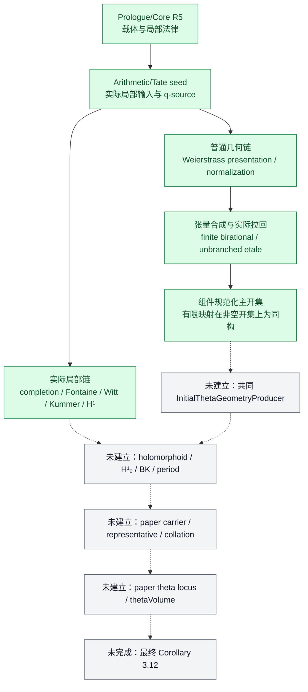

# Scene1 进度总览

日期：2026-10-25（Asia/Shanghai）

### 状态判定

| 标记 | 状态 | 使用条件 |
| --- | --- | --- |
| 🟢 | 已闭合 | 本行声明的义务、实际输入和验收均已完成 |
| 🔵 | 条件性完成 | 定理及其显式条件已证明，但条件尚未由目标真实数据全部推出 |
| 🟡 | 部分完成 | 已有可引用子结果，仍缺构造、比较或身份等式 |
| ⚪ | 未建立 | 尚无满足本行要求的验收构造或证明 |
| 🔴 | 路线已排除 | 已排除一条具体装配路线，并写明排除范围 |

“已闭合”只对本行声明的范围有效。局部 actual carrier、条件性 consumer 或普通
仿射几何证明不自动关闭所属闸门，也不构成共同真实来源 producer。四个闸门的数量
只表示验收状态，不表示工作量比例。

## 当前结论

| 项目 | 当前值 |
| --- | --- |
| Scene1 整体 | **未完成；最终闸门关闭 0/4** |
| 当前代码基线 | `main` 与 `origin/main` 对齐于 `738f78a` |
| 最近完成单元 | 组件规范化主开集与实际规范化拉回方案的交换式；模块、Checks、Axioms、ImportAudit、`Act1Scene1` 聚合和 `git diff --check` 均通过 |
| 当前推进位置 | arithmetic/Tate seed 的规范化、presentation、张量合成、拉回、非分支 étale 和组件主开集链已接通；真实共同 producer 仍未建立 |
| 主要未接通连接 | `InitialThetaGeometryProducer`、共同 `InitialThetaData/TateFamily`、holomorphoid、H¹ₑ/BK、Fréchet `B`/ρ-norm、跨来源 collation、论文处集与 `thetaVolume` |
| Prologue 边界 | `R5`；本轮几何单元没有新增 Core 假设、没有调用 `Prologue/Obligations` |
| 父义务状态 | `docs/具有明确参考来源指示的证明义务.md` 中的父义务均保持未勾选 |

阅读顺序：先看四个闸门，再看已完成的局部链和当前路线，最后查看未完成义务与负面证据。

## 四个最终验收闸门

| 闸门 | 状态 | 已完成范围 | 关闭所需的剩余工作 | 证据入口 |
| --- | --- | --- | --- | --- |
| **G1：目标与归一化冻结** | 🟡 | raw、degree-normalized、paper-normalized 的局部 q-factor、q-order、权重和 volume 会计已有条件性证明 | 在同一 paper carrier 上冻结 qLogTerm 符号、local/global degree、`p*`、`2ℓ`、无穷处因子、`logVolume` 和最终 target | `docs/开发计划.V1Act1Scene1.md` §3；`IutInitialThetaCanonical*`、`Corollary312*` |
| **G2：共同真实来源模型装配** | 🟡 | actual torsion/Tate/q-root、completion/Fontaine/Witt/B_dR、局部 Kummer/H¹，以及 arithmetic seed 的普通规范化和 presentation 链已有证明 | 从同一真实输入产生 `OrbicurveData`、`LocalThetaData`、完整 `InitialThetaData`、holomorphoid、H¹ₑ/BK/period 和四项 producer laws | `ProducerContracts.lean`；`InitialThetaGeometryInterfaceCountermodel.lean`；`InitialTheta*` 几何链 |
| **G3：论文处集与重数会计** | 🟡 | `VBad` 有限性、section-selected carrier、selected q-root support 和内部 degree/weight regrouping 已证明 | 证明论文 `V_p^oss`/`\underline V^oss`、`L'` representative、fiber multiplicity、omitted mass、mixed-moduli descent 和 paper weighted sum 的身份 | `IutInitialThetaPlaceSection.lean`、`IutInitialThetaSelected*`、`IutInitialThetaRepresentative*` |
| **G4：论文 theta-volume 与最终连接** | 🟡 | actual Kummer/ordinary-log、finite/archimedean packet/hull、Haar/cost 会计和条件性 Corollary consumer 已证明 | 建立 H¹ₑ/BK/theta-value/holomorphoid 身份，识别 paper theta locus 与 `thetaVolume`，再证明无自由 producer law 的最终 Corollary 3.12 | `IutInitialTheta*Hull*`、`IutInitialTheta*Log*`、`Corollary312.lean` |

四个闸门关闭后，还必须通过计划规定的最终窄构建、ImportAudit、Checks、Axioms、
`git diff --check` 和全图验收，才能宣布 Scene1 完成。单个单元的构建和推送通过，
不等于最终验收完成。

## 当前证明路线

图中的绿色节点只表示其局部声明已经有 proof term 和相应审计；它们没有把任意
`AG/TG` 上的几何接口变成真实 producer，也没有把普通仿射拉回方案识别为论文
orbicurve 的 cartesian diagram。

## 已完成的局部结果

| 范围 | 已完成结果 | 边界 |
| --- | --- | --- |
| Arithmetic/Tate seed | 数域、admissible prime、torsion field、Tate family、bad-place finite support、q-order、completion-valued q parameter 和 field orientation 的适配 | 不产生 `InitialThetaData.orb/localData` 的真实共同来源 |
| Actual local period chain | cyclotomic Tate tower、PreTilt、tilt、sharp=1 fiber、Fontaine θ、primitive kernel、Witt localization、`B_dR⁺`/`B_dR` 和 bounded Witt expansion | 不等同论文 Fréchet `B`、ρ-norm、holomorphoid 或 `T_y ⊂ B^{φ=p}` |
| Kummer/H¹/ordinary-log | actual root tower、continuous Kummer cocycle、ambient integral/rational H¹、unit/prime split、ordinary-log normalization、有限/无穷处 hull 与 Haar/cost 会计 | 不等同 H¹ₑ、crystalline、Bloch–Kato 或论文 theta-value class |
| q-pilot 与条件性目标 | canonical q-pilot、raw/degree/paper-normalized q-accounting、selected support 和条件性 `Corollary 3.12` consumer | 仍需要真实 producer、paper carrier、thetaVolume 和最终归一化身份 |
| 普通规范化几何 | 原 Weierstrass 坐标环与实际 normalization 的同构、presentation 覆盖和交换方块、signed/base compositum、有限 normalization map | 不证明任意 `AG.Orbicurve` 的 cartesian law 或共同 geometry producer |
| 张量与拉回 | selected tensor component 是 integral domain；其 field map injective；fraction field、integral closure、finite birational map 和实际 normalization fiber product 已识别 | 只识别普通仿射方案层面的 fiber product |
| 非分支与组件开集 | branch complement 上的 finite étale tensor cover；组件 normalization 在一个非空 principal open 上为同构；该开集到 tensor scheme 和 pullback 的交换三角已证明 | 未识别为论文 theta locus、`V_p^oss` 或 orbicurve open |

## 最近完成的几何单元

| 提交 | 结果 | 保留的边界 |
| --- | --- | --- |
| `7077936` | 证明当前无约束 `AG/TG` 接口不能产生 universal `InitialThetaGeometryProducer` 的反模型 | 这是接口路线的负面证据，不是实际几何的反例 |
| `1e93ffd`、`25e494b` | 建立实际 presentation 范畴、交换方块和原 x 覆盖的 presentation 同构 | 不提供任意 `AG` 的 cartesian 证明 |
| `b7c4418`–`2eddfb2` | 构造 signed/base 张量合成，识别 selected component 的 field image、fraction field 和 integral closure | 不构造真实 `orb/localData` producer |
| `9caed51`、`d5e9d94` | 证明 selected component normalization finite birational，并识别 tensor scheme 与实际 normalization pullback | 只在普通 scheme 层面成立 |
| `657b894`、`915e20d` | 证明 branch complement 上的 finite étale tensor cover 及 signed covering 的 étale 性 | 不关闭 paper branch/cusp 或 orbicurve producer |
| `06d3a52`–`738f78a` | 找到非空 principal open，在该开集上组件 normalization 为同构；证明 source open 非空、组件开图交换，并与实际 pullback 交换 | 该开集尚未获得论文对象身份 |

这些单元均通过叶模块、Checks、Axioms、ImportAudit、`Act1Scene1` 聚合和差异检查；
最近单元已推送到 `origin/main` 的 `738f78a`。

## 未完成父义务

以下状态与[具有明确参考来源指示的证明义务](具有明确参考来源指示的证明义务.md)保持一致，
本总览不把局部结果改写成父义务完成：

| 闸门 | 未完成义务 |
| --- | --- |
| G2 | 实际 perfectoid bridge 的来源适配；Core 载体的共同真实来源；`InitialThetaGeometryProducer`；共同 `InitialThetaData/TateFamily`；holomorphoid source；Fréchet `B`/ρ-norm；H¹ₑ/crystalline/BK/period；四项 Scene1 producer laws；跨 holomorphoid collation |
| G3 | 论文 `V_p^oss`/`\underline V^oss`；`L'` representative map；fiber multiplicity、omitted mass、residue/inertia-degree 和 mixed-moduli weighted carrier |
| G1/G4 | 三层 q-factor 与 qLogTerm 最终冻结；无穷处和 `thetaVolume` 归一化；actual Kummer/log hull 与 paper theta locus 的身份；paper hull/volume identity；无自由 source law 的最终 Corollary 3.12 |

## 负面证据：已排除的具体路线

### N1：q-root 不能直接充当旧 theta base

实际 contracting q-root 的 norm 小于 1，而旧 theta/period/normalization 与旧
`VolumeTransfer` 组合要求非负 `logVolume`。这排除“q-root norm = theta base norm”，
不排除另一个 theta lift、different untilt 或 negative-log cost。

### N2：signed Haar log-volume 不能直接作为 `VolumeTransfer`

actual ordinary-log hull 的 signed Haar log-volume 在正长度时为负。当前保留
`-log(volume)` actual cost 路线，但尚未证明其与 paper `thetaVolume` 相同。

### N3：字面 Corollary 的 qLogTerm 存在符号冲突

当前 ordinary real-log 解释下，selected contracting q-root 使字面右端与左端符号不一致。
该问题按既有边界暂作待冻结的符号问题处理；不得静默反号或取 reciprocal。

### N4：ambient unit/Kummer carrier 不能改名为 H¹ₑ/BK

ambient continuous H¹、unit subspace、saturated Kummer carrier 和 normalized ordinary-log
witness 的局部性质，不能自动给出论文 H¹ₑ/BK 身份。仍需真实 period、Frobenius 和
holomorphoid comparison。

### N5：固定 completion orbit 不能替代跨 holomorphoid collation

factor automorphism、closure、hull 和 Haar 结果只作用于固定 completion tensor，不能替代
不同 untilt、arithmeticoid、moduli point 之间的 marking、transport 和 global collation。

### N6：canonical finite carrier 不能自动成为论文处集或代表

actual selected support、finite equivalence 和 coefficient-weighted accounting 仍保留
representative defect、omitted mass 和 global degree 因子，不能直接改名为 `V_p^oss`、
`L'` 或无缺陷 paper sum。

### N7：当前 geometry interface 不能产生 universal producer

`InitialThetaGeometryInterfaceCountermodel.lean` 保留 arithmetic seed 的全部字段，只把
`AG.IsCartesianSquare` 改为恒假，即得到满足现有接口但不存在 producer 输出的 geometry。
这排除“只凭现有 seed 对任意无约束 `AG/TG` 直接装配 producer”的路线；它不是实际
orbicurve 或 Joshi/IUT 几何命题的反例。

### N8：普通规范化开集不能自动成为论文 theta locus

组件 normalization 的非空 principal open 和 pullback 交换三角只说明普通 scheme 层面
的有限 birational comparison。它没有提供论文 theta-value、H¹ₑ/BK、holomorphoid marking、
`V_p^oss` 或 `thetaVolume` 身份。

## 执行顺序和验收

1. 先完成 G2 的共同真实 `InitialThetaGeometryProducer` 和 `InitialThetaData/TateFamily` 来源。
2. 在同一对象上完成 holomorphoid、period、H¹ₑ/BK、Fréchet `B`/ρ-norm 和四项 producer laws。
3. 完成 G3 的论文处集、representative、multiplicity、mixed-moduli descent 和 weighted carrier。
4. 冻结 G1 的符号/归一化，再完成 G4 的 paper theta locus、`thetaVolume` 和最终 Corollary。
5. 每个逻辑单元执行叶模块、Checks、Axioms、ImportAudit、`Act1Scene1` 聚合和
   `git diff --check`，通过后提交并推送；所有父义务完成后再执行最终全图验收。

构建边界保持 `docs/开发计划.V1.md` 与 `docs/开发计划.V1Act1Scene1.md`：固定 Lean/mathlib
版本、CPU 0–13、`LEAN_NUM_THREADS=14`、Lean `-j1`、不删除缓存、不导入
`Prologue/Obligations`、Scene2 或 Act2。未完成义务不能通过改名、删除字段或兼容包装器消除。
