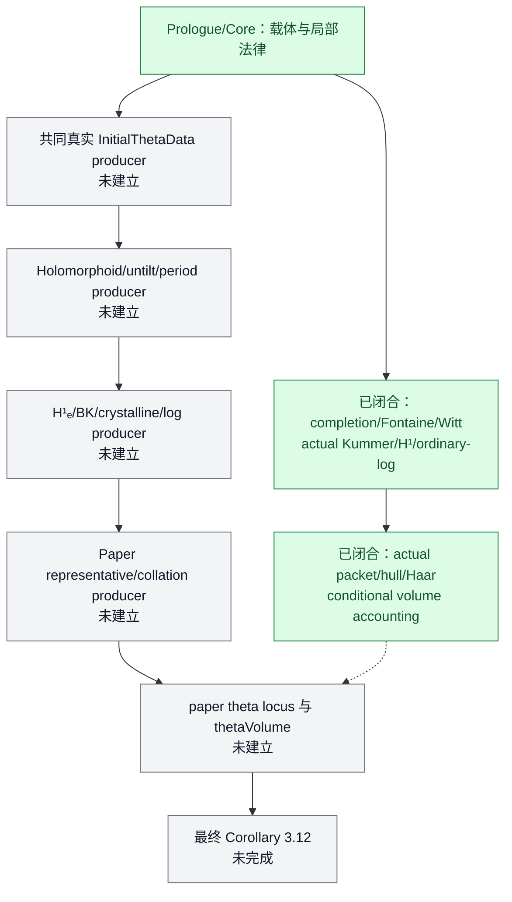

# Scene1 进度总览

日期：2026-10-21（Asia/Shanghai）

### 状态判定

| 标记 | 状态 | 使用条件 |
| --- | --- | --- |
| 🟢 | 已闭合 | 本行义务、所需实际输入和验收均已完成 |
| 🔵 | 条件性完成 | 定理及显式条件已证明，但条件尚未由目标真实数据产生 |
| 🟡 | 部分完成 | 有可引用子结果，仍缺构造、比较或身份等式 |
| ⚪ | 未建立 | 尚无满足本行要求的验收构造或证明 |
| 🔴 | 路线已排除 | 已排除一条具体装配路线，并写明适用范围 |

“已闭合”只对本行声明的范围有效。局部 actual carrier、条件性 consumer 或 toy model
不自动关闭所属闸门，也不构成共同真实来源生产者。四个闸门的数量只表示验收状态，
不表示工作量比例。

## 当前结论

| 项目 | 当前值 |
| --- | --- |
| Scene1 整体 | **未完成；最终闸门关闭 0/4** |
| 最近数学基线 | actual Tate tower/tilt/Fontaine/B_dR/Witt localization、有界 Witt 展开、Kummer/H¹、ordinary-log、packet/hull/Haar 和 weighted accounting 已验收；最近记录基线为 `d86ecae` |
| 当前代码边界提交 | `1892fda`：四项来源法律移出 Prologue input；producer 契约已落盘 |
| 当前文档提交 | `808fc89`：开发计划重写；`a328879`：来源证明义务清单重写 |
| Prologue 边界 | `R5`；Core 只保留载体/局部法律；新增 Core 假设 0 |
| 当前推进位置 | actual local chains 和条件性 volume consumers 已完成；真实 Initial Θ-data、holomorphoid、H¹ₑ/BK/period、paper collation 仍未生产 |
| 主要未接通连接 | G1 最终归一化和符号、G2 四层 producer、G3 论文处集/代表/重数、G4 paper theta locus/`thetaVolume`/最终 Corollary |

阅读顺序：先看四个闸门，再看已完成结果和未完成义务，最后看负面证据与执行顺序。

## 四个最终验收闸门

| 闸门 | 状态 | 已完成范围 | 关闭所需的剩余工作 | 证据入口 |
| --- | --- | --- | --- | --- |
| **G1：目标与归一化冻结** | 🟡 | raw/degree/paper-normalized 的若干局部换算、coefficient-weighted q/hull 会计、actual cost transfer 已证明 | 在同一 paper carrier 上冻结 q-term 符号、global/local degree、`p*`、`2ℓ`、archimedean factor、`thetaVolume` 和最终 target | `开发计划.V1Act1Scene1.md` G1；`PaperQNormalizationBridge.lean`；S1.305、S1.322、S1.489–503 |
| **G2：真实来源模型装配** | 🟡 | actual completion/tilt/Fontaine/Witt/B_dR、Tate/q-root、Kummer/H¹ 和局部 bridge 已有 | 实现共同 `InitialThetaGeometryProducer`、holomorphoid source、H¹ₑ/BK/period source、Fréchet `B`/ρ-norm，并由同一对象产生四项 Scene1 producer laws | `ProducerContracts.lean`；`refer/iut/Iut/Concrete/Existence.lean`；Joshi/Joshi2 audits |
| **G3：论文处集与重数会计** | 🟡 | actual finite support、section carrier、fiber regrouping、degree-weighted internal accounting 已证明 | 证明论文 `V_p^oss`/`\underline V^oss`、`L'` representatives、multiplicity、residue/inertia-degree 和 mixed-moduli descent 的身份 | `IutInitialThetaSelectedQRootLinkAccounting.lean`；S1.489–503；Joshi III weighted-volume sources |
| **G4：论文 theta-volume 与最终连接** | 🟡 | actual ordinary-log Kummer hull、finite/arch packet、Haar/procession volume、conditional Corollary consumer 已证明 | 完成 H¹ₑ/BK/theta/holomorphoid identity、paper theta locus、paper hull/`thetaVolume` 等式和最终无条件 Corollary 3.12 | `IutInitialThetaWitnessHullHaarProduct.lean`；`IutInitialThetaNormalizedLogCollation.lean`；`Corollary312.lean` |

四个闸门关闭后，还必须通过最终窄构建、ImportAudit、Checks、Axioms、`git diff --check`
和用户要求的全图验收，才能宣布 Scene1 完成。

## 当前证明路线

## 已完成证明义务（简表）

| 范围 | 已完成结果 | 边界 |
| --- | --- | --- |
| Prologue arithmetic | finite-place、residue characteristic、completion norm、q-order、height、ramification carrier 和局部法律 | 不产生真实 InitialThetaData |
| Perfectoid/local period | PreTilt、tilt、sharp、Fontaine θ、Witt kernel/localization、`B_dR⁺`/`B_dR`、有界 Witt 展开 | 不产生论文 Fréchet `B`/ρ-norm 或 holomorphoid marking |
| Tate/q source | actual TateFamily 投影、q-root support、q-order、q-norm、field orientation 和 finite support | 不等同论文 `V_p^oss`/`L'` |
| Kummer/H¹ | continuous Kummer cocycle、ambient H¹、rational closure、unit/prime split、ordinary-log normalization | 不等同 H¹ₑ/BK |
| Actual volume | finite/arch packet、hull、Haar/procession、closure、singleton witness、coefficient-weighted internal accounting | 不等同 paper `thetaVolume` |
| Conditional target | `cor312_of_scene1_data` 及 q-pilot/volume consumers 有 proof term | 依赖显式 producer laws和 paper inputs |

## 未完成证明义务

### G1：目标和归一化

- [ ] 在同一个 paper carrier 上证明 raw completion factor、degree-normalized factor 和
  paper-normalized q-factor 的完整等式，明确 local/global degree、residue/inertia degree、
  `p*`、`2ℓ`、q-order 和 norm 的位置。
- [ ] 冻结 `qLogTerm` 的最终符号。当前工程使用 `-log(qFactor)`；Joshi III
  `cor:cor312` 字面式与其前文负号说明冲突，必须并列记录字面式和 volume-derived 解释。
- [ ] 证明 `logVolume`、actual negative-log cost 和 paper `thetaVolume` 的关系，不允许
  由 `VolumeTransfer` 直接输入目标需要的数值。
- [ ] 将 archimedean factor、finite procession average 和 squareAverage 接入同一个最终
  normalization，并证明最终 target 与实际 producer 输出一致。

来源：Joshi III `cor:cor312`、`th:moccor-Mochizuki-form2`；IUT I Example 3.2(iv)；
IUT IV Theorem 1.10；`refer/iut/Iut/Cor312/LogVolume.lean`。

### G2：共同真实来源 producer

- [ ] 从 arithmetic curve、global conditions、admissible prime、TateFamily 和
  `HasCoreUniversally` 产生共同 `OrbicurveData`、`LocalThetaData` 和完整
  `InitialThetaData`。必须证明 cartesian diagrams、valuation section、decomposition groups、
  bad theta-root model 和 distinguished cusp。
- [ ] 从同一个 `InitialThetaData` 产生 holomorphoid/untilt、tilt、解析基点、Tate parameter
  family、Berkovich marking 和跨来源标记，并证明它们与实际 completion/Fontaine bridge
  相容。
- [ ] 构造论文 Fréchet `B`、ρ-norm、Tate-log convergence 和 `T_y ⊂ B^{φ=p}`（或当前
  精确目标的等价形式）。已有 `A_inf`、Witt 和 `B_dR` 结果不能直接改名为这些对象。
- [ ] 构造 ambient H¹、H¹ₑ、crystalline/Frobenius carrier、BK exp/log、integrality law，
  并识别 actual Kummer classes；明确 integral `log/p*` 与 divided rational unscaled-log
  的选择和比较。
- [ ] 由上述共同来源产生 `AdelicThetaLink`、`ThetaLiftLog`、`PacketCollationHull` 和
  `VolumeTransfer`。`Scene1Input.ofExplicit` 只允许兼容包装，不能承担生产。

来源：IUT I Definition 3.1；`refer/iut/Iut/Concrete/Existence.lean`；
`ReferenceIut/Iut/Cor312/ThetaData/Orbicurve.lean`、`LocalConditions.lean`；Joshi I–III
holomorphoid、untilt、theta-value、Bloch–Kato 和 theta construction；
`docs/Joshi2审计.md`、`docs/Mochizuki审计.md`。

### G3：论文处集、代表和重数

- [ ] 证明 actual `VBad`、odd q-root support、论文 `V_p^oss`/`\underline V^oss` 的包含、
  过滤、坏处外行为和 finite/arch support。
- [ ] 构造 `L'` representative map、fiber equivalence、representative multiplicity、
  selected/omitted mass 和 residue/inertia-degree 等式。
- [ ] 证明 local degree、residue degree、inertia degree、tensor dimension、fiber mass 和
  coefficient-weighted paper sum 在同一 carrier 上相等。
- [ ] 完成不同 moduli point、untilt 和 holomorphoid 之间的 marking、transport 和 mixed-
  moduli descent；固定 completion factor orbit 不足以完成这项义务。

来源：Joshi III `ss:weighted-vol`、`pr:general-cohomology-set-const`；Joshi2 Tate divisor
和 extension-degree 讨论；IUT `Concrete/Container.lean`、`Cor312/LogVolume.lean`。

### G4：theta locus、volume 和最终定理

- [ ] 将 actual ordinary-log/Kummer hull 识别为论文 theta locus，证明该身份依赖真实
  holomorphoid、H¹ₑ/BK 和 theta-value marking。
- [ ] 证明 actual packet/hull、finite/arch volume、procession average 和 paper
  `thetaVolume` 是同一 carrier 的量，并闭合正性、可测性、finite support 和归一化。
- [ ] 将 q-product lower bound、theta-volume lower bound、G1 符号与 G3 weighted carrier
  放入一个无自由 source law 的 proof term。
- [ ] 完成最终 `Corollary 3.12`、ImportAudit、Checks、Axioms 和 `sorryAx` 审计。

来源：Joshi III `eq:bloch-kato-log-class`、`th:thetam-construction`、
`th:moccor-Mochizuki-form2`、`cor:cor312`；`refer/iut/Iut/Cor312/Statement.lean`；
当前 Scene1 volume/Corollary consumers。

## 负面证据

### N1：q-root 与旧 theta base 的直接身份被排除

`ThetaLogSignAudit.lean`、S1.243 和 S1.321 证明 actual contracting q-root norm 小于 1，
而旧 theta/period/normalization 与 `VolumeTransfer` 组合要求非负 `logVolume`。因此排除
“q-root norm = theta base norm”；不排除另一 theta lift、different untilt 或 negative-log
cost 路线。

### N2：signed Haar log-volume 不能直接作为 `VolumeTransfer`

actual ordinary-log hull 的 signed Haar log-volume 在正长度时严格为负。S1.321 排除直接
填入旧 transfer；S1.322/S1.406 改为 actual `-log(volume)` cost。该 cost 路线尚未证明
paper `thetaVolume` 身份，不能标为最终完成。

### N3：字面 Corollary 的 qLogTerm 存在符号冲突

S1.305 证明 actual selected contracting q-root 下，字面右端
`-∑ log |q_w^(1/(2ℓ))|` 为正，而字面左端非正。用户决定按笔误暂处理（S1.332），但
这不关闭 G1，也不允许静默反号或取 reciprocal。

### N4：ambient unit/Kummer carrier 不能改名为 H¹ₑ/BK

S1.403、S1.447–451 证明 actual continuous H¹、unit subspace、saturated Kummer carrier
和 normalized ordinary-log witness 的局部事实；S1.451 还排除当前 q-root class 属于
normalized principal-unit class 的 ℚₚ 单生成空间。它们排除改名路线，不排除真实 period/
holomorphoid producer 的另一种比较。

### N5：固定 completion orbit 不能替代跨 holomorphoid collation

actual factor automorphism、closure、hull 和 Haar monotonicity 只在固定 completion tensor
内成立，不能替代不同 untilt、arithmeticoid、moduli point 之间的 Ind1–Ind3 和 global
collation。

### N6：canonical finite carrier 不能自动成为论文处集或代表

S1.489–503 的 actual coefficient-weighted accounting 保留 representative defect、omitted
mass 和 global degree 因子。finite equivalence、degree-one witness 或 selected support
不能自动改名为 `V_p^oss`、`L'` 或无缺陷 paper sum。

### N7：参考工程没有共同真实 producer

`refer/iut` 的 `AnabelianExistence` 是条件接口，model existence 只适用于 `modelAG/modelTG`。
参考工程没有当前所需的任意真实 `AG/TG`、holomorphoid marking、H¹ₑ/BK、Fréchet `B`/
ρ-norm 和 paper collation 联合 proof。不能通过移植 `thetaData`、扩大
`PerfectoidBridgeLaws` 或调用 `Prologue/Obligations` 宣布生产者存在。

## 执行顺序和验收

1. 先完成 G2 的共同 `InitialThetaGeometryProducer` 和实际 `InitialThetaData/TateFamily`；
2. 在同一对象上完成 holomorphoid、period、H¹ₑ/BK 和 Fréchet `B`/ρ-norm；
3. 完成 G3 的论文处集、代表、multiplicity 和 weighted carrier；
4. 冻结 G1 符号/归一化，再完成 G4 的 paper theta locus、`thetaVolume` 和最终 Corollary；
5. 通过窄构建、ImportAudit、Checks、Axioms、`git diff --check` 和一次用户要求的全图验收。

构建规则：CPU affinity `0-13`、`LEAN_NUM_THREADS=10`、Lean worker `-j1`、复用热缓存；
maxHeartbeats 第一次失败设为 `1,000,000`，第二次失败先优化一次并翻倍，之后重复直到
通过。所有失败、优化和资源数据必须记录。未完成义务不能通过重命名、删除字段或
`Prologue/Obligations` 构造器消除。
