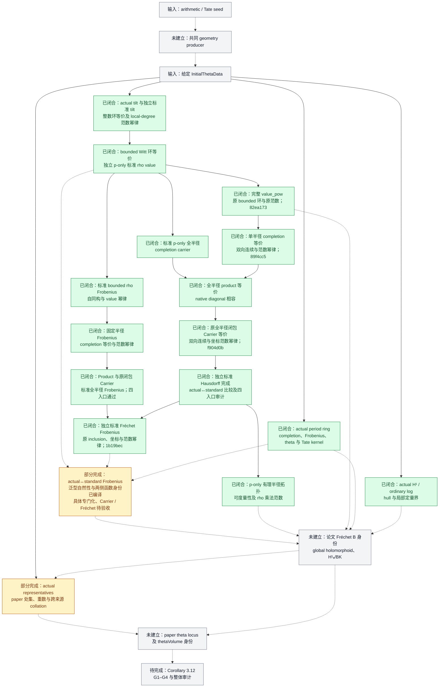

# Scene1 进度总览

### 状态判定

| 标记 | 状态 | 使用条件 |
| --- | --- | --- |
| 🟢 | 已闭合 | 本行精确义务已证明，所需实际输入已落实，相关验收已通过 |
| 🔵 | 条件性完成 | 定理及其显式条件已验证，但条件尚未从目标实际数据全部推出 |
| 🟡 | 部分完成 | 已有可引用子结果，仍缺构造、比较、身份等式或整单验收 |
| ⚪ | 未建立 | 尚无满足本行要求的已验收构造或证明 |
| 🔴 | 路线已排除 | 已证明某条具体路线不成立；必须保留排除范围及所用条件 |

“已闭合”只对该行声明的范围有效。局部构造闭合，不自动关闭所属最终闸门。
给定 `InitialThetaData` 后的实际适配，不等于从 arithmetic seed 构造出完整真实模型；
actual carrier 上的定理，不自动成为论文 carrier 上的定理。
必要充分条件已证明，也不表示实际数据满足该条件。

不按文件数、声明数、S1 编号或复选框数计算总完成百分比。
四个闸门的关闭数只表示验收状态，不表示工作量比例或剩余时间。

## 当前结论

| 项目 | 当前值 |
| --- | --- |
| 更新日期 | 2026-11-05（Asia/Shanghai） |
| 状态截点 | 2026-11-05 04:33（Asia/Shanghai）；当前没有运行中的 Lean/Coq 进程，未验收运行不计作完成 |
| 最近完成的数学单元 | 独立标准 Fréchet Hausdorff completion 上的 Frobenius；14 项公开名称、原 inclusion/坐标相容及正逆范数幂律已通过叶和四入口验收 |
| 已推送数学基线 | `1b19bec`；前一单元 `035da86` 已完成固定半径 completion、全半径 Product 与原闭包 Carrier 的标准 Frobenius；本次总览更新没有新增数学证明 |
| 当前未提交单元 | 原 bounded localization、全半径 Carrier 和 Fréchet completion 三层 actual↔standard Frobenius 交换图；上游辅助叶已有成功编译，完整比较尚未验收 |
| Scene1 整体 | **未完成；最终闸门关闭 0/4；15 项父义务全部开放** |
| 当前推进位置 | 泛型 Witt 局部化 Frobenius、actual choice/standard 两侧与泛型映射的完整函数身份、observer 比较构造器自然性均已分别通过叶编译；正尝试将具体参数逐声明接入，再运输回原 bounded 环 |
| 当前编译阻塞 | 具体自然性专门化仍触发 Kernel deterministic timeout；源端 Mul/Add 身份已证明，目标端具体实例转换仍未闭合。最新 v6 在 `11.604 GiB` 下仍以 timeout 结束 |
| 尚未闭合的比较边界 | actual↔standard Frobenius 三层相容、旧 named `ambientInclusion/toAmbient` 方块及具体 named inclusion 恢复包装；论文 `B`、标量/Galois/Tate-log、period 与 H¹ₑ/BK 身份仍开放 |
| 内存优化结果 | 早期约 100 GiB 的整体 rho 比较已改走拆分与 presentation 路线，最终 `value_pow`、原闭包及完成比较均已低于 16 GiB 验收；旧 named ambient 包装和当前 Frobenius 比较仍有未通过声明 |
| 最近完整单元验收 | `1b19bec` 新叶及四入口均退出 0；叶峰值 `5516340 KiB`（5.261 GiB），四入口最大峰值 `9577724 KiB`（9.134 GiB）；14 项公理审计无 `sorryAx` |
| 当前工作树验收 | 新比较单元尚未通过；Carrier/Fréchet 下游草稿未编译，当前修改后的聚合与审计入口未重新验收。已通过的四入口结论只覆盖对应已提交版本 |
| 内存边界 | 单叶验收上限 16 GiB；当前监控停止线 15 GiB，总编译内存上限 100 GiB。低于内存线但超时的构建仍不算通过 |
| 尚未接通的主要连接 | 共同真实 geometry producer、global holomorphoid、论文 Fréchet `B`/ρ-norm、H¹ₑ/BK、paper representatives、跨来源 collation、theta locus/`thetaVolume` 与最终 Corollary 3.12 |
| Prologue 边界 | `R5`；四项 source laws 仍由 Scene1 producer 从共同真实来源证明 |

阅读顺序：先看四个闸门，再看当前路线，最后看最近单元变化与内存记录。
总体义务以[开发计划](开发计划.V1Act1Scene1.md)、[证明义务台账](具有明确参考来源指示的证明义务.md)
和[来源台账](../ArithmeticTeichmullerSpaces/SOURCE_LEDGER.md)为准。已验收单元的资源证据见
[Scene1Witt比较内存.jsonl](Scene1Witt比较内存.jsonl)；当前比较的部分后续运行尚仅保存在本机
`/tmp/abc-rho-builds`，下文单独标明，不计作完整单元验收。

## 四个最终验收闸门

G1–G4 对应[开发计划 §3](开发计划.V1Act1Scene1.md#3-未完成义务按最终闸门分解)。
每行的“已有结果”概括子结果，不表示该闸门已经关闭。

| 闸门 | 当前状态 | 已有结果 | 关闭所需的剩余工作 | 证据入口 |
| --- | --- | --- | --- | --- |
| **G1：目标与归一化冻结** | 🟡 部分完成 | raw/degree-normalized 换算、weighted source sum、grouped volume 会计、actual qProduct lower bound 和条件性最终消费者已有 | 在同一 paper carrier 上冻结 q-term、局部/全局次数、`p*`、`2ℓ`、无穷处项和最终目标，证明 paper normalization 身份 | [计划 G1](开发计划.V1Act1Scene1.md#g1目标符号和归一化) |
| **G2：共同真实来源模型装配** | 🟡 部分完成 | 给定 `InitialThetaData` 后，actual Tate/q-root、局部 tilt/Fontaine/Witt、perfectoid 局部法律及实际与标准 carrier 比较已有 | 从同一 arithmetic seed 产生 geometry、完整 `InitialThetaData/TateFamily`、holomorphoid、period/H¹ₑ/BK 和四项 source laws，完成论文 `B` 身份 | [计划 G2](开发计划.V1Act1Scene1.md#g2共同真实来源和-producer)；[父义务台账](具有明确参考来源指示的证明义务.md) |
| **G3：论文处集与重数会计** | 🟡 部分完成 | actual representatives、prime fibers、selected/omitted mass、Galois fiber 权重和 grouped volume 会计已有 | 识别论文处集和 `L'` representatives，闭合 multiplicity、residue/inertia degree、paper weights 与 mixed-moduli descent | [计划 G3](开发计划.V1Act1Scene1.md#g3论文处集代表和重数) |
| **G4：实际 theta-volume 与最终连接** | 🟡 部分完成 | ordinary-log/Kummer hull、Haar/cost、actual volume 比较、period-ring 和 Tate kernel 的局部链已有 | 接通 H¹ₑ/BK、theta-value、不同 untilt/holomorphoid、paper theta locus 与 `thetaVolume`，在同一归一化下完成最终 proof term | [计划 G4](开发计划.V1Act1Scene1.md#g4论文-theta-locusvolume-和最终-corollary) |

qLogTerm 的字面符号问题按既有决定暂作笔误处理，等待作者回复后再讨论。
本总览不把它列为当前停工项；G1 的其他归一化和来源义务仍保留。

四个闸门关闭后，还须通过[计划 §6 的构建与审计](开发计划.V1Act1Scene1.md#6-构建与审计规则)，
才能宣布 Scene1 完成。单个单元的编译、审计或推送通过，不等于最终验收完成。

## 当前证明路线

下图展示当前构造与待完成连接，不是完整 Lean 导入图。
实线表示已验收的构造连接；虚线表示仍需证明或装配。
绿色只覆盖节点写明的完整验收范围；黄色节点有局部结果，灰色节点尚未验收。



当前 value 路线已通过局部化 presentation 和系数范数比较证明完整商值幂律。
它没有把旧 named `ambientInclusion` 方块作为已证明前提；该方块仍单独开放。
全半径 product 等价已经限制到两侧原始闭包 `Carrier`，保留完整半径族、原范数和
`ρ ↦ ρ ^ localDeg(w)`；之后两侧原始 Fréchet completion 也已通过环等价、一致等价、
有理半径收敛判据及四入口审计。标准 p-only 有理半径拓扑、可度量性和 rho 乘法范数已闭合。

标准 bounded rho localization 上的 Frobenius 自同构及 `ρ ↦ ρ^p` 值幂律已通过四入口。
`035da86` 将其延伸到固定半径完成、全半径 Product 和原闭包 Carrier，三叶、四入口及
48 项逐名审计均已通过。`1b19bec` 又通过原 completion/Carrier 等价，在原标准 Fréchet
completion 上构造连续环自同构，证明正逆 inclusion、坐标和范数幂律，并完成四入口验收。

当前 actual↔standard 比较把自然性提前到泛型 Witt 局部化层证明，并分别证明原 actual
choice Frobenius、原标准 Frobenius 与泛型映射的完整函数身份，再以函数等式运输相容性。
这些上游叶已分别编译；具体参数专门化与接回原 bounded 环的交换图尚未通过。
后续仍须沿原 diagonal、稠密性和连续性传到 Carrier 与 Fréchet completion，逐层验收。
该局部比较也不替代论文 `B` 身份。

### 关键子结果与缺口

| 路线位置 | 状态 | 已证明范围或验收缺口 | 所属闸门／证据 |
| --- | --- | --- | --- |
| 条件性最终定理 | 🔵 条件性完成 | `cor312_of_scene1_data` 与 canonical actual-hull consumer 已有证明；完整真实输入、来源法律和 paper identity 仍须产生 | G1/G2/G4；[计划 §2.3](开发计划.V1Act1Scene1.md#23-scene1-条件性消费者与会计) |
| Actual Tate/q-root 与局部会计 | 🟢 已闭合 | 给定数据后的 q 参数、q-order、根、有限支撑和 raw/degree-normalized 恒等式已有 | G1/G3；[Scene1 聚合](../ArithmeticTeichmullerSpaces/ArithmeticTeichmullerSpaces/Act1Scene1.lean) |
| Actual representatives 与处集会计 | 🟢 已闭合 | actual carrier 内的 representative image、prime support、finite fibers、omitted mass 和 grouped volume 已有；paper 身份另计 | G3；[计划 §2.3](开发计划.V1Act1Scene1.md#23-scene1-条件性消费者与会计) |
| Actual period-ring 与 Tate kernel | 🟢 已闭合 | actual bounded Witt/ρ-norm、completion、Frobenius、theta、twisted integral representatives、full Tate kernel 与实际正合列已有 | G2/G4；[period-ring 边界](#period-ring-路线的边界) |
| Actual H¹、ordinary log 与 hull | 🟢 已闭合 | actual rational H¹、带 integral 来源的 Kummer 像、ordinary log、tensor hull、Haar/cost 和实际定量界已有 | G4；[父义务台账](具有明确参考来源指示的证明义务.md) |
| 标准 tilt 与 integer-ring bridge | 🟢 已闭合 | 标准 fraction field 的范数、完备性、代数闭性、拓扑比较和整数环 bridge 已有；比较保留 local-degree 范数幂律 | G2；`GeometricTiltNorm.lean`、`IutInitialThetaPadicTiltTopology.lean` |
| 独立标准 bounded Witt rho value | 🟢 已闭合 | 仅依赖 p 的 expansion、localization、presentation-independent value、指定半径范围内有限性、零点分离和素数校准已提交 | G2/G4；`7e40f65`；[标准 value](../ArithmeticTeichmullerSpaces/ArithmeticTeichmullerSpaces/Act1Scene1/PadicWittRhoValue.lean) |
| 标准 p-only 全半径 completion carrier | 🟢 已闭合 | 由单半径标准 completion 组装全半径产品 carrier，含坐标范数、稠密嵌入、分离性和坐标收敛；叶、Scene1、Checks、Axioms、ImportAudit 已通过 | G2/G4；`b2ac96f`；[全半径 carrier](../ArithmeticTeichmullerSpaces/ArithmeticTeichmullerSpaces/Act1Scene1/PadicWittAllRadiusCompletion.lean) |
| 实际↔标准全半径 product 等价 | 🟢 已闭合 | 沿 `ρ ↦ ρ ^ localDeg(w)` 组装各半径 completion 等价，给出全乘积双向连续环等价；原 diagonal 相容随后通过 native 接口接通 | G2/G4；`213751d`、`f904d0b`；[product 等价](../ArithmeticTeichmullerSpaces/ArithmeticTeichmullerSpaces/Act1Scene1/IutInitialThetaPadicWittRhoProductEquiv.lean) |
| 原 actual↔standard 全半径闭包比较 | 🟢 已闭合 | 原 `Carrier` 间的环等价、双向连续、homeomorphism、原 inclusion 的 diagonal 底层值公式、双向 evaluate 与坐标范数幂律均已验收；没有替换共同闭包 | G2/G4；`f904d0b`；[原载体比较](../ArithmeticTeichmullerSpaces/ArithmeticTeichmullerSpaces/Act1Scene1/IutInitialThetaPadicWittAllRadiusComparison.lean) |
| 独立标准全半径 Source 与 Hausdorff completion | 🟢 已闭合 | p-only 原一致结构、分离性、完成与原闭包比较、连续环同态延拓及唯一性已通过叶和四入口；来源与资源已归档 | G2/G4；[Source](../ArithmeticTeichmullerSpaces/ArithmeticTeichmullerSpaces/Act1Scene1/PadicWittFrechetSource.lean)、[完成比较](../ArithmeticTeichmullerSpaces/ArithmeticTeichmullerSpaces/Act1Scene1/PadicWittFrechetComparison.lean)；`3a60371` |
| Actual↔standard 全半径完成比较 | 🟢 已闭合 | 双向连续环等价、一致等价、homeomorphism、原 inclusion 底层值、半径相容、范数幂律与收敛判据已通过四入口；保留实际与标准原载体 | G2/G4；[实际完成比较](../ArithmeticTeichmullerSpaces/ArithmeticTeichmullerSpaces/Act1Scene1/IutInitialThetaPadicWittFrechetComparison.lean)；`3a60371` |
| 独立 p-only 半径拓扑与可度量性 | 🟢 已闭合 | 有理半径夹逼完整 `(0,1)` 范数族；标准 carrier、Source 与 Hausdorff completion 的原拓扑可度量，actual 比较消费该独立判据 | G2/G4；`fdfb6b7`；[拓扑模块](../ArithmeticTeichmullerSpaces/ArithmeticTeichmullerSpaces/Act1Scene1/PadicWittFrechetTopology.lean) |
| 独立标准 rho 乘法范数 | 🟢 已闭合 | 原 bounded `value`、fixed-radius Source/Completed 范数和 all-radius `coordinateSeminorm` 的精确乘法等式均已证明并通过四入口 | G2/G4；`959d595`；[乘法模块](../ArithmeticTeichmullerSpaces/ArithmeticTeichmullerSpaces/Act1Scene1/PadicWittRhoMultiplicativeNorm.lean) |
| 独立标准 bounded rho Frobenius | 🟢 已闭合 | 原 bounded localization 上的 p-only Frobenius 环自同构、ambient/presentation 相容及 `ρ ↦ ρ^p` 的 value/realValue 幂律已通过四入口 | G2/G4；`fabaa1b`；[bounded Frobenius](../ArithmeticTeichmullerSpaces/ArithmeticTeichmullerSpaces/Act1Scene1/PadicWittRhoFrobenius.lean) |
| 标准固定半径与全半径 Frobenius 延拓 | 🟢 已闭合 | 固定半径 completion 等价、范数幂律、全半径 Product 自同构与原 all-radius Carrier 限制已通过三叶、四入口和 48 项逐名审计 | G2/G4；`035da86`；[fixed-radius](../ArithmeticTeichmullerSpaces/ArithmeticTeichmullerSpaces/Act1Scene1/PadicWittRhoFrobeniusCompletion.lean)、[Product](../ArithmeticTeichmullerSpaces/ArithmeticTeichmullerSpaces/Act1Scene1/PadicWittProductFrobenius.lean)、[Carrier](../ArithmeticTeichmullerSpaces/ArithmeticTeichmullerSpaces/Act1Scene1/PadicWittAllRadiusFrobenius.lean) |
| 独立标准 Fréchet Frobenius | 🟢 已闭合 | 原 Hausdorff completion 上的连续环自同构、正逆 inclusion/坐标相容和 `ρ ↦ ρ^p` 范数幂律；14 项逐名审计、叶及四入口通过，仅依赖 p 与素性 | G2/G4；`1b19bec`；[Fréchet Frobenius](../ArithmeticTeichmullerSpaces/ArithmeticTeichmullerSpaces/Act1Scene1/PadicWittFrechetFrobenius.lean) |
| Actual↔standard Frobenius 交换图 | 🟡 部分完成 | 泛型 Witt 局部化自然性、两侧原 Frobenius 的完整函数身份及函数等式运输叶已编译；具体专门化仍未通过，Carrier/Fréchet 草稿尚未编译，整单未验收 | G2/G4；[当前编译阻塞](#当前比较单元的编译阻塞) |
| 共享 carrier 比较与 `ambientEquiv` | 🟢 局部闭合 | 系数、field-Witt 和 fraction ambient 等价已有 proof term；相关叶有低于 16 GiB 的成功记录，范围不含 bounded ambient inclusion 方块 | G2/G4；`d4a05cd`；[ambient 等价叶](../ArithmeticTeichmullerSpaces/ArithmeticTeichmullerSpaces/Act1Scene1/IutInitialThetaPadicWittRhoAmbientEquiv.lean) |
| 原 inclusion 后的系数范数幂律 | 🟢 叶验收通过 | `coefficient_inclusion_norm_pow` 已在默认预算下通过独立叶编译；新接口直接保存两侧 inclusion 后的系数范数 | G2/G4；[系数范数叶](../ArithmeticTeichmullerSpaces/ArithmeticTeichmullerSpaces/Act1Scene1/IutInitialThetaPadicWittRhoCoefficientNorm.lean) |
| 分子、分母与商值幂律 | 🟢 叶验收通过 | `numerator_value_pow`、`denominator_value_pow`、`quotient_value_pow` 分别通过默认预算叶编译；最终局部化值定理也已在 `82ea173` 通过 | G2/G4；[商值叶](../ArithmeticTeichmullerSpaces/ArithmeticTeichmullerSpaces/Act1Scene1/IutInitialThetaPadicWittRhoQuotientValue.lean) |
| 两侧 localization presentation 值公式 | 🟢 叶验收通过 | actual arbitrary-contraction 与 standard Away presentation 的值公式已有成功编译记录 | G2/G4；[presentation 叶](../ArithmeticTeichmullerSpaces/ArithmeticTeichmullerSpaces/Act1Scene1/IutInitialThetaWittRhoLocalizationPresentation.lean) |
| Actual→standard 完整 rho 幂律 | 🟢 已闭合 | 原 bounded `ringEquiv` 上的 `value_pow` 在默认 heartbeat 下通过，保留原范数、标准独立收缩元和半径 rho^localDeg；聚合、审计和推送已完成 | G2/G4；`82ea173`；[最终值声明](../ArithmeticTeichmullerSpaces/ArithmeticTeichmullerSpaces/Act1Scene1/IutInitialThetaPadicWittRhoValuePow.lean) |
| 旧 named `ambientInclusion` / `toAmbient` 比较 | ⚪ 未建立 | 已测试的具体交换图仍未通过；ambient 环等价和新系数范数叶不能代替该命名映射的相容证明 | G2/G4；[计划中的构建边界](开发计划.V1Act1Scene1.md#2026-11-03named-ambient-inclusion-的内核阻塞已复核) |
| 原标准 named inclusion 的具体恢复包装 | ⚪ 未建立 | 在具体 `ringFun` 像上恢复原标准 named inclusion 的独立点态包装仍有 Kernel timeout；p-only 上游的全函数 diagonal 身份和原闭包比较已经验收，两者范围须区分 | G2/G4；[来源台账](../ArithmeticTeichmullerSpaces/SOURCE_LEDGER.md)的原闭包比较边界 |
| 论文 `B`、H¹ₑ/BK 与 global holomorphoid | ⚪ 未建立 | actual/local 及 p-only 载体构件尚未识别为论文要求的 carrier、拓扑、子空间及比较映射；bounded Frobenius 也未替代该身份 | G2/G4；[父义务台账](具有明确参考来源指示的证明义务.md) |
| Paper representatives、theta locus 与 `thetaVolume` | 🟡 部分完成 | actual 会计和 hull 可复用；paper carrier、跨来源 transport、locus/volume 身份及最终共同装配仍缺 | G2/G3/G4；[计划 §3](开发计划.V1Act1Scene1.md#3-未完成义务按最终闸门分解) |

“已闭合”只覆盖本行的精确范围。已提交的 bounded、单半径、全半径 product、原闭包与
Fréchet completion 单元及独立标准 Frobenius 延伸均有聚合和审计证据；当前 actual↔standard
Frobenius 单元尚未完成整单验收。这些局部结果不关闭论文 `B` 身份或父义务。
`integralKummerSubmodule` 是带 integral 来源的有理像载体；特定像类非零不表示一般 integral H¹
系数映射单射。actual ordinary log 仍须与论文 Bloch–Kato log 比较。

### Period-ring 路线的边界

| 层次 | 状态 | 已有结果 | 仍保留的目标 |
| --- | --- | --- | --- |
| Actual bounded Witt 与 ρ-norm | 🟢 已闭合 | 有界 Witt ring、半径 norm、乘法性和 completion 构造已有 | 与论文对象、来源及归一化的身份 |
| 全半径 completion、Frobenius 与 theta | 🟢 已闭合 | actual completion、各半径求值、Frobenius、theta、Tate-log 和 principal-unit period 局部链已有 | 论文 `B`/ρ-norm、holomorphoid 与 H¹ₑ/BK 身份 |
| Twisted integral 代表与 Tate kernel | 🟢 已闭合 | 指定实际 twisted 解可缩放到原始 `A_inf`；full Tate kernel、唯一实际 `ℚₚ` 标量分类与正合列已有 | 论文 carrier、topology 及来源比较 |
| Actual ρ=1 `B⁺` candidate | 🟢 已闭合 | actual 单位球 candidate 的 Frobenius 自同构和 `PadicInt` 结构已有 | 论文 `B⁺` 标记、Galois 作用、global holomorphoid 与标量相容 |
| 环带指数延拓 | 🟡 部分完成 | overlap 法律、闭区间有界逼近和条件性消费者已有 | 精确 Witt 代表或全半径延拓；固定正内半径的单位界不足以推出整性 |
| Actual / standard bounded rho 比较 | 🟢 已闭合 | 原环等价上的完整 `value_pow`、单半径 completion、双向连续和完成范数幂律已验收 | 旧 named ambient 方块和具体原 inclusion 包装仍单独开放 |
| 原全半径闭包 carrier 比较 | 🟢 已闭合 | p-only carrier、半径重参数、product 等价、native diagonal 相容及原闭包等价均已验收 | 标量/Frobenius/period transport 和论文 `B` 身份 |
| 全半径 Hausdorff completion 比较 | 🟢 已闭合 | 独立标准完成、通用延拓与 actual 比较已通过四入口；独立 p-only 可度量性随后单独通过 | 论文 `B`、标量/Frobenius/period 与 H¹ₑ/BK 身份仍开放 |
| 独立标准 Frobenius 全链 | 🟢 已闭合 | bounded、固定半径、Product、原闭包至原 Fréchet completion 的自同构和相应幂律已分单通过四入口 | actual 相容、标量/Galois/Tate-log/period 与论文 `B` 身份另计 |
| Actual↔standard Frobenius transport | 🟡 部分完成 | 上游源公式、泛型局部化自然性、两侧完整函数身份与纯函数运输已有叶编译证据 | 具体专门化及原 bounded 交换图先闭合，再独立验收 Carrier 与 Fréchet 交换图 |

Joshi II 的原型为 `B_{C_p^flat,ℚₚ}`、`φ=p`；Joshi III 也允许 `B_E`、tensor 和局部化变体。
选择哪一种载体仍须证明它与实际 holomorphoid、theta-value 来源及权重相容。
当前 p-only 链没有自动给出一般 `E` 的 ramified Witt、Lubin–Tate 或 `φ=π` 身份，
也不能因此断言论文只允许一般 `E` 路线。来源见[计划中的论文载体变体边界](开发计划.V1Act1Scene1.md#2026-11-04原生-completion-coe-接口与论文载体变体边界)。

### 已排除路线：避免重复投入

| 具体路线 | 状态与排除范围 | 当前保留方向 | 证据 |
| --- | --- | --- | --- |
| 从任意抽象 AG/TG 接口自动产生 universal geometry producer | 🔴 反模型排除仅凭现有抽象字段无条件产生 witness；不评价真实 orbicurve | 为真实 geometry 证明 cartesian、covering 和 local 来源法律 | [计划 2026-10-23](开发计划.V1Act1Scene1.md#2026-10-23任意无约束-agtg-的统一-producer-反模型) |
| Actual contracting q-root 直接充当旧 theta base | 🔴 q-root 范数小于 1，与旧 period/normalization/transfer 的非负 logVolume 要求冲突 | 另一 theta lift、different untilt 或 negative-log cost | 计划 N1；S1.243/S1.321 |
| Signed Haar log-volume 直接等同旧 `VolumeTransfer` | 🔴 正长度 ordinary-log hull 的 signed log-volume 为负，排除指定直接身份 | 证明 actual `-log(volume)` cost 的 paper identity | 计划 N2；S1.321/S1.322/S1.406 |
| 指定 representative certificates 与 reference q-pilot equality 联合使用 | 🔴 已证明指定证书组合与 selected/reference strict gap 不相容 | 从 paper source 重审 representatives、omitted mass 和 degree/weight | [计划 2026-10-29](开发计划.V1Act1Scene1.md#2026-10-29canonical-degree-one-representative-certificate-的乘积不相容性) |
| 固定正内半径上的单位界直接推出 `A_inf` 整性 | 🔴 实际环带反例排除只凭该单位界取得 integral 代表；不排除附带 Frobenius 方程的识别 | 使用实际 Frobenius 方程，或构造全半径延拓 | [计划 2026-10-30](开发计划.V1Act1Scene1.md#2026-10-30固定环带的双侧单位界不足以推出-a_inf-整性) |

这些结果只排除表中具体路线，不构成 Corollary 3.12 的反例。
内核超时和超内存属于构建失败证据，不标为数学上的“路线已排除”。

## 最近单元变化与内存记录

| 单元 | 新增结果 | 验收状态 | 保留边界 |
| --- | --- | --- | --- |
| `82ea173`：bounded rho 值比较 | 经系数范数、numerator、denominator、quotient 和原局部化 presentation，证明原环等价上的完整 `value_pow` | 🟢 已验收并推送 | 旧 named ambient 方块另计 |
| `f904d0b`：原全半径闭包比较 | 标准 diagonal 身份上移到 p-only 源叶，product transport 限制到两侧原 `Carrier` | 🟢 已验收并推送 | 具体旧 named inclusion 包装及论文身份仍开放 |
| `3a60371`：全半径完成比较 | 独立标准 Source/Hausdorff completion、原闭包比较、通用延拓及 actual↔standard 完成等价 | 🟢 四入口验收并推送 | 额外结构相容与论文来源身份另计 |
| `fdfb6b7`、`959d595` | 独立 p-only 有理半径拓扑、可度量性及原 rho 范数的精确乘法律 | 🟢 四入口验收并推送 | 不关闭论文载体身份 |
| `fabaa1b`：标准 bounded Frobenius | 原标准 localization 自同构及 value/realValue 的 `ρ ↦ ρ^p` 幂律 | 🟢 四入口验收并推送 | 不自动给 actual 比较 |
| `035da86`：固定/全半径 Frobenius | 原 fixed-radius completion、Product、闭包 Carrier 上的延拓与组装 | 🟢 三叶、四入口及 48 项逐名审计通过并推送 | actual 相容及论文身份另计 |
| `1b19bec`：标准 Fréchet Frobenius | 在原 Hausdorff completion 上构造连续环自同构，兼容原 inclusion、坐标与正逆范数幂律 | 🟢 叶、四入口及 14 项逐名审计通过并推送 | actual 相容、标量/Galois/Tate-log、period/BK 与论文身份仍开放 |
| 当前未提交：actual↔standard Frobenius | 泛型 Witt 局部化 Frobenius、两侧与原 Frobenius 的函数身份、observer 构造器自然性和函数运输分别通过叶编译 | 🟡 部分完成；整单未验收 | 具体专门化仍未通过；v6 已在 `11.604 GiB` 下 timeout，Carrier/Fréchet 草稿未编译 |

已验收的完整值目标为：令 `d = localDeg(w)`、`B = InitialThetaPadicBoundedWittComparison`，
对 `ρ ≠ 0`、`ρ ≠ ⊤` 及原 actual bounded Witt 元素 `x`，证明

```text
PadicWittRhoValue.value p ρ (B.ringEquiv D w x) ^ d
  = InitialThetaWittRhoValue.value D w (ρ ^ d) x
```

原全半径闭包和 Fréchet completion 上的相应范数幂律也已分别验收。
最新标准 Fréchet Frobenius 的坐标与范数公式为

```text
R_(ρ^p)(φ(x)) = φ_ρ(R_ρ(x))
‖R_(ρ^p)(φ(x))‖ = ‖R_ρ(x)‖^p
```

这里 `R` 是原标准 completion 的 `radiusMap`，`φ_ρ` 是已验收的固定半径完成等价；
正逆公式均已证明。这些标准侧公式没有证明 actual↔standard 比较等价与两侧 Frobenius 交换。

### 当前比较单元的编译阻塞

直接专门化通用局部化自然性的路线仍未通过：`stage00_base` 仅固定两侧 localization
和 inclusion 时通过，加入原 `ringEquiv D w` 的 `stage01_E` 就发生 Kernel
deterministic timeout，尚未传入 Frobenius 参数。

同一 `AG/TG/D/w` 上下文的目标载体定向 `isDefEq` 检查返回 `true`。源端 Mul/Add
身份现已分别证明，通用 dictionary transport 和 recast 引理也已修复并编译通过。
目标端 p-only 操作相容性曾有成功版本，但具体比较实例接入该版本仍超时；
该 p-only 文件后续又有未编译修改，旧成功记录不覆盖当前源码。
这些结果说明转换检查成本仍高，不支持载体不相同、数学反例或 Kernel 实现错误的结论。

当前把编译负荷继续上移，已分别通过以下默认预算叶编译：

1. 在泛型 `WittPrimeTeichLocalization` 上构造 Frobenius，并证明它与系数环等价诱导的局部化等价交换。
2. 用局部化唯一性，将原 actual choice Frobenius 和原标准 Frobenius 分别识别为该泛型映射，得到完整函数等式。
3. 证明 observer 比较构造器所存 `locEquiv` 的泛型自然性；另证纯函数等式运输引理。
4. 在泛型上预先用目标收缩元确定源收缩元并消去相容性证明，减少具体消费者需要接入的参数。

具体参数专门化仍是缺口。将系数等价先接入的版本已超时；随后把源收缩元、目标收缩元
和相容性证明逐一拆为独立声明。最新 `actual_standard_bounded_frobenius_concrete_transfer_pieces_v6`
已结束，但在 `242.6` 秒、峰值 `12167816 KiB`（`11.604 GiB`）下触发 Kernel
deterministic timeout；因此只记录为失败证据，不登记为成功。

下一步先验收具体 choice 自然性，再用已证函数身份接回两侧原 Frobenius，并经原
`choiceEquiv` 回到 canonical actual bounded 环。之后才验收 Carrier、Fréchet 和整单四入口。
全程保留原映射、载体和范数，不增加自由比较证书。

### 最新完整单元的受控构建

构建使用 CPU `0-13`、`LEAN_NUM_THREADS=14`、Lean `-j1`、热缓存和默认 heartbeat，
每 0.5 秒采样进程组 RSS；15 GiB 是监控停止线，16 GiB 是单叶验收上限。
GiB 按 `KiB / 1048576` 换算。资源值仅覆盖对应源码和依赖版本的那次运行。

以下是 `1b19bec` 的完整五次验收，均退出 0、无停止原因，已归档到
[资源 JSONL](Scene1Witt比较内存.jsonl) 和[来源台账](../ArithmeticTeichmullerSpaces/SOURCE_LEDGER.md)：

| 构建记录 label | 范围 | 耗时 | 峰值 RSS（KiB / GiB） | 结果 |
| --- | --- | --- | --- | --- |
| `standard_frechet_frobenius_leaf` | 标准 Fréchet Frobenius 叶 | 72.6 秒 | `5516340` / 5.261 | 通过 |
| `standard_frechet_frobenius_scene1` | Scene1 聚合 | 150.5 秒 | `9368324` / 8.934 | 通过 |
| `standard_frechet_frobenius_checks` | Checks | 160.8 秒 | `9577724` / 9.134 | 通过 |
| `standard_frechet_frobenius_axioms` | Axioms | 163.0 秒 | `9553636` / 9.111 | 通过 |
| `standard_frechet_frobenius_importaudit` | ImportAudit | 161.5 秒 | `9440740` / 9.003 | 通过 |

14 项公理审计的并集仅为 `propext`、`Classical.choice`、`Quot.sound`，没有 `sorryAx`；
四入口静态导入图覆盖 1031 个工程模块。该结论属于已提交版本，不能替代当前未提交比较单元的验收。

### 当前未提交单元：成功与失败记录

“工作树”表示摘要已写入资源 JSONL、尚未随当前数学单元提交；“本机”表示记录目前仅在
`/tmp/abc-rho-builds/<label>.json`，同目录保存日志与 RSS 样本。以下列出代表性已结束运行；
完整历史以资源 JSONL 和各次本机记录为准。前六条泛型路线成功记录的源码 SHA256 均与
当前对应源码匹配；它们只证明表中辅助范围。旧成功产物不覆盖后续修改，诊断通过也不等于整单验收。

| 构建记录 label | 耗时 | 峰值 RSS（KiB / GiB） | 结果与范围 | 记录位置 |
| --- | --- | --- | --- | --- |
| `generic_witt_localization_frobenius` | 78.2 秒 | `4228912` / 4.033 | 泛型 Witt 局部化 Frobenius 与自然性通过 | 工作树 |
| `standard_frobenius_generic_comparison` | 99.2 秒 | `5506412` / 5.251 | 原标准 Frobenius 与泛型映射的完整函数身份通过 | 工作树 |
| `actual_choice_frobenius_generic_comparison` | 221.3 秒 | `9105404` / 8.684 | 原 actual choice Frobenius 与泛型映射的完整函数身份通过 | 工作树 |
| `generic_mapped_witt_frobenius` | 103.3 秒 | `4290296` / 4.092 | observer 比较构造器的泛型自然性通过 | 工作树 |
| `generic_frobenius_function_transfer` | 39.3 秒 | `2366200` / 2.257 | 纯函数等式运输叶通过 | 本机 |
| `generic_witt_frobenius_target` | 73.3 秒 | `4164500` / 3.972 | 泛型目标收缩元版本通过；具体专门化另计 | 本机 |
| `ring_equiv_dictionary_transport_explicit` | 53.8 秒 | `2781408` / 2.653 | 通用 dictionary transport 修订版通过 | 工作树 |
| `generic_localization_frobenius_recast_v2` | 53.1 秒 | `3267592` / 3.116 | 通用 recast 修订版通过 | 工作树 |
| `frobenius_dictionary_source_add` | 169.3 秒 | `9104164` / 8.682 | 源端 Add 实例身份通过 | 工作树 |
| `frobenius_dictionary_source_mul` | 169.4 秒 | `9110112` / 8.688 | 源端 Mul 实例身份通过 | 工作树 |
| `standard_target_dictionary_coherence` | 94.0 秒 | `5497564` / 5.243 | p-only 目标操作相容的历史版本通过；不覆盖后续改动 | 工作树 |
| `actual_standard_cached_witt_frobenius_naturality` | 154.0 秒 | `9092308` / 8.671 | Witt 自然性缓存叶通过 | 工作树 |
| `standard_frobenius_native_diagonal_leaf` | 92.8 秒 | `5490912` / 5.237 | 标准 native diagonal 叶通过 | 工作树 |
| `actual_standard_bounded_frobenius_leaf` | 494.8 秒 | `12166424` / 11.603 | 初版四个声明 Kernel timeout，退出 1 | 工作树 |
| `actual_standard_bounded_frobenius_equiv_inferred` | 263.0 秒 | `12160376` / 11.597 | 单声明专门化 Kernel timeout，退出 1 | 工作树 |
| `actual_standard_bounded_frobenius_equiv_1m` | 358.3 秒 | `15740828` / 15.012 | 局部 100 万预算触及停止线，memory_limit，退出 −15；提升已撤回 | 工作树 |
| `frobenius_stage00_base` | 161.1 秒 | `9105584` / 8.684 | 仅固定基础参数的分阶段诊断通过 | 工作树 |
| `frobenius_stage01_map` | 232.3 秒 | `12157576` / 11.594 | 仅加入原环等价便 Kernel timeout，退出 1 | 工作树 |
| `frobenius_target_carrier_defeq` | 139.5 秒 | `9536476` / 9.095 | 诊断退出 0；目标载体 isDefEq = true，不证明操作实例身份 | 工作树 |
| `actual_standard_bounded_frobenius_homext_split_branches` | 404.7 秒 | `15744160` / 15.015 | 局部化 ext 分支拆分触及停止线，memory_limit，退出 −15 | 工作树 |
| `actual_standard_bounded_frobenius_original_functions` | 278.4 秒 | `12160264` / 11.597 | 原映射纯函数组合仍 Kernel timeout，退出 1 | 工作树 |
| `actual_standard_choice_generic_naturality` | 321.2 秒 | `12158820` / 11.596 | observer 构造器具体专门化 Kernel timeout，退出 1 | 本机 |
| `actual_standard_choice_generic_naturality_equiv_first` | 230.2 秒 | `12156844` / 11.594 | 系数等价先接入版本 Kernel timeout，退出 1 | 本机 |
| `actual_standard_bounded_frobenius_concrete_transfer_pieces_v6` | 242.6 秒 | `12167816` / 11.604 | canonical choice action step 重写后仍 Kernel deterministic timeout，退出 1 | 本机与资源 JSONL |

当前 Carrier 与 Fréchet 比较草稿尚未编译；
它们没有成功资源记录，也没有整单四入口结论。当前新路线的 SOURCE_LEDGER 交付条目、
逐名审计、归档和数学提交也尚未完成。
成功与失败均须保留命令、源码版本、耗时、峰值、退出码及停止原因；低于 16 GiB
但超时或报错的运行不算通过。

### 历史资源边界

| 单元或尝试 | 已记录结果 | 判定 |
| --- | --- | --- |
| 早期整体 rho comparison | `104733916 KiB`，约 99.88 GiB，退出码 137 | 未验收 |
| 早期 field bridge | `111356192 KiB`，约 106.20 GiB，退出码 137 | 未验收 |
| 早期 field-Witt inclusion | `44895852 KiB`，约 42.82 GiB，退出码 137 | 未验收 |
| 拆分和函数接口调整后的 coefficient、field-Witt、`ambientEquiv` 等叶 | 对应成功运行低于 16 GiB | 局部叶已通过，不覆盖旧 named ambient 方块 |
| 新 presentation 路线的最终 `value_pow` | `9098108 KiB`，8.677 GiB，136.3 秒 | `82ea173` 已验收推送 |
| 原全半径闭包及完成比较 | 比较叶峰值约 8.7 GiB，均已通过四入口 | `f904d0b`、`3a60371` 已验收推送 |
| 旧 named ambient inclusion 与具体 named inclusion 包装 | 多次约 11.6 GiB 触发 deterministic timeout；提高预算的诊断曾触及 15 GiB 停止线 | 仍未验收；保留为独立缺口 |

因此，早期约 100 GiB 的整体比较已由低内存路线完成其值比较、闭包和完成目标；
不能据此声称所有旧命名包装及新 Frobenius 相容都已解决。
早期运行摘要见[开发计划的资源边界记录](开发计划.V1Act1Scene1.md#2026-11-02rho-比较的-kernel-资源边界与载体接口调整)，
其监控条件与后来受控运行不同。一次不限内存诊断授权已使用，后续继续遵守单叶上限。

## 后续顺序

1. 完成泛型 Witt 自然性的具体参数专门化，经两侧已证函数身份与原 `choiceEquiv` 接回 bounded Frobenius 交换图，逐声明验证并记录内存。
2. 完成原 Carrier 与 Fréchet completion 的 actual↔standard Frobenius 交换图，执行整单四入口及逐名审计。
3. 接通标量、Galois、Tate-log、period 身份，明确所选论文 `B` 或允许变体及其真实来源。
4. 按[计划 §5](开发计划.V1Act1Scene1.md#5-执行顺序)完成共同 geometry producer、holomorphoid、H¹ₑ/BK，随后闭合 paper representatives、multiplicity、mixed-moduli descent、G1 归一化及 G4 theta-volume。

旧 named ambient 方块和具体 named inclusion 包装继续单独登记；已通过的闭包与完成比较
使用已证 native diagonal 路线。只有同一真实输入上的 G1–G4 与最终整体审计全部通过，
才能宣布 Scene1 完成。
