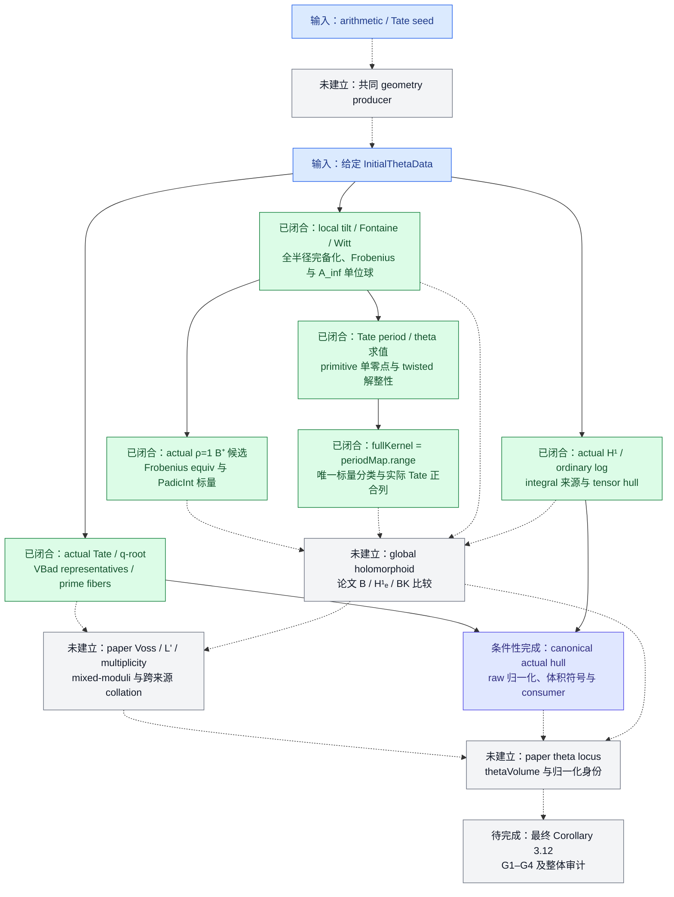

# Scene1 进度总览

### 状态判定

| 标记 | 状态 | 使用条件 |
| --- | --- | --- |
| 🟢 | 已闭合 | 本行精确子义务已有证明，所需输入与验收范围已明确 |
| 🔵 | 条件性完成 | 定理及显式条件已有证明，但条件尚未从目标真实来源全部产生 |
| 🟡 | 部分完成 | 已有可引用子结果，仍缺构造、比较、来源或身份等式 |
| ⚪ | 未建立 | 尚无满足本行目标的已验收构造或证明 |
| 🔴 | 路线已排除 | 已证明某条具体路线不成立；须保留排除范围和所用条件 |

“已闭合”只对该行声明的范围有效。给定 `InitialThetaData` 后构造出的实际对象，
不等于已从 arithmetic seed 产生完整的 `InitialThetaData`；actual carrier 的定理，
也不等于论文 carrier 的定理。必要充分条件的证明不表示实际对象已经满足其中任何一端。

不按文件数、代码量、声明数、S1 编号或全部复选框计算总完成百分比。
四个闸门的关闭数只表示验收状态，不表示工作量比例、成功概率或剩余时间。

## 当前结论

| 项目 | 当前值 |
| --- | --- |
| 更新日期 | 2026-11-01（Asia/Shanghai） |
| 数学证明基线 | 截至已提交并推送的 `4bd930e`：通用整数环 bridge 已专门化为标准 `PadicComplex p` tilt 的 source/integer-ring bridge；标准整数环 Witt/p-localization 提升仍开放 |
| Scene1 整体 | **未完成；最终闸门关闭 0/4** |
| 父义务状态 | [明确来源证明义务][obligations]中的 15 项全部开放 |
| 近期定量进展 | 独立标准 `C_p^flat` 模型、实际 tilt 的范数幂律、actual PreTilt Witt 自然性、通用整数环 bridge 及其标准 `PadicComplex p` 专门化已验收；一般数域次数下的 actual qProduct lower bound、条件性 Corollary consumer 和 `qProduct = thetaVolume^[F:ℚ]` 仍有效 |
| 近期处集进展 | actual representative fibers、omitted mass、Galois fiber 权重和 grouped volume 会计已有；指定 representative certificates 与 reference q-pilot equality 的联合不相容性已证明 |
| Period 路线位置 | 共同单位球及非线性 `φ(x)=x^p` 解的代表已有；任意 `φ(x)=-ξx` 解经 `p^N` scaling 后有原始 `A_inf` 代表；实际 full Tate 核分类、拓扑正合列、商求值单射及 Fréchet/actual Tate 商的求值相容性已闭合；actual ρ=1 单位球候选已有 Frobenius 自同构与 `PadicInt` 标量结构 |
| 尚未接通的主要连接 | 共同 geometry producer、global holomorphoid、H¹ₑ/BK、论文 `B`/ρ-norm 身份、actual 候选到论文 `B⁺` 的身份、paper representatives、跨来源 collation、paper theta locus/volume 与最终 Corollary 3.12 |
| Prologue 边界 | `R5`；四项 source laws 由 Scene1 producer 负责，仍须从共同真实来源证明 |
| 本次更新范围 | 记录 `4bd930e` 已推送单元及其精确边界；不改变 15 项父义务或最终闸门状态 |

阅读顺序：先看四个闸门，再看当前路线和关键缺口，最后看近期变化卡及父义务清单。
局部结果以[源码][scene1]、模块头的来源与忠实度说明、[既有来源台账][ledger]及已提交记录为依据。近期构建、失败与资源数据见对应提交正文。

## 四个最终验收闸门

G1–G4 对应[开发计划 §3][plan-gates]。每行的“已有结果”概括可复用子结果，
关闭闸门仍须完成该行全部来源和身份连接。

| 闸门 | 当前状态 | 已有结果 | 关闭所需的剩余工作 | 证据入口 |
| --- | --- | --- | --- | --- |
| **G1：目标与归一化冻结** | 🟡 部分完成 | raw/degree-normalized、weighted source sum 及 grouped volume 会计已有；一般次数下 actual `qProduct = thetaVolume^[F:ℚ]` 和 lower bound 已有；旧严格 raw margin 仍限 degree-one | 在同一 paper carrier 上冻结 q-term、local/global degree、`p*`、`2ℓ`、无穷处项与最终 target；完成跨 carrier 身份和 paper normalization | [canonical data][actual-data]、[q-product][qproduct]、[raw margin][margin]、计划 G1 |
| **G2：共同真实来源模型装配** | 🟡 部分完成 | 给定 `InitialThetaData` 后的 actual Tate/q-root、section/Voss、局部 tilt/Fontaine/Witt、perfectoid source 和 canonical bridge 相容性已有 | 从同一 arithmetic seed 产生 `OrbicurveData`、`LocalThetaData`、完整 `InitialThetaData/TateFamily`；再产生 global holomorphoid、H¹ₑ/BK/period 和四项共同 source laws | [producer contracts][contracts]、[bridge coherence][bridge]、计划 G2 |
| **G3：论文处集与重数会计** | 🟡 部分完成 | actual VBad representative、prime fibers/Sigma、omitted mass、Galois fiber 权重与 grouped volume 已有；指定 representative/reference 证书联合已被排除 | 识别论文 `V_p^oss`、`\underline V^oss`、`L'` representatives；闭合 omitted mass、paper multiplicity、residue/inertia degree 和 mixed-moduli descent | [representative][representative]、[prime carrier][voss]、[Sigma 分解][sigma]、计划 G3 |
| **G4：实际 theta-volume 与最终连接** | 🟡 部分完成 | ordinary-log/Kummer hull、Haar/cost、一般次数的 qProduct lower bound 与条件性 Corollary consumer、actual volume 符号已有；全半径整性识别推进 period 分支 | 接通 H¹ₑ/BK、theta-value、different untilt/holomorphoid、paper theta locus 和 `thetaVolume` 身份；在同一归一化下产生最终 Corollary proof term | [actual data][actual-data]、[volume bridge][volume-sign]、[strict volume][strict-volume]、[最终 consumer][cor312]、计划 G4 |

qLogTerm 的字面符号问题按既有决定暂作笔误处理，等待作者回复后再讨论。
本页不将它列为当前停工项；最终目标的符号记录和其他 G1 归一化义务仍保留。

四个闸门关闭后，还须通过[计划 §6 的最终构建与审计][plan-audit]，才能宣布 Scene1 完成。
单个逻辑单元的构建、审计和推送通过，只关闭该单元。

## 当前证明路线

下图展示已有构造和待完成连接，不是完整 Lean 导入图。
实线表示已有局部连接；虚线表示仍需证明或装配。蓝色是给定输入，绿色是局部闭合结果。



`A` 节点还需要显式 `CanonicalActualHull.AnalyticInput`，包括 theta scaling、period/log、
normalization 和 perfectoid bridge 等法律。图中从 actual arithmetic/Haar 对象进入该节点的
实线，只表示这些局部构件已经接通，不表示 `AnalyticInput` 已有共同真实 producer。

### 关键子结果与缺口

| 路线位置 | 状态 | 已证明范围或剩余缺口 | 所属闸门／证据 |
| --- | --- | --- | --- |
| 条件性最终消费者 | 🔵 条件性完成 | `cor312_of_scene1_data` 及 canonical actual-hull consumer 已有 proof term；共同真实输入和 paper identity 仍须产生 | G1/G2/G4；[Corollary312][cor312]、[summary][summary] |
| Actual Tate/q-root 与基础会计 | 🟢 已闭合 | 给定数据下的 completion-valued q 参数、q-order、根、有限支撑、raw/degree-normalized 恒等式已有 | G1/G3；[canonical data][actual-data]、[来源台账][ledger] |
| Actual section/Voss 与素数纤维 | 🟢 已闭合 | representative image、prime support、有限 fibers、Sigma 等价及基数和式已有；范围限于 concrete carrier | G3；[Sigma][sigma]、[prime carrier][voss] |
| Local perfectoid/Fontaine 与来源相容性 | 🟢 已闭合 | supported place 的 untilt、tilt、θ、Frobenius、coefficient map 和 canonical bridge 相容性已有 | G2；[bridge coherence][bridge] |
| Actual H¹/log source 与 integral 来源 | 🟢 已闭合 | ambient rational H¹、指定 integral Kummer 像、ordinary/normalized log 及来源绑定已有 | G4；[local H¹/log][h1] |
| Torsion pilot 与 tensor hull | 🟢 已闭合 | integral pilot 的非零性、指标单射、log/p* 标定、finite pilot tensor/log-shell 与 actual hull 连接已有 | G1/G4；[integral classes][integral]、[integral tensor][integral-tensor] |
| Ordinary-log hull、Haar 与 cost | 🟢 已闭合 | actual finite/archimedean tensor、normalization hull、singleton collation、volume/cost 及 q-product 比较已有 | G4；[H¹ tensor hull][hull]、[ordinary collation][collation] |
| Canonical actual target 的字段装配 | 🔵 条件性完成 | 在给定 `AnalyticInput` 下，从同一 D 固定 raw q-family、actual hull volume 与 transfer；字段相容性已有 | G1/G2/G4；[data][actual-data]、[Scene1 coherence][coherence] |
| Canonical actual target 的符号与界 | 🔵 条件性完成 | 同一显式输入下的正性、严格收缩与体积符号已有；一般次数下的 actual qProduct lower bound 和条件性 Corollary consumer 已证明 | G1/G4；[qLogSum][qlogsign]、[volume sign][volume-sign]、[strict volume][strict-volume] |
| Raw qLogSum 严格 margin | 🔵 条件性完成 | 另需 `Module.finrank ℚ D.F = 1`，才得到 raw qLogSum 与 selected internal paperSum 的指定严格比较 | G1/G4；[raw margin][margin] |
| Actual period-ring 局部链 | 🟢 已闭合 | actual Witt、ρ-norm 构造、全半径完备化及比较、Frobenius、theta、Tate-log 与 principal-unit period 已有 | G2/G4；见下节 [period 路线](#period-ring-路线的精确位置) |
| 标准 `C_p^flat` 与实际 tilt 比较 | 🟢 已闭合 | 独立标准 fraction field 的范数、完备性、代数闭包、uniform/homeomorphic 比较及整数环等价已有；保留 local-degree 幂律，不称为 isometry | G2；[标准 tilt 范数][standard-tilt-norm]、[标准 tilt 拓扑][standard-tilt-topology] |
| Actual PreTilt Witt 自然性 | 🟢 已闭合 | 既有 actual `preTiltWittEquiv` 的 Teichmüller lift 和逐系数公式已证明；直接提升到标准整数环 Witt/p-localization 触发内核实例转换边界 | G2；[Witt 自然性][witt-naturality] |
| 通用 PreTilt 整数环 bridge | 🟢 已闭合 | `Source Ω p` 与原 fraction field 的 valuation integer ring 已构造 RingEquiv，并证明应用和范数保持；为标准 `C_p^flat` source/integer 链提供 carrier bridge | G2；[通用整数环 bridge][integer-ring-bridge] |
| 标准 `PadicComplex p` 整数环 bridge | 🟢 已闭合 | 通用 bridge 已专门化为 `PadicTiltField.Source p ≃+* PadicTiltField.Integers p`，证明应用和范数保持 | G2；[标准整数环 bridge][padic-integer-bridge] |
| 全半径整性与非线性 Frobenius 识别 | 🟢 已闭合 | 原始 `A_inf` 像恰为所有 ρ-norm 的共同单位球；全半径 `φ(x)=x^p` 解有原始 bounded Witt 代表，单半径单位界给 integral Teichmüller 代表 | G2/G4；[单位球判据][completed-integral]、[非线性识别][completed-recognition] |
| Twisted 解的实际整性 producer | 🟢 已闭合 | 任意原始 full common-ring 解 `φ(x)=-ξx`，均可构造 `N` 和原始 `a∈A_inf`，使 `ainfMap(a)=p^N·x` 且 `Frob(a)=-ξ_Ainf·a`；无需预设 bounded/integral lift | G2/G4；[twisted 整性识别][twisted-integral] |
| Primitive 单零点与一阶核求值 | 🟢 已闭合 | 对完整 actual `φ=p` 空间，`ξ²∣x ↔ x=0`；`fullKernel` 上先除轨道乘积 P 再作 θ 的一阶求值单射，区别于 Banach 商求值 | G2/G4；[simple zero][simple-zero] |
| 环带指数的实际 Witt 代表 | 🟡 部分完成 | 指数收敛、单位性、overlap Frobenius 法律、闭区间单位有界逼近及条件性 completed-lift consumer 已有；精确 Witt 代表或全半径延拓的存在性仍缺 | G2/G4；[环带指数][annular-exp]、[闭区间逼近][annular-unit-approximation]、[completed-lift consumer][completed-exp-period] |
| 完整 Tate 核分类 | 🟢 已闭合 | 已证明 `fullKernel = periodMap.range`、twisted period 满射、所有非零 twisted 解的唯一实际 `ℚₚ` 标量表示，以及实际 Tate 商求值单射 | G2/G4；[full Tate kernel][full-tate-kernel]、[Tate exact sequence][tate-exact] |
| 共同 geometry producer | ⚪ 未建立 | seed 到完整 `orb/localData/InitialThetaData` 的真实 witness 仍缺；reference adapter 仍消费 existence contract | G2；[producer contracts][contracts]、[接口反模型][countermodel] |
| H¹ₑ/BK 与 global holomorphoid | ⚪ 未建立 | actual H¹、ordinary log 和 local untilt 尚未通过论文 marking、crystalline/period 与 BK comparison 统一识别 | G2/G4；[父义务 §三][obligations] |
| Paper carrier、theta locus 与 volume | 🟡 部分完成 | actual 会计和 hull 可复用；paper representatives、跨来源 transport、locus/volume 身份及最终联合装配仍缺 | G3/G4；[父义务 §四–五][obligations] |

`integralKummerSubmodule` 是带 integral 来源的有理像载体。特定 pilot 像类的非零性与单射性，
不表示一般 integral H¹ 的系数映射单射。这里的 ordinary log 仍须与论文 Bloch–Kato log 比较。

### Period-ring 路线的精确位置

这一路线已超出早期仅有 `A_inf`/`B_dR` 或形式 ρ-bound 的阶段，现有实际构造如下。

| 层次 | 状态 | 已有结果 | 仍保留的目标 |
| --- | --- | --- | --- |
| Actual bounded Witt 与 ρ-norm | 🟢 已闭合 | 有界 Witt ring、各半径 norm、乘法性及 completion 构造已有 | 与论文全部对象和来源约定的共同身份 |
| 全半径完备化与拓扑比较 | 🟢 已闭合 | 原 bounded source 的全半径 uniformity、Hausdorff completion 与 diagonal-closure ring 的 uniform/ring equivalence、保留原环及各半径求值的比较已有；标准 ℚₚ 标量和 calibrated seminorms 已有 | 论文 `B`/ρ-norm、holomorphoid 标记与后续 period/BK 身份 |
| Frobenius、theta 与 Tate period | 🟢 已闭合 | 同一 actual carrier 上的 Frobenius、theta evaluation、Tate-log、rational Tate period、principal-unit period 以及 full θ-kernel 与 Tate-period range 身份已有 | 与论文 `B`、global holomorphoid 和 H¹ₑ/BK 的来源身份 |
| Entire φ=p 子空间与 Banach 商 | 🟢 已闭合 | 完整 actual φ=p 子空间的 Banach 结构、闭 Tate line、完整空间除以该 line 的 Banach 商、商 theta 求值的连续满射、开放性与单射性已有 | 与论文 `B` 和目标 holomorphoid 的拓扑身份 |
| 完整核的带因子比较 | 🟢 已闭合 | 非零轨道乘积 P 将原解空间 `φ(y)=-ξ·y` 与完整特征 θ 核连续 ℚₚ 线性等价；canonical solution `t/P` 的 period 像为其一维闭张成空间，且所有非零解均有唯一实际 `ℚₚ` 标量表示 | 与论文 `B`、H¹ₑ/BK 的跨来源身份 |
| 全半径共同单位球 | 🟢 已闭合 | 不假设 source lift 或 integral approximants；从实际全半径单位界构造原始 Witt 整系数及 `A_inf` 代表 | 单个环带的单位界不能直接套用此判据 |
| 全半径非线性 Frobenius 解 | 🟢 已闭合 | 对 `φ(x)=x^p`，全部半径 norm 相等；单半径单位界给 integral Teichmüller 代表；contracting Teichmüller 因子去掉单位界后给 bounded source | 不涵盖尚未延拓的环带元素，也不分类线性 `φ(x)=p·x` 解 |
| Twisted 解的 integral Witt 代表 | 🟢 已闭合 | 同一个构造出的 `p^N` 给出小半径起点界和大半径起点界；两组 Frobenius 轨道及插值给出全半径单位界，从而构造原始 `A_inf` 代表及其 Witt 方程；唯一实际 `ℚₚ` 标量分类随后已闭合 | 论文 `B`、global holomorphoid 与 H¹ₑ/BK 身份 |
| Actual ρ=1 B⁺ 候选 | 🟢 已闭合 | ρ=1 单位球已包装为 actual `Subring`，单射嵌入 common completion；候选在 Frobenius 和逆 Frobenius 下稳定，得到环自同构，并带有现有 `PadicInt` 映射与 algebra 结构 | 论文 `B⁺` 的标记、Galois 作用、global holomorphoid 和标量相容性法律 |
| 环带指数与闭区间逼近 | 🟡 部分完成 | 线性 eigen 元素适当 scaling 后给环带指数单位及 overlap Frobenius 法律；仅由两个端点单位界即可构造整个闭区间上单位有界的 bounded source 逼近；去负 p 次项后的误差 ≤max(ε,ρ/r) | 精确 Witt 代表或全半径延拓仍缺；固定正内半径保留 ρ/r，不能由此推出整性 |
| 指数到 principal-unit period | 🔵 条件性完成 | 在可选 scaling 与小范数条件下，精确 bounded lift 可给 period；已进一步弱化为任意 full common-ring 延拓，由 overlap 法律导出 `φ(x)=x^p`，构造 integral Teichmüller 代表并给出 period | 环带指数的 full common-ring 延拓存在性仍缺 |
| Frobenius 权与 Tate 可除性 | 🟢 已闭合 | 非零整数权 eigen 元素的权非负；非零 weight-k 元素被 t^m 整除则 m≤k；线性 φ=p 空间与 (t²) 仅交于零 | 不单独给出完整核的 ℚₚ 维数或 Tate 核身份 |
| Primitive 单零点与一阶求值 | 🟢 已闭合 | 实际 `ξ=[varpi]-p` 的小半径范数恒为 primeNorm；平方可除性沿轨道传播并给出 P² 商，范数对数凸性证明 `ξ²∣x ↔ x=0`；一阶求值因而单射，实际 `Eigen / Tate-line` Banach 商求值单射也已由 full-kernel 身份闭合 | 与论文 `B` 和全局 period 身份的比较 |
| 完整核身份与商线性等价 | 🟢 已闭合 | 已证明 `fullKernel = periodMap.range`、twisted period 满射、唯一标量分类、剩余商平凡、商求值单射和实际拓扑正合列；actual 与 Fréchet Tate 商的连续线性等价及求值交换图也已构造 | 与论文 `B`、global holomorphoid 和 H¹ₑ/BK 的跨来源身份 |

证据入口：[Fréchet source/completion 比较][frechet]、[calibrated seminorms][seminorms]、
[Banach 商][banach]、[开放求值][open-evaluation]、[twisted Tate period][twisted]、
[完整核比较][quotient-kernel]、[条件性商等价][quotient-equiv]、[单位球判据][completed-integral]、
[Fréchet/actual 商求值相容性][frechet-tate-quotient]、
[非线性 Frobenius 识别][completed-recognition]、[环带指数][annular-exp]、
[环带截断][annular-truncation]、[闭区间逼近][annular-unit-approximation]、
[completed 延拓到 period][completed-exp-period]、[Tate 可除性][tate-divisibility]、
[一阶核][first-order]、[simple zero][simple-zero]及[twisted 整性识别][twisted-integral]。

## 最近单元变化卡

### Fréchet Tate 商求值相容性

| 项目 | 内容 |
| --- | --- |
| 提交 | `92122ff` |
| 构造结论 | Fréchet Tate 商到 actual Tate Banach 商的连续线性等价，经 actual 商求值后恰等于 Fréchet 商求值；对 Fréchet eigen 元素生成的商类给出显式求值公式 |
| 关键推进 | 将两条商到同一 actual untilt 的连续线性等价复合，证明求值交换；子空间代表公式由商映射和 Fréchet evaluation 定义直接推出 |
| 来源边界 | 保留 actual completion、Fréchet completion 和 actual untilt 的既有 carrier 与拓扑；叶模块、Checks/Axioms、Scene1 聚合及 ImportAudit 通过，903 个可达工程模块的 proof-hole/禁用导入扫描无发现 |
| 保留缺口 | 没有识别论文 Fréchet `B`、定义其 ρ-norm 或 Tate-log 收敛域；15 项父义务和四个最终闸门仍开放 |

### 所有 twisted 解的实际 integral Witt 代表（当前数学基线）

| 项目 | 内容 |
| --- | --- |
| 提交 | `8bb052d`；后续由 `a1fb1d3`、`92290fe` 完成分类与正合列消费 |
| 输入 | 原始 full common-ring 中任意满足 `φ(x)=-ξ·x` 的 x |
| 构造结论 | 存在 `N∈ℕ` 和原始 `a∈A_inf`，使 `ainfMap(a)=p^N·x` 且 `Frob(a)=-ξ_Ainf·a` |
| 关键推进 | 小半径 `r<primeNorm` 时 `‖ξ‖ᵣ=primeNorm`；大半径 `primeNorm<r` 时 `‖ξ‖ᵣ=r`。同一个 p-power scaling 给出两个起点界，分别沿向零和向一的半径轨道传播，再插值得到全部半径单位界 |
| 来源边界 | bounded/integral 代表均为构造结论，不是输入；保留原始 carrier、范数和 Prologue R5 |
| 保留缺口 | 论文 `B`、global holomorphoid 与 H¹ₑ/BK 身份仍缺；15 项父义务不变 |

### 实际 full Tate 核分类与拓扑正合列

| 项目 | 内容 |
| --- | --- |
| 提交 | `a1fb1d3`、`92290fe`、`0d6f2b6` |
| 构造结论 | 任意 full common-ring twisted 解均有唯一实际 `ℚₚ` 标量表示；因此 `fullKernel = periodMap.range`，实际 Tate 商求值单射，且 rational Tate period 与 eigen evaluation 构成严格拓扑正合列 |
| 关键推进 | 先把每个 twisted 解缩放为 bounded Witt 代表，再以 ambient Frobenius 固定域识别比值为现有 `Padic` 嵌入中的实际标量；随后消费 period range 身份构造连续线性商同构与唯一 period fiber |
| 来源边界 | 结果只针对 actual common carrier、原始拓扑和现有 Prologue R5；没有把 actual carrier 识别为论文 `B`，也没有产生 global holomorphoid 或 H¹ₑ/BK 身份 |
| 保留缺口 | 论文 `B`/ρ-norm、跨来源 period 比较、global holomorphoid、H¹ₑ/BK 以及 15 项父义务仍开放 |

### Primitive 单零点与一阶求值单射

`376c5f1` 证明完整 actual `φ=p` 元素满足 `ξ²∣x ↔ x=0`。
证明将平方可除性沿 primitive 轨道传播，构造原始轨道乘积 P² 的商，
再用小半径范数递推和对数凸性排除非零商，无需 ξ² 到 t² 的可除性桥接。

已有一阶核刻画由此给出 `fullKernel` 上 `quotientEvaluation` 的单射性。
这个映射先除 P 再作 θ，区别于 `Eigen / Tate-line` 上的 Banach 商求值；
后者的单射性已由 `a1fb1d3` 消费 full-kernel 身份闭合。

### Actual ρ=1 B⁺ 候选与整系数标量

| 项目 | 内容 |
| --- | --- |
| 提交 | `bced8ac`、`377dd28`、`31c4b8d`、`bbac7d1`、`377bf99`、`f6b627d` |
| 构造结论 | actual ρ=1 单位球已构成 `Subring`，并单射嵌入 actual common completion；候选对 Frobenius 和逆 Frobenius 稳定，形成环自同构；现有 `PadicInt` 映射落入候选并给出候选上的 `PadicInt` algebra |
| 关键推进 | ρ=1 单位界先被刻画为 `A_inf` 的 p-integral presentation，再将 bounded localization 的 Frobenius transport 到 common completion；标量部分使用已有 Witt prime-field image，指数取 0 |
| 来源边界 | 明确称为 actual B⁺ candidate，不命名为论文 `B⁺`；论文 `B`、Galois、global holomorphoid、H¹ₑ/BK 及跨来源标量相容性仍未产生 |

### 全半径单位球与非线性 Frobenius 识别

| 项目 | 内容 |
| --- | --- |
| 提交 | `f710fe4`、`78469d8`、`960d864`、`61a3f4b`、`5bd7d91`、`f45e8d4` |
| 单位球结果 | 原始 common completion 内，`A_inf` 像 = 所有半径 ρ-norm 同时 ≤1 的集合 |
| 构造内容 | 去负 p 次项逼近、原始 Witt 系数的 Cauchy 性和整系数极限；较大半径控制几何尾项，识别原始 `A_inf` 像 |
| 非线性结果 | 对 full common-ring 解 `φ(x)=x^p`，各半径 norm 相等；一个半径的单位界给原始 integral Teichmüller 代表 |
| 去除单位界 | 乘原始 contracting Teichmüller 因子的幂进入单位球，再用 source 中已有的单位逆，得到任意此类解的 bounded Witt 代表 |
| 新增假设 | 不要求预先给出 bounded/integral source 代表；结果仍以给定 D、supported place 和 full common-ring 元素为范围 |
| 保留缺口 | 环带指数的全半径延拓或精确 Witt 代表、论文 `B` 及 H¹ₑ/BK 身份；线性 `φ=p` 的实际 Tate 核分类已由后续单元闭合 |

### 环带指数：条件延拓、闭区间逼近与整性障碍

`0590f5b` 将已有 bounded-lift consumer 推进到任意 full common-ring 延拓：
由环带 overlap 法律和原始半径求值单射性导出 `φ(x)=x^p`，再构造原始 integral
Teichmüller 代表，并在已有 scaling 与小范数条件下给出 principal-unit period。
此处仍以延拓为输入，尚未构造任意环带指数的延拓。

`7f81612` 证明原始 bounded source 在环带 carrier 的稠密性和有限坐标同时逼近。
`d262cf5` 对已经在所有环带半径单位有界的实际 source，构造无负 p 次项的 source，
保留全部环带单位界，误差在半径 r 处不超过 ρ/r。

`16acd4b` 进一步仅从两个端点单位界，构造在闭区间 [ρ,t] 的每个半径上单位有界的
原始 bounded source 逼近；去负 p 次项后仍保留区间单位界，误差 ≤max(ε,ρ/r)。
这已超出有限坐标控制，但固定正内半径 ρ 时，ρ/r 不自动趋零，仍不能替代精确 lift。

`3e1afd7` 给出实际障碍：每个固定正内半径都有原始 bounded source
`z=[varpi]^N/p`，其环带范数均 <1，却没有原始 `A_inf` 代表。
`u=1-z` 还是实际环带单位，u 与其逆的各环带范数均为 1，仍无整代表。
因此 density、单位性和双侧单位界不能单独推出整性。反例未附加 Frobenius-power
方程，且其值已有全半径延拓；它不排除方程驱动的识别，也不反驳延拓存在性。

### 一般数域次数下的 actual hull 比较

| 项目 | 内容 |
| --- | --- |
| 提交 | `0368c3b`、`73cbb83`、`33884b3`、`d6f8f84`、`8aa4a0f`、`ad3e0fd` |
| 改进 | actual qProduct lower bound 和相应条件性 Corollary consumer 已移除旧 degree-one 限制 |
| 精确等式 | 在显式 normalization、同一 Tate source、actual hull-volume identity 和 procession length 匹配下，`qProduct = thetaVolume^[F:ℚ]` |
| Reference 体积式 | 显式 normalization 与 actual hull-volume identity 给 `thetaVolume = exp(-n·referenceAbsLogQ)`，无需 degree-one |
| 保留条件 | Scene1 base、normalization、actual hull-volume identity 等仍为显式输入；共同真实 producer 与 paper thetaVolume 身份未产生 |
| 旧结果范围 | 下方历史 raw strict margin 仍要求 `[F:ℚ]=1`；一般 lower bound 不表示这个严格 margin 已推广 |

### Actual representative、omitted mass 与联合证书限制

`85608b1` 已提交旧总览标为“未提交”的 prime-fiber image 等价与基数会计。
后续结果连接 omitted prime-fiber mass、support coverage、Galois fiber multiplicity、
base-fiber weights、grouped root volume 及 weighted source product。

`c4a82ca`、`602f667`、`08a75f4`、`707d173` 排除了指定旧装配：同时要求 reference
q-pilot equality 与两类 representative accounting certificates，会与已证明的实际
selected/reference strict gap 冲突。排除范围限于这些证书和等式的联合；它不排除其他
paper carrier 或归一化，也不关闭 paper representative/mixed-moduli 父义务。

下列三卡保留早期结果和其原始条件，便于与当前一般次数结果对照。

### Canonical actual hull：归一化、符号与 lower bound

| 项目 | 内容 |
| --- | --- |
| 提交 | `9ea0931`、`9dc5065`、`0d3ee12`、`40ee645`、`656c4bf`、`e66f80b` |
| 输入 | 给定 D、theta pilot、route、thetaBase、height/ramification 和显式 `AnalyticInput X` |
| 已有构造 | 从 actual arithmetic/Haar hull 固定 target、q-family、qFactor、thetaVolume；无需调用者自由给定目标体积或 lower bound |
| 归一化 | `qProduct = exp(-ellStar·qLogSum)`；`qLogSum = [F:ℚ]·referenceAbsLogQ`；除以全局次数后得到 reference/weighted source 会计 |
| 定量结果 | `qLogSum > 0`；每个 qFactor 属于 `(0,1)`；`0 < qProduct ≤ thetaVolume < 1`；`log thetaVolume < 0`；coefficient-weighted internal paper sum 严格为正 |
| Consumer | `Corollary312SideConditions`、`Corollary312VolumeBound` 与相应 conditional Corollary consumer 已装配 |
| 实际推进 | raw q-term 和 actual hull volume 已在同一 canonical target 内比较；条件性 analytic 来源与 paper identity 仍开放 |

### Degree-one 下的 raw margin

记 S 为 `VBadSelectedPaper.paperSum D`，L 为 canonical target 的 `ellStar`。
在上卡全部输入及额外条件 `Module.finrank ℚ D.F = 1` 下，提交 `6531822` 证明：

```text
qLogSum < S
exp(-L·S) < qProduct ≤ thetaVolume
```

第一段比较是严格的，`qProduct ≤ thetaVolume` 是已有的非严格 lower bound。
S 是当前 actual VBad carrier 上定义的内部 selected paper sum，仍须与论文求和对象识别；
本结果也没有移除 degree-one 条件。

### Actual VBad representative image 的 prime-fiber Sigma 分解

| 项目 | 内容 |
| --- | --- |
| 提交 | `4a97588`、`85608b1` |
| 对象 | actual VBad section representative image、其 rational residue-characteristic support 及各 prime fiber |
| 等价 | `representativeImagePrimeFiberSigmaEquiv`：整个 image 与有限素数支撑上的 fibers 的 Sigma 等价 |
| 会计 | `representativeImage_card_eq_primeFiber_sum` 和 `representativeImage_card_eq_vbad_card` |
| 实际推进 | 将 concrete representative 的全局有限计数分解到逐素数 fiber，并接回 VBad moduli carrier |
| 保留缺口 | paper `L'` representative、paper multiplicity、omitted mass、mixed-moduli descent |
| 已提交扩展 | `representativePrimeFiberImageEquiv`、`representativeImage_card_eq_primeFiberImageType_sum` 与 `vbad_card_eq_primeMultiplicity_sum` 已接到实际 fiber-image/multiplicity 类型 |

上述单元的模块头、既有台账及提交记录提供来源和验收信息。当前 `f6b627d` 的叶模块、
`Act1Scene1` 聚合、`Checks/SelectedRoots`、`Axioms/SelectedRoots` 和 `ImportAudit` 均通过。
当前 Axioms 日志解析了 1784 个声明，包含 actual B⁺ candidate 标量单元的新增公开声明。
登记的新定理公理输出仅含 `propext`、`Classical.choice`、`Quot.sound`，
相应扫描未发现 `sorryAx`、proof hole 或禁用导入。该记录不替代最终联合模型的验收。

### 独立标准 `C_p^flat` 与实际 tilt 的范数拓扑比较

| 项目 | 内容 |
| --- | --- |
| 提交 | `c0b2882` |
| 构造结论 | 以 `p` 和 `PadicComplex p` 构造独立标准 tilt fraction field，证明原始 valuation 范数、完备性、代数闭包、特征 `p`、perfectness、uniform/homeomorphic 结构和整数环；将实际 tilt 接入该标准模型 |
| 关键推进 | 保留精确幂律 `‖e x‖ ^ localDeg(w) = ‖x‖`；因此得到双向 uniform continuity、uniform equivalence、homeomorphism 和整数环 ring equivalence，不把 degree 不为一的比较称为 isometry |
| 验收 | 五个模块共 60 个公开声明逐名 Checks/Axioms 通过；叶、聚合、Checks、Axioms、ImportAudit 均退出 0；静态扫描 `REACHABLE 923`、`BAD []`；RSS 峰值最高 9,496,908 KiB，均自然退出 |
| 来源边界 | 标准模型不含 `D,w`；结果仍限于 actual tilt 与独立标准 tilt 的代数/拓扑比较，不识别论文 `B`、ρ-norm、H¹ₑ/BK、global holomorphoid 或 paper theta-volume |
| 后续缺口 | 需要从整数环等价继续接到 Witt-vector 等价、bounded localization 与 rho 范数比较；15 项父义务和四个最终闸门保持开放 |

### Actual PreTilt Witt 自然性

| 项目 | 内容 |
| --- | --- |
| 提交 | `24b3ede` |
| 构造结论 | 在既有 actual `preTiltWittEquiv` 上证明 Teichmüller lift compatibility 和逐系数 compatibility |
| 验收 | 叶、Scene1、Checks、Axioms、ImportAudit 均退出 0；静态扫描 `REACHABLE 924`、`BAD []`；两条新定理公理仅为 `propext` |
| 保留边界 | 直接将 Witt 映射目标设为标准 tilt 整数环，以及进一步的 p-localization，多次触发标准局部化实例的内核 deterministic timeout；因此本提交不声称标准整数环 Witt 等价、bounded localization、rho/Frechet 比较或论文 `B` 身份 |
| 下一步 | 设计不展开标准 `OreLocalization` 实例的 carrier bridge，再继续整数环 Witt 与 p-localization比较 |

### 通用 PreTilt 整数环 bridge

| 项目 | 内容 |
| --- | --- |
| 提交 | `46b569b` |
| 构造结论 | 对一般完备代数闭超度量系数域，构造 `Source Ω p ≃+* O(FractionField Ω p)`，并证明应用公式和范数保持 |
| 验收 | 叶、Scene1、Checks、Axioms、ImportAudit 均退出 0；静态扫描 `REACHABLE 925`、`BAD []`；4 个公开声明无 `sorryAx` |
| 来源边界 | 只消费原 PreTilt 单位球像和分式环单射；不产生 Witt、p-localization、bounded localization、rho/Frechet 或论文 `B` 身份 |
| 下一步 | 在标准 `PadicComplex p` 上专门化该 bridge，再评估标准整数环 Witt 映射的实例展开成本 |

### 标准 `PadicComplex p` source/integer-ring bridge

| 项目 | 内容 |
| --- | --- |
| 提交 | `4bd930e` |
| 构造结论 | 专门化为 `PadicTiltField.Source p ≃+* PadicTiltField.Integers p`，并证明应用公式和范数保持 |
| 验收 | 叶、Scene1、Checks、Axioms、ImportAudit 均退出 0；静态扫描 `REACHABLE 926`、`BAD []`；4 个公开声明无 `sorryAx` |
| 保留边界 | 仍未构造标准整数环 Witt 等价、p-localization、bounded localization、rho/Frechet 或论文 `B` 身份 |
| 下一步 | 以该标准 source/integer bridge 重新评估 Witt 层 map，避免直接展开标准局部化实例 |

## 未完成父义务

以下编号按[明确来源证明义务][obligations]的顺序排列。15 项均保持开放；
“已有局部支撑”只说明可以复用的结果。

| 编号 | 父义务 | 已有局部支撑／剩余关键连接 |
| --- | --- | --- |
| 1 | 实际 perfectoid bridge 的来源适配 | local bridge、系数映射和 canonical coherence 已有；仍缺论文 holomorphoid 的同一来源身份 |
| 2 | Core 载体到真实输入的共同来源 | 给定 D 的 arithmetic/Tate/q-root 投影与 target 字段相容性已有；完整共同 producer 仍缺 |
| 3 | 四项 source laws 的正式移交与真实产生 | owner 已移到 Scene1；部分 actual cost/hull laws 已构造，四项法律的共同真实来源仍缺 |
| 4 | `InitialThetaGeometryProducer` | contract 和 reference adapter 已有；真实 geometry 的 orbicurve、covering、local 条件 witness 仍缺 |
| 5 | 共同实际 `InitialThetaData/TateFamily` 模型 | 给定数据的局部派生链已有；arithmetic seed 到完整模型及全部来源等式仍缺 |
| 6 | 实际 holomorphoid source | local untilt/tilt/Fontaine package 已有；global marking、解析基点、Fargues–Fontaine/论文身份仍缺 |
| 7 | 论文 Fréchet `B` 和 ρ-norm | actual completion、共同单位球、非线性解代表、twisted 解的 integral producer、完整 Tate 核分类、实际正合列及 actual B⁺ candidate 已有；环带延拓、论文 `B` 身份和 candidate 到 paper carrier 的比较仍缺 |
| 8 | H¹ₑ/crystalline/Bloch–Kato comparison | actual H¹、integral 像、ordinary log/p* 与 period 构件已有；正确子空间成员性、BK exp/log 和整性约定仍缺 |
| 9 | 跨 holomorphoid/arithmeticoid collation | fixed tensor hull、factor orbit 和 ordinary singleton collation 已有；不同 untilt/moduli source 的 marking 与 transport 仍缺 |
| 10 | 论文 `V_p^oss` / `\underline V^oss` | actual VBad/section/Voss、prime support 与 finite fibers 已有；论文处集、过滤和坏处外身份仍缺 |
| 11 | `L'` representative 和 fiber multiplicity | actual Sigma、fiber multiplicity、omitted-mass 会计及指定证书不相容性已有；paper representative、paper omitted mass 与 degree/multiplicity 身份仍缺 |
| 12 | Mixed-moduli descent 和 weighted carrier | actual Galois/base fiber weights、grouped volume 与 coefficient-weighted identities 已有；同一 paper carrier 上的 degree、dimension、fiber mass 身份仍缺 |
| 13 | Actual Kummer/log hull = paper theta locus | actual witness、normalization hull 与定量界已有；H¹ₑ/BK、theta-value、holomorphoid marking 的身份链仍缺 |
| 14 | Paper hull / `thetaVolume` identity | actual volume、cost、q-product 比较及严格符号已有；paper procession、weights、无穷处和全部归一化身份仍缺 |
| 15 | 最终 Corollary 3.12 proof term | 条件性 consumer 与 actual volume-bound 已有；须同时落实 G1–G4，不以未证明的 producer law 或 paper identity 作为自由输入 |

## 已排除路线与身份边界

只有已有证明排除的具体路线标红。每项排除均保留其条件和范围。

| 具体路线 | 状态与排除范围 | 保留的工作方向 | 证据 |
| --- | --- | --- | --- |
| 从任意抽象 AG/TG 的现有接口自动取得 universal producer | 🔴 保留 arithmetic seed、将接口的 cartesian predicate 设为 False，即无法产生所需 orbicurve/producer；这是接口反模型 | 对真实 geometry 增加并证明所需 cartesian/covering/local 来源法律 | [InterfaceCountermodel][countermodel] |
| Actual contracting q-root 直接充当旧 theta base | 🔴 q-root norm 小于 1，与旧 period/normalization/transfer 联合要求的非负 logVolume 冲突 | 另一 theta lift、different untilt 或 negative-log cost | [计划 §4 N1][plan-negative]；`ThetaLogSignAudit.lean` |
| Signed Haar log-volume 直接填入旧 VolumeTransfer | 🔴 正长度 ordinary-log hull 的 signed log-volume 为负，排除指定直接等式 | 已有 `-log(volume)` actual cost 路线，继续证明 paper identity | 计划 N2；S1.321–322、S1.406 |
| 将 VBad 去权系数直接补成 1 | 🔴 对应实际条件下系数严格小于 1，不能通过忽略因子完成原装配 | 保留 coefficient-weighted 会计，核对 representative、omitted mass 和归一化 | [历史 log4][log4]；S1.282–283、320 |
| 旧 degree-one 装配直接覆盖一般数域 | 🔴 指定旧装配及历史 raw strict margin 要求 finrank=1；一般次数的 actual lower bound 与条件性 consumer 已另行证明 | 继续完成来源与 paper normalization，区分一般 lower bound 和旧严格 margin | 历史 log4 S1.270；[raw margin][margin]、[一般次数比较][degree-volume] |
| 指定 representative certificates 与 reference equality 联合装配 | 🔴 两类显式证书将 actual selected product 强制等于 reference exponential，与已证明的严格 gap 冲突；已移除 degree-one 限制 | 检查 paper carrier、omitted mass、degree/weight 的实际来源，避免复用这组不相容证书 | [reference incompatibility][representative-incompatibility]、[degree-normalized audit][degree-incompatibility] |
| 固定正内半径上的单位界或环带单位性直接推出整性 | 🔴 实际 `z=[varpi]^N/p` 在环带各半径范数 <1 却无 `A_inf` 代表；`1-z` 及其逆各半径范数均为 1，仍无整代表 | 使用实际 Frobenius 方程或其他真实来源；反例本身已有全半径延拓，不排除方程识别或延拓路线 | [annular integral obstruction][annular-integral-obstruction]；`3e1afd7` |

接口反模型只排除“由这些抽象字段无条件自动产生 witness”的路线，不评价真实 orbicurve
的 cartesian 性质。上述负面证据也不构成 Corollary 3.12 的反例。

以下连接仍属于开放身份：actual H¹/ordinary log 到 H¹ₑ/BK、local perfectoid 到 global
holomorphoid、actual period ring 到 paper `B`、fixed-factor orbit 到跨来源 collation、
concrete Voss 到论文处集、canonical actual hull volume 到 paper `thetaVolume`。
`ReferenceAnabelianExistenceContract` 与参考 IUT 的 `AnabelianExistence` 仍是显式条件接口；
参考工程、适配器名称和已有代码量均不能代替这些缺失来源的 proof term。

## 后续顺序与验收

按[开发计划 §5][plan-order]，最终装配先需要共同真实 geometry producer，再需要
holomorphoid、period、H¹ₑ/BK 与 paper `B`/ρ-norm 来源；随后闭合论文处集、代表、重数和
mixed-moduli descent，冻结 G1，并完成 G4 的 paper locus/volume 与 Corollary。
当前 period 分支已把任意 twisted 解归约到原始 integral Witt 方程，并已完成非零
integral 解的实际 ℚₚ 标量比较、`fullKernel = periodMap.range`、拓扑正合列和商求值单射。
actual ρ=1 B⁺ candidate 也已具备 Frobenius 自同构与 `PadicInt` algebra；下一步可继续补齐
候选的标量相容性法律，再比较 candidate 与论文 `B⁺`/`B`。环带 eigen 指数的
精确 Witt 代表或全半径延拓也仍开放。representative 分支须把
concrete fiber 会计接到 paper multiplicity 和遗漏项来源，并处理已发现的联合证书冲突。

局部逻辑单元按计划通过叶模块、聚合、Checks/Axioms、ImportAudit、proof-hole/禁用导入扫描、
差异检查，再进入已验收记录。按当前维护约定，来源记于模块头，构建/失败/资源记于提交正文。
最终定理还须在同一个真实输入上检查全部
producer 和 paper identity，不通过 `Prologue/Obligations`、Scene2、Act2 或隐藏 `Iut.*`
导入补齐 Scene1 义务。Scene1 最终验收后按计划暂停。

[obligations]: 具有明确参考来源指示的证明义务.md
[plan-gates]: 开发计划.V1Act1Scene1.md#3-未完成义务按最终闸门分解
[plan-negative]: 开发计划.V1Act1Scene1.md#4-负面证据和路线排除
[plan-order]: 开发计划.V1Act1Scene1.md#5-执行顺序
[plan-audit]: 开发计划.V1Act1Scene1.md#6-构建与审计规则
[log4]: https://github.com/NanachiKyubey/joshi-teich-abc/blob/f45e8d4e00c34756077e1a1b8c41cff23c85427e/docs/开发计划.V1Act1log4.md
[ledger]: ../ArithmeticTeichmullerSpaces/SOURCE_LEDGER.md
[scene1]: ../ArithmeticTeichmullerSpaces/ArithmeticTeichmullerSpaces/Act1Scene1.lean
[contracts]: ../ArithmeticTeichmullerSpaces/ArithmeticTeichmullerSpaces/Act1Scene1/ProducerContracts.lean
[countermodel]: ../ArithmeticTeichmullerSpaces/ArithmeticTeichmullerSpaces/Act1Scene1/InitialThetaGeometryInterfaceCountermodel.lean
[bridge]: ../ArithmeticTeichmullerSpaces/ArithmeticTeichmullerSpaces/Act1Scene1/IutInitialThetaCanonicalBridgeCoherence.lean
[actual-data]: ../ArithmeticTeichmullerSpaces/ArithmeticTeichmullerSpaces/Act1Scene1/IutInitialThetaCanonicalActualHullData.lean
[coherence]: ../ArithmeticTeichmullerSpaces/ArithmeticTeichmullerSpaces/Act1Scene1/IutInitialThetaCanonicalActualHullScene1Coherence.lean
[summary]: ../ArithmeticTeichmullerSpaces/ArithmeticTeichmullerSpaces/Act1Scene1/IutInitialThetaCanonicalActualHullSummary.lean
[qproduct]: ../ArithmeticTeichmullerSpaces/ArithmeticTeichmullerSpaces/Act1Scene1/IutInitialThetaCanonicalActualHullQProductNormalization.lean
[qlogsign]: ../ArithmeticTeichmullerSpaces/ArithmeticTeichmullerSpaces/Act1Scene1/IutInitialThetaCanonicalActualHullQLogSumSign.lean
[volume-sign]: ../ArithmeticTeichmullerSpaces/ArithmeticTeichmullerSpaces/Act1Scene1/IutInitialThetaCanonicalActualHullVolumeSign.lean
[strict-volume]: ../ArithmeticTeichmullerSpaces/ArithmeticTeichmullerSpaces/Act1Scene1/IutInitialThetaCanonicalActualHullStrictVolume.lean
[margin]: ../ArithmeticTeichmullerSpaces/ArithmeticTeichmullerSpaces/Act1Scene1/IutInitialThetaCanonicalActualHullRawMargin.lean
[representative]: ../ArithmeticTeichmullerSpaces/ArithmeticTeichmullerSpaces/Act1Scene1/IutInitialThetaVBadSectionRepresentative.lean
[voss]: ../ArithmeticTeichmullerSpaces/ArithmeticTeichmullerSpaces/Act1Scene1/IutInitialThetaPaperVossPrimeCarrier.lean
[sigma]: ../ArithmeticTeichmullerSpaces/ArithmeticTeichmullerSpaces/Act1Scene1/IutInitialThetaVBadRepresentativePrimeFiberSigma.lean
[h1]: ../ArithmeticTeichmullerSpaces/ArithmeticTeichmullerSpaces/Act1Scene1/IutInitialThetaLocalH1LogSource.lean
[integral]: ../ArithmeticTeichmullerSpaces/ArithmeticTeichmullerSpaces/Act1Scene1/IutInitialThetaTorsionPilotIntegralClasses.lean
[integral-tensor]: ../ArithmeticTeichmullerSpaces/ArithmeticTeichmullerSpaces/Act1Scene1/IutInitialThetaTorsionPilotIntegralTensor.lean
[hull]: ../ArithmeticTeichmullerSpaces/ArithmeticTeichmullerSpaces/Act1Scene1/IutInitialThetaLocalH1LogTensorHullBridge.lean
[collation]: ../ArithmeticTeichmullerSpaces/ArithmeticTeichmullerSpaces/Act1Scene1/IutInitialThetaLocalH1LogOrdinaryCollationBridge.lean
[cor312]: ../ArithmeticTeichmullerSpaces/ArithmeticTeichmullerSpaces/Act1Scene1/Corollary312.lean
[frechet]: ../ArithmeticTeichmullerSpaces/ArithmeticTeichmullerSpaces/Act1Scene1/IutInitialThetaWittFrechetComparison.lean
[seminorms]: ../ArithmeticTeichmullerSpaces/ArithmeticTeichmullerSpaces/Act1Scene1/IutInitialThetaWittNormalizedSeminorms.lean
[banach]: ../ArithmeticTeichmullerSpaces/ArithmeticTeichmullerSpaces/Act1Scene1/IutInitialThetaWittTateBanachQuotient.lean
[open-evaluation]: ../ArithmeticTeichmullerSpaces/ArithmeticTeichmullerSpaces/Act1Scene1/IutInitialThetaWittEigenEvaluationOpen.lean
[twisted]: ../ArithmeticTeichmullerSpaces/ArithmeticTeichmullerSpaces/Act1Scene1/IutInitialThetaWittTwistedTatePeriod.lean
[quotient-kernel]: ../ArithmeticTeichmullerSpaces/ArithmeticTeichmullerSpaces/Act1Scene1/IutInitialThetaWittTateBanachQuotientFullKernel.lean
[quotient-equiv]: ../ArithmeticTeichmullerSpaces/ArithmeticTeichmullerSpaces/Act1Scene1/IutInitialThetaWittTateBanachQuotientEquiv.lean
[full-tate-kernel]: ../ArithmeticTeichmullerSpaces/ArithmeticTeichmullerSpaces/Act1Scene1/IutInitialThetaWittFullTateKernel.lean
[tate-exact]: ../ArithmeticTeichmullerSpaces/ArithmeticTeichmullerSpaces/Act1Scene1/IutInitialThetaWittTateExactSequence.lean
[frechet-tate-quotient]: ../ArithmeticTeichmullerSpaces/ArithmeticTeichmullerSpaces/Act1Scene1/IutInitialThetaWittFrechetTateKernel.lean
[standard-tilt-norm]: ../ArithmeticTeichmullerSpaces/ArithmeticTeichmullerSpaces/Act1Scene1/GeometricTiltNorm.lean
[standard-tilt-topology]: ../ArithmeticTeichmullerSpaces/ArithmeticTeichmullerSpaces/Act1Scene1/IutInitialThetaPadicTiltTopology.lean
[witt-naturality]: ../ArithmeticTeichmullerSpaces/ArithmeticTeichmullerSpaces/Act1Scene1/IutInitialThetaPadicTiltWittLocalization.lean
[integer-ring-bridge]: ../ArithmeticTeichmullerSpaces/ArithmeticTeichmullerSpaces/Act1Scene1/GeometricTiltIntegerRing.lean
[padic-integer-bridge]: ../ArithmeticTeichmullerSpaces/ArithmeticTeichmullerSpaces/Act1Scene1/PadicTiltIntegerRingBridge.lean
[actual-bplus]: ../ArithmeticTeichmullerSpaces/ArithmeticTeichmullerSpaces/Act1Scene1/IutInitialThetaWittActualBPlusCandidate.lean

[completed-integral]: ../ArithmeticTeichmullerSpaces/ArithmeticTeichmullerSpaces/Act1Scene1/IutInitialThetaWittCompletedIntegralCriterion.lean
[completed-recognition]: ../ArithmeticTeichmullerSpaces/ArithmeticTeichmullerSpaces/Act1Scene1/IutInitialThetaWittCompletedFrobeniusRecognition.lean
[annular-exp]: ../ArithmeticTeichmullerSpaces/ArithmeticTeichmullerSpaces/Act1Scene1/IutInitialThetaWittAnnularExponential.lean
[annular-truncation]: ../ArithmeticTeichmullerSpaces/ArithmeticTeichmullerSpaces/Act1Scene1/IutInitialThetaWittAnnularNonnegativeTruncation.lean
[bounded-exp-period]: ../ArithmeticTeichmullerSpaces/ArithmeticTeichmullerSpaces/Act1Scene1/IutInitialThetaWittBoundedExponentialPeriod.lean
[tate-divisibility]: ../ArithmeticTeichmullerSpaces/ArithmeticTeichmullerSpaces/Act1Scene1/IutInitialThetaWittTateDivisibility.lean
[first-order]: ../ArithmeticTeichmullerSpaces/ArithmeticTeichmullerSpaces/Act1Scene1/IutInitialThetaWittEigenKernelFirstOrder.lean
[simple-zero]: ../ArithmeticTeichmullerSpaces/ArithmeticTeichmullerSpaces/Act1Scene1/IutInitialThetaWittEigenKernelSimpleZero.lean
[twisted-integral]: ../ArithmeticTeichmullerSpaces/ArithmeticTeichmullerSpaces/Act1Scene1/IutInitialThetaWittTwistedIntegralRecognition.lean
[completed-exp-period]: ../ArithmeticTeichmullerSpaces/ArithmeticTeichmullerSpaces/Act1Scene1/IutInitialThetaWittCompletedExponentialPeriod.lean
[annular-unit-approximation]: ../ArithmeticTeichmullerSpaces/ArithmeticTeichmullerSpaces/Act1Scene1/IutInitialThetaWittAnnularUnitApproximation.lean
[annular-integral-obstruction]: ../ArithmeticTeichmullerSpaces/ArithmeticTeichmullerSpaces/Act1Scene1/IutInitialThetaWittAnnularIntegralObstruction.lean
[degree-volume]: ../ArithmeticTeichmullerSpaces/ArithmeticTeichmullerSpaces/Act1Scene1/IutInitialThetaCanonicalActualHullDegreeProductVolume.lean
[representative-incompatibility]: ../ArithmeticTeichmullerSpaces/ArithmeticTeichmullerSpaces/Act1Scene1/IutInitialThetaRepresentativeReferenceProductIncompatibility.lean
[degree-incompatibility]: ../ArithmeticTeichmullerSpaces/ArithmeticTeichmullerSpaces/Act1Scene1/IutInitialThetaDegreeNormalizedRepresentativeIncompatibility.lean
