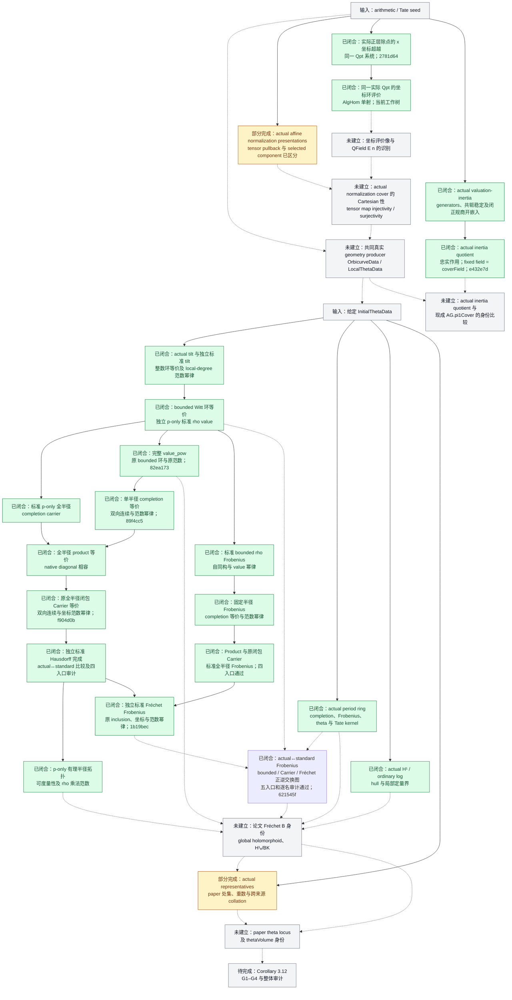

# Scene1 进度总览

### 状态判定

| 标记 | 状态 | 使用条件 |
| --- | --- | --- |
| 🟢 | 已闭合 | 本行精确义务已证明，所需实际输入已落实，相关验收已通过 |
| 🔵 | 条件性完成 | 定理及其显式条件已验证，但条件尚未从目标实际数据全部推出 |
| 🟡 | 部分完成 | 已有可引用子结果，仍缺构造、比较、身份等式或整单验收 |
| ⚪ | 未建立 | 尚无满足本行要求的已验收构造或证明 |
| 🔴 | 路线已排除 | 已证明某条具体路线不成立；必须保留排除范围及所用条件 |

“已闭合”只对该行声明的范围有效。局部构造闭合，不自动关闭所属最终闸门。
给定 `InitialThetaData` 后的实际适配，不等于从 arithmetic seed 构造出完整真实模型；
actual carrier 上的定理，不自动成为论文 carrier 上的定理。
必要充分条件已证明，也不表示实际数据满足该条件。

不按文件数、声明数、S1 编号或复选框数计算总完成百分比。
四个闸门的关闭数只表示验收状态，不表示工作量比例或剩余时间。

## 当前结论

| 项目 | 当前值 |
| --- | --- |
| 更新日期 | 2026-11-05（Asia/Shanghai） |
| 状态截点 | 2026-11-05 17:46（Asia/Singapore）；新评价叶及四入口均已结束，工作树尚未提交 |
| 最近完成的数学单元 | 待提交：构造同一实际 `Qpt` 的坐标环评价 `AlgHom`，并证明其单射 |
| 已推送版本与验收基线 | `HEAD = origin/main = 2781d64`；已推送的除点坐标超越通过叶及四入口。新坐标评价单元已在工作树通过叶、Scene1、Checks、Axioms、ImportAudit，尚未提交或推送 |
| 当前工作单元 | G2 actual affine Cartesian cover：把坐标环评价扩张到函数域，识别像与 `QField E n` 的关系，并据此处理 signed quotient 非平凡性；之后仍须证明 tensor 映射满射并完成 geometry producer 比较 |
| Scene1 整体 | **未完成；最终闸门关闭 0/4；15 项父义务全部开放** |
| 当前推进位置 | 新增并验收实际 `Qpt` 坐标环评价映射的单射性；函数域像的 `QField` 身份和 Cartesian cover 仍开放 |
| 最近完成的构建验收 | 新坐标评价叶、Scene1、Checks、Axioms、ImportAudit 均退出 0；叶峰值 `9160304 KiB`（8.736 GiB），四入口最高 `9625152 KiB`（9.179 GiB） |
| 构建与工作树状态 | 本逻辑单元的源码、入口、审计、来源台账及资源记录尚未提交；工作树还有其他未提交、未跟踪和删除项 |
| 尚未闭合的比较边界 | 除点坐标的评价映射像尚未识别为 `QField E n`，Cartesian cover 仍未证明；旧 named `ambientInclusion/toAmbient` 方块及具体 named inclusion 恢复包装仍未验收；actual inertia quotient 尚未接入现成 `AG.pi1Cover`；论文 `B`、标量/Galois/Tate-log、period 与 H¹ₑ/BK 身份仍开放 |
| 内存优化结果 | 早期约 100 GiB 的整体 rho 比较已由低内存 presentation 路线完成值、闭包与完成比较；三层 Frobenius 比较、actual inertia 系列及实际除点坐标超越均在 16 GiB 单叶上限内通过，原载体、原映射及范数得到保留 |
| 内存边界 | 单叶验收上限 16 GiB；当前监控停止线 15 GiB，总编译内存上限 100 GiB。低于内存线但超时的构建仍不算通过 |
| 尚未接通的主要连接 | actual affine Cartesian cover、除点坐标评价像与 `QField E n` 的识别、共同真实 geometry producer、actual inertia quotient 与现成 `AG.pi1Cover` 的比较、global holomorphoid、论文 Fréchet `B`/ρ-norm、H¹ₑ/BK、paper representatives、跨来源 collation、theta locus/`thetaVolume` 与最终 Corollary 3.12 |
| Prologue 边界 | `R5`；四项 source laws 仍由 Scene1 producer 从共同真实来源证明 |

阅读顺序：先看四个闸门，再看当前路线，最后看最近单元变化与内存记录。
总体义务以[开发计划](开发计划.V1Act1Scene1.md)、[证明义务台账](具有明确参考来源指示的证明义务.md)
和[来源台账](../ArithmeticTeichmullerSpaces/SOURCE_LEDGER.md)为准。已验收单元的资源证据见
[Scene1Witt比较内存.jsonl](Scene1Witt比较内存.jsonl)。当前工作树中的其他草稿和未提交文件
不作为已验收证据。

## 四个最终验收闸门

G1–G4 对应[开发计划 §3](开发计划.V1Act1Scene1.md#3-未完成义务按最终闸门分解)。
每行的“已有结果”概括子结果，不表示该闸门已经关闭。

| 闸门 | 当前状态 | 已有结果 | 关闭所需的剩余工作 | 证据入口 |
| --- | --- | --- | --- | --- |
| **G1：目标与归一化冻结** | 🟡 部分完成 | raw/degree-normalized 换算、weighted source sum、grouped volume 会计、actual qProduct lower bound 和条件性最终消费者已有 | 在同一 paper carrier 上冻结 q-term、局部/全局次数、`p*`、`2ℓ`、无穷处项和最终目标，证明 paper normalization 身份 | [计划 G1](开发计划.V1Act1Scene1.md#g1目标符号和归一化) |
| **G2：共同真实来源模型装配** | 🟡 部分完成 | 给定 `InitialThetaData` 后，actual Tate/q-root、局部 tilt/Fontaine/Witt、actual affine presentations、惯性生成元相等、函数域惯性商，以及同一实际 `Qpt` 的坐标环评价单射已有局部结果 | 识别评价映射延拓到函数域后的像与 `QField E n`，证明 actual normalization cover 的 Cartesian 性，构造共同来源的 `OrbicurveData`/`LocalThetaData` producer，并将 actual inertia quotient 与现成 `AG.pi1Cover` 比较；另接通 holomorphoid、period/H¹ₑ/BK 和论文 `B` 身份 | [计划 G2](开发计划.V1Act1Scene1.md#g2共同真实来源和-producer)；[父义务台账](具有明确参考来源指示的证明义务.md) |
| **G3：论文处集与重数会计** | 🟡 部分完成 | actual representatives、prime fibers、selected/omitted mass、Galois fiber 权重和 grouped volume 会计已有 | 识别论文处集和 `L'` representatives，闭合 multiplicity、residue/inertia degree、paper weights 与 mixed-moduli descent | [计划 G3](开发计划.V1Act1Scene1.md#g3论文处集代表和重数) |
| **G4：实际 theta-volume 与最终连接** | 🟡 部分完成 | ordinary-log/Kummer hull、Haar/cost、actual volume 比较、period-ring 和 Tate kernel 的局部链已有 | 接通 H¹ₑ/BK、theta-value、不同 untilt/holomorphoid、paper theta locus 与 `thetaVolume`，在同一归一化下完成最终 proof term | [计划 G4](开发计划.V1Act1Scene1.md#g4论文-theta-locusvolume-和最终-corollary) |

qLogTerm 的字面符号问题按既有决定暂作笔误处理，等待作者回复后再讨论。
本总览不把它列为当前停工项；G1 的其他归一化和来源义务仍保留。

四个闸门关闭后，还须通过[计划 §6 的构建与审计](开发计划.V1Act1Scene1.md#6-构建与审计规则)，
才能宣布 Scene1 完成。单个单元的编译、审计或推送通过，不等于最终验收完成。

## 当前证明路线

下图展示当前构造与待完成连接，不是完整 Lean 导入图。
实线表示已验收的构造连接；虚线表示仍需证明或装配。
绿色只覆盖节点写明的完整验收范围；黄色节点有局部结果，灰色节点尚未验收。



当前 value 路线已通过局部化 presentation 和系数范数比较证明完整商值幂律。
它没有把旧 named `ambientInclusion` 方块作为已证明前提；该方块仍单独开放。
全半径 product 等价已经限制到两侧原始闭包 `Carrier`，保留完整半径族、原范数和
`ρ ↦ ρ ^ localDeg(w)`；之后两侧原始 Fréchet completion 也已通过环等价、一致等价、
有理半径收敛判据及四入口审计。标准 p-only 有理半径拓扑、可度量性和 rho 乘法范数已闭合。

标准 bounded rho localization 上的 Frobenius 自同构及 `ρ ↦ ρ^p` 值幂律已通过四入口。
`035da86` 将其延伸到固定半径完成、全半径 Product 和原闭包 Carrier，三叶、四入口及
48 项逐名审计均已通过。`1b19bec` 又通过原 completion/Carrier 等价，在原标准 Fréchet
completion 上构造连续环自同构，证明正逆 inclusion、坐标和范数幂律，并完成四入口验收。

当前 actual↔standard 比较已完成整单验收。bounded 正向证明以四个
private theorem 保存 choice action、naturality、comparison composition 和最终组合；
bounded 逆向证明消费上游保存的两侧原逆函数法律。全半径 Carrier 用通用 inclusion 方块、
稠密性与连续性延拓；Fréchet 用原 completion→Carrier 映射的相容性和单射性运输。
三层正逆交换图均已通过叶、Scene1、Checks、Axioms、ImportAudit 五入口，原映射、载体、
范数及半径重参数均保留。静态审计覆盖 46 个模块、163 个非 private 名称及 1077 个
联合工程模块；没有 `sorryAx`、proof hole、禁用导入或额外 heartbeat/recursion-depth override。

真实 geometry 路线处于不同边界：除点覆盖的惯性生成元相等、共轭稳定、闭正规函数域商
及商群在 inertia-fixed field 上的忠实作用均已验收，但这些结果没有建立 actual affine
normalization cover 的 Cartesian 性，也没有提供现成 `AG.pi1Cover` 的消费者。它们不关闭共同
geometry producer、论文 `B`、holomorphoid 或 H¹ₑ/BK 身份。

`2781d64` 证明同一实际除点系统中每个正层 `Qpt E n` 的 x 坐标超越底域。当前工作树上的
`GenuineDivisionPointEvaluation` 用这个结果构造原 Weierstrass 坐标环到 `Ω E` 的实际评价
`AlgHom`，并证明其单射。该单元尚未扩张到函数域或 `FractionRing`，也未证明像等于
`QField E n`；signed quotient 非平凡性及 Cartesian 性仍未证明。

### 关键子结果与缺口

| 路线位置 | 状态 | 已证明范围或验收缺口 | 所属闸门／证据 |
| --- | --- | --- | --- |
| 条件性最终定理 | 🔵 条件性完成 | `cor312_of_scene1_data` 与 canonical actual-hull consumer 已有证明；完整真实输入、来源法律和 paper identity 仍须产生 | G1/G2/G4；[计划 §2.3](开发计划.V1Act1Scene1.md#23-scene1-条件性消费者与会计) |
| Actual Tate/q-root 与局部会计 | 🟢 已闭合 | 给定数据后的 q 参数、q-order、根、有限支撑和 raw/degree-normalized 恒等式已有 | G1/G3；[Scene1 聚合](../ArithmeticTeichmullerSpaces/ArithmeticTeichmullerSpaces/Act1Scene1.lean) |
| Actual affine normalization presentations | 🟡 部分完成 | 真实 base/cover normalization rings、有限覆盖和 tensor scheme 的 pullback 已构造；actual normalization 只映入所选 tensor component，未证明该映射是同构 | G2；[实际交换方块](../ArithmeticTeichmullerSpaces/ArithmeticTeichmullerSpaces/Act1Scene1/InitialThetaOrbicurvePresentationSquare.lean) |
| Actual division-point x-coordinate transcendence | 🟢 已闭合 | 对同一实际相容除点系统的每个 `n > 0`，证明 `ptX (Qpt E n)` 超越底域；为坐标评价映射提供输入，但不识别像与 `QField E n`，也不证明 signed quotient 非平凡或 Cartesian | G2；`2781d64`；[超越性引理](../ArithmeticTeichmullerSpaces/ArithmeticTeichmullerSpaces/Act1Scene1/GenuineDivisionPointTranscendence.lean) |
| Actual division-point coordinate evaluation | 🟢 已闭合 | 从原 Weierstrass 坐标环到 `Ω E` 构造同一实际 `Qpt E n` 的 `AlgHom`；`n > 0` 时由 x 坐标超越性和一维坐标环论证证明单射。未扩张到函数域或 `FractionRing`，未识别像与 `QField E n` | G2；当前工作树；[评价叶](../ArithmeticTeichmullerSpaces/ArithmeticTeichmullerSpaces/Act1Scene1/GenuineDivisionPointEvaluation.lean) |
| Actual cover Cartesian square | ⚪ 未建立 | tensor map kernel 仅证明为 minimal prime，未证明为零。零核仍需签名覆盖域与原椭圆函数域在 `x`-line 上线性不交；下一步是扩张坐标评价并识别其像与 `QField E n`，再排除 `yG` 属于签名覆盖域。满射还需 tensor ring 整闭或直接证明映射满射 | G2；[计划 G2](开发计划.V1Act1Scene1.md#g2共同真实来源和-producer) |
| Actual valuation-inertia generators 与共轭 | 🟢 已闭合 | 真实 unsigned/base generator 集相等，且 base generator 对全 `Gal E` 共轭稳定；保留原 valuation witness 和实际除点系统 | G2；`f46562a`、`b36f85c`；[generators](../ArithmeticTeichmullerSpaces/ArithmeticTeichmullerSpaces/Act1Scene1/GenuineInertiaGenerators.lean)、[共轭稳定性](../ArithmeticTeichmullerSpaces/ArithmeticTeichmullerSpaces/Act1Scene1/GenuineInertiaConjugation.lean) |
| Actual inertia quotient 与覆盖开嵌入 | 🟢 已闭合 | 构造真实闭正规惯性生成子群及函数域商；覆盖诱导连续开嵌入，同层 unsigned→signed 映射也为开嵌入 | G2；`602be9c`；[惯性商](../ArithmeticTeichmullerSpaces/ArithmeticTeichmullerSpaces/Act1Scene1/GenuineInertiaQuotient.lean) |
| Actual inertia quotient 的 fixed-field 作用 | 🟢 已闭合 | 同一 seed 上，惯性商忠实作用于 `Ω^N`，作用核是既有 `inertiaKernel`，不变量恰为既有 `functionFieldCoverField` | G2；`e432e7d`；[作用模块](../ArithmeticTeichmullerSpaces/ArithmeticTeichmullerSpaces/Act1Scene1/InitialThetaInertiaQuotientAction.lean) |
| Geometry producer 与现成 `AG.pi1Cover` | ⚪ 未建立 | affine presentation 与函数域商都没有现成 adapter 到 `OrbicurveData`/`LocalThetaData` 或 `AG.Cover`；`AG.pi1` 与 actual inertia quotient 间也没有已证映射/身份 | G2；`e4b7014`；[父义务台账](具有明确参考来源指示的证明义务.md) |
| Actual representatives 与处集会计 | 🟢 已闭合 | actual carrier 内的 representative image、prime support、finite fibers、omitted mass 和 grouped volume 已有；paper 身份另计 | G3；[计划 §2.3](开发计划.V1Act1Scene1.md#23-scene1-条件性消费者与会计) |
| Actual period-ring 与 Tate kernel | 🟢 已闭合 | actual bounded Witt/ρ-norm、completion、Frobenius、theta、twisted integral representatives、full Tate kernel 与实际正合列已有 | G2/G4；[period-ring 边界](#period-ring-路线的边界) |
| Actual H¹、ordinary log 与 hull | 🟢 已闭合 | actual rational H¹、带 integral 来源的 Kummer 像、ordinary log、tensor hull、Haar/cost 和实际定量界已有 | G4；[父义务台账](具有明确参考来源指示的证明义务.md) |
| 标准 tilt 与 integer-ring bridge | 🟢 已闭合 | 标准 fraction field 的范数、完备性、代数闭性、拓扑比较和整数环 bridge 已有；比较保留 local-degree 范数幂律 | G2；`GeometricTiltNorm.lean`、`IutInitialThetaPadicTiltTopology.lean` |
| 独立标准 bounded Witt rho value | 🟢 已闭合 | 仅依赖 p 的 expansion、localization、presentation-independent value、指定半径范围内有限性、零点分离和素数校准已提交 | G2/G4；`7e40f65`；[标准 value](../ArithmeticTeichmullerSpaces/ArithmeticTeichmullerSpaces/Act1Scene1/PadicWittRhoValue.lean) |
| 标准 p-only 全半径 completion carrier | 🟢 已闭合 | 由单半径标准 completion 组装全半径产品 carrier，含坐标范数、稠密嵌入、分离性和坐标收敛；叶、Scene1、Checks、Axioms、ImportAudit 已通过 | G2/G4；`b2ac96f`；[全半径 carrier](../ArithmeticTeichmullerSpaces/ArithmeticTeichmullerSpaces/Act1Scene1/PadicWittAllRadiusCompletion.lean) |
| 实际↔标准全半径 product 等价 | 🟢 已闭合 | 沿 `ρ ↦ ρ ^ localDeg(w)` 组装各半径 completion 等价，给出全乘积双向连续环等价；原 diagonal 相容随后通过 native 接口接通 | G2/G4；`213751d`、`f904d0b`；[product 等价](../ArithmeticTeichmullerSpaces/ArithmeticTeichmullerSpaces/Act1Scene1/IutInitialThetaPadicWittRhoProductEquiv.lean) |
| 原 actual↔standard 全半径闭包比较 | 🟢 已闭合 | 原 `Carrier` 间的环等价、双向连续、homeomorphism、原 inclusion 的 diagonal 底层值公式、双向 evaluate 与坐标范数幂律均已验收；没有替换共同闭包 | G2/G4；`f904d0b`；[原载体比较](../ArithmeticTeichmullerSpaces/ArithmeticTeichmullerSpaces/Act1Scene1/IutInitialThetaPadicWittAllRadiusComparison.lean) |
| 独立标准全半径 Source 与 Hausdorff completion | 🟢 已闭合 | p-only 原一致结构、分离性、完成与原闭包比较、连续环同态延拓及唯一性已通过叶和四入口；来源与资源已归档 | G2/G4；[Source](../ArithmeticTeichmullerSpaces/ArithmeticTeichmullerSpaces/Act1Scene1/PadicWittFrechetSource.lean)、[完成比较](../ArithmeticTeichmullerSpaces/ArithmeticTeichmullerSpaces/Act1Scene1/PadicWittFrechetComparison.lean)；`3a60371` |
| Actual↔standard 全半径完成比较 | 🟢 已闭合 | 双向连续环等价、一致等价、homeomorphism、原 inclusion 底层值、半径相容、范数幂律与收敛判据已通过四入口；保留实际与标准原载体 | G2/G4；[实际完成比较](../ArithmeticTeichmullerSpaces/ArithmeticTeichmullerSpaces/Act1Scene1/IutInitialThetaPadicWittFrechetComparison.lean)；`3a60371` |
| 独立 p-only 半径拓扑与可度量性 | 🟢 已闭合 | 有理半径夹逼完整 `(0,1)` 范数族；标准 carrier、Source 与 Hausdorff completion 的原拓扑可度量，actual 比较消费该独立判据 | G2/G4；`fdfb6b7`；[拓扑模块](../ArithmeticTeichmullerSpaces/ArithmeticTeichmullerSpaces/Act1Scene1/PadicWittFrechetTopology.lean) |
| 独立标准 rho 乘法范数 | 🟢 已闭合 | 原 bounded `value`、fixed-radius Source/Completed 范数和 all-radius `coordinateSeminorm` 的精确乘法等式均已证明并通过四入口 | G2/G4；`959d595`；[乘法模块](../ArithmeticTeichmullerSpaces/ArithmeticTeichmullerSpaces/Act1Scene1/PadicWittRhoMultiplicativeNorm.lean) |
| 独立标准 bounded rho Frobenius | 🟢 已闭合 | 原 bounded localization 上的 p-only Frobenius 环自同构、ambient/presentation 相容及 `ρ ↦ ρ^p` 的 value/realValue 幂律已通过四入口 | G2/G4；`fabaa1b`；[bounded Frobenius](../ArithmeticTeichmullerSpaces/ArithmeticTeichmullerSpaces/Act1Scene1/PadicWittRhoFrobenius.lean) |
| 标准固定半径与全半径 Frobenius 延拓 | 🟢 已闭合 | 固定半径 completion 等价、范数幂律、全半径 Product 自同构与原 all-radius Carrier 限制已通过三叶、四入口和 48 项逐名审计 | G2/G4；`035da86`；[fixed-radius](../ArithmeticTeichmullerSpaces/ArithmeticTeichmullerSpaces/Act1Scene1/PadicWittRhoFrobeniusCompletion.lean)、[Product](../ArithmeticTeichmullerSpaces/ArithmeticTeichmullerSpaces/Act1Scene1/PadicWittProductFrobenius.lean)、[Carrier](../ArithmeticTeichmullerSpaces/ArithmeticTeichmullerSpaces/Act1Scene1/PadicWittAllRadiusFrobenius.lean) |
| 独立标准 Fréchet Frobenius | 🟢 已闭合 | 原 Hausdorff completion 上的连续环自同构、正逆 inclusion/坐标相容和 `ρ ↦ ρ^p` 范数幂律；14 项逐名审计、叶及四入口通过，仅依赖 p 与素性 | G2/G4；`1b19bec`；[Fréchet Frobenius](../ArithmeticTeichmullerSpaces/ArithmeticTeichmullerSpaces/Act1Scene1/PadicWittFrechetFrobenius.lean) |
| Actual↔standard 三层 Frobenius | 🟢 已闭合 | bounded、原 all-radius Carrier 与原 Fréchet completion 上的正逆交换图已通过叶、四入口及逐名静态审计；不改变原等价、映射、载体或范数 | G2/G4；`621545f`；[验收边界](#当前三层比较与验收边界) |
| 共享 carrier 比较与 `ambientEquiv` | 🟢 局部闭合 | 系数、field-Witt 和 fraction ambient 等价已有 proof term；相关叶有低于 16 GiB 的成功记录，范围不含 bounded ambient inclusion 方块 | G2/G4；`d4a05cd`；[ambient 等价叶](../ArithmeticTeichmullerSpaces/ArithmeticTeichmullerSpaces/Act1Scene1/IutInitialThetaPadicWittRhoAmbientEquiv.lean) |
| 原 inclusion 后的系数范数幂律 | 🟢 叶验收通过 | `coefficient_inclusion_norm_pow` 已在默认预算下通过独立叶编译；新接口直接保存两侧 inclusion 后的系数范数 | G2/G4；[系数范数叶](../ArithmeticTeichmullerSpaces/ArithmeticTeichmullerSpaces/Act1Scene1/IutInitialThetaPadicWittRhoCoefficientNorm.lean) |
| 分子、分母与商值幂律 | 🟢 叶验收通过 | `numerator_value_pow`、`denominator_value_pow`、`quotient_value_pow` 分别通过默认预算叶编译；最终局部化值定理也已在 `82ea173` 通过 | G2/G4；[商值叶](../ArithmeticTeichmullerSpaces/ArithmeticTeichmullerSpaces/Act1Scene1/IutInitialThetaPadicWittRhoQuotientValue.lean) |
| 两侧 localization presentation 值公式 | 🟢 叶验收通过 | actual arbitrary-contraction 与 standard Away presentation 的值公式已有成功编译记录 | G2/G4；[presentation 叶](../ArithmeticTeichmullerSpaces/ArithmeticTeichmullerSpaces/Act1Scene1/IutInitialThetaWittRhoLocalizationPresentation.lean) |
| Actual→standard 完整 rho 幂律 | 🟢 已闭合 | 原 bounded `ringEquiv` 上的 `value_pow` 在默认 heartbeat 下通过，保留原范数、标准独立收缩元和半径 rho^localDeg；聚合、审计和推送已完成 | G2/G4；`82ea173`；[最终值声明](../ArithmeticTeichmullerSpaces/ArithmeticTeichmullerSpaces/Act1Scene1/IutInitialThetaPadicWittRhoValuePow.lean) |
| 旧 named `ambientInclusion` / `toAmbient` 比较 | ⚪ 未建立 | 已测试的具体交换图仍未通过；ambient 环等价和新系数范数叶不能代替该命名映射的相容证明 | G2/G4；[计划中的构建边界](开发计划.V1Act1Scene1.md#2026-11-03named-ambient-inclusion-的内核阻塞已复核) |
| 原标准 named inclusion 的具体恢复包装 | ⚪ 未建立 | 在具体 `ringFun` 像上恢复原标准 named inclusion 的独立点态包装仍有 Kernel timeout；p-only 上游的全函数 diagonal 身份和原闭包比较已经验收，两者范围须区分 | G2/G4；[来源台账](../ArithmeticTeichmullerSpaces/SOURCE_LEDGER.md)的原闭包比较边界 |
| 论文 `B`、H¹ₑ/BK 与 global holomorphoid | ⚪ 未建立 | actual/local 及 p-only 载体构件尚未识别为论文要求的 carrier、拓扑、子空间及比较映射；bounded Frobenius 也未替代该身份 | G2/G4；[父义务台账](具有明确参考来源指示的证明义务.md) |
| Paper representatives、theta locus 与 `thetaVolume` | 🟡 部分完成 | actual 会计和 hull 可复用；paper carrier、跨来源 transport、locus/volume 身份及最终共同装配仍缺 | G2/G3/G4；[计划 §3](开发计划.V1Act1Scene1.md#3-未完成义务按最终闸门分解) |

“已闭合”只覆盖本行的精确范围。已提交的 bounded、单半径、全半径 product、原闭包与
Fréchet completion 比较，以及 actual↔standard 三层 Frobenius 单元均有聚合和审计证据；
它们不关闭论文 `B` 身份或父义务。函数域惯性商的开嵌入也不自动给出 Cartesian cover、
几何 producer 或 étale `π₁` 身份。
`integralKummerSubmodule` 是带 integral 来源的有理像载体；特定像类非零不表示一般 integral H¹
系数映射单射。actual ordinary log 仍须与论文 Bloch–Kato log 比较。

### Period-ring 路线的边界

| 层次 | 状态 | 已有结果 | 仍保留的目标 |
| --- | --- | --- | --- |
| Actual bounded Witt 与 ρ-norm | 🟢 已闭合 | 有界 Witt ring、半径 norm、乘法性和 completion 构造已有 | 与论文对象、来源及归一化的身份 |
| 全半径 completion、Frobenius 与 theta | 🟢 已闭合 | actual completion、各半径求值、Frobenius、theta、Tate-log 和 principal-unit period 局部链已有 | 论文 `B`/ρ-norm、holomorphoid 与 H¹ₑ/BK 身份 |
| Twisted integral 代表与 Tate kernel | 🟢 已闭合 | 指定实际 twisted 解可缩放到原始 `A_inf`；full Tate kernel、唯一实际 `ℚₚ` 标量分类与正合列已有 | 论文 carrier、topology 及来源比较 |
| Actual ρ=1 `B⁺` candidate | 🟢 已闭合 | actual 单位球 candidate 的 Frobenius 自同构和 `PadicInt` 结构已有 | 论文 `B⁺` 标记、Galois 作用、global holomorphoid 与标量相容 |
| 环带指数延拓 | 🟡 部分完成 | overlap 法律、闭区间有界逼近和条件性消费者已有 | 精确 Witt 代表或全半径延拓；固定正内半径的单位界不足以推出整性 |
| Actual / standard bounded rho 比较 | 🟢 已闭合 | 原环等价上的完整 `value_pow`、单半径 completion、双向连续和完成范数幂律已验收 | 旧 named ambient 方块和具体原 inclusion 包装仍单独开放 |
| 原全半径闭包 carrier 比较 | 🟢 已闭合 | p-only carrier、半径重参数、product 等价、native diagonal 相容及原闭包等价均已验收 | 标量/Frobenius/period transport 和论文 `B` 身份 |
| 全半径 Hausdorff completion 比较 | 🟢 已闭合 | 独立标准完成、通用延拓与 actual 比较已通过四入口；独立 p-only 可度量性随后单独通过 | 论文 `B`、标量/Frobenius/period 与 H¹ₑ/BK 身份仍开放 |
| 独立标准 Frobenius 全链 | 🟢 已闭合 | bounded、固定半径、Product、原闭包至原 Fréchet completion 的自同构和相应幂律已分单通过四入口 | actual 相容、标量/Galois/Tate-log/period 与论文 `B` 身份另计 |
| Actual↔standard Frobenius transport | 🟢 已闭合 | bounded、全半径 Carrier、Fréchet 三层正逆交换图均通过最终四入口；46 模块、163 个名称与 1077 个联合工程模块的静态审计通过 | 论文 `B`、scalar/Galois/Tate-log、period 与 H¹ₑ/BK 身份另计 |

Joshi II 的原型为 `B_{C_p^flat,ℚₚ}`、`φ=p`；Joshi III 也允许 `B_E`、tensor 和局部化变体。
选择哪一种载体仍须证明它与实际 holomorphoid、theta-value 来源及权重相容。
当前 p-only 链没有自动给出一般 `E` 的 ramified Witt、Lubin–Tate 或 `φ=π` 身份，
也不能因此断言论文只允许一般 `E` 路线。来源见[计划中的论文载体变体边界](开发计划.V1Act1Scene1.md#2026-11-04原生-completion-coe-接口与论文载体变体边界)。

### 已排除路线：避免重复投入

| 具体路线 | 状态与排除范围 | 当前保留方向 | 证据 |
| --- | --- | --- | --- |
| 从任意抽象 AG/TG 接口自动产生 universal geometry producer | 🔴 反模型排除仅凭现有抽象字段无条件产生 witness；不评价真实 orbicurve | 为真实 geometry 证明 cartesian、covering 和 local 来源法律 | [计划 2026-10-23](开发计划.V1Act1Scene1.md#2026-10-23任意无约束-agtg-的统一-producer-反模型) |
| Actual contracting q-root 直接充当旧 theta base | 🔴 q-root 范数小于 1，与旧 period/normalization/transfer 的非负 logVolume 要求冲突 | 另一 theta lift、different untilt 或 negative-log cost | 计划 N1；S1.243/S1.321 |
| Signed Haar log-volume 直接等同旧 `VolumeTransfer` | 🔴 正长度 ordinary-log hull 的 signed log-volume 为负，排除指定直接身份 | 证明 actual `-log(volume)` cost 的 paper identity | 计划 N2；S1.321/S1.322/S1.406 |
| 指定 representative certificates 与 reference q-pilot equality 联合使用 | 🔴 已证明指定证书组合与 selected/reference strict gap 不相容 | 从 paper source 重审 representatives、omitted mass 和 degree/weight | [计划 2026-10-29](开发计划.V1Act1Scene1.md#2026-10-29canonical-degree-one-representative-certificate-的乘积不相容性) |
| 固定正内半径上的单位界直接推出 `A_inf` 整性 | 🔴 实际环带反例排除只凭该单位界取得 integral 代表；不排除附带 Frobenius 方程的识别 | 使用实际 Frobenius 方程，或构造全半径延拓 | [计划 2026-10-30](开发计划.V1Act1Scene1.md#2026-10-30固定环带的双侧单位界不足以推出-a_inf-整性) |

这些结果只排除表中具体路线，不构成 Corollary 3.12 的反例。
内核超时和超内存属于构建失败证据，不标为数学上的“路线已排除”。

## 最近单元变化与内存记录

| 单元 | 新增结果 | 验收状态 | 保留边界 |
| --- | --- | --- | --- |
| `82ea173`：bounded rho 值比较 | 经系数范数、numerator、denominator、quotient 和原局部化 presentation，证明原环等价上的完整 `value_pow` | 🟢 已验收并推送 | 旧 named ambient 方块另计 |
| `f904d0b`：原全半径闭包比较 | 标准 diagonal 身份上移到 p-only 源叶，product transport 限制到两侧原 `Carrier` | 🟢 已验收并推送 | 具体旧 named inclusion 包装及论文身份仍开放 |
| `3a60371`：全半径完成比较 | 独立标准 Source/Hausdorff completion、原闭包比较、通用延拓及 actual↔standard 完成等价 | 🟢 四入口验收并推送 | 额外结构相容与论文来源身份另计 |
| `fdfb6b7`、`959d595` | 独立 p-only 有理半径拓扑、可度量性及原 rho 范数的精确乘法律 | 🟢 四入口验收并推送 | 不关闭论文载体身份 |
| `fabaa1b`：标准 bounded Frobenius | 原标准 localization 自同构及 value/realValue 的 `ρ ↦ ρ^p` 幂律 | 🟢 四入口验收并推送 | 不自动给 actual 比较 |
| `035da86`：固定/全半径 Frobenius | 原 fixed-radius completion、Product、闭包 Carrier 上的延拓与组装 | 🟢 三叶、四入口及 48 项逐名审计通过并推送 | actual 相容及论文身份另计 |
| `1b19bec`：标准 Fréchet Frobenius | 在原 Hausdorff completion 上构造连续环自同构，兼容原 inclusion、坐标与正逆范数幂律 | 🟢 叶、四入口及 14 项逐名审计通过并推送 | actual 相容、标量/Galois/Tate-log、period/BK 与论文身份仍开放 |
| `621545f`：actual↔standard 三层 Frobenius | bounded、全半径 Carrier、Fréchet 的正逆交换图和原映射身份 | 🟢 五入口通过；46 模块、163 名称、1077 个联合模块静态审计通过并推送 | 不建立论文 `B`、period 或 H¹ₑ/BK 身份 |
| `f46562a`、`b36f85c`：actual valuation-inertia | 实际 unsigned/base generator 相等及全 `Gal E` 共轭稳定 | 🟢 叶、四入口及资源记录通过并推送 | 不证明 Cartesian、étale `π₁` 或 geometry producer |
| `602be9c`：actual inertia quotient | 闭正规惯性商、覆盖诱导连续开嵌入及同层 unsigned→signed 开嵌入 | 🟢 通用叶、实际叶和四入口通过并推送 | 不接入现成 `AG.pi1Cover`，不证明 Cartesian/core/cusp/theta-root |
| `e4b7014`：G2 pi1-consumer 边界 | 核实实际 inertia quotient 尚无现成 `AG.pi1Cover` 消费者，记录共同 producer 与身份比较缺口 | 🟢 边界审查已记录并推送 | 未排除几何命题；实际 producer 与比较仍待证明 |
| `e432e7d`：actual inertia quotient fixed-field action | 惯性商在同一 seed 的 inertia-fixed field 上忠实作用，且不变量等于既有 cover function field | 🟢 叶及五入口通过并推送；逐名公理仅含 `propext`、`Classical.choice`、`Quot.sound` | 不建立 Cartesian cover、共同 geometry producer 或 `AG.pi1Cover` 比较 |
| `2781d64`：actual division-point x-coordinate transcendence | 对同一实际相容除点系统的所有正层，证明所选 x 坐标超越底域 | 🟢 叶及四入口通过并推送；公理逐名审计仅含 `propext`、`Classical.choice`、`Quot.sound` | 不识别坐标评价像与 `QField E n`，不证明 signed quotient 非平凡或 Cartesian cover |
| 当前工作树：actual division-point coordinate evaluation | 从同一实际 `Qpt` 构造坐标环到 `Ω E` 的 `AlgHom`，并证明 `n > 0` 时单射 | 🟢 叶、Scene1、Checks、Axioms、ImportAudit 均通过；尚未提交 | 未扩张到函数域或 `FractionRing`，未识别像与 `QField E n`，不关闭 Cartesian 父义务 |

已验收的完整值目标为：令 `d = localDeg(w)`、`B = InitialThetaPadicBoundedWittComparison`，
对 `ρ ≠ 0`、`ρ ≠ ⊤` 及原 actual bounded Witt 元素 `x`，证明

```text
PadicWittRhoValue.value p ρ (B.ringEquiv D w x) ^ d
  = InitialThetaWittRhoValue.value D w (ρ ^ d) x
```

原全半径闭包和 Fréchet completion 上的相应范数幂律也已分别验收。
最新标准 Fréchet Frobenius 的坐标与范数公式为

```text
R_(ρ^p)(φ(x)) = φ_ρ(R_ρ(x))
‖R_(ρ^p)(φ(x))‖ = ‖R_ρ(x)‖^p
```

这里 `R` 是原标准 completion 的 `radiusMap`，`φ_ρ` 是已验收的固定半径完成等价；
正逆公式均已证明。三层 actual↔standard 比较的正逆交换公式已通过整单验收。

### 当前三层比较与验收边界

令 `E` 为对应层原 actual→standard 比较，`φₐ`、`φₛ` 为两侧原 Frobenius。
bounded localization、全半径 Carrier 和 Fréchet Hausdorff completion 三层的正逆公式均已验收：

```text
E (φₐ x) = φₛ (E x)
E (φₐ⁻¹ x) = φₛ⁻¹ (E x)
```

native 函数接口直接调用原等价，并保存原函数身份；通用方块的前提由同一实际数据上的
已证公式消除，没有增加自由比较证书。当前路线将原先集中在具体声明头部的转换负荷
移到上游函数法律及下游纯函数组合。

| 层次 | 已通过的具体范围 | 剩余边界 |
| --- | --- | --- |
| bounded localization | 原正向自然性及两侧原逆函数法律；由正向律推出原逆映射交换 | 此比较单元已通过五入口；论文载体身份另计 |
| 全半径原闭包 Carrier | 原 inclusion 方块、稠密延拓及正逆交换图 | 此比较单元已通过五入口；原闭包不等同论文 `B` |
| Fréchet Hausdorff completion | 原 completion→Carrier 桥接、观察映射单射性及正逆交换图 | 此比较单元已通过五入口；period/BK 身份另计 |
| 整单交付 | 46 个模块、163 个非 private 名称；四入口联合 1077 个工程模块；无 proof hole、`sorryAx` 或禁用导入 | 已于 `621545f` 完成；不关闭 Scene1 的 G1–G4 |

旧的 concrete header、直接重写和 bundled 包装多次在约 11.6 GiB 触发 Kernel
deterministic timeout；对应目标现已有上述替代证明。旧失败仍保留为资源证据，
不作为当前数学缺口，也不据此确定 Kernel 实现错误。旧 named ambient 方块仍是独立目标。

### 受控构建与资源证据

构建使用 CPU `0-13`、`LEAN_NUM_THREADS=14`、Lean `-j1`、热缓存和默认 heartbeat，
每 0.5 秒采样进程组 RSS；15 GiB 是监控停止线，16 GiB 是单叶验收上限，
总编译内存上限为 100 GiB。GiB 按 `KiB / 1048576` 换算。
资源值只覆盖对应源码和依赖版本的那次运行；无终态、超时或报错均不计为通过。

先前独立标准 Fréchet Frobenius 单元 `1b19bec` 的五次记录均退出 0，已归档到
[资源 JSONL](Scene1Witt比较内存.jsonl) 和[来源台账](../ArithmeticTeichmullerSpaces/SOURCE_LEDGER.md)：

| 构建记录 label | 范围 | 耗时 | 峰值 RSS（KiB / GiB） | 结果 |
| --- | --- | --- | --- | --- |
| `standard_frechet_frobenius_leaf` | 标准 Fréchet Frobenius 叶 | 72.6 秒 | `5516340` / 5.261 | 通过 |
| `standard_frechet_frobenius_scene1` | Scene1 聚合 | 150.5 秒 | `9368324` / 8.934 | 通过 |
| `standard_frechet_frobenius_checks` | Checks | 160.8 秒 | `9577724` / 9.134 | 通过 |
| `standard_frechet_frobenius_axioms` | Axioms | 163.0 秒 | `9553636` / 9.111 | 通过 |
| `standard_frechet_frobenius_importaudit` | ImportAudit | 161.5 秒 | `9440740` / 9.003 | 通过 |

该单元的 14 项公理审计并集仅为 `propext`、`Classical.choice`、`Quot.sound`，
没有 `sorryAx`。更新的三层比较另有独立整单审计。

### 最近完成单元的资源证据

以下为已验收的单元记录；最后一项仍在工作树、尚未提交。16 GiB 是单叶上限；四入口按串行受控脚本运行。

| 单元 | 叶峰值 RSS（KiB / GiB） | 四入口峰值 RSS（KiB / GiB） | 结果 |
| --- | --- | --- | --- |
| `621545f` actual↔standard 三层 Frobenius | 各比较叶低于 16 GiB | `9447996`、`9599316`、`9575416`、`9378408` KiB；最高约 9.155 GiB | 五入口通过；源码运行前后 SHA 一致 |
| `f46562a` valuation-inertia generator equality | `9153236` / 8.729 | `9448148`、`9608920`、`9584836`、`9443064` KiB；最高约 9.164 GiB | 叶及四入口退出 0 |
| `b36f85c` valuation-inertia conjugacy stability | `9171832` / 8.747 | `9443032`、`9611644`、`9587580`、`9378332` KiB；最高约 9.166 GiB | 叶及四入口退出 0 |
| `602be9c` closed-normal inertia quotient | 实际商叶 `9179512` / 8.754；通用叶 `3517760` / 3.355 | `9383124`、`9616468`、`9592244`、`9443864` KiB；最高约 9.171 GiB | 两叶及四入口退出 0 |
| `e432e7d` inertia quotient fixed-field action | `9219556` / 8.7925 | `9450048`、`9623424`、`9599228`、`9371288` KiB；最高约 9.178 GiB | 叶及四入口退出 0；单个 fixed-field 不变量声明使用 `maxHeartbeats 1000000` |
| `2781d64` division-point x-coordinate transcendence | `9166656` / 8.7420 | `9450656`、`9624308`、`9600376`、`9400300` KiB；最高约 9.1785 GiB | 叶及四入口退出 0；默认 heartbeat；源码 SHA 前后相同 |
| 当前工作树 division-point coordinate evaluation | `9160304` / 8.736 | `9450916`、`9625152`、`9599236`、`9445892` KiB；最高 `9625152` / 9.179 GiB | 叶及四入口退出 0；三项公理逐名审计通过；尚未提交 |

| 历史失败记录 label | 耗时 | 峰值 RSS（KiB / GiB） | 终态与后续 |
| --- | --- | --- | --- |
| `actual_standard_bounded_frobenius_concrete_transfer_pieces_v6` | 242.6 秒 | `12167816` / 11.604 | Kernel timeout，退出 1；v7 theorem 拆分后通过 |
| `frobenius_final_leaf_IutInitialThetaPadicBoundedWittFrobeniusInverse` | 385.7 秒 | `12166360` / 11.6027 | Kernel timeout，退出 1；逆函数法律上移后通过 |
| `actual_standard_bounded_frobenius_equiv_1m` | 358.3 秒 | `15740828` / 15.012 | memory_limit，退出 −15；局部预算提升已撤回 |

早期监控器曾将部分输出产物摘要误作源码 SHA。受影响的 32 条历史记录已改记为
`unverified_monitor_digest` 并保留说明；耗时、RSS 和退出码仍是原运行记录，
但这些摘要不能用于精确源码验收。新监控记录包含运行前后源码 SHA 及源码变化标记。

### 历史资源边界

| 单元或尝试 | 已记录结果 | 判定 |
| --- | --- | --- |
| 早期整体 rho comparison | `104733916 KiB`，约 99.88 GiB，退出码 137 | 未验收 |
| 早期 field bridge | `111356192 KiB`，约 106.20 GiB，退出码 137 | 未验收 |
| 早期 field-Witt inclusion | `44895852 KiB`，约 42.82 GiB，退出码 137 | 未验收 |
| 拆分和函数接口调整后的 coefficient、field-Witt、`ambientEquiv` 等叶 | 对应成功运行低于 16 GiB | 局部叶已通过，不覆盖旧 named ambient 方块 |
| 新 presentation 路线的最终 `value_pow` | `9098108 KiB`，8.677 GiB，136.3 秒 | `82ea173` 已验收推送 |
| 原全半径闭包及完成比较 | 比较叶峰值约 8.7 GiB，均已通过四入口 | `f904d0b`、`3a60371` 已验收推送 |
| 旧 named ambient inclusion 与具体 named inclusion 包装 | 多次约 11.6 GiB 触发 deterministic timeout；提高预算的诊断曾触及 15 GiB 停止线 | 仍未验收；保留为独立缺口 |

因此，早期约 100 GiB 的整体比较已由低内存路线完成其值比较、闭包和完成目标；
三层 Frobenius 相容和 actual valuation-inertia 商均已完成各自单元验收。旧命名 ambient
包装及论文载体身份仍是独立缺口。
早期运行摘要见[开发计划的资源边界记录](开发计划.V1Act1Scene1.md#2026-11-02rho-比较的-kernel-资源边界与载体接口调整)，
其监控条件与后来受控运行不同。一次不限内存诊断授权已使用，后续继续遵守单叶上限。

## 后续顺序

1. 将已证的坐标环评价扩张到实际函数域或 `FractionRing`，识别其像与 `QField E n` 的关系，并据此处理 signed quotient 非平凡性；再证明签名覆盖域与原椭圆函数域在 `x`-line 上线性不交（等价地排除 `yG` 属于签名覆盖域），并证明 tensor ring 整闭或直接证明 tensor map 满射，才能判断 selected component 是否为完整 pullback。
2. 构造共同真实 `InitialThetaGeometryProducer`，并把 actual inertia quotient 与已有 `AG.pi1Cover` 接通；不得用新建 π₁ 定义代替缺失的比较，也不得把函数域开嵌入称为 étale `π₁` 结果。
3. 完成 holomorphoid、论文允许的 `B` 或变体、标量/Galois/Tate-log/period 身份及 H¹ₑ/BK 比较。
4. 接通 paper representatives、multiplicity、mixed-moduli descent、G1 归一化和 G4 theta-volume，完成最终 Corollary 3.12 与整体审计。

旧 named ambient 方块和具体 named inclusion 包装继续单独登记。
已通过的值、闭包、完成比较及三层 Frobenius 叶证明不自动关闭这些包装或任何父义务。
