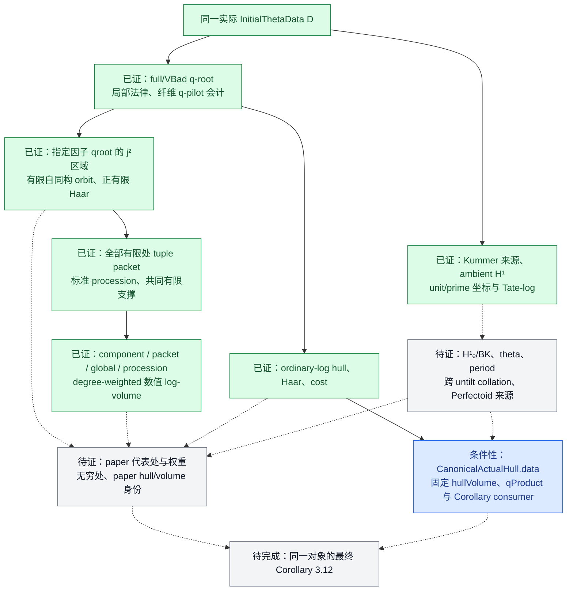

# Scene1 进度总览 2

已完成证明只保留结论；未完成义务和负面证据保留详细范围、条件和证据。

### 状态判定

| 标记 | 状态       | 使用条件                                                 |
| ---- | ---------- | -------------------------------------------------------- |
| 🟢   | 已闭合     | 本行精确义务已证明，所需实际输入已落实，相关验收已通过   |
| 🔵   | 条件性完成 | 定理及其显式条件已验证，但条件尚未从目标实际数据全部推出 |
| 🟡   | 部分完成   | 已有可引用子结果，仍缺构造、比较或身份等式               |
| ⚪   | 未建立     | 尚无满足本行要求的已验收构造或证明                       |
| 🔴   | 路线已排除 | 已证明某条具体路线不成立；必须写出排除范围及所用条件     |

“已闭合”只对该行声明的范围有效。局部构造闭合，不自动关闭所属最终闸门。
条件性反例不记为无条件反例；一个实际数据适配器不记为完整真实满足模型。
不按文件数、声明数或 S1 编号计算总完成百分比。

## 当前结论

| 项目 | 当前值 |
| --- | --- |
| 更新日期 | 2026-10-19（Asia/Shanghai） |
| 最近完成的数学单元 | actual de Rham θ-fiber 的求值像、tensor 单点、有限 factor orbit 及其 normalization hull；本次交付 `IutInitialThetaDeRhamFiberHull.lean` |
| 数学证明基线 | S1.503 及未编号的 q-root 局部法律、VBad 限制族、有限 factor automorphism 区域、指定因子区域、全部 tuple packet、三层 log-volume 和 de Rham θ-fiber/hull 局部法律；以 [SOURCE_LEDGER](../ArithmeticTeichmullerSpaces/SOURCE_LEDGER.md) 的声明为准 |
| 最近已推送单元 | `4a80562`：actual de Rham θ-fiber、tensor 单点、factor orbit 与 normalization hull；此前为 `30ce5fa` 的 de Rham 求值到旧 tensor container，均已通过最终四项检查并推送 |
| Scene1 整体 | **未完成；最终闸门关闭 0/4** |
| 数学工作状态 | 真实 q-root 来源及局部/纤维会计、ambient H¹ 的 log/valuation 坐标、actual ordinary-log hull 消费者、de Rham θ-fiber 到旧 tensor container 的精确求值和局部 hull 身份已建立；有限处 container 与三层数值 log-volume 已有完整 proof term |
| 当前推进位置 | 从同一 D 的 de Rham fiber / finite-place container / packet / procession，继续比较 Joshi paper carrier、代表权重、真实 theta locus 和 paper volume；另须落实 `CanonicalActualHull.AnalyticInput` 的来源 |
| 尚未接通的主要连接 | H¹ₑ/BK/crystalline、跨 untilt collation、period/Perfectoid 的共同来源、论文代表处与权重、无穷处贡献、ordinary-log hull / finite container 到 paper thetaVolume 的身份、最终 3.12 |
| Prologue 边界 | R5；本轮 Core 假设增量 0，未改既有定理类型或独立依赖 |
| 最新工程验收 | de Rham fiber/hull 新叶、Checks.SceneBounds、Axioms.SceneBounds、Act1Scene1 四项通过；20/20 新声明及 2950 个打印声明通过公理白名单；537 个可达本工程模块的静态导入边界通过 |

阅读顺序：先看四个闸门，再看当前路线和关键子结果，最后查看未完成义务与负面证据。
本总览不以单元数量计算总完成率，详细待办见[具有明确参考来源指示的证明义务](具有明确参考来源指示的证明义务.md)。

## 四个最终验收闸门

G1–G4 依次对应[开发计划 §3](开发计划.V1Act1Scene1.md#3-scene1-形式冻结闸门)的四项要求。
每行的“已有结果”概括子结果，不表示该闸门已经关闭。

| 闸门 | 当前状态 | 已有结果 | 关闭所需的剩余工作 | 证据入口 |
| --- | --- | --- | --- | --- |
| **G1：目标与归一化冻结** | 🟡 部分完成 | general-degree raw/degree-normalized reference 与 grouped weighted paper-source 等式；actual tuple 权重总和 1、tensor dimension 消去、packet/global/procession log-volume 与非正符号已证 | 将当前 raw q-term、Joshi paper q-term、选定 thetaVolume 的载体、权重及归一化统一冻结；本次 reference 形式的 packet 公式尚不等于 Joshi relative-degree 代表权重 | S1.489–503；`IutInitialThetaFinitePacketLogVolume.lean`；负面证据 |
| **G2：真实来源模型装配** | 🟡 部分完成 | 同一 D 的 full-support / VBad q-root、任意下方坏处的幂与估值法律、完整纤维会计；ambient H¹ 连续线性坐标、Tate-log 与 q-root 方向比较已证 | 共同构造真实 thetaScaling、period、Perfectoid bridge、H¹ₑ/BK 和跨 untilt collation；证明论文类与实际来源一致 | S1.452–457、S1.466–470；q-root 局部法律与 VBad family 来源条目 |
| **G3：论文处集与重数会计** | 🟡 部分完成 | full-support 的 selected/omitted 及 coefficient defect 分解、large-prime 条件性 coverage、VBad 限制族的无额外 coverage 纤维等式；全部 torsion-field tuple 权重与质量已证 | 证明 actual selected carrier 与论文 `V_p^oss/L'` representatives 对应，闭合代表重数、relative degree、mixed-moduli descent；保留已证明不能删除的缺陷与 degree 因子 | S1.471–492、S1.496–500；`IutInitialThetaVBadQRootFamily.lean` |
| **G4：实际 theta-volume 与最终连接** | 🟡 部分完成 | actual ordinary-log hull 的 qProduct 下界及 canonical Corollary consumer；de Rham θ-fiber 的求值像、有限 factor orbit、normalization hull、指定因子 j² 区域、全部 tuple packet、标准 procession 与三层 log-volume 已证 | 实际 theta locus/BK/untilt 来源、paper holomorphic hull/volume 身份、无穷处或其消去、完整 RHSData 与最终 3.12 联合验收仍缺 | S1.493–503；`IutInitialThetaDeRhamFiberHull.lean`、`IutInitialThetaFiniteFactorRegion.lean`、`IutInitialThetaFinitePacketRegion.lean`、`IutInitialThetaFinitePacketLogVolume.lean` |

qLogTerm 符号问题按用户决定暂作笔误处理，等待作者回复后再讨论。
本总览不把该问题列为当前停工项；G1 的其他归一化和来源义务仍保留。

四个闸门关闭后，还须通过[计划 §4 的最终审计和推送验收](开发计划.V1Act1Scene1.md#4-审计和推送验收)，才能宣布 Scene1 完成。
单个单元的检查和推送通过，不等于该最终验收已完成。

## 当前证明路线

下图展示已经建立的两条实际构造链及其尚缺的汇合关系，不是完整 Lean 导入图。
实线表示已有构造或条件性消费者，虚线表示尚待证明的来源比较。



### 关键子结果与缺口

| 路线位置 | 状态 | 已证明范围或验收缺口 | 所属闸门／证据 |
| --- | --- | --- | --- |
| Tate、连续 H¹ 和 Kummer 基础 | 🟢 已闭合 | 实际 Tate 基、连续 cocycle、标准 H¹ 系数比较、root descent 已证 | G2/G4；S1.336–345 |
| ordinary-log principal-unit 与 integral carrier | 🟢 已闭合 | 饱和/线性/连续 log、integral-image intersection、p* 缩放同构及 actual normalized integral witness 已证 | G1/G4；S1.359–425；`IutInitialThetaNormalizedIntegralLog.lean` |
| actual ambient H¹ 坐标与 Tate-log | 🟢 已闭合 | 原拓扑上 `H¹ ≃L[ℚₚ] completion × ℚₚ`；log(p)=0 分支及核为实际 q-root 线的 Tate-log、商比较、连续性已证；actual q-root 与 normalized 类线性独立 | G2/G4；S1.452–457、S1.466 |
| full-support 与 VBad q-root family | 🟢 已闭合 | 任意下方实际 VBad 处的 `2ℓ` 幂方程、标准 ordp 公式与坏特征法律；VBad 限制族取 1 于支撑外，其全部 torsion-place 纤维和及全局 log-sum 精确恢复实际 absLogQ | G2/G3；`IutInitialThetaQRootFamilyLocalLaws.lean`、`IutInitialThetaVBadQRootFamily.lean` |
| selected/omitted 与代表系数会计 | 🟢 已闭合 | 原 full support 的分解、缺陷公式与严格正性已证；large-prime coverage 结果保留其选择及大小条件 | G1/G3；S1.475–492 |
| ordinary-log hull 与 canonical actual bundle | 🔵 条件性完成 | 同一 D 固定 ordinary-log hullVolume、raw q-term、q-family、qProduct 下界和 Corollary consumer；剩余 theta/period/Perfectoid 法律由 AnalyticInput 接收 | G1/G2/G4；S1.493–503；`IutInitialThetaCanonicalActualHullData.lean` |
| finite factor orbit / 指定因子 j² 区域 | 🟢 已闭合 | 实际有限 tensor 自同构、normalization 稳定、紧性与正有限 Haar；指定因子缩放及坏特征外恢复 normalization 已证 | G4；`db8dc46`、`17eb097` |
| actual de Rham θ-fiber / tensor image / normalization hull | 🟢 已闭合 | 对原 B_dR⁺ 残值子环的完整 θ-fiber 证明非空及 primitive·b+pilot 表示；求值像是原 qrootAt^(j²) 单点，指定 tensor 因子像是旧 scaleElt 单点；factor orbit 等于旧点轨道且 Haar 为零，其 normalization hull 等于旧 leastHull，紧、Haar 正有限并包含旧 thickened region | G2/G4；`4a80562`；`IutInitialThetaDeRhamFiberHull.lean` |
| 全部有限处 tuple packet 与标准 procession | 🟢 已闭合 | 每个素数上全部 tuple、非空、显式 witness、紧性、普通乘积测度、`ellStar=(ℓ−1)/2` 与共同有限支撑已证 | G3/G4；`223ff40` |
| finite tuple 的三层数值 log-volume | 🟢 已闭合 | local-degree tuple 权重质量 1、tensor dimension 消去、productMeasure 对数公式、有限素数和与 procession 平均及非正符号已证 | G1/G3/G4；本次 `IutInitialThetaFinitePacketLogVolume.lean` |
| paper carrier / weights / representatives | 🟡 部分完成 | 实际 selected/full carriers 及比较界已有；尚缺论文 `V_p^oss/L'` 的完整来源身份与 relative-degree / multiplicity 对齐 | G3；S1.471–500 |
| H¹ₑ/BK/crystalline/period | ⚪ 未建立 | ordinary Kummer/log 已证；尚无与论文 H¹ₑ/BK 对象的实际比较，参考 iut 没有可直接移植 Lean proof；Joshi 论文提供构造规格 | G2/G4；`JT-SCENE1-CANONICAL-ACTUAL-HULL-DATA`、来源义务清单 |
| 跨 untilt theta locus、paper hull/volume、无穷处 | ⚪ 未建立 | 当前有限处 container 尚未识别为论文 theta locus；尚缺跨 arithmeticoid collation、paper hull/volume 比较、无穷处区域或消去证明 | G2/G4；来源义务清单 |

### 最新会计公式及适用范围

令 `Kt = D.prime.torsionField`，`N=[Kt:ℚ]`；capsule 有 `m=j+1` 个标签，`c` 遍历同一有理素数上全部处的 tuple。记 `d_c` 为实际 tensor 的 `ℚₚ` 维数，`R_c` 为指定因子缩放后的有限自同构区域，`μ_c` 为 normalization 测度取 1 的实际 Haar。已证明

```text
weight(v) = [Kt_v : ℚₚ] / N
Σ_v weight(v) = 1
weight(c) = Π_i weight(c_i) = d_c / N^m
Σ_c weight(c) = 1
componentLog(R_c) = log(μ_c(R_c)) / d_c
packetLog(R) = Σ_c weight(c) · componentLog(R_c)
             = log((Π_c μ_c)(R)) / N^m
```

各 `μ_c(R_c)` 正且有限，区域位于 normalization，所以 packet log 不大于零。坏特征外所有区域恢复 integral 基准，packet log 为零，因此 global log 是有限素数和。procession log 为这些 global log 在 `j=1,…,ellStar` 上的平均，且 `-|processionLog| = processionLog`。

这条等式连接的是当前完整 torsion-field tuple 的 local-degree 权重；还须证明它怎样对应 Joshi III `ss:weighted-vol` / `eq:weights` 的所选处及 relative-degree 权重。它也没有把有限 container、ordinary-log hull 和论文 theta locus 宣布为同一对象。

### 已排除路线：避免重复投入

| 具体路线                                                  | 状态与排除范围                                                              | 当前应保留的工作方向                                          | 证据                     |
| --------------------------------------------------------- | --------------------------------------------------------------------------- | ------------------------------------------------------------- | ------------------------ |
| 用旧 weighted normalization 直接覆盖一般数域              | 🔴 当前路线要求额外 finrank=1，不能完成一般数域模型                         | 来源驱动的归一化复审与真实模型装配                            | S1.270                   |
| 把 VBad 去权系数直接补成 1                                | 🔴 实际系数在指定条件下严格小于 1                                           | 保留实际 coefficient，加权重审 target/volume 会计             | S1.282–283、S1.320      |
| 令 target qLogSum 等于未加权 selectedPaperSum | 🔴 degree-one 旧路线上存在严格 gap；general-degree raw 仍有 degree-scaled 严格 gap | 保留实际 coefficient、degree 及 omitted contribution，使用已证加权恒等式 | S1.356–357、S1.489–492 |
| 把 signed Haar logMeasure 直接等同旧 `link.logVolume`   | 🔴 actual signed log-volume 为负，而旧 transfer 要求非负                    | 使用 negative-log cost，继续证明论文 volume 身份              | S1.321–322、S1.405–406 |
| 将 raw-norm weighted region 无条件当作 paper region       | 🔴 区域函数存在要求 weighted degree 恒定                                    | 从真实 paper norm、处集和 residue-degree 证明条件，或改写载体 | S1.439                   |
| 把 q-root 自身 Kummer 类当作 normalized principal-unit 类 | 🔴 q-root 类不在 saturated image，且不在 normalized ℚₚ 线                 | 保留 unit/prime 分解，分别追踪两个实际类                      | S1.440、S1.451           |

这些结果排除的是表中具体装配路径，不是 Corollary 3.12 本身。

## 未完成证明义务

### G1：目标、符号和归一化

1. **冻结 q-term 的来源语义。** 当前工程 `qLogTerm` 使用 `-log(qFactor)`，论文 Corollary 3.12 字面式存在相反符号；用户已决定暂按笔误处理，但来源审查和作者确认尚未完成。
2. **统一 raw、degree-normalized、paper-normalized 三层。** 现有 general-degree reference/grouped-source 恒等式和 finite tuple 维数消去已证；仍须在最终 paper carrier 上对齐 global degree、`p*`、`2p`、residue-degree、代表权重与选定 volume 的完整表达。
3. **冻结 `thetaVolume` 的对象。** 必须确定它是 actual Haar volume、negative-log cost 的指数，还是不同 untilt 的论文体积，并证明与实际 hull 的关系。
4. **统一消费者。** `Corollary312`、q-family、packet/hull、volume transfer 和最终目标必须共享同一 carrier、权重和符号。

### G2：真实来源模型

1. **共同 analytic 来源。** 同一 D 的算术/q-root、ordinary-log hull、有限处 container 已能实际构造；`CanonicalActualHull.AnalyticInput` 仍接收 `placeData`、`bridge`、`thetaScaling`、`periodMap`、`normalization`、`perfectoidBridge`、`theta_log_shell`。须从同一论文 theta/untilt 来源产生这些字段，而非把现有 bundle 称为联合真实模型。
2. **H¹ₑ/BK 身份。** 需要证明当前 ambient `unitsSubspace` 或明确替代载体与 H¹ₑ/Bloch–Kato 相同；若不相同，必须改写消费者。ordinary log 和成员性不能自动给出该身份。
3. **crystalline/Frobenius/period。** 需要实际 Fontaine/BK 数据、映射及核像等式，以及全局 product-formula period map 到本地标量 `theta.period` 的比较；参考工程没有可直接移植的完整对应声明。Prologue 通用 Fontaine theta/untilting 法律已有，不列为从零重做。
4. **different/untilt/descent。** 需要连接 completion valuation、论文不同 untilt、period 和 descent，同时保持 q-order、residue-degree 和 volume 会计一致。
5. **最终 Kummer 来源对象。** S1.446 的 span=ambient H¹ 不证明论文所需类来自指定 single field element、untilt 或 H¹ₑ。

### G3：论文处集、代表元和重数

1. 证明 selected finite-place carrier 与论文 `V_p^oss`、`L'` representatives 的来源等式，或给出明确替代映射。
2. 逐项闭合 representative multiplicity、packet weight、place weight、residue degree、tensor dimension 的乘法会计。
3. 对 full-support 路线，保留 large-prime coverage 的前提或 omitted contribution；对已构造的 VBad 限制族，其 exact fiber accounting 已不要求 full support 等于 VBad。论文 carrier 选择仍须统一，不能删掉原 full-support 的额外贡献。
4. 从真实 paper norm、moduli degree 和不同处集推出 S1.439 的 weighted-degree 恒定条件，或重新定义 region 载体。
5. 将已证 full torsion-field tuple 的 local-degree / tensor dimension 会计，与论文所选代表处的 relative-degree 权重和无穷处归一化接到同一目标求和。

### G4：theta-volume、Corollary 3.12 和最终验收

1. 给出 actual ordinary-log hull 或 finite q-root container 到论文 theta locus / holomorphic hull / `thetaVolume` 的来源等式或足够比较。actual canonical bundle 已定义 `thetaVolume=hullVolume D`；缺的是该对象与论文 volume 的身份，不是本地字段等式。
2. 消费已证有限处 packet/procession 长度、正权质量、有限支撑及 log-volume 等式，完成 paper 权重、无穷处及 q-sum 的最终比较；保持 ordinary-log hull cost 与有限 container 的记账各自明确，证明所需连接。
3. actual canonical target、q-family、ordinary-log volume 与 Corollary consumer 的接线已存在；须证明其 AnalyticInput 和论文身份从共同真实来源满足，并完成完整 RHSData。
4. 用同一个对象同时满足 G1、G2、G3、G4，而不是保留互不连接的局部适配器。
5. 所有最终声明冻结后，再执行完整 ImportAudit、逐名 checks/axioms、无 `sorryAx`、`git diff --check` 和最终推送验收。

## 负面证据

负面证据只排除下文写明的路线；它们不自动证明论文命题错误，也不允许把条件性结果升级为最终定理。

### S1.305：Corollary 3.12 字面式符号冲突

- **证据：** 在普通实数 log 和 actual contracting q-root 解释下，论文字面右端 `-∑ log |q_w^(1/(2ℓ))|` 为正，左端 `-(1/n)|log(volume)|` 不大于零。
- **排除：** 该组符号解释下的字面不等式不能成立。
- **不能推出：** 不证明论文在其他 carrier、untilt 或符号约定下错误；不能无记录地反转工程 `qLogTerm`。
- **当前决策：** 按用户决定暂作笔误，等待作者回复；不作为当前停工项。

### S1.243：theta/logVolume 与 contracting q-root 的符号冲突

- **证据：** 当前 `Scene1Input` 的 FirstAxiom/VolumeTransfer 强制 `logVolume ≥ 0`；actual canonical contracting q-root 的 ordinary log-volume 在同一解释下为负。
- **排除：** 不能把该 q-root norm 直接作为当前 theta base norm，不能用普通 `norm_pow` 代替论文不同 untilt 的估值关系。
- **不能推出：** 不排除另一个 theta lift、different untilt 或 negative-log cost 解释；不应直接反转 Core 字段或用 reciprocal 替代 q-root。

### S1.321、S1.405：signed Haar logMeasure 不能直接填入旧 VolumeTransfer

- **证据：** actual ordinary-log generated hull 在正长度时的 Haar log-volume 严格为负；旧 transfer 对非负 packet/hull 权重要求 `logVolume ≥ 0`。
- **排除：** 不能把 signed Haar logMeasure 直接当作旧 `link.logVolume` 的生产者。
- **可保留路线：** 使用 `-log(volume)` 作为非负 actual cost；S1.406 已构造有限 cost carrier 和 transfer producer。
- **不能推出：** 不等于论文 `thetaVolume` 必须错误；negative-log cost 与论文 volume 的身份仍未证明。

### S1.420–421：unscaled integral-log image 不等于 p*-scaled shell

- **证据：** 原 integral ordinary-log image 有界、非零且严格小于 p*-scaled shell；乘以 `p*` 才恢复精确载体，并产生 Haar/log-volume correction。
- **排除：** 不能把 unscaled integral image 直接命名为 scaled shell，也不能删除 p* correction。
- **不能推出：** 不证明 actual 原 integral witness 不存在；`IutInitialThetaNormalizedIntegralLog.lean` 已给原 integral 类及 finite-power 类配 `log/p*` 的 witness 公式。旧 divided rational 类是否有 integral lift，仍按其有限根/整除判据判断；两种 class/map 约定必须区分。

### S1.425：usual small-ball Kummer inverse 与 ordinary log/p* 不相容

- **证据：** 保留通常小球指数、原 class identification 和 ℚₚ-linearity 时，逆映射被唯一强制为 ordinary log；actual 原类的 ordinary log 是 `p*` 乘 paper witness。
- **排除：** 不能同时保留这三项约定，又把 ordinary log/p* 当作同一个 BK inverse。
- **可保留路线：** 保留 S1.424 的显式 normalized ordinary map，从来源比较指数、class identification 或 map normalization。
- **不能推出：** 不能仅凭该冲突宣布 H¹ₑ/BK 不存在或论文错误。

### S1.283、S1.356–357：未加权 paper sum 不能替代 weighted target

- **证据：** 当前 VBad representative coefficient 严格小于 1；canonical degree-one 条件下 `qLogSum = referenceAbsLogQ < selectedPaperSum`。
- **排除：** 不能把 target qLogSum 设为未加权 selected paper sum，不能把 VBad 去权系数补成 1。
- **问题等级：** 当前证据支持“上下游接口契约/实现适配问题”，不足以归类为原作者不可修复错误。
- **可保留路线：** 使用实际 coefficient 加权会计，重审下游 hull/volume 消费者。

### S1.403：参考 iut 没有可直接移植的 H¹ₑ/BK 证明

- **证据：** 参考 iut Lean 工程没有可直接移植的 H¹ₑ/Bloch–Kato 比较 proof；Joshi III `ss:bloch-kato-exp`、`ss:bloch-kato-logarithm`、`th:thetam-construction` 给出明确论文构造及外部依赖，但本地 ordinary Kummer/log 尚未与这些对象识别。
- **排除：** 不能通过简单移植参考工程代码关闭 H¹ₑ/BK 义务，不能把 ambient `unitsSubspace` 改名为 H¹ₑ。
- **剩余工作：** 独立建立来源可追溯的形式接口和实际比较定理。

### S1.404：Prologue obligation 构造器不能作为证明来源

- **证据：** `Prologue/Obligations/Constructors.lean` 的 `build_*` 构造器是 `sorry` 占位，Scene1 计划明确禁止导入该模块。
- **排除：** 不能用这些构造器补齐真实 theta、period、volume 或联合模型。
- **不能推出：** 这不是数学命题的反例，只是独立工程原则下的来源拒绝。

### S1.440、S1.451：q-root 类与 normalized principal-unit 类不能混用

- **证据：** actual q-root 的 field-element Kummer 类 norm<1，不在 saturated Kummer image；normalized principal-unit 类在 saturated image、在 ambient `unitsSubspace`，且 q-root 类不在其 `ℚₚ` 单生成 span。
- **排除：** 不能把 q-root 自身 Kummer 类当作 `1+p*·qroot` 产生的 normalized 类，不能用二者互换完成 H¹ₑ/BK 或 prime-line 识别。
- **不能推出：** 不证明 q-root 类不是论文所需的另一个 untilt/prime-line 类；只排除当前两个实际类的混用。

### S1.439：raw-norm weighted region 的恒定条件

- **证据：** weighted region volume 函数存在的充要条件是 weighted degree 恒定；selected fibre 下归结为 moduli local degree 恒定。
- **排除：** 不能无条件把当前 raw-norm region 当作一般 mixed-moduli paper region。
- **剩余工作：** 从真实 paper norm、处集和 residue-degree 数据证明恒定条件，或重新定义 region 载体。

### S1.489–492：general-degree raw target 仍不能消去 paper defects

- **证据：** 保留实际 Tate/source 对齐时，general-degree raw qLogSum 含 `[D.F:ℚ]` 因子；large-prime 路线上有精确恒等式 `raw qLogSum + degree·(coefficient defect + omitted paper mass) = degree·full paper sum`，且实际 VBad 非空给严格 defect。
- **排除：** 不能将 raw qLogSum 直接设成无缺陷的 degree-scaled paper sum，也不能只靠除去 global degree 就删除 representative defect。
- **可保留路线：** S1.496–500 的 degree-normalized reference/grouped weighted-source 恒等式与 S1.493–503 的 actual hull 消费者；论文 carrier/weights 身份仍单独验收。

## 本次验收与工程边界

本次 de Rham θ-fiber/hull 单元最终验收如下；详细声明与资源记录见 SOURCE_LEDGER 的 `JT-SCENE1-INITIAL-THETA-DE-RHAM-FIBER-HULL`。

| 检查 | 结果 | 耗时 | 进程组峰值 RSS |
| --- | --- | --- | --- |
| 新叶 IutInitialThetaDeRhamFiberHull | 通过，无错误或 warning | 119.498 秒 | 9,268,328 KiB |
| Checks.SceneBounds | 通过 | 135.888 秒 | 9,434,856 KiB |
| Axioms.SceneBounds | 通过；20/20 新声明、2950 个打印声明在白名单内 | 124.654 秒 | 9,416,580 KiB |
| Act1Scene1 聚合 | 通过 | 119.569 秒 | 9,269,460 KiB |

最终四项合计 499.609 秒；编辑期一次类型推断失败和一次 linter 清理复验后通过，本轮 6 个直接 Lean 任务累计 745.682 秒（5 成功、1 失败），没有 heartbeat 超时。公理仅 `propext`、`Classical.choice`、`Quot.sound`，无 `sorryAx`；静态导入边界覆盖 537 个本工程模块，未引入 Obligations、Candidate、Scene2、Act2 或 `Iut.*`。

所有任务固定 CPU 0–13、`LEAN_NUM_THREADS=10`、Lean `-j1`，实际并发 worker 峰值 1。每 0.5 秒采样进程组 RSS，85 GiB 停止线未触发；用户上限 90 GiB。使用 `lake env lean -j1 -o` 和现有预编译依赖，未冷建、清缓存或重编 Mathlib。冻结 Lean `v4.35.0-rc3`、Mathlib `389347a7c1cfa76f6bd5be2ca35d4cb621610ad3` 已核对。

- 来源义务清单只维护复选框；本总览此次按用户明确指令更新。
- `docs/开发计划.V1Act1log5.md` 只记录动态边界变更和负面证据，本轮没有修改它。
- 常规来源和验收登记写入 SOURCE_LEDGER；不要求其他进度文档同步更新。
- `docs/Email.txt` 仍是独立草稿，不属于数学证明。
- 最近单元的验收只支持 de Rham fiber、tensor image、factor orbit 和 normalization hull 的精确局部结论；它没有关闭论文 theta locus、H¹ₑ/BK、跨 holomorphoid 或最终 3.12 义务，最终四闸门仍为 0/4。

## 最终完成条件

只有同时满足以下条件，才能把 Scene1 标记为完成：

1. G1 的目标、符号和归一化冻结，并由来源审计支持。
2. G2 的真实 `InitialThetaData/TateFamily`、H¹ₑ/BK、period、different/untilt 和 Kummer 来源链共同实例化。
3. G3 的论文处集、representatives、重数、residue-degree 和 weighted carrier 会计闭合。
4. G4 的 actual `thetaVolume`、packet/hull accounting 和 Corollary 3.12 连接闭合。
5. 最终 ImportAudit、checks、axiom 白名单、无 `sorryAx`、`git diff --check` 和推送验收通过。
