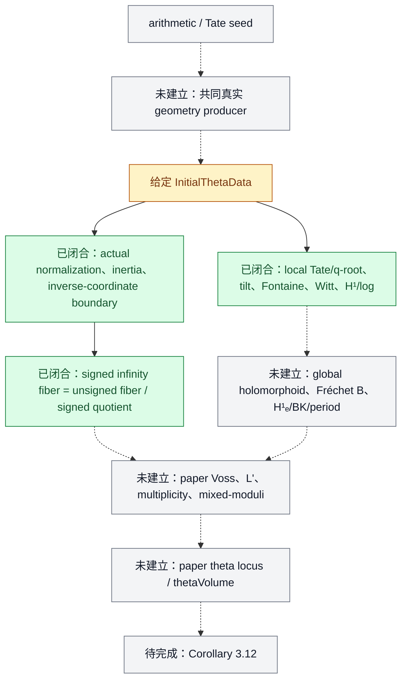

# Scene1 进度总览 2

本文件以 2026-11-06 的 [Scene1进度总览](Scene1进度总览.md) 为上一份基线，记录
截至 2026-11-07 的真实验收状态。已完成部分只保留结论；未完成证明义务保留目标、
来源、当前支撑和缺失的身份证明。

### 状态判定

| 标记 | 状态 | 使用条件 |
| --- | --- | --- |
| 🟢 | 已闭合 | 本行精确范围已有 proof term，实际输入已落实，相关验收已通过 |
| 🔵 | 条件性完成 | 定理及显式条件已验证，但条件尚未由目标实际数据产生 |
| 🟡 | 部分完成 | 已有可复用子结果，仍缺构造、比较、身份等式或来源装配 |
| ⚪ | 未建立 | 尚无满足本行要求的已验收构造或证明 |
| 🔴 | 路线已排除 | 仅排除表中明确路线，不构成对最终数学命题的否定 |

局部构造的闭合不关闭所属最终闸门。实际 carrier、条件性 consumer 和通用 Mathlib
定理不自动成为论文对象或真实 producer。总完成率不按文件数、声明数或复选框数计算。

## 当前结论

| 项目 | 当前值 |
| --- | --- |
| 更新日期 | 2026-11-07（Asia/Shanghai） |
| 数学代码基线 | `aa9fd9b`；其后的总览刷新仅修改本文，`main` 与 `origin/main` 同步 |
| 上一份总览 | `docs/Scene1进度总览.md`，基线日期 2026-11-06 |
| Scene1 整体 | **未完成；G1–G4 关闭 0/4** |
| 父义务 | [证明义务清单](具有明确参考来源指示的证明义务.md) 的 15 项全部为 `[ ]` |
| Prologue 边界 | R5；四项 source laws 由 Scene1 producer 承接，不能作为 Core 已证明输入 |
| 最近推进位置 | 同一实际函数域的无穷远闭点、环境赋值、signed 中心和 signed 轨道商 |
| 最终缺口 | 共同真实 producer、论文 `B`/ρ-norm、H¹ₑ/BK、论文处集与 `L'`、theta locus/`thetaVolume`、最终 Corollary 3.12 |

## 已完成的局部结果

以下项目只概括已验收的局部结果，不表示父义务关闭：

- 数域、有限处、Tate 参数、q-root、completion、tilt、Fontaine、Witt、`B_dR`、actual
  H¹/Kummer/ordinary-log 和有限、无穷、adelic 会计链已有 proof term。
- actual normalization、分支外比较、呈示范畴的全局 pullback、signed fixed-ring descent、
  actual inertia quotient 及其固定域作用已有验收；这些结果不产生任意 `AG/TG` 的 geometry producer。
- standard/actual bounded Witt Frobenius 的 function-ring laws、numerator/presentation
  bridge、stage-00 interface、cached map 和 source operation dictionaries 已有独立验收；
  这些是 Scene1/Derived 局部桥接，不是 actual completion 或论文 `B` 的身份证明。
- 既有条件性 Corollary consumer、q-pilot、hull、Haar/cost 和 weighted accounting 已可消费显式输入。
- 2026-11-07 新增的逆坐标图、环境赋值和 signed 轨道商结果均已通过 Scene1、Checks、
  Axioms、ImportAudit、AxiomAudit；它们描述实际闭素点边界，不识别论文 cusp。

## 四个最终闸门

| 闸门 | 状态 | 当前已有结果 | 关闭所需的证明 |
| --- | --- | --- | --- |
| **G1：目标与归一化冻结** | 🟡 | raw/degree/weighted 的内部换算、q-product、hull 和 volume 会计已有；符号冲突已登记 | 在同一 paper carrier 上冻结 q-term、局部/全局次数、`p*`、`2ℓ`、无穷处项、`thetaVolume` 和最终 target，且不能保留自由 `logVolume` |
| **G2：共同真实来源与 producer** | 🟡 | 给定 `InitialThetaData` 后的局部 Tate/q-root、perfectoid、Witt、normalization、inertia 和无穷远边界链已有 | 从 arithmetic seed 共同产生 `OrbicurveData`、`LocalThetaData`、`InitialThetaData/TateFamily`、global holomorphoid、period/H¹ₑ/BK 和四项 producer laws |
| **G3：论文处集、代表与重数** | 🟡 | actual finite support、section、prime fibers、selected/omitted mass、内部 weighted regrouping 已有 | 证明论文 `V_p^oss`、`\underline V^oss`、`L'` representative、fiber multiplicity、residue/inertia degree 和 mixed-moduli descent 的同一 carrier 身份 |
| **G4：theta locus、volume 与最终定理** | 🟡 | actual Kummer/ordinary-log hull、Haar/cost、packet/hull 和条件性 consumer 已有 | 用 H¹ₑ/BK、theta-value、holomorphoid marking 识别 paper locus，证明 paper `thetaVolume`，再给出无自由 producer law 的 Corollary 3.12 |

qLogTerm 的字面符号冲突仍按既有决定暂作笔误处理；不允许静默取反或取 reciprocal。

## 当前路线

## 未完成证明义务

以下 15 项与 [明确来源证明义务](具有明确参考来源指示的证明义务.md) 一一对应。每项的
局部支撑不改变其 `[ ]` 状态。

### Prologue/Core 来源义务

#### 1. 实际 perfectoid bridge 的来源适配（⚪）

目标是从真实 finite place、局部整数环、untilt 和 Fontaine theta 产生同一输入的
`PerfectoidPlaceData`、`PerfectoidBridgeData`，并证明 place support、coefficient map、
局部法律与同一个 `InitialThetaData`/holomorphoid 相容。现有 completion、tilt、Fontaine、
Witt 和 canonical bridge 是给定数据上的局部 proof；它们没有证明这些对象来自论文
holomorphoid，也没有共同 producer。

来源：Joshi I `def:arith-hol-strs`、`def:untilt-galois`，Joshi III §2，
`refer/JoshiTeich/Arithmetic Holomorphic Structures.tex` 的 perfectoid 段落，及
Mathlib `Untilt.lean`、`FontaineTheta.lean`。关闭条件是来源适配 proof term，而不是把
现有 `PerfectoidData` 改名为论文 bridge。

#### 2. Core 载体到真实输入的共同来源证明（⚪）

`AdelicThetaLinkData` 的 q-parameter、places、Tate parameter、height、ramification 和
packet carrier 必须由同一真实输入投影。当前 `ofInitialThetaData`、`ofTateParameters`、
q-norm bridge 和局部 source laws 只证明字段投影及相容等式，不能证明 link、completion、
q-root 和 packet 来自同一 producer。需要共同的 arithmetic seed 到 `InitialThetaData/TateFamily`
来源图，并证明所有字段相等。

来源：Joshi II `th:tate-parameter-as-a-function`，Joshi III `pr:admissible-lifts-tate-params`、
`th:adelic-theta-link`，以及 `refer/iut/Iut/Cor312/ThetaData` 相关文件。

#### 3. 四项 source laws 的正式移交（⚪）

`AdelicThetaLink`、`ThetaLiftLog`、`PacketCollationHull`、`VolumeTransfer` 已从
`PrologueInputLaws` 移到 Scene1 producer 层，但目前仍可由调用者显式传入。未完成的是证明
它们由真实共同来源产生：period/normalization、log-shell、来源支持/collation 和 volume
transfer 必须分别有 producer proof term。兼容适配器消费命题，不构成来源证明。

来源：Joshi III 的 adelic theta link、additive theta pilot、general cohomology、theta
construction、volume lemma；`Act1Scene1/ProducerContracts.lean`。

### Act1Scene1：共同真实 Initial Θ-data 与 G2

#### 4. 实现 `InitialThetaGeometryProducer`（⚪）

生产者必须同时输出与 `AG/TG` 相容的 `OrbicurveData`、`LocalThetaData`、valuation section、
decomposition groups、local covering diagrams 以及 `InitialThetaData.orb/localData`，并与
同一 `F/E/Fbar`、admissible prime、`TateFamily` 对齐。还需证明 `HasCoreUniversally`、
cartesian covering、bad theta-root model、distinguished cusp 和 local `Π_v` 条件。

当前有 reference existence contract、actual normalization、inertia、Cartesian presentation
和无穷远闭点 orbit quotient，但它们没有构造任意真实 geometry 的 producer witness。参考
`modelAG/modelTG` 的 existence 不能实例化当前任意 `AG/TG`。

来源：IUT I Definition 3.1(d)–(f)、Joshi III `se:theta-data` 与 `ss:theta-data-fixing2`、
IUT IV Corollary 2.2、`refer/iut/Iut/Concrete/Existence.lean`、`ThetaData/Orbicurve.lean`。

#### 5. 共同实际 `InitialThetaData/TateFamily` 模型（⚪）

必须把 place carrier、completion embedding、Tate `j` identity、uniformizer、q-order
positivity/coprimality、torsion basis、q-root、Scene1 link 放在同一实际 producer 中。当前
所有这些字段在给定 `InitialThetaData` 上都有不同程度的 adapter 或局部法律，但缺少
arithmetic seed 到整份共同数据的来源等式，也缺少对后续 four source laws 的统一投影。

来源：`refer/iut/Iut/Concrete/Existence.lean` 的 `tateFamily`/`thetaData`，
`AdmissiblePrime.lean`、`TateFamily.lean`，Joshi III `pr:admissible-lifts-tate-params`。

### Act1Scene1：holomorphoid、period 与 H¹ₑ/BK

#### 6. 构造实际 holomorphoid source（⚪）

需要从同一 `InitialThetaData` 产生 untilt、tilt、Fargues–Fontaine/解析点、Berkovich base
point、Tate parameter family 和 anabelomorphic marking，并证明它们与 completion、Fontaine
theta、q-parameter、`PerfectoidBridgeLaws` 的字段等式。当前 local holomorphoid、tilt、
Fontaine 和 actual period 链只覆盖固定输入与局部 carrier，没有 global marking、不同来源
间的相容性，也没有论文 holomorphoid identity。

来源：Joshi I `def:arith-hol-strs`、`def:geom-base-points`、`def:untilt-galois`，
`Arithmetic Holomorphic Structures.tex`，Joshi II–III 的 holomorphoid/adelic Ansatz。

#### 7. 论文 Fréchet `B` 和 ρ-norm（⚪）

必须定义论文使用的 Fréchet period carrier、ρ-norm 和 Tate-log 收敛域，并证明目标形式的
`T_y ⊂ B^{φ=p}`。当前 `A_inf`、Witt localization、`B_dR⁺`/`B_dR`、DVR、bounded/all-radius
completion 和 Frobenius 已在 actual/standard carrier 上验收，但不能直接改名为论文 `B`，
也没有论文 ρ-norm、Fréchet 拓扑和 holomorphoid 来源身份。

来源：Joshi II `pr:teichmuller-lift-A/B`、`thm:theta-pilot-object-appears`、period-ring
段落；Joshi III §5、`ss:log-shells`；`docs/Joshi2审计.md` G2/G4。

#### 8. H¹ₑ/crystalline/Bloch–Kato comparison（⚪）

需要定义 ambient H¹、H¹ₑ、crystalline/Frobenius carrier、comparison map、BK exp/log、
integrality law 和 actual Kummer class 成员性，并明确 integral class 配 `log/p*` 或 divided
rational class 配未缩放 log 的路线。当前 continuous H¹、Kummer、ordinary-log、integral
pilot、normalized witness 和系数映射已有 proof；它们不证明 H¹ₑ 身份、不提供 crystalline
comparison，也不证明论文 theta-value class 与实际类是同一对象。还需证明所选标量和核约定
与论文一致。

来源：Joshi III `ss:bloch-kato-exp`、`ss:bloch-kato-logarithm`、
`ss:bloch-kato-isom-extended`、`eq:bloch-kato-log-class`、`th:thetam-construction`。

#### 9. 跨 holomorphoid/arithmeticoid collation（⚪）

需要定义不同 untilt、holomorphoid、moduli point 之间的 marking、comparison、代表选择
和 cohomology transport，并证明 collation 保持 H¹ₑ/BK/log 数据。当前 factor automorphism、
closure、hull orbit、ordinary singleton collation 只作用于固定 completion tensor，不能
替代跨 holomorphoid 的 Ind1–Ind3 和 global collation，也不能处理 mixed-moduli descent。

来源：Joshi II `th:galois-action-on-adelic-ff`、`cor:global-frobenius`，Joshi III
`pr:general-cohomology-set-const`、Ind1–Ind3，Joshi2 FAQ Questions 23–37。

### Act1Scene1：论文处集、代表与重数

#### 10. 构造论文 `V_p^oss` / `\underline V^oss` carrier（⚪）

必须证明 actual `VBad`、odd q-root support 与论文处集之间的包含、过滤、坏处外行为，
并明确 finite/archimedean support。当前 actual finite support、valuation section、无穷远
闭点载体和 weighted accounting 只证明工程内部 carrier 的有限性与会计，不能直接命名为
论文 `V_p^oss` 或 `\underline V^oss`，也没有论文处集的来源等式。

来源：Joshi III `ss:weighted-vol`、`pr:general-cohomology-set-const`，
`refer/iut/Iut/Concrete/Container.lean`、`Cor312/LogVolume.lean`。

#### 11. 构造 `L'` representative map 和 fiber multiplicity（⚪）

必须给出 representative 选择、finite fiber equivalence、selected/omitted mass、
representative multiplicity 以及 `L'` 下的 residue/inertia degree 关系。当前 canonical
source-to-section map、prime fibers、signed orbit quotient 和内部 regrouping 已验收，
但这些结果尚未证明 image 是论文 `L'`、没有 paper representative 的 multiplicity 来源，
也没有消除 omitted/selected defect。

来源：Joshi III 的 `L'`、representative、weighted volume 段落；Joshi2 Tate divisor 与
extension-degree 公式；`refer/iut/Iut/Concrete/Container.lean`。

#### 12. 闭合 mixed-moduli descent 和 weighted carrier（⚪）

必须在同一 paper carrier 上证明 local degree、residue degree、inertia degree、tensor
dimension、fiber mass 和 coefficient-weighted paper sum 相等，并处理不同 moduli point、
untilt、holomorphoid 的 descent。S1.489–503 和后续 actual accounting 保留 representative
defect、omitted mass、global degree 因子；不能用有限等价或 orbit quotient 静默消除这些项。

### Act1Scene1：theta locus、volume 和最终定理

#### 13. 将 actual Kummer/log hull 识别为 paper theta locus（⚪）

需要 H¹ₑ/BK、theta-value、holomorphoid marking 和 log-shell 的共同身份，并证明 actual
ordinary-log/Kummer hull 是论文 theta locus。当前 actual witness、closure、Haar、cost、
finite packet 和无穷远边界均属工程 carrier；没有论文 theta-value，也没有跨来源 marking，
因此不能把 containment 改名为 locus equality。

来源：Joshi III `eq:bloch-kato-log-class`、`pr:general-cohomology-set-const`、
`th:thetam-construction`；`refer/iut/Iut/Concrete/ThetaRegion.lean`。

#### 14. 证明 paper hull/`thetaVolume` identity（⚪）

必须把 packet、hull、finite volume、archimedean factor、procession average、paper weight
和 `thetaVolume` 接到同一 carrier，并证明正性、可测性、finite support 和全部归一化。当前
actual Haar/cost、coefficient-weighted sum、signed/unsigned 无穷远 orbit quotient 和条件性
volume consumer 已有，但不提供 paper hull、paper weight、procession 或 `thetaVolume` 身份。
`VolumeTransfer` 不能作为目标等式的自由参数。

来源：Joshi III `le:volume-lemma3`、`th:moccor-Mochizuki-form2`；IUT III
`Cor312/LogVolume.lean`；IUT IV Corollary 2.2。

#### 15. 完成最终 Corollary 3.12 proof term（⚪）

必须同时消费 G1 的冻结目标、G2 的共同 producer、G3 的 paper carrier 和 G4 的
theta-volume identity。当前 `cor312_of_scene1_data` 是条件性 consumer；它显式需要
producer laws、paper carrier、weight、volume 或 lower-bound 证书。最终 proof term 不能
把 `AdelicThetaLink`、`VolumeTransfer`、`thetaVolume` 或 paper lower bound 作为调用者自由
输入，也不能通过 `Prologue/Obligations` 引入隐藏构造子。

来源：Joshi III `cor:cor312`、`th:moccor-Mochizuki-form2`；
`refer/iut/Iut/Cor312/Statement.lean`；当前 `Act1Scene1/Corollary312.lean`。

## 已排除路线与身份边界

以下只排除具体路线，不构成论文命题反例：

| 路线 | 排除范围 | 保留方向 |
| --- | --- | --- |
| contracting q-root 直接作为旧 theta base | q-root norm 小于 1，与旧 period/normalization 的非负 `logVolume` 要求冲突 | 另一 theta lift、different untilt 或 negative-log cost |
| signed Haar log-volume 直接等同 `VolumeTransfer` | 正长度 ordinary-log hull 的 signed log-volume 为负 | 证明 actual `-log(volume)` 的 paper identity |
| ambient Kummer/unit carrier 直接命名 H¹ₑ/BK | actual H¹、unit、ordinary-log 不提供论文子空间或 BK map | 构造真实 H¹ₑ/crystalline/BK comparison |
| 固定 completion orbit 代替跨 holomorphoid collation | 固定 tensor 内的 orbit/hull 不能比较不同来源 | 建立 global marking 和 cohomology transport |
| canonical actual carrier 直接命名 `V_p^oss`/`L'` | representative defect、omitted mass、global degree 尚未消除 | 从 paper source 构造代表和 weighted carrier |
| 参考工程 model existence 直接实例化任意 `AG/TG` | 只排除无条件自动 producer，不评价真实 geometry 命题 | 构造真实 geometry producer 和消费者 |

## 后续顺序与验收

按开发计划推进：先完成共同真实 geometry/`InitialThetaData/TateFamily` producer，再完成
holomorphoid、period、H¹ₑ/BK、Fréchet `B`/ρ-norm；随后完成论文处集、`L'`、multiplicity、
mixed-moduli descent，冻结 G1，最后接通 paper theta locus、`thetaVolume` 和 Corollary 3.12。

每个逻辑单元必须通过叶模块、所属 Checks/Axioms、ImportAudit、Act1Scene1 聚合、AxiomAudit
和 `git diff --check`，通过后提交并推送。使用冻结 Lean/mathlib、热缓存、CPU 0–13、
`LEAN_NUM_THREADS=14`、Lean `-j1`，不导入 `Prologue/Obligations`、Scene2 或 Act2 补齐缺失来源。
最终验收完成前，不勾选父义务，不宣布 Scene1 完成。

## 上一份进度总览到现在的新进展简报

上一份总览的状态截点为 2026-11-06 00:07，记录了实际除点域取负；当时 ambient 延拓、
signed quotient、Cartesian cover 和无穷远边界仍待证明。以下按提交顺序概括此后已推送的
局部结果。它们扩展可复用的几何与 Frobenius 桥接，但均未改变 G1–G4 或 15 项父义务状态。

1. **Standard/actual Witt Frobenius 局部桥接（2026-11-06，`6ed9f91` 至 `253c845`）。**
   增加标准 Frobenius 的 RingHom、通用比较和环运算律、标准 bounded localization 的
   presentation/uniqueness，以及 Teichmüller target bridge；actual 一侧增加 numerator
   naturality、bounded map wrapper、条件性 presentation interface、stage-00 interface、
   tilt carrier operation coherence 和 source `Add`/`Mul` dictionary laws。它们分别固定
   Frobenius 的局部表示或操作字典，不证明 actual completion 上的完整 comparison，也不识别
   论文 Fréchet `B`、ρ-norm、period 或 BK 对象。
2. **Signed normalization 与覆盖几何（2026-11-06，`9c16136` 至 `272a83a`）。**
   将函数域取负延拓为 ambient negation 并构造 signed quadratic quotient；证明 signed
   covering fields 线性无交、normalization tensor 为 domain 且目标双有理；证明分支外
   normalized covering square Cartesian，并在 `AffineOrbicurvePresentation` 中证明全局
   pullback；最后证明实际 signed normalization quotient 的 fixed-ring descent。这些结果
   不声称 `coarseFunctor` 保持该 pullback，也不识别 root stack 或任意 `AG.Orbicurve`。
3. **无穷远闭点纤维（`fa895c9`，2026-11-07）。**
   在同一环境函数域改用 `u = (xG)⁻¹`，构造 `k[u]` 积分闭包的 `u = 0` 上方实际闭素点
   纤维，并证明纤维有限、非空、signed 收缩映射满射，以及每个点满足 `v(u) < 1`。这建立
   逆坐标图上的边界载体，不把原 `k[xG]` 图当成无穷远图。
4. **共同 ambient 赋值与中心（`495d2cd`）。**
   从纤维闭素点的 Dedekind 赋值构造环境域 `Ω` 上的实际赋值环 `W`，证明中心公式、常数域
   包含、`v_W((xG)⁻¹) < 1` 和 `xG ∉ W`；同一个 `W` 在 signed normalization 上的中心
   正是原 `infinityFiberMap`。
5. **无穷远 signed 轨道商（`84de696`）。**
   将 signed quotient action 限制到逆坐标 normalization，证明 relative ring Galois law，
   并证明 `infinityFiberMap q₁ = infinityFiberMap q₂` 当且仅当两素点在同一 signed quotient
   轨道中；由此得到 unsigned boundary orbit quotient 与 signed fiber 的等价。

上述三项 11 月 7 日边界几何单元已通过对应的 Scene1、Checks、Axioms、ImportAudit 和
AxiomAudit。无穷远结果仍未把闭素点识别成 `E[ℓ]/M`、几何点或 `AG.Cusp`，也没有构造任意
真实 geometry producer。

资源边界也需保留在进度判断中：actual `CachedInclusion` 曾到约 13.8 GiB 后按停止线终止，
没有生成可验收 `.olean`；完整 actual `PresentationTransfer` 曾触发 Lean kernel
deterministic timeout。因此这些尝试不计作已完成 Frobenius 比较。
