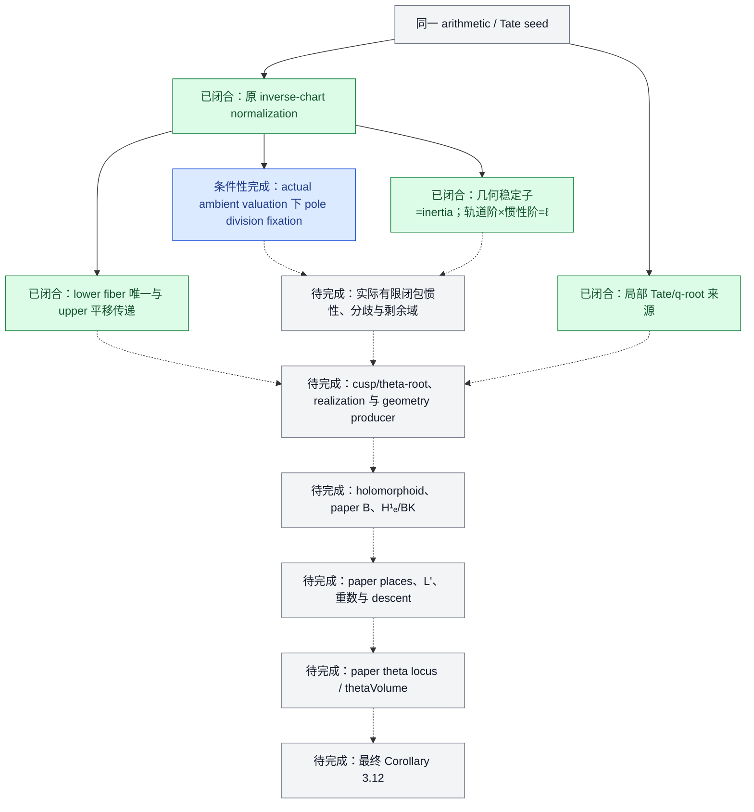

# Scene1 进度总览 4

本文件参考 `/mnt/d/Codex/参考样式.md`，以 [Scene1进度总览3](Scene1进度总览3.md)
的数学基线 `e575744` 为比较起点，记录截至 **2026-11-10（Asia/Shanghai）**、
已推送数学提交 **`a443952`** 的状态。已完成部分只概括精确结论；未完成部分详列
目标、来源、现有支撑和关闭条件。未提交草稿及仅通过叶检查的候选另列，不计作已交付。

### 状态判定

| 标记 | 状态 | 使用条件 |
| --- | --- | --- |
| 🟢 | 已闭合 | 本行精确义务已有 proof term，所需实际输入已落实，相关验收已通过 |
| 🔵 | 条件性完成 | 定理及显式条件已验证，但条件尚未从目标实际数据全部推出 |
| 🟡 | 部分完成 | 已有可复用子结果，仍缺构造、比较、身份等式或共同来源 |
| ⚪ | 未建立 | 尚无满足本行完整要求的已验收构造或证明 |
| 🔴 | 路线已排除 | 仅排除明确条件下的具体路线，不表示最终数学命题为假 |

“已闭合”只覆盖该行陈述。局部 carrier、条件性 consumer、代数纤维或通用引理的完成，
不自动关闭所属父义务。不按文件数、声明数、提交数或复选框数计算总完成百分比。

## 当前结论

| 项目 | 当前值 |
| --- | --- |
| 更新日期 | 2026-11-10（Asia/Shanghai） |
| 已推送数学基线 | `a443952`：同一 seed 的二阶挠点来源与实际无穷远 valuation-inertia consumer |
| 上一份总览 | 总览3；数学状态截点 `e575744`，2026-11-08 |
| Scene1 整体 | **未完成；G1–G4 关闭 0/4** |
| 明确来源父义务 | [证明义务清单](具有明确参考来源指示的证明义务.md) 的 **15 项全部保持 `[ ]`** |
| Prologue 边界 | R5；四项 source laws 归 Scene1 producer，不能作为 Core 已证明的自由输入 |
| 最近已交付的推进 | 实际 lower infinity fiber 唯一、原平移作用传递、几何稳定子等于惯性，以及极点除法点的赋值惯性固定 |
| 当前数学缺口 | 有限正规闭包上的实际惯性消费者、原无穷远分歧指数、剩余域与 cusp 身份，以及完整 geometry producer |
| 其他最终缺口 | holomorphoid、论文 `B`/ρ-norm、H¹ₑ/BK、paper places/`L'`、theta locus/`thetaVolume` 和最终 Corollary 3.12 |
| 当前未交付尝试 | 有限素理想通用桥接仅叶检查通过；实际正规闭包叶检查失败，详见末节 |

当前工作已经从“给定 `InitialThetaData` 后投影局部数据”，推进到从同一 arithmetic seed
构造部分 Tate/q-root 来源，并证明原无穷远 normalization 的具体代数性质。但它仍没有
产生完整 `InitialThetaGeometryProducer`，也没有关闭任何一项明确来源父义务。

## 已完成的局部结果

以下只简列已交付结果及其范围：

| 范围 | 已验收结论 | 仍不代表 |
| --- | --- | --- |
| 局部算术与 period 基础 | 数域处、Tate/q-root、completion、tilt、Fontaine、Witt、`B_dR`、H¹/Kummer/ordinary-log 与 packet/hull 会计已有 proof term | 完整 holomorphoid、论文 period ring 或 H¹ₑ/BK |
| actual Fréchet/Witt 子链 | principal eigen-log 分类、有限 p-division 标量公式、inverse-prime rho 校准、B+ Frobenius 与 all-radius coordinate seminorm 保持 | 论文 `B`、paper rho 或论文 `T_y` 身份 |
| 同一 seed 的局部来源 | Tate family、局部 q-root、uniformizer/valuation、精确 `2ℓ` 阶局部点及其全局 distinguished class 连接（保留正负号） | distinguished cusp、bad theta-root model 或完整 `InitialThetaData` |
| 实际平移与固定域 | 椭圆函数域平移、torsion displacement quotient、有限 Galois 作用和次数 `ℓ`；full-TK lower field 等于 level-one 椭圆基域 | 跨 holomorphoid collation 或论文 representative |
| 实际无穷远代数边界 | 逆坐标进入原 normalization；raw 原点中心；lower fiber 唯一；原 upper fiber 上平移作用传递 | 剩余域次数一、算术 prime stabilizer 平凡或 `AG.Cusp` |
| 几何点与极点惯性 | 原平移几何稳定子等于 prime inertia；几何轨道阶乘惯性阶等于 `ℓ`；实际 ambient valuation 下的条件性除法点固定 | 原有限 prime inertia 已平凡、无条件的 cusp/theta-root 来源 |
| 已有最终消费者 | q-pilot、weighted regrouping、Haar/cost 与 `cor312_of_scene1_data` 可消费显式输入 | 无自由 producer laws 的最终 Corollary 3.12 |

最近三项交付的主要源码入口：
[lower fiber 唯一性](../ArithmeticTeichmullerSpaces/ArithmeticTeichmullerSpaces/Act1Scene1/InitialThetaInfinityTranslationSingleton.lean)、
[原平移几何稳定子](../ArithmeticTeichmullerSpaces/ArithmeticTeichmullerSpaces/Act1Scene1/InitialThetaInfinityTranslationGeometricPoints.lean)、
[实际极点惯性消费者](../ArithmeticTeichmullerSpaces/ArithmeticTeichmullerSpaces/Act1Scene1/InitialThetaInfinityPoleInertia.lean)。

## 四个最终验收闸门

| 闸门 | 状态 | 现有支撑 | 关闭所需的剩余证明 |
| --- | --- | --- | --- |
| **G1：目标与归一化冻结** | 🟡 | raw/degree/weighted 内部换算、q-product、Haar/cost 及符号审计 | 在同一 paper carrier 上统一 q-term、local/global degree、`p*`、`2ℓ`、剩余/惯性次数、无穷处项及 `thetaVolume`，固定最终 target |
| **G2：共同真实来源与 producer** | 🟡 | 同一 seed 的局部 Tate/q-root 来源、actual presentation、normalization、平移固定域和无穷远代数边界 | 实现 presentation 到 `AG.Orbicurve` 的 realization，落实 core/cartesian/cusp/theta-root/local `Π_v`，再共同产生 `InitialThetaData`、holomorphoid、period/H¹ₑ/BK 和四项 source laws |
| **G3：论文处集、代表与重数** | 🟡 | actual section/Voss、coverage 判据、prime fibers、有限/无穷处拆分和内部 weighted accounting | 证明论文处集与 `L'` 身份、实际 coverage、representative multiplicity、residue/inertia degree 与 mixed-moduli descent，处理全部 defect |
| **G4：theta locus、volume 与最终定理** | 🟡 | actual Kummer/log hull、packet/Haar/cost 与条件性 Corollary consumer | 以共同 H¹ₑ/BK、theta-value、marking 识别 paper locus，证明 paper `thetaVolume` 及 lower bound，完成无自由 producer laws 的 proof term |

qLogTerm 的字面符号冲突继续按既有决定暂作笔误处理；这不构成停工要求，也不允许在
最终目标中静默反号或取 reciprocal。G1 的其他来源和归一化义务仍须证明。

## 当前证明路线

下图表示证明连接与缺口，不是完整 Lean 导入图。绿色只表示节点所写的局部范围。

## 未完成证明义务

以下 15 项与 [具有明确参考来源指示的证明义务](具有明确参考来源指示的证明义务.md)
逐项对应。每项均保持开放；“现有支撑”只说明可以复用的结果。

### Prologue/Core 来源义务

#### 1. 实际 perfectoid bridge 的来源适配（🟡）

**目标与来源。** 从同一真实 finite place、局部整数环、untilt 和 Fontaine theta 产生
`PerfectoidPlaceData`、`PerfectoidBridgeData`，并对齐 place support、coefficient map、
局部法律及同一个 `InitialThetaData`/holomorphoid。来源是 Joshi I
`def:arith-hol-strs`、`def:untilt-galois`，`Arithmetic Holomorphic Structures.tex`
的 `lem:perfectoid`、Joshi III 第2节，以及 Mathlib 的 Untilt/FontaineTheta。

**现有支撑。** completion、tilt、Fontaine、Witt 和 canonical bridge 已在给定对象上
证明局部法律；actual Fréchet/Witt 子链也提供局部比较。它们没有指定论文 holomorphoid
或其 geometric base point。

**关闭条件。** 构造来源适配映射，证明同一处、同一 coefficient embedding、同一 untilt
和 theta map 的字段等式，并由该来源实际生产 bridge laws。仅把现有载体命名为“真实
bridge”，或另给一个与 seed 无共同来源的满足模型，均不能关闭本义务。

#### 2. Core 载体到真实输入的共同来源证明（🟡）

**目标与来源。** `AdelicThetaLinkData` 的 q-parameter、places、Tate parameter、height、
ramification 和 packet carrier 必须来自同一个实际输入。来源为 Joshi II
`th:tate-parameter-as-a-function`，Joshi III `pr:admissible-lifts-tate-params`、
`th:adelic-theta-link` 及参考工程 ThetaData 的 Basic/AdmissiblePrime/TateFamily。

**现有支撑。** `ofInitialThetaData`、`ofTateParameters` 和 q-norm bridge 已有投影
等式；总览3之后新增同一 seed 的 Tate family、局部 q-root、uniformizer 和挠点来源。

**关闭条件。** 把这些局部来源接入整份共同 `InitialThetaData/TateFamily`，证明
completion、link、q-root、packet 和 degree 数据的全部字段等式。不能分别构造互不相干的
对象，再把它们作为同一输入的字段。

#### 3. 四项 source laws 的正式移交（⚪）

**目标与来源。** `AdelicThetaLink`、`ThetaLiftLog`、`PacketCollationHull`、
`VolumeTransfer` 已从 Core 抽出，归 Scene1 producer。来源为 Joshi III 的 adelic
theta-link、additive theta pilot、general cohomology、theta construction、volume lemma，
接口见 [ProducerContracts](../ArithmeticTeichmullerSpaces/ArithmeticTeichmullerSpaces/Act1Scene1/ProducerContracts.lean)。

**现有支撑。** 边界拆分和条件性适配器已经完成；它们只消费显式命题。改变 owner、
包装已有 law 或投影 seed 局部字段，都不等于证明四项 law。

**关闭条件。** 分别从共同来源生产 period/normalization、log-shell、支持与 collation、
volume transfer，并证明同一消费者使用这些实际输出。禁止把目标所需的数值关系作为
`VolumeTransfer` 的自由字段重新传入，也不能从 `Prologue/Obligations` 提供它们。

### Act1Scene1：共同真实 Initial Θ-data

#### 4. 实现 `InitialThetaGeometryProducer`（🟡）

**目标与来源。** 对同一 arithmetic curve seed，共同构造与 `AG/TG` 相容的
`OrbicurveData`、`LocalThetaData`、valuation section、decomposition groups、local
covering diagrams 和 `InitialThetaData.orb/localData`。来源为 IUT I Definition
3.1(d)–(f)、Joshi III `se:theta-data`/`ss:theta-data-fixing2`、IUT IV Corollary 2.2，
以及参考工程 Existence/Orbicurve/LocalConditions。

**现有支撑。** actual affine presentations、Cartesian source certificate、normalization
与有限处局部来源已有；新增 full-TK lower field 身份、lower infinity fiber 唯一性、
upper 平移传递性、几何稳定子与惯性等式，以及实际极点赋值惯性消费者。

**仍须逐项证明。**

1. 在实际有限正规闭包中固定除法点坐标与 unsigned cover field，并将原无穷远素点提升到该闭包。
2. 在原 chart 与原 ring inclusion 上证明所需分歧指数；单独处理剩余域及算术 prime stabilizer 中的剩余域自同构因素。
3. 把代数边界与 projective 无穷远、distinguished torsion/cusp、`AG.Cusp` 和 bad theta-root model 作身份比较。
4. 建立 presentation-to-`AG.Orbicurve` realization，落实 `HasCoreUniversally`、
   `AG.IsCartesianSquare`、local `Π_v` 及所有 covering laws 的来源和证明。
5. 将上述输出装配为同一 `F/E/Fbar`、admissible prime 和 Tate family 上的 producer witness。

**关闭条件。** 上述输出必须由同一实际 seed 产生并进入真实消费者。参考
`AnabelianExistence` 是条件接口；`modelAG/modelTG` 的 existence 不能替代任意目标
geometry 的 realization。lower fiber 唯一也不等于 upper prime action 自由。

#### 5. 共同实际 `InitialThetaData/TateFamily` 模型（🟡）

**目标与来源。** 将 place carrier、completion embedding、Tate `j` identity、
uniformizer、q-order positivity/coprimality、torsion basis、odd support、q-root 和
Scene1 link 装入同一实际模型。来源为参考工程 `tateFamily`/`thetaData`、
AdmissiblePrime/TateFamily，以及 Joshi III `pr:admissible-lifts-tate-params`。

**现有支撑。** 新增 seed Tate family、Tate split reduction、同源局部 q-root、
uniformizer/valuation、精确 `2ℓ` 阶局部点和全局 distinguished class 连接，缩小了
“另给一个不相干局部参数”的缺口。

**关闭条件。** 证明这些对象与义务4生产的 `orb/localData` 及整份 `InitialThetaData`
逐字段相同，再接入 link 和四项 source laws。局部 distinguished class 仍须与实际
distinguished cusp/theta-root 数据比较；不能把局部挠点的精确阶直接当作 cusp 身份。

### Act1Scene1：holomorphoid、period 与 H¹ₑ/BK

#### 6. 构造实际 holomorphoid source（🟡）

**目标与来源。** 从同一 `InitialThetaData` 产生 untilt、tilt、Fargues–Fontaine/解析点、
Berkovich geometric base point、Tate parameter family 和 anabelomorphic marking，并
对齐 completion、Fontaine theta、q-parameter 与 `PerfectoidBridgeLaws`。来源为
Joshi I 的 arithmetic holomorphic structures、geometric base points、untilt-Galois
定义及 Joshi II–III 的 holomorphoid/adelic Ansatz。

**现有支撑。** 固定局部输入上的 completion/tilt/Fontaine/period 代数与拓扑链已有。
本期椭圆函数域的 torsion translation 作用于同一函数域，未构造不同 holomorphoid
之间的比较。

**关闭条件。** 给出论文 holomorphoid 的实际来源、几何基点、全局 marking 及其局部化
相容证明，明确同一数据怎样进入后续 period 和 Kummer class。固定 completion 内的
自同构与 transport 不能代替这些输出。

#### 7. 论文 Fréchet `B` 和 ρ-norm（🟡）

**目标与来源。** 构造论文 period carrier、Fréchet 拓扑、ρ-norm、Tate-log 收敛域，
并证明目标形式的 `T_y ⊂ B^{φ=p}`。来源为 Joshi II
`pr:teichmuller-lift-A/B`、`thm:theta-pilot-object-appears` 及 period-ring 段落，
Joshi III 第5节 / `ss:log-shells`；比较问题见 `docs/Joshi2审计.md`。

**现有支撑。** 总览3已记录 actual Fréchet principal eigen-log 的加法等价、有限
`p^k` 根到 `p^-k` 标量、inverse-prime rho 精确值、actual B+ integral Frobenius
及 all-radius coordinate seminorm 保持。本期已推送新增主要位于 geometry/infinity
路线，没有关闭 paper period identity。

**关闭条件。** 证明项目 carrier 与论文 `B` 的代数和拓扑身份，识别 paper rho、
Frobenius、holomorphoid 来源及论文 `T_y`，再证明收敛和成员性。不能把 `A_inf`、
Witt localization、`B_dR` 或 actual-derived Fréchet carrier 直接改名为论文 `B`。

#### 8. H¹ₑ/crystalline/Bloch–Kato comparison（🟡）

**目标与来源。** 构造 ambient H¹、H¹ₑ、crystalline/Frobenius carrier、comparison map、
BK exp/log、integrality law 和 actual Kummer class 成员性。来源为 Joshi III
`ss:bloch-kato-exp`、`ss:bloch-kato-logarithm`、`ss:bloch-kato-isom-extended`、
`eq:bloch-kato-log-class` 与 `th:thetam-construction`。

**现有支撑。** 标准 continuous H¹、Kummer cocycle、实际类、ordinary-log lattice、
integral/normalized witness 和系数映射已有。它们提供 ambient carrier 和局部计算，
没有定义并识别论文要求的 H¹ₑ 或 crystalline comparison。

**关闭条件。** 明确选择 integral class 配 `log/p*`，或 divided rational class 配
未缩放 log；证明该选择的核、torsion、标量和整性约定与论文一致。随后证明 actual
theta-value class 落在正确子空间，BK logarithm 等于所需实际 log，并与义务6、7
的同一 holomorphoid/period 来源相容。不能把系数层单射自动提升为 H¹ 单射。
参考 IUT 工程没有可直接移植的完整 H¹ₑ/BK proof。

#### 9. 跨 holomorphoid/arithmeticoid collation（⚪）

**目标与来源。** 为不同 untilt、holomorphoid、arithmeticoid 和 moduli point 定义
marking、comparison、representative 选择与 cohomology transport，并证明它们保持
H¹ₑ/BK/log 数据。来源为 Joshi II `th:galois-action-on-adelic-ff`、
`cor:global-frobenius`，Joshi III `pr:general-cohomology-set-const`、Ind1–Ind3，
以及 Joshi2 FAQ Questions 23–37。

**现有支撑。** 固定 completion tensor 内的 factor automorphism、closure、hull orbit、
singleton collation 与 Haar monotonicity 已有。本期的 torsion translation 仍作用于
同一椭圆函数域，不是上述跨来源的 collation。

**关闭条件。** 指定可比较的实际来源及各自标记，构造 transport，证明代表选择及
H¹ₑ/BK/log 数据的相容和独立性，再接入 paper collation 与 mixed-moduli descent。
不能以固定 carrier 上的群作用直接提供跨 holomorphoid 法律。

### Act1Scene1：论文处集、代表与重数

#### 10. 构造论文 `V_p^oss` / `\underline V^oss` carrier（🟡）

**目标与来源。** 证明 actual `VBad`、odd q-root support 与论文处集的包含、过滤、
坏处外行为和 finite/archimedean support。来源为 Joshi III `ss:weighted-vol`、
`pr:general-cohomology-set-const`，参考工程 Container/LogVolume。

**现有支撑。** supplied valuation section 的 image injectivity、finite/archimedean 拆分、
selected Voss carrier、prime fibers 与 selected q-root source image 已验收。coverage
判据把所有 concrete fiber maps 满射，等价为
`VBadModuliFinset = OddModSupportFinset`。

**关闭条件。** 证明该 coverage 等式对目标实际数据成立，建立 paper place-set 的来源
等式，并处理坏处外及无穷处。section 的 image 有限、selected source 有成员或现成的
coverage 必要充分判据，都没有证明论文 carrier 已被覆盖。

#### 11. 构造 `L'` representative map 和 fiber multiplicity（🟡）

**目标与来源。** 构造论文 representative 选择、fiber equivalence、selected/omitted
mass、representative multiplicity 及 `L'` 下 residue/inertia degree 关系。来源为
Joshi III 的代表与 weighted volume 段落，Joshi2 Tate divisor/extension-degree 公式，
参考工程 Container。

**现有支撑。** canonical source-to-section map、concrete prime fibers 和内部 regrouping
已有；新增 lower infinity singleton、原 upper fiber 的平移传递性，以及原几何点
stabilizer=inertia 等式。

**关闭条件。** 将原代数/几何 fiber 与论文代表载体作身份比较，证明具体 representative
及其重数、剩余域次数和惯性次数，处理 selected/omitted defect。几何点稳定子等于
惯性不等于算术素理想稳定子平凡；即使后续证明惯性平凡，也仍须处理剩余域自同构因素。

#### 12. 闭合 mixed-moduli descent 和 weighted carrier（🟡）

**目标与来源。** 在同一 paper carrier 上证明 local degree、residue degree、inertia
degree、tensor dimension、fiber mass 与 coefficient-weighted paper sum 相等，并处理
不同 moduli point、untilt 和 holomorphoid 的 descent。来源为 Joshi III weighted
volume/general cohomology，以及 Joshi2 Tate divisor、representative 和 extension-degree
讨论。

**现有支撑。** S1.489–503 及后续 actual accounting 已证明内部恒等式；实际轨道商、
有限 Galois degree 和 residue/inertia 局部公式提供可复用代数输入。

**关闭条件。** 消费义务9–11的来源与身份等式，给出每个 fiber 的实际重数与 degree，
并明确证明 representative defect、omitted mass 和 global degree 因子的处理。
不能由一个有限等价、传递作用或局部 degree 公式静默删去这些项。

### Act1Scene1：theta locus、volume 与最终定理

#### 13. 将 actual Kummer/log hull 识别为 paper theta locus（🟡）

**目标与来源。** 通过共同 H¹ₑ/BK、theta-value、holomorphoid marking 和 log-shell，
识别 actual Kummer/ordinary-log hull 与论文 theta locus。来源为 Joshi III
`eq:bloch-kato-log-class`、`pr:general-cohomology-set-const`、
`th:thetam-construction`，参考工程 ThetaRegion。

**现有支撑。** actual witness、containment、closure、packet、Haar 和 cost 已有。
这些是项目定义载体上的定理，未提供论文 theta-value 或跨来源 marking。

**关闭条件。** 先完成所用 Kummer class 的 H¹ₑ/BK 身份和 theta-value 比较，再证明
paper collation、log-shell、packet/hull 与同一 actual carrier 的相等或目标所需的
精确包含。不能把现有 containment 的名称改为 locus identity。

#### 14. 证明 paper hull/`thetaVolume` identity（🟡）

**目标与来源。** 将 packet、hull、finite volume、archimedean factor、procession
average、paper weight 和 `thetaVolume` 接到同一 carrier，并证明正性、可测性、
finite support 与全部归一化。来源为 Joshi III `le:volume-lemma3`、
`th:moccor-Mochizuki-form2`，IUT III LogVolume 与 IUT IV Corollary 2.2。

**现有支撑。** actual Haar/cost、finite/archimedean accounting、
coefficient-weighted internal sum 和条件性 volume consumer 已有。

**关闭条件。** 消费 paper locus、处集/代表/重数及 descent，逐项识别 paper hull、
paper measure、weight、procession 与 `thetaVolume`；在 G1 的同一符号和归一化下证明
所需 lower bound。`VolumeTransfer` 不能直接规定待证明的体积数值。

#### 15. 完成最终 Corollary 3.12 proof term（🔵：仅条件性 consumer）

**目标与来源。** 同时消费 G1 的冻结目标、G2 的共同 producer、G3 的 paper carrier、
G4 的 theta-volume identity，完成 Joshi III `cor:cor312` /
`th:moccor-Mochizuki-form2` 的目标。参考边界还包括 IUT Statement 的 variant 区分；
当前消费者见 [Corollary312](../ArithmeticTeichmullerSpaces/ArithmeticTeichmullerSpaces/Act1Scene1/Corollary312.lean)。

**现有支撑。** `cor312_of_scene1_data` 证明显式输入足以推出相应结论。它的条件性证明
已存在，但完整实际输入及论文身份尚未产生。

**关闭条件。** 将前14项及 G1 的实际输出接成完整 proof term，消除调用者自由传入的
`AdelicThetaLink`、`VolumeTransfer`、paper `thetaVolume` 或 lower-bound 证书。
导出的目标不得经由隐藏实例、`Prologue/Obligations` 或未说明的 producer law
补齐。最后逐名完成导入、公理、来源与整体范围验收。

## 已排除路线与当前身份边界

| 路线 | 已证明的排除范围或限制 | 保留的方向 |
| --- | --- | --- |
| contracting q-root 直接作为旧 theta base | norm 小于1，与旧 period/normalization 的非负 `logVolume` 要求冲突 | 其他 theta lift、different untilt 或已登记 cost 路线 |
| signed Haar log-volume 直接填入旧 transfer | 正长度 ordinary-log hull 的 signed log-volume 为负 | 负对数 cost；仍须 paper volume 身份 |
| ambient H¹/Kummer/ordinary log 直接命名为 H¹ₑ/BK | 缺少子空间成员性、crystalline comparison 和论文 class 身份 | 建立实际 comparison 与明确的标量/核约定 |
| 固定 completion orbit 或 torsion translation 代替跨 holomorphoid collation | 作用载体和来源范围不同，未构造跨 untilt 的 transport | 义务9的真实标记与比较 |
| canonical section/Voss image 直接称为论文处集或 `L'` | coverage、representative 与 multiplicity 来源尚缺 | 完成义务10–12 |
| lower infinity fiber 唯一就断言 upper 完全分裂 | 唯一性给出原平移传递性，未证明 prime stabilizer、剩余域次数或 inertia 平凡 | 原有限扩张的惯性、分歧和剩余域证明 |
| 几何 stabilizer=inertia 就断言算术 prime stabilizer 平凡 | 几何点固定了剩余域嵌入；算术素理想稳定子还可能作用于剩余域 | 分开证明惯性与剩余域因素 |
| 移植参考 `AnabelianExistence` 就得到目标 producer | 它是条件接口；model existence 不覆盖任意真实 `AG/TG` | 本工程内的 realization 与共同来源 proof term |

这些限制只针对所写的装配路径。编译超时、kernel timeout 和类型错误均不是数学反例。

## 后续顺序与验收边界

1. 先完成原 inverse chart 的有限正规闭包惯性消费者及实际素点提升，得到所需分歧结论，
   再处理剩余域、projective cusp、distinguished torsion/theta-root 与 realization。
2. 将同一 seed 的 Tate/q-root 与 geometry 输出装配成共同 `InitialThetaData/TateFamily`，
   完成 `InitialThetaGeometryProducer`。
3. 接通 holomorphoid、paper period/H¹ₑ/BK 和四项 producer laws，再处理 paper places、
   `L'`、multiplicity、mixed-moduli descent。
4. 在共同 carrier 上冻结 G1，证明 paper theta locus/`thetaVolume` 及最终 Corollary。
   单个局部单元通过，不代替 Scene1 最终整体验收。

编译纪律以仓库 `AGENTS.md` 的现行 MCP-CI 流程为准：主智能体直接提交
稳定主工作区绝对路径并使用 `exclusive: true`；所有 Lean 编译及 review 均交调度器，
不沿用历史手动 affinity、线程数或内存硬限制。首次叶预估固定为 `60s/16GiB`；
后续按回执重估。单叶峰值 RSS 超过16 GiB须拆分，聚合进程树峰值与单叶峰值分别解释。

每个数学单元须通过新叶、所属 Checks/Axioms、ImportAudit、Act1Scene1、AxiomAudit、
实际公理输出 review 和 `git diff --check`，再提交并立即推送。公理审查还须完整解析
输出，不能仅依据退出码0。本总览的文档整理不增加新的数学验收范围。

## 进度总览3到现在的新进展简报

比较区间为 **`e575744..a443952`**。以下已交付项以 Git 提交、源码和相应审计为依据；
仅记录负面证据的提交不计为数学结果。**G1–G4仍关闭0/4，15项父义务仍全部未勾选。**

1. **实际 signed 几何轨道公式和二分已验收（`d6f7823`、`87c3241`）。**
   总览3仍把实际 geometric orbit consumer 列为未验收。现在已把通用 orbit–stabilizer
   桥接应用于原 residue geometric point，得到 signed 几何轨道阶乘惯性阶等于2，
   并得到“轨道阶为1或惯性阶为1”的二分。二分没有选择实际分支，也未给出 cusp 身份。

2. **从同一 seed 派生 Tate 与局部 q-root 来源（`9126808`、`032569c`、
   `18ccc54`、`f000103`、`d819d58`、`94a0ea5`）。**
   新增 Tate split reduction、seed Tate family、同源局部 q-root、uniformizer/所选根赋值、
   精确 `2ℓ` 阶局部点，以及其倍点落入两种 canonical rank-one class 的连接，保留正负号。它们补强共同来源
   的局部段；完整 `orb/localData`、distinguished cusp 和 bad theta-root model仍开放。

3. **实际椭圆函数域平移与有限 Galois degree（`810debd`、`0ea5f71`、
   `6e2ca5e`、`e3df35a`）。**
   构造原 generic point/函数域上的 torsion translation，证明基域固定与 ambient lift、
   实际 Hgp torsion displacement quotient 的指数，以及原平移固定域的有限 Galois
   作用与次数 `ℓ`。这是同一椭圆函数域上的实际作用，不是跨 holomorphoid transport。

4. **平移作用进入原无穷远 normalization，lower field 身份已落实
   （`91b6777`、`54cdc28`）。**
   原 infinity ring/fiber 现有实际 translation action 与 fiber-orbit 比较；full-TK
   translation fixed field 已证明等于 level-one 椭圆基域。后续唯一性使用的是原 lower
   normalization，没有替换为一个无来源的 toy chart。

5. **整个局部赋值环的 prime inertia 与二阶平移前置已证明
   （`e085aa7`、`0feeb40`）。**
   原 coordinate-ring prime inertia 经分式表示推广为整个 prime valuation ring 上的
   逐点残差恒等；非零有理二阶点平移把原 `x` 极点移到整坐标图。这两项为有限极点
   惯性消费者提供可组合输入，本身不证明原无穷远惯性平凡。

6. **逆坐标方程、整性和共同原点中心接到原 normalization
   （`3f8e693`、`f86d21e`、`ca6d800`）。**
   先证明 raw inverse-chart 边界引理，再从同一 `Genuine.xG/yG` 构造逆坐标方程及
   第二逆坐标的整性；实际坐标进入原 lower/unsigned normalization。所有原 lower
   infinity primes 收缩到同一个实际 raw origin，而非仅证明一般环中的示例。

7. **原 lower infinity fiber 唯一，原 upper 平移作用传递（`7fe49d8`）。**
   结合共同分式域、整扩张、原点局部整闭性和实际 center 身份，证明原 lower fiber
   为 subsingleton；加上既有非空性即为 singleton。原 fiber-orbit 定理随后给出 upper
   unsigned fiber 上原平移群作用传递。尚未证明作用自由、剩余域次数一或 `AG.Cusp`。

8. **原平移几何稳定子与惯性，以及 `ℓ` 阶公式（`ddda76a`）。**
   在原 residue geometric point 上，稳定子等于原 normalization-prime inertia；
   原平移群阶等于同一 admissible prime `ℓ`，故几何轨道阶乘惯性阶等于 `ℓ`。
   该结果没有证明 inertia 为平凡群，也没有消除算术 prime stabilizer 的剩余域因素。

9. **实际极点赋值处的除法点惯性消费者（`a443952`）。**
   `PoleDivisionPointInertia` 组合二阶点平移和整坐标惯性定理，固定奇数阶除法点；
   `InitialThetaInfinityPoleInertia` 从同一 seed 的六阶挠点来源产生非零二阶点，
   并固定原 `Genuine.divSys`。结论仍显式要求整个实际 ambient valuation ring 上的
   pointwise inertia 及 generic point fixation，未证明这些条件来自原有限 prime inertia。

最近三项交付的关键回执如下。每项均另有叶与所需聚合验收；下表只列主要验收/review入口。

| 已推送单元 | 主要验收回执 | 实际公理 review | 验收范围 |
| --- | --- | --- | --- |
| lower singleton／平移传递性 | `ci-002467-d16ab892` | `ci-002480-c00b16b6` | 本审计家族236项输出仅含三项标准公理 |
| 原平移几何稳定子 | `ci-002515-d2688861` | `ci-002530-1b1bc3a5` | 本审计家族241项输出仅含三项标准公理 |
| 实际 pole valuation inertia | `ci-002605-be295fde` | `ci-002609-67dc7ac3` | 本审计家族246项输出齐全，无 `sorryAx` 或额外公理 |

本期还有一条**未交付的在研路线**，不得并入上述已完成清单：

- `FiniteInversePrimePoleInertia.lean` 在 `ci-002637-ae367340` 中通过独立叶检查，
  默认 heartbeat，墙钟130.20秒，进程树峰值 RSS约7.86 GiB；CPU总计131.10秒
  （user 11.81 + system 119.29）。它将有限 inverse-coordinate prime inertia 接到通用
  pole theorem，但尚未完成实际消费者、整单元审计和提交。
- `InitialThetaInfinityDivisionClosure.lean` 的首次任务 `ci-002644-2a97415c`
  触及调度超时，日志为空，终值资源未知。随后 `ci-002654-e3232032` 返回失败：
  多个实际字段包含声明触发 Lean kernel deterministic timeout，并有 `Genuine.ptX/ptY`
  未识别诊断。墙钟657.01秒，CPU总计655.22秒（412.12 + 243.10），峰值 RSS约9.11 GiB，
  PSS未知。该文件仍是未提交草稿，没有通过构建的实际正规闭包消费者。
- 实际除法坐标固定消费者目前仅有临时草稿，尚未通过叶检查。后续还须完成
  原无穷远素点的实际提升、有限惯性到 unsigned field 的固定、原分歧指数与剩余域比较。
  这些编译失败没有提供数学反例，也不改变已推送基线 `a443952` 的已验收范围。
