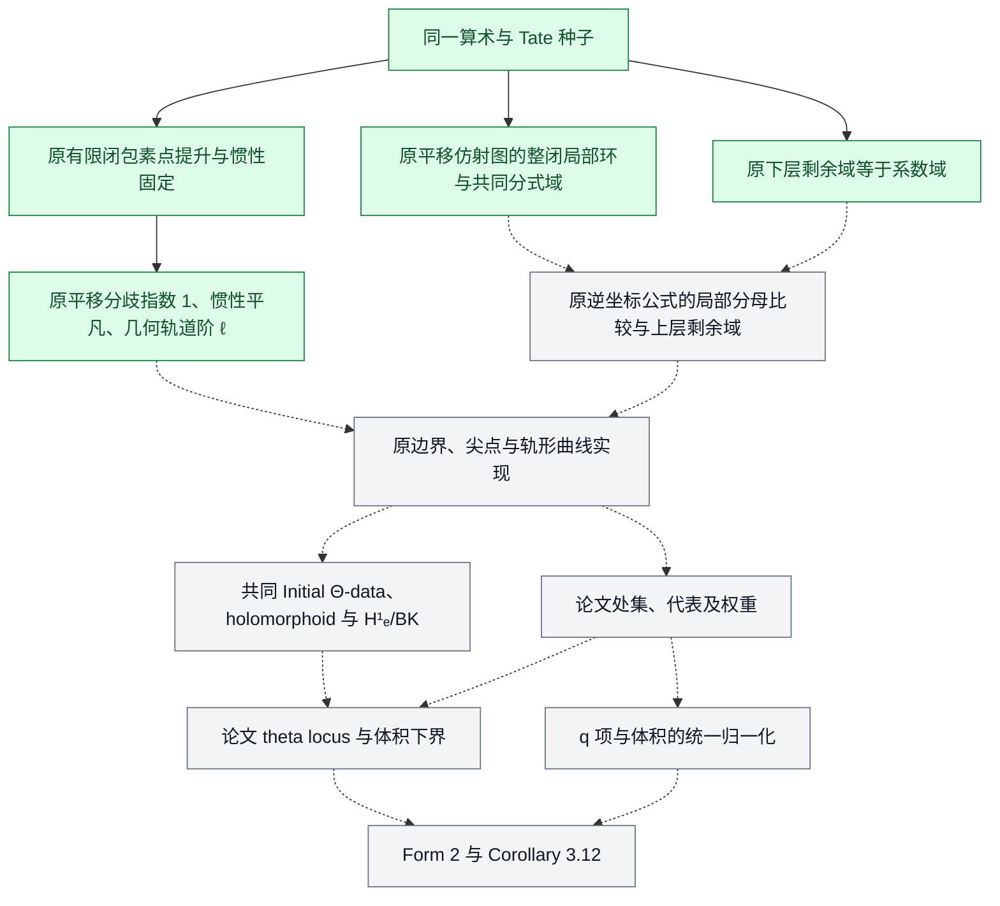

# Scene1 进度总览 5

截至 **2026-11-18（Asia/Shanghai）**。Scene1 的几何交付从总览4的 **`a443952`** 推进到 **`0477a914`**。本期还完成了 Lean 工具链迁移，并推进了 Prove2Me 的参考算术链。 [总览4](Scene1进度总览4.md) · [Scene1 开发计划](开发计划.V1Act1Scene1.md) · [Prove2Me 适配计划](开发计划.Prove2Me适配.md)

### 状态判定

| 标记 | 状态 | 使用条件 |
| --- | --- | --- |
| 🟢 | 已闭合 | 本行精确义务有证明，所需输入已落实，对应验收已通过 |
| 🔵 | 条件性完成 | 已验证给定明确输入时的定理，目标数据仍缺这些输入的构造 |
| 🟡 | 部分完成 | 已有可复用的子结果，仍缺实际构造、比较或身份等式 |
| ⚪ | 未建立 | 完整要求仍缺满足其类型的已验收构造或证明 |
| 🔴 | 路线已排除 | 只在所列条件下排除一条具体路线 |

## 当前结论

| 项目 | 当前值 |
| --- | --- |
| Scene1 整体 | **未完成，G1–G4 关闭 0/4** |
| 有明确来源指示的父义务 | **15 项均开放**。见[证明义务清单](具有明确参考来源指示的证明义务.md) |
| iut 参考链适配 | **78/95（82.1%）**。已在目标环境证明扭点域分歧整除、三足曲线的 SL₂ 像、Legendre 挠点次数界和导子比较，并将这些证明装入曲线输入构造器。 [适配计划 §4.1](开发计划.Prove2Me适配.md#41-参考链审计) |
| 最新 Scene1 数学单元 | 原二阶点平移仿射图的分式域沿原包含映射的像等于原无符号正规化域。 [分式域像等式](../ArithmeticTeichmullerSpaces/ArithmeticTeichmullerSpaces/Act1Scene1/InitialThetaInfinityShiftedChartFractionField.lean#L156) |
| 几何路线的下一处缺口 | 在平移仿射图的同一剩余中心证明逆坐标公式的分母可逆，再用局部整闭性识别原无符号正规化的上层剩余域 |
| 本地构建环境 | Lean `v4.33.1`，Mathlib `0df444a360eaa60ab8c11dca51a86af692955474`。见[环境锁](../ArithmeticTeichmullerSpaces/migration/environment.lock.json) |
| Prologue 边界 | R5。四项来源法律由 Scene1 生产者负责。见[生产者契约](../ArithmeticTeichmullerSpaces/ArithmeticTeichmullerSpaces/Act1Scene1/ProducerContracts.lean) |

各项状态以对应定理实际量化的对象、条件及验收范围为准。

## 四个最终验收闸门

| 闸门 | 状态 | 已有支撑 | 关闭所需的证明 |
| --- | --- | --- | --- |
| G1 目标与归一化 | 🟡 | q 因子的原始、按次数归一和加权公式已有局部换算 | 对论文指定的同一处集证明 q 项、论文权重、无穷处体积和符号约定的完整换算，固定 Form 2 及 3.12 的精确类型 |
| G2 共同真实来源 | 🟡 | 同一种子的 Tate 参数与 q 根，原无穷远分歧指数、下层剩余域及平移仿射图的分式域 | 证明上层剩余域及边界身份，实现轨形曲线与尖点，再从同一数据构造 Initial Θ-data、holomorphoid、period 和 H¹ₑ/BK |
| G3 论文处集与重数 | 🟡 | 所选 valuation section、有限覆盖判据、纤维重组及内部加权等式 | 供应论文处集与 $L'$ 的实际代表，证明覆盖、重数、剩余和分歧次数公式，并处理遗漏质量及跨模点下降 |
| G4 theta locus、体积与最终连接 | 🟡 | actual Kummer/ordinary-log 包络、Haar 体积、负对数 cost 和条件性 3.12 消费者 | 由共同标记与 BK 对数证明论文 theta locus 身份，再识别测度和体积并导出最终下界 |

四闸门的正式目标和完成标准见开发计划，现行构建与公理审查依仓库约定执行。 [闸门目标](开发计划.V1Act1Scene1.md#3-未完成义务按最终闸门分解) · [完成标准](开发计划.V1Act1Scene1.md#7-完成标准) · [仓库验收约定](../AGENTS.md#回执与项目验收)

## 已完成的局部结果

| 范围 | 状态 | 精确结果 |
| --- | --- | --- |
| 局部算术与解析基础 | 🟢 | 同一种子给出 Tate 参数、q 根及有限处的完成域。局部倾斜、Fontaine θ、Witt 法律及标准有理半径完成上的 Frobenius 已建立。 [计划第 2 节](开发计划.V1Act1Scene1.md#2-已完成义务只列结果) |
| Kummer 与对数 | 🟢 | 连续整系数和有理系数 H¹ 类、系数映射、普通对数群律和相应包络及体积公式已有证明。 [计划第 2.2 节](开发计划.V1Act1Scene1.md#22-实际-initialthetadata-的局部派生链) |
| 原无穷远分歧与几何作用 | 🟢 | 原无符号上层素点的分歧指数为 1，原平移惯性平凡，带剩余域嵌入的几何点轨道阶为 $\ell$。 [分歧指数](../ArithmeticTeichmullerSpaces/ArithmeticTeichmullerSpaces/Act1Scene1/InitialThetaInfinityTranslationUnramified.lean#L59) · [几何轨道](../ArithmeticTeichmullerSpaces/ArithmeticTeichmullerSpaces/Act1Scene1/InitialThetaInfinityTranslationFreeGeometricOrbit.lean#L60) |
| 原下层剩余域与仿射图 | 🟢 | 原下层剩余域与扭点系数域代数等价。两个剩余坐标均来自该域，仿射图在剩余中心的局部环整闭，其分式域经原包含的像等于原无符号正规化域。 [下层剩余域](../ArithmeticTeichmullerSpaces/ArithmeticTeichmullerSpaces/Act1Scene1/InitialThetaInfinityTranslationBaseResidue.lean#L119) · [局部整闭性](../ArithmeticTeichmullerSpaces/ArithmeticTeichmullerSpaces/Act1Scene1/InitialThetaInfinityShiftedAffineChart.lean#L192) · [分式域像等式](../ArithmeticTeichmullerSpaces/ArithmeticTeichmullerSpaces/Act1Scene1/InitialThetaInfinityShiftedChartFractionField.lean#L156) |
| Corollary 3.12 的条件消费者 | 🔵 | `cor312_of_scene1_data` 接收含体积、q 族、归一化和会计字段的 `Corollary312Scene1Data`。`CanonicalActualHull.corollary312` 接收 `InitialThetaData` 及相应的 `AnalyticInput` 等数据，得到实际包络与原始完成域 q 范数上的不等式。 [通用消费者](../ArithmeticTeichmullerSpaces/ArithmeticTeichmullerSpaces/Act1Scene1/AdelicThetaLinkBridge.lean#L111) · [实际包络消费者](../ArithmeticTeichmullerSpaces/ArithmeticTeichmullerSpaces/Act1Scene1/IutInitialThetaCanonicalActualHullData.lean#L258) |

## 当前证明路线

实线表示已有证明连接，虚线表示还缺构造或比较。

## 未完成的证明义务

第 1–15 项沿用明确来源义务的顺序。统一归一化和 Scene2 需要的全称适配见第 15 项。 [明确来源义务清单](具有明确参考来源指示的证明义务.md)

### Prologue/Core 的来源接口

#### 1. 真实 perfectoid bridge 的来源适配（🟡）

给定共同算术种子的实际有限处，须从论文指定的解析来源同时取得局部整数环、untilt、tilt 与 Fontaine θ。随后要证明该处与 `PerfectoidPlaceData` 的处标记一致，系数映射等于同一 completion embedding，且 `PerfectoidBridgeData` 中的 θ、核和局部法律由这个来源给出。已有局部倾斜、Fontaine 与 Witt 证明可用于这些局部法律。解析点、同一 untilt 的身份和系数图交换仍需要第 6 项提供。 [来源义务一](具有明确参考来源指示的证明义务.md#一prologuecore-相关义务)

#### 2. Core 载体到同一个真实输入（🟡）

`AdelicThetaLinkData` 中的 q 参数、处集、Tate 参数、高度、分歧和 packet 必须由同一数域与曲线的全局数据产生。现有同种子 Tate family、局部 q 根、离散赋值和挠点提供局部构造，`ofInitialThetaData` 等适配器提供投影等式。尚须把这些局部构造与第 4、5 项产出的 `orb`、`localData` 接在同一数域、同一个 $\ell$ 和同一个扭点域上，逐处证明 q 根的范数、阶数和输入到 packet 的坐标转换等式。 [来源义务一](具有明确参考来源指示的证明义务.md#一prologuecore-相关义务)

#### 3. 四个 Scene1 生产者的来源法律（⚪）

`AdelicThetaLink` 需要真实 period 和 q 归一化，`ThetaLiftLog` 需要实际 theta-value 的类及其 log-shell，`PacketCollationHull` 需要论文的来源支撑与跨标记拼接，`VolumeTransfer` 需要同一包络上的测度和体积传递。当前边界已指明四个消费者及各自的显式输入。开放工作是按第 2、6–14 项逐一把字段落实为有精确类型的数学命题与证明，并核对四个输出使用共同来源。体积字段应由测度比较构造，最终数值下界由第 15 项组合导出。 [生产者契约](../ArithmeticTeichmullerSpaces/ArithmeticTeichmullerSpaces/Act1Scene1/ProducerContracts.lean)

### 共同 Initial Θ-data 与原无穷远边界

#### 4. 实现 `InitialThetaGeometryProducer`（🟡）

在目标几何接口 `AG/TG` 上，对每个 `InitialThetaGeometrySeed` 共同构造 `OrbicurveData` 与依赖该输出的 `LocalThetaData`。种子固定数域、椭圆曲线、代数闭包、坏处集、适用素数及 `HasCoreUniversally`。证明须在同一几何输出上实现赋值截面、分解群和局部覆盖图，并使 `toInitialThetaData` 能用种子的 Tate 族装配这些数据。 [生产者的量化与输出](../ArithmeticTeichmullerSpaces/ArithmeticTeichmullerSpaces/Act1Scene1/ProducerContracts.lean)

1. 在同一有限正规闭包素点上，设 $k$ 为扭点系数域，$A=k[x',y']$ 为平移除法点 $Q'$ 的仿射坐标环，$\mathfrak m$ 为它的剩余映射核。平移所用的非零二阶点 $T=(r,s)$ 满足 $[\ell]Q'=G+T$，其中 $G$ 是原泛点。记 $c=3r^2+2a_2r+a_4-a_1s$，$\Phi=\Phi_\ell(x')$、$\Psi=\Psi_\ell^2(x')$ 为配方模型的除法多项式取值。待在原共同分式域中组合二阶点平移公式与精确纤维方程，得到

   $$
   x_G^{-1}=\frac{\Phi-r\Psi}{r(\Phi-r\Psi)+c\Psi}.
   $$

   已证的剩余纤维方程给出 $\overline{\Phi-r\Psi}=0$。须将除法多项式在该纤维根处的非零引理特化为 $\overline{\Psi}\ne 0$，并用二阶点的非奇异性和 $2s+a_1r+a_3=0$ 得到 $c\ne 0$。系数域的剩余映射为单射，故目标分母的剩余值为 $\bar c\,\overline{\Psi}\ne 0$，使原基环 $k[x_G^{-1}]$ 进入 $A_{\mathfrak m}$。 [二阶点平移公式](../ArithmeticTeichmullerSpaces/ArithmeticTeichmullerSpaces/Act1Scene1/TwoTorsionTranslationIntegral.lean#L23) · [实际剩余纤维方程](../ArithmeticTeichmullerSpaces/ArithmeticTeichmullerSpaces/Act1Scene1/InitialThetaInfinityShiftedDivisionResidue.lean#L130) · [纤维根处分母非零引理](../ArithmeticTeichmullerSpaces/ArithmeticTeichmullerSpaces/Act1Scene1/IutCompat/Torsion/Count.lean#L212)
2. 沿已证分式域身份，把原上层正规化的每个元素送入 $A_{\mathfrak m}$。所需证明使用这些元素对 $k[x_G^{-1}]$ 的整性与 $A_{\mathfrak m}$ 的整闭性。随后核对 $\mathfrak m A_{\mathfrak m}$ 在原上层正规化中的收缩就是选定的上层素点，沿该包含诱导剩余域映射。仿射图的常数剩余像使该映射的像恰为 $k$。还须核对它与原下层系数映射相容，得到原上下层相对剩余次数为 1。结合惯性平凡与纤维传递性，可再计算原算术素理想稳定子及上层素点纤维的基数。 [上层剩余域的开放边界](开发计划.V1Act1Scene1.md#2026-11-11原-shifted-chart-的共同分式域与-full-division-field)
3. 把原无穷远正规化纤维与原射影曲线的无穷远点比较，构造与挠点商 $E[\ell]/M$ 的等价，并验证该等价下的 distinguished class。再实现到 `AG.Cusp` 的映射，证明该尖点与坏处的 theta 根模型相容。现有几何轨道定理量化的是带剩余域嵌入的点。 [原几何作用及边界](开发计划.V1Act1Scene1.md#2026-11-10原平移惯性平凡与原几何轨道阶-ℓ)
4. 从原呈示在实际 `AG.Orbicurve` 中构造对象及覆盖，将种子的 core 条件和原呈示的拉回接到 `AG.IsCartesianSquare`，落实局部 $\Pi_v$ 与覆盖条件。最后让尖点、theta 根、赋值截面和局部分解群都属于同一 `orb/localData`。参考 `modelAG/modelTG` 中的构造仍需目标几何接口上的实现。 [来源义务二](具有明确参考来源指示的证明义务.md#二act1scene1共同真实-initial-θ-data-producer)

#### 5. 装配同一份实际 `InitialThetaData/TateFamily`（🟡）

从第 4 项的几何输出和原种子组装数据。记模域、原数域和扭点域为 $M,F,K$，须逐点证明数据中保存的 $M\to K$ 等于规范包含 $M\to F\to K$ 的复合，并沿该等式比较 Tate 族与局部赋值截面的处集限制。使用同一完成域嵌入，逐坏处核对 Tate 曲线的 $j$ 不变量、局部一致化元、q 阶数的正性及其与 $\ell$ 的互素性、扭点基和 q 根。把局部精确 $2\ell$ 阶点及已证正负两种 distinguished class 接到第 4 项的实际尖点，再核对有限支撑与 q-pilot、link 和 packet 的字段等式。 [来源义务二](具有明确参考来源指示的证明义务.md#二act1scene1共同真实-initial-θ-data-producer) · [模域代数结构的一致性](Prove2Me适配状态.md#初始-θ-数据中模域代数结构的一致性)

### Holomorphoid、period 与 H¹ₑ/BK

#### 6. 构造论文的实际 holomorphoid 来源（🟡）

对第 5 项的数据逐处构造论文的 Fargues–Fontaine 解析点、Berkovich 几何基点、所选 untilt/tilt 和带 anabelomorphic 标记的 Tate 参数族。先证明基准点给出的完成域、整数环及 Fontaine θ 与已有实际局部构造相容。再为参与拼接的每个标记给出所用 Tate 参数、相应 Galois 作用与嵌入，使 period 和上同调的比较能追溯到同一解析来源。 [Joshi I 至 III 来源索引](具有明确参考来源指示的证明义务.md#三act1scene1holomorphoidperiod-和-h¹ₑbk-producer)

#### 7. 识别论文 Fréchet `B`、ρ-范数和 $T_y$（🟡）

现有 `A_inf`、Witt 局部化、`B_dR` 以及标准和实际有理半径完成提供比较对象。须沿第 6 项的同一解析来源证明底环、局部化、拓扑完成和论文 Fréchet $B$ 的比较，并逐半径证明 $\rho$-范数在该映射下的换算。随后须证明比较映射与 Frobenius 交换，在同一环上给出 Tate 对数的收敛域，证明相应元素属于论文 $T_y$ 以及 $T_y\subseteq B^{\varphi=p}$。这些结论须用于第 8 项实际选取的 period 元素。 [Fréchet 计划](开发计划.V1Act1Scene1.md#g2共同真实来源和-producer) · [Joshi II 审计](Joshi2审计.md)

#### 8. H¹ₑ、crystalline 与 Bloch–Kato 比较（🟡）

从同一局部域及 Galois 作用定义论文所用的 H¹ₑ 和 crystalline/Frobenius 比较，给出 BK 指数与对数的精确定义域和核。对每个所选 $2\ell$ 次根 $u$ 及标签 $j$，将 $1+p^*u^j$ 的实际 Kummer 类送入该比较，证明所需的 H¹ₑ 成员关系、整性及 log-shell 身份。系数扩张须明确区分整类、有理像和核中的挠类。若采用整类，须验证论文所写的 $\log_p(1+p^*u^j)/p^*$ 比较。若采用除以 $p^*$ 的有理类，须先对原有理类验证未缩放的普通对数公式，再用 $\mathbb Q_p$ 线性计算其除以 $p^*$ 的像。指定 $\log_p(p)=0$、奇素数时 $p^*=p$、$p=2$ 时 $p^*=4$，并落实实际使用的处与标签。 [来源义务三](具有明确参考来源指示的证明义务.md#三act1scene1holomorphoidperiod-和-h¹ₑbk-producer)

#### 9. 跨 holomorphoid 与 arithmeticoid 的拼接（⚪）

为不同 untilt、不同 holomorphoid 和不同模点定义共同可比较的标记、代表选择与 cohomology transport。必须证明组合相容性、选择代表的独立性及 H¹ₑ、BK 对数和 log-shell 的保持规律，明确 Joshi III 实际使用的 Ind1–Ind3 怎样作用于可比较的数据。固定完备域张量积上的 factor automorphism 和 closure/hull 轨道只给出该固定载体的拼接公式。第 12、13 项需要真实跨来源的 transport。 [来源义务三](具有明确参考来源指示的证明义务.md#三act1scene1holomorphoidperiod-和-h¹ₑbk-producer)

### 论文处集、代表与重数

#### 10. 构造论文 $V_p^{\mathrm{oss}}$ 和 $\underline V^{\mathrm{oss}}$（🟡）

从第 5 项的同一数据实现模域处集到 $L'$ 所选处的双射。逐个有理素数证明 $\underline V^{\mathrm{oss}}$ 的纤维恰是论文选出的奇剩余特征分裂乘法约化处，给出它与 `VBad` 及实际 q 根支撑的双向对应。现有实际纤维覆盖判据给出 `VBadModuliFinset = OddModSupportFinset` 这一等价条件。仍须在论文数据上证明所需覆盖，说明坏处外局部体积何时贡献单位因子，并明确无穷处在总体积中的位置。 [来源义务四](具有明确参考来源指示的证明义务.md#四act1scene1论文处集代表和重数)

#### 11. 实际 $L'$ 代表映射与纤维重数（🟡）

由论文的实际模域、核域 $L'$ 和处集构造代表选择及其限制映射，证明有代表的纤维、代表重数、剩余次数、分歧指数和遗漏项的对应。现有 canonical source-to-section 有限等价可做局部计数。第 4 项的无穷远几何纤维只为相应原函数域的边界提供代数证据。这里仍需核对实际数域的素数纤维，证明论文的代表乘积或求和是否及如何计入重复代表、遗漏质量和剩余域次数。 [来源义务四](具有明确参考来源指示的证明义务.md#四act1scene1论文处集代表和重数)

#### 12. 混合模点下降与统一权重（🟡）

消费第 9–11 项给出的同一论文处集、代表和标记。在每条纤维上推导局部次数、剩余次数、分歧指数、张量维数及纤维质量的公式，再把等式推到跨模点的乘积或求和。既有加权会计等式显式包含代表的次数差额、遗漏质量和全局次数。须证明这些量对论文所选代表取何值。

Joshi III 的 `eq:weights` 给出 $1/[L'_w:(L_{\mathrm{mod}})_v]$。望月新一 IUT III 注记 3.1.1 的系数还含基模域在有理处之上的局部次数和。参考 `LogVolume` 要求正权重且每条有理处纤维权重之和为 1。须在同一处集和测度上证明从论文系数到参考权重的换算，并证明缩放保留反像的对数体积律和张量的乘积公式。左侧 q 项还要另行识别 `QPilotData` 的坏处权重和 IUT IV 定义 1.9 的纤维归一化。 [参考权重审计](Prove2Me适配状态.md#对数体积处权重与局部归一化的来源适配)

### 论文 theta locus、体积与最终证明

#### 13. 将实际 Kummer/log 包络识别为论文 theta locus（🟡）

从第 6、8、9 项取得同一来源的标记、theta 值的 H¹ₑ 类及 BK 对数。在 Joshi III 的 M、J 两类接收空间上，核对基准主单位及 $\{0,\ldots,j\}$ 在乘积与显式序列中的位置。用多重线性映射构造从有限直积到张量积的纯张量像，保留混合处的张量项。随后根据论文的 log-shell、凸闭包及跨来源拼接定义证明实际 packet/hull 的身份，或给出 Form 2 所需的精确包含方向。下界证明须在两个论文集合中找出由同一标记的 $\tau_j=\log_{\mathrm{BK}}(\xi_j)$ 产生的张量格子。 [Joshi 的索引与张量映射义务](Prove2Me适配状态.md#2-joshi-论文直接列出而尚未拆分的证明义务) · [来源义务五](具有明确参考来源指示的证明义务.md#五act1scene1theta-locusvolume-和最终定理)

#### 14. 证明论文包络和 `thetaVolume` 的身份（🟡）

用第 12 项的权重和第 13 项的集合证明测度身份。逐处落实测度的归一化、可测性、非零体积及张量格子的乘积公式，进而证明有穷多个非单位因子的 adelic 乘积公式，接入无穷处因子和标签集递增族上的平均。还须把已证的 Haar 体积及负对数 cost 转换成论文 `thetaVolume` 及其对数，对两个全局集合分别从局部格子包含和体积估计导出乘积下界。 [来源义务五](具有明确参考来源指示的证明义务.md#五act1scene1theta-locusvolume-和最终定理)

#### 15. 完成 Form 2、Corollary 3.12 和必要的下游适配（🔵，现有消费者）

最终声明须保留 Joshi III 的全局初始条件，包括无实嵌入的 $L$、严格 Belyi 型的穿孔椭圆曲线、Galois 扩张 $L/L_{\mathrm{mod}}$、六阶扭点有理性、$\ell\ge 5$ 且 $\ell\nmid[L:L_{\mathrm{mod}}]$、模 $\ell$ 表示的像包含 $\mathrm{SL}_2(\mathbb F_\ell)$、其核的固定域 $L'$ 以及起自模域处集的双射。Form 2 进一步要求充分大的奇素数。设 $\ell^*=(\ell-1)/2$，论文对两个全局集合 $\Theta_M,\Theta_J$ 分别给出体积下界

$$
\operatorname{Vol}(\Theta)\ \ge\
\prod_{w\in\underline V^{\mathrm{oss}}}\left|q_w^{1/(2\ell)}\right|^{\ell^*}
\qquad\bigl(\Theta\in\{\Theta_M,\Theta_J\}\bigr).
$$

Corollary 3.12 的字面左端为 $-\lvert\operatorname{logVol}(\Theta_M)\rvert/\ell^*$，右端为 $-\sum_{p,w}\log|q_w^{1/(2\ell)}|_{L'_w}$，求和取非空 $V_p^{\mathrm{oss}}$ 中的 $(p,w)$。当贡献项为收缩根时，字面右端的负对数与 Form 2 体积推导的右端符号相反。符号冲突沿用暂作笔误的记录，冻结目标前仍须对照字面式、前文采用的符号约定和体积推导。换算须在同一处集上落实每项的原始完成域范数、局部与全局次数、分歧与剩余次数、论文权重及 $2\ell$ 次根和 $p^*$ 对数归一化，再核对无穷处项和取绝对值的条件。 [Joshi 两个目标的来源](Prove2Me适配状态.md#2-joshi-论文直接列出而尚未拆分的证明义务) · [目标代码](../ArithmeticTeichmullerSpaces/ArithmeticTeichmullerSpaces/Act1Scene1/Corollary312.lean) · [G1 的冻结要求](开发计划.V1Act1Scene1.md#g1目标符号和归一化)

用第 1–14 项构造 q 项、`thetaVolume` 和四项来源法律，并从实际测度给出下界，再实例化现有条件消费者。Scene1 的最终验收覆盖完整类型、导入图、公理和来源追踪。接入参考 `c2` 还须证明 `∀ X, P X → Corollary312Variant X`，其中几何接口固定，`ThetaDataExistence`（P7）为全部适用点和素数提供满足同一 `P` 的数据，以及参考链所需的证书、局部估计和各项身份。已验收的参考链在 `c2` 保留了这个全称命题作为输入，规范高度及 P7 的接合仍开放。 [参考变体与 P7 的适配义务](Prove2Me适配状态.md#joshi-的-312-与参考工程变体之间的适配) · [Scene2 参考链](开发计划.Prove2Me适配.md#41-参考链审计)

### 参考 `c2` 装配中仍开放的曲线输入

- **循环子群估计。** 对紧有界集内的适用三足点、素数 $\ell\ge7$ 和 Galois 稳定的 $\ell$ 阶循环子群，须从 (P2) 的 q 阶数条件证明该子群在各奇乘法约化处满足图线条件。再在这些处上接合循环同源与高度上界，得到 $(\ell-2)(h-h_2)/24\le 2\log\ell+T_K$，其中 $T_K$ 只依赖给定的紧有界集。该估计供 `CurveFactsProp.cyclic` 和推论 2.2 消费。 [来源义务与适配状态](Prove2Me适配状态.md#1-根据-referiut-指示尚未拆分的证明义务)
- **core 例外有限性。** 须把所选远 Abel 几何下的非 core 曲线归入有限的有理 $j$ 不变量例外集，再证明每个例外值对应的三足点有限。给定例外值 $c$ 时，可用非零多项式 $256(X^2-X+1)^3-cX^2(X-1)^2$ 的根集。几何部分要对同一 `AG` 证明非例外曲线具有 `HasCoreUniversally`，并将所得有限性作为 `CoreFinitenessHyp` 交给曲线输入构造器。 [参考链审计](开发计划.Prove2Me适配.md#41-参考链审计)
- **P7 及高度身份。** 将实际曲线供应、循环子群界和 core 例外有限性装入 `CurveInputs`。对每个适用点和素数，构造同一 `AG/TG` 下的 `InitialThetaData`、局部理论、theta 局部数据及 q-pilot，并验证塔算术与模域次数、局部高度、不同理想和导子各项身份。第 15 项的全称适配还须覆盖这套构造供应的整个数据族。在 Prove2Me 上验收上述曲线字段还需要独立依赖打包与跨版本类型和公理核对。 [构造器实际输入](../prove2me_workspace/Solutions/Source_TripodCurveInputsFromSource.lean#L48) · [参考链审计](开发计划.Prove2Me适配.md#41-参考链审计)

## 已排除的具体路线

| 状态 | 具体路线及排除范围 |
| --- | --- |
| 🔴 | 在已审计的旧 period 与 transfer 装配中，用实际收缩 q 根的范数直接充作 `thetaBase.norm` 会与所需的非负 `logVolume` 冲突。正长度 ordinary-log 包络的 signed Haar log-volume 也不能直接充作该非负量。 |
| 🔴 | 在已审计的处集和归一化下，现有 canonical q-log 总和严格小于论文候选代表和。实际扭点来源的分歧质量也排除了该来源上的纤维质量为一。 |
| 🔴 | 当前收缩 q-root 的有理类不在已归一化主单位类生成的那条 $\mathbb Q_p$ 直线上。这项排除针对已有普通对数路线的特定单生成空间。 |

负面证据的具体假设和 Lean 入口见 [Scene1 开发计划第 4 节](开发计划.V1Act1Scene1.md#4-负面证据和路线排除)。

## 进度总览4到现在的新进展简报

几何交付的比较区间自 **`a443952`** 至 **`0477a914`**，适配增量见下文。总览4所列未交付的有限闭包和有限素点惯性消费者已进入正式 Scene1 源码。

| 交付 | 总览4之后的精确增量 |
| --- | --- |
| `0de7812f`、`a1ce3f2e` | 在同一有限除法正规闭包中，证明固定原下层域的原有限逆坐标素点惯性元固定原除法点的两个坐标，进而固定整个原无符号域。 |
| `775306be`、`b0e9db57` | 构造原无穷远上层素点的有限闭包提升，证明分歧指数为一，进而证明原平移惯性平凡、几何轨道阶等于 $\ell$。 |
| `4275fb43` | 原下层素点的剩余域沿规范系数映射与同一扭点系数域代数等价，系数次数为一。 |
| `9eff8d37`、`a6ca3e75`、`d1e740fa` | 证明同一种子的二阶点平移给出指定的严格剩余值，将原除法点整坐标与精确纤维方程专化到实际剩余域。 |
| `30a0c0cf`、`022e558b`、`0477a914` | 证明两个平移坐标的剩余值都在系数域中、仿射图在该剩余中心的局部环整闭，以及分式域经原包含的像等于原无符号正规化域。 |

在各交付提交的 Lean `v4.35.0-rc3` 环境中，原分歧指数一、下层剩余域及共同分式域的聚合与公理审查回执依次为 `ci-002988-4a4d0d32`、`ci-003010-d3b776a3`，`ci-003248-4934f3cd`、`ci-003266-95572bcb`，以及 `ci-004720-d1428d42`、`ci-004731-567d6213`。三个 `NormalizationInfinity` 公理审查分别覆盖 286、334、496 条输出，依赖仅含 `propext`、`Classical.choice`、`Quot.sound`。

`d1d6a1a6` 将项目移至 Lean `v4.33.1` 与 Mathlib `0df444a360eaa60ab8c11dca51a86af692955474`，并纳入 FormalSchemes 兼容补丁。`07609510` 更新依赖补丁流程并锁定 Tate 曲线库的兼容补丁。迁移后主库与导入审查、公理聚合、兼容声明审查回执分别为 `ci-006966-5dfcf86a`、`ci-006979-cc34b3c6`、`ci-006981-87320f57`。 [环境锁](../ArithmeticTeichmullerSpaces/migration/environment.lock.json) · [仓库构建约定](../AGENTS.md)

Prove2Me 私有平台已验收参考局部体积平均界、定理 1.10、推论 2.2 及 `statementII_of_cor312` 的条件性证明链。后续本地提交通过了实际 Tate 局部高度比较、Northcott 有限性、素数 2 处贡献和模域次数界的目标环境检查。 [平台适配计划与回执入口](开发计划.Prove2Me适配.md#41-参考链审计)

本地适配从指定扭点域的全体挠点构造判别式平方根，借助同坐标的 Tate 均匀化证明相对分歧整除，进而得到实际三足曲线的 SL₂ 像包含。Legendre 挠点基使 3、5 挠点坐标的次数倍数界 48、480 对每个三足点成立。两向导子比较也已证明，反向误差为 $\log(2\ell)$。 [局部 Tate 与分歧](../prove2me_workspace/Solutions/Source_SL2ImageLocalTate.lean#L81) · [挠点基与次数界](../prove2me_workspace/Solutions/Source_TripodTorsionBasis.lean) · [导子比较](../prove2me_workspace/Solutions/Source_TripodLogCond.lean#L188)

21 字段构造器已消费上述证明。同一供应曲线的定义域次数至多为 `552960 * d`，点的 `logDiff` 等于同一曲线三足域的归一化不同理想次数。构造器和 SL₂ 像通过类型与公理审查 `ci-020827-2725d6f7`，挠点和导子的公开证明通过 `ci-020829-26f0c710`，项目聚合与审查通过 `ci-020844-3d5ac401`。本轮从原合并待办中登记了四项已验收的本地成果，适配计划 §4.1 从 **74/91（81.3%）** 更新为 **78/95（82.1%）**。 [构造器](../prove2me_workspace/Solutions/Source_TripodCurveInputsFromSource.lean#L48) · [来源与回执](../prove2me_workspace/.local/adaptation/b1-curve-field-arithmetic-20261118/SOURCE_LEDGER.md#torsion-field-ramification-and-tripod-curve-inputs)
