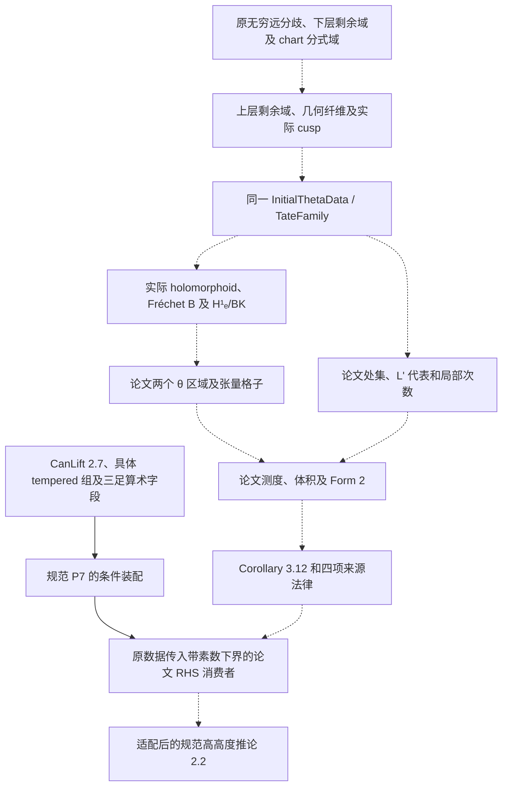

# Scene1 进度总览 6

## 状态判定

| 标记 | 状态 | 使用条件 |
| --- | --- | --- |
| 🟢 | 已闭合 | 对应定理、实际输入和局部验收均已落实。 |
| 🔵 | 条件性完成 | 消费定理已验证，目标数据仍须供应显式前提。 |
| 🟡 | 部分完成 | 有可复用结果，仍缺实际构造、身份或比较。 |
| ⚪ | 未建立 | 目标范围尚缺通过验收的构造或证明。 |
| 🔴 | 具体路线已排除 | 反例适用于表中列明的输入与归一化。 |

## 当前结论

| 项目 | 当前值 |
| --- | --- |
| 更新日期与仓库基线 | 2026-11-21（Asia/Shanghai），`migration/lean-4.33.1-mathlib-0df444a` 的 `a7848012`。 |
| Scene1 整体 | **未完成，G1–G4 关闭 0/4。明确来源的 15 项父义务仍开放。** [义务清单](具有明确参考来源指示的证明义务.md) |
| 原几何进度 | 原平移仿射图的分式域像等式已证，数学单元为 `0477a914`。当前入口仍是同一剩余中心处的逆坐标分母非零、上层剩余域与原 cusp 身份。 [原分式域身份](../ArithmeticTeichmullerSpaces/ArithmeticTeichmullerSpaces/Act1Scene1/InitialThetaInfinityShiftedChartFractionField.lean) |
| iut 参考链进度 | §4.1 已验收 190/193 个条目。CanLift 命题 2.7、私有 Tate/SL₂ 链及三足曲线构造器的字段重放已验收。带素数下界的 `c2` 已接入同一实际 P7 上的论文右端供应接口。 [参考链审计](开发计划.Prove2Me适配.md#41-参考链审计) |
| 共同数学缺口 | 从真实标记和 H¹ₑ/BK 构造论文 θ 区域与测度，用论文处和局部次数识别其体积，再在实际 P7 数据上证明比较。 |
| Prologue 边界 | 保持 R5，四项来源法律由 Scene1 生产者交付。 [生产者契约](../ArithmeticTeichmullerSpaces/ArithmeticTeichmullerSpaces/Act1Scene1/ProducerContracts.lean) |

## 四个最终验收闸门

| 闸门 | 状态 | 关闭所需的证明 |
| --- | --- | --- |
| **G1 目标、符号与归一化** | 🟡 | 固定 Form 2 与 3.12 的精确类型。在同一论文处集处理 q 项、按次数归一、对数符号、处权重、无穷处因子及两端换算。 |
| **G2 共同真实来源** | 🟡 | 证明原上层剩余域和 cusp 身份，构造同一真实 `InitialThetaData/TateFamily`，接通实际 holomorphoid、period、H¹ₑ/BK 和跨来源运输。 |
| **G3 论文处集、代表与重数** | 🟡 | 由同一数域塔及实际标记给出论文处集和 $L'$ 代表的覆盖、纤维重数、局部次数、遗漏质量及跨模点下降。 |
| **G4 theta locus、体积与终局** | 🟡 | 构造两个论文 θ 区域及测度，验证下界、与 `thetaVolume` 的身份及 3.12。为参考 `c2` 供应同一 P7 数据的实际论文比较。 |

四闸门对应原计划的目标和完成标准。 [Scene1 开发计划](开发计划.V1Act1Scene1.md)

## 当前证明路线

实线表示已有构造或带显式前提的消费关系，虚线表示待证连接。

## 已完成的局部义务

| 范围 | 已验收结论 |
| --- | --- |
| 🟢 原几何 | 同种子 Tate 参数、q 根和完成域。原无穷远上层分歧指数为 1，平移惯性平凡，带剩余域嵌入的几何轨道阶为 ℓ。下层剩余域及平移图整闭性、共同分式域已有证明。 [总览 5](Scene1进度总览5.md) |
| 🟢 局部代数与分析 | 倾斜、Fontaine θ、Witt 与标准半径 Frobenius，实际整／有理 Kummer 类、ordinary log 及其 Haar 包络的局部结果。 [Scene1 开发计划 §2](开发计划.V1Act1Scene1.md) |
| 🟢 参考算术 | CanLift 2.7 已接到具体 étale／tempered 理论。有限高度、Tate 点方程到一致化及 SL₂、三足高度与模域次数已按各自接口验收。 [CanLift 证明](../prove2me_workspace/Solutions/Source_ReferenceIutCanLiftProp27.lean) · [参考链审计](开发计划.Prove2Me适配.md#41-参考链审计) |
| 🔵 消费接口 | `cor312_of_scene1_data` 可消费完整会计和体积字段。P7 的 `withRHSData` 保留初始 θ 数据、q-pilot 和原算术不变量，带下界的 `c2` 消费给定的论文 RHS、局部估计及比较。 [3.12 消费者](../ArithmeticTeichmullerSpaces/ArithmeticTeichmullerSpaces/Act1Scene1/AdelicThetaLinkBridge.lean) · [P7 论文 RHS](../prove2me_workspace/.local/adaptation/b1-tripod-height-correspondence-20261121/c2-prime-bound/Source_TripodCanonicalCorollary22PaperRHS.lean) |

## 未完成的证明义务

### 共同来源与原无穷远纤维

1. **真实 perfectoid bridge。** 在同一算术种子的每个实际有限处，由论文解析点生产局部整数环、untilt、tilt 与 Fontaine θ。分别证明处标记与 `PerfectoidPlaceData` 一致，系数图等于同一 completion embedding，核及局部法律与 `PerfectoidBridgeData` 的数据相容。
2. **Core 字段共用实际输入。** 由同一数域及椭圆曲线生产 q 参数、处集、Tate 参数、高度、分歧和 packet。把已有 Tate/q-root 与实际局部完成域接到同一扭点域及一条共用的赋值截面，逐处核对范数、阶数、标记与 packet 坐标。
3. **四条来源法律。** 为 `AdelicThetaLink` 给出实际 period 与 q 归一化，为 `ThetaLiftLog` 给出真实类和 log-shell，为 `PacketCollationHull` 给出论文支撑和跨标记拼接，为 `VolumeTransfer` 给出同一包络上的测度比较。四次构造使用同一来源。 [来源清单与契约](具有明确参考来源指示的证明义务.md) · [生产者契约](../ArithmeticTeichmullerSpaces/ArithmeticTeichmullerSpaces/Act1Scene1/ProducerContracts.lean)
4. **实现 `InitialThetaGeometryProducer`。** 固定原正规闭包的上层素点和扭点系数域 k。在 $A=k[x',y']$ 的实际剩余中心组合二阶点平移和精确纤维方程，证明 $x_G^{-1}=(\Phi-r\Psi)/(r(\Phi-r\Psi)+c\Psi)$。分母模剩余中心化为 $\bar c\,\bar\Psi$，须用原二阶点的非奇异性和该纤维根处除法多项式的非零证明其可逆。由此将 $k[x_G^{-1}]$ 送入 $A_{\mathfrak m}$，沿已证分式域身份及整闭性延伸到原上层正规化。核对素点收缩、剩余像为 k 及与下层系数图相容，得到相对剩余次数一。再由惯性和平移轨道计算算术素点稳定子，识别原射影无穷远纤维与 $E[\ell]/M$、distinguished class 和实际 `AG.Cusp`。在目标 `AG/TG` 中实现 orbicurve、覆盖、拉回与局部 $\Pi_v$。 [原平移公式](../ArithmeticTeichmullerSpaces/ArithmeticTeichmullerSpaces/Act1Scene1/TwoTorsionTranslationIntegral.lean) · [实际剩余纤维](../ArithmeticTeichmullerSpaces/ArithmeticTeichmullerSpaces/Act1Scene1/InitialThetaInfinityShiftedDivisionResidue.lean)
5. **装配同一 `InitialThetaData/TateFamily`。** 由同一 seed 和上述 `orb/localData` 装配原数据。对模域、原数域和扭点域核对保存的代数结构等于规范复合。逐坏处使用同一完成域核对 j、素元、q 阶数与 ℓ 互素、扭点基及 $2\ell$ 次 q 根。把尖点与局部精确 $2\ell$ 阶点及两个符号的 distinguished class 接合，证明 q-pilot、link、packet 及有限支撑的实际等式。 [共同数据义务](具有明确参考来源指示的证明义务.md)

### Holomorphoid、period、H¹ₑ/BK 和拼接

6. **产生论文 holomorphoid。** 在第 5 项数据上逐处给出 Fargues–Fontaine 解析点、Berkovich 几何基点、所选 untilt/tilt 及各 anabelomorphic 标记的 Tate 参数、嵌入与 Galois 作用。基准标记须恢复已有实际完成域、局部整数环和 θ。
7. **识别 Fréchet B、ρ-范数与 $T_y$。** 沿上述标记比较 $A_{\mathrm{inf}}$、Witt 局部化、$B_{\mathrm{dR}}$、各半径完成和论文 Fréchet B。逐半径证明范数换算及 Frobenius 交换。给出 Tate 对数的实际收敛域，在同一环证明实际 period 属于论文 $T_y$，再证明 $T_y\subseteq B^{\varphi=p}$。 [period 来源义务](具有明确参考来源指示的证明义务.md) · [Joshi II 审计](Joshi2审计.md)
8. **定义 H¹ₑ 并证明 BK 比较。** 用同一局部 Galois 作用构造 crystalline/Frobenius 比较、H¹ₑ、BK 指数和对数，固定定义域、核和整性。对实际 $1+p^*u^j$ 将 Kummer 类接入该比较，处理整类、有理像和可能进入核的挠类。若使用有理归一类，先证明未缩放的 ordinary-log 身份，再由 $\mathbb Q_p$ 线性计算除以 $p^*$ 后的像。核对 $\log_p(p)=0$，奇素数 $p^*=p$、二进处 $p^*=4$，并在实际标签上读回 log-shell。
9. **跨来源 transport。** 对不同 untilt、holomorphoid 与模点给出共同标记、实际比较映射和代表独立性，验证组合及 H¹ₑ、BK 对数和 log-shell 的保持。用该 transport 解释 Joshi III 中 Ind1–Ind3 在实际数据上的作用，供后续处集下降和 θ 拼接共用。 [H¹ₑ/BK 与拼接义务](具有明确参考来源指示的证明义务.md)

### 论文处集、代表与会计

10. **构造论文处集。** 在同一数据中实现模域处到 $L'$ 所选处的双射。逐有理素数给出 $V_p^{\mathrm{oss}}$、$\underline V^{\mathrm{oss}}$ 与奇剩余特征分裂乘法处的精确对应，比较 `VBad` 及实际 q-root 支撑，处理坏处外的单位贡献与无穷处约定。
11. **证明 $L'$ 代表及纤维重数。** 对论文实际模域、核固定域 $L'$ 和所选处构造限制映射。计算纤维、重复和遗漏项、算术分歧与剩余次数。原函数域边界的几何平移轨道可供对应比较，在实际数域处上仍须给出代表及计数证明。
12. **跨模点下降和同一归一化。** 在同一标记和处集上求局部次数、分歧、剩余次数、张量维数、遗漏质量及纤维总权。把 Joshi III 的局部逆次数与 IUT III 的基模域权重换到参考 `LogVolume` 的正权重及有理处纤维和为一的规格，并验证缩放后的反像测度与张量乘法。q-pilot 另须识别 IUT IV 定义 1.9 的坏处权重。 [处集与代表义务](具有明确参考来源指示的证明义务.md) · [代表乘积](../prove2me_workspace/Solutions/Source_ReferenceIutCor312RepresentativeProduct.lean)

### 两个 θ 区域、体积与最终目标

13. **构造实际 θ locus。** 在第 6–9 项的同一标记下，将实际 BK 值 $\tau_j$ 接入 M、J 两类接收空间。核对基准主单位、标签 $0,\ldots,j$ 和张量槽。用实际多重线性图给出有限直积的纯张量像，跟踪混合处张量及跨来源拼接。沿论文 log-shell、凸闭包及拼接定义证明 packet/hull 的身份或 Form 2 所需的包含，给两个全局区域各自落实共享标记的张量格子。
14. **识别论文测度和 `thetaVolume`。** 从上项证明格子可测、非零、逐处 Haar 归一和张量乘积律，经第 12 项的权重形成有限非单位因子的 adelic 乘积，接无穷处及随标签的平均。证明现有 ordinary-log 估计在相同数据下给出论文体积或精确比较方向，逐包验证容器包含和体积上界。 [theta locus 与体积义务](具有明确参考来源指示的证明义务.md)
15. **冻结目标并完成两个消费者。** 保留无实嵌入、严格 Belyi 型、Galois、六阶扭点及模 ℓ 像、核固定域 $L'$ 和所选处双射等共同初始条件。Form 2 用充分大的奇素数，分别对 $\Theta_M,\Theta_J$ 证明体积至少为 $\prod_w|q_w^{1/(2\ell)}|^{(\ell-1)/2}$。从同一归一化推导 3.12 的对数式，逐项核对绝对值、次数和符号。原字面右端与收缩 q 根的 Form 2 对数推导的符号问题沿用暂作笔误的记录，最后冻结时核准。再组装四条来源法律并实例化原 3.12，按计划验收精确类型、导入图、公理和来源。 [目标与冻结标准](开发计划.V1Act1Scene1.md) · [原目标](../ArithmeticTeichmullerSpaces/ArithmeticTeichmullerSpaces/Act1Scene1/Corollary312.lean)

### 参考 c2 的剩余供应和比较

- **实际曲线供应。** 三足输入构造器已有字段对应。对完整适用族仍须供应 `CurveProviders` 实际曲线和 Tate 数据，逐项接通 Northcott、远 Abel 存在性、几何以及组合中显式保留的素数估计。核对同一初始数据上的高度、模域次数、不同理想、导子和局部证书。 [参考链审计](开发计划.Prove2Me适配.md#41-参考链审计)
- **同一个可用素数。** 对固定 K 和 d 证明 Form 2 的统一阈值 $N(K,d)$，或从原规定窗口选到同时满足下界及全部论文初始条件的同一素数。Joshi II 平方和给出的数值严格界适用于奇素数 $\ell\ge5$。 [素数阈值审查](../prove2me_workspace/.local/adaptation/b1-tripod-height-correspondence-20261121/c2-prime-bound/readback.md)
- **生产论文右端并证明比较。** 对 `ConcreteThetaDataExistence` 实际给出的每个适用点与素数供应 `PaperRHSSupplyAtLeast`，保持同一初始数据、q-pilot、塔算术和十二个算术不变量。在同一 `RHSData` 落实来源谓词和论文比较。沿用原包与测度时从实际新区域证明 `LocalEstimate.thetaPilot_subset`，使用新包或新测度时同时验证逐包体积界。最后把全称变体比较送给已通过审查的 `c2` 消费者。 [同 P7 的论文右端装配](../prove2me_workspace/.local/adaptation/b1-tripod-height-correspondence-20261121/SOURCE_LEDGER.md) · [点态接口](../prove2me_workspace/.local/adaptation/b1-tripod-height-correspondence-20261121/c2-prime-bound/Source_TripodCanonicalCorollary22PaperRHS.lean)

## 已排除的具体路线

| 路线 | 已核实的排除范围 |
| --- | --- |
| 🔴 旧 `h312` 对任意 `LocalTheory` | 固定 q-pilot 与有限处贡献并取无穷处 `indAut={id}`，缩小正半径 r 会在 RHS 加上 $\log r$，从而可低于左端。 [适配状态](Prove2Me适配状态.md) |
| 🔴 用规范 P7 的具体旧主区域体积作论文比较 | 对给定合法提供器构造度一有理 Legendre 族，五进贡献使 $\log Q\ge 2m\log5$，旧主区域比较却给出 $\log Q\le(126/11)\log\pi$。当 $m\ge6$ 时矛盾。 [来源与审查](../prove2me_workspace/.local/adaptation/b1-curve-field-arithmetic-20261118/SOURCE_LEDGER.md#counterexample-to-the-concrete-source-p7-volume-comparison) |
| 🔴 直接复用次数一的 canonical link 会计 | 指定次数一桥的 `hEll/hLink/hDegree/hq` 与所选论文代表会计不能同时成立。 [Lean 反证](../ArithmeticTeichmullerSpaces/ArithmeticTeichmullerSpaces/Act1Scene1/IutInitialThetaCanonicalTargetPaperSumAudit.lean) |

## 进度总览5到现在的新进展简报

以总览 5 最后一次已提交修订 `2819a1a1` 为比较起点，核对到 `a7848012`。总览 5 采用的几何基线 `0477a914` 仍是本分支最新几何数学单元。 [总览 5](Scene1进度总览5.md)

- **复几何与可提升性。** 一次穿孔一致化后补齐可公度子群的增长和分类链，证明 CanLift 命题 2.7。具体 étale／tempered 组已接入规范推论 2.2。 [CanLift 2.7](../prove2me_workspace/Solutions/Source_ReferenceIutCanLiftProp27.lean) · [参考链审计](开发计划.Prove2Me适配.md#41-参考链审计)
- **曲线算术。** 私有平台九节点的 Tate 一致化与 SL₂ 链已回读为 Proved。有限高度、扩张缩放、三足高度归一、二进界及模域次数的字段审查推进到三足输入构造器的发布及 21 个字段的参考重放。 [来源及验收](../prove2me_workspace/.local/adaptation/b1-tripod-height-correspondence-20261121/SOURCE_LEDGER.md)
- **论文 RHS 与负面证据。** 已验收旧具体主区域比较的 Legendre 反例。随后用 `withRHSData` 保持原 P7 算术和 q-pilot，把论文右端与充分大素数条件接上 `c2` 的实际数据接口。参考链 §4.1 从总览 5 记录的 150/165 走到 190/193，剩余三个复选框仍包括论文区域、测度及比较。 [参考链审计](开发计划.Prove2Me适配.md#41-参考链审计) · [同 P7 的论文 RHS](../prove2me_workspace/.local/adaptation/b1-tripod-height-correspondence-20261121/SOURCE_LEDGER.md)
