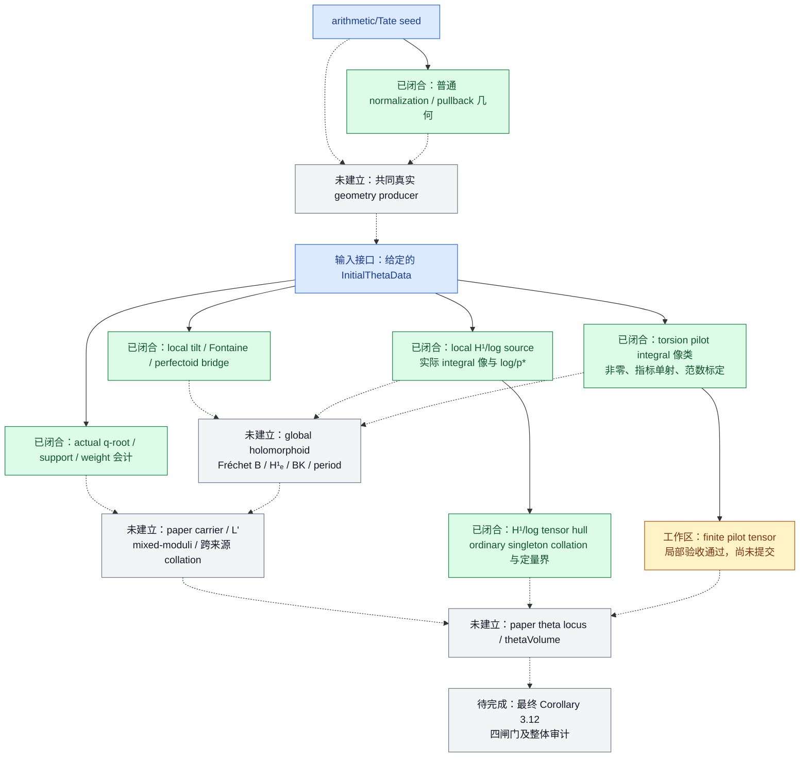

# Scene1 进度总览

### 状态判定

| 标记 | 状态 | 使用条件 |
| --- | --- | --- |
| 🟢 | 已闭合 | 本行精确义务已证明，所需实际输入已落实，相关验收已通过 |
| 🔵 | 条件性完成 | 定理及其显式条件已验证，但条件尚未从目标实际数据全部推出 |
| 🟡 | 部分完成 | 已有可引用子结果，仍缺构造、比较、身份等式或验收 |
| ⚪ | 未建立 | 尚无满足本行要求的已验收构造或证明 |
| 🔴 | 路线已排除 | 已证明某条具体路线不成立；须注明排除范围和所用条件 |

“已闭合”只对该行声明的范围有效。局部构造闭合，不自动关闭所属最终闸门。
条件性反例不记为无条件反例；实际数据适配器不记为完整真实满足模型。
已证明的必要充分条件，不表示目标实际数据已满足该条件。

不按文件数、声明数、S1 编号或复选框计算总完成百分比。
四个闸门的关闭数只表示验收状态，不表示工作量比例或剩余时间。

## 当前结论

| 项目 | 当前值 |
| --- | --- |
| 更新日期 | 2026-10-25（Asia/Shanghai） |
| 已推送数学基线 | `main` 与本地 `origin/main` 均为 `fd4c25d`：Construct torsion pilot integral Kummer classes |
| 最近完成的数学单元 | 构造实际 torsion pilot integral Kummer 像类，证明 normalized log 标定、范数公式、非零性与指标单射性 |
| 基线验收 | 对应 SelectedRoots Checks/Axioms、ImportAudit 与 Act1Scene1 聚合已有通过记录；所查新增定理只依赖 `propext`、`Classical.choice`、`Quot.sound` |
| 工作区新增单元 | finite pilot 的 log endpoint 与 repeated-place tensor；叶模块、Checks/Axioms、ImportAudit 与 Act1Scene1 聚合均已通过，尚未提交推送，详见变化卡 |
| Scene1 整体 | **未完成；最终闸门关闭 0/4** |
| 当前推进位置 | 已从同一给定 `InitialThetaData` 派生 local perfectoid、H¹/log 与 torsion pilot；H¹/log 已连接到实际 tensor hull 和 ordinary singleton collation |
| 尚未接通的主要连接 | 共同真实 geometry producer、global holomorphoid、Fréchet `B`/ρ-norm、H¹ₑ/BK/period、论文处集与 `L'`、跨来源 collation、paper `thetaVolume` 和最终 Corollary 3.12 |
| Prologue 边界 | `R5`；四项 source laws 属于 Scene1 producer，仍须证明，不能作为 Core 已接受的来源假设 |
| 父义务状态 | [明确来源证明义务](具有明确参考来源指示的证明义务.md)中的 15 项均未勾选 |

阅读顺序：先看四个闸门，再看当前路线，最后查看近期变化卡和父义务清单。
本页的“实际”局部结果均保留各自的显式输入；从给定 `InitialThetaData` 派生对象，
不等于已从 arithmetic seed 构造完整 `InitialThetaData`。

## 四个最终验收闸门

G1–G4 对应[开发计划 §3](开发计划.V1Act1Scene1.md#3-未完成义务按最终闸门分解)。
每行“已有结果”概括子结果，不表示该闸门已关闭。下表中的数学结果以已推送基线为准。

| 闸门 | 当前状态 | 已有结果 | 关闭所需的剩余工作 | 证据入口 |
| --- | --- | --- | --- | --- |
| **G1：目标与归一化冻结** | 🟡 部分完成 | raw、degree-normalized、paper-normalized 的 q-factor、权重和 volume 有条件性换算；torsion pilot 的 `j²/(2ℓ)` period 标定及原 integral 像类配 `log/p*` 的局部公式已证明 | 在同一 paper carrier 上冻结 qLogTerm、local/global degree、`p*`、`2ℓ`、无穷处贡献和最终 volume/target，消除自由 `logVolume` | 计划 §3 G1；`PaperQNormalizationBridge.lean`、`IutInitialThetaNormalizedIntegralLog.lean` |
| **G2：共同真实来源模型装配** | 🟡 部分完成 | arithmetic/Tate/q-root 派生链、局部 holomorphoid、H¹/log source 及 canonical perfectoid bridge 已有构造；系数映射与 bridge 的一致性已证明 | 从同一 seed 产生 `OrbicurveData`、`LocalThetaData` 和完整 `InitialThetaData/TateFamily`，再产生 global marking、H¹ₑ/BK/period、Fréchet `B`/ρ-norm 与四项 producer laws | 计划 §3 G2；[ProducerContracts][contracts]、[perfectoid source][perfectoid]、[H¹/log source][h1] |
| **G3：论文处集与重数会计** | 🟡 部分完成 | actual finite support、section representative、odd/selected q-root、Voss prime fibers 及内部 degree/weight regrouping 已证明 | 识别论文 `V_p^oss`/`\underline V^oss` 和 `L'`；闭合 fiber multiplicity、omitted mass、residue/inertia degree、mixed-moduli descent 与 paper weighted sum | 计划 §3 G3；`IutInitialThetaVBadSectionRepresentative.lean`、`IutInitialThetaPaperVossPrimeCarrier.lean` |
| **G4：实际 theta-volume 与最终连接** | 🟡 部分完成 | actual Kummer/ordinary-log、tensor log-shell、normalization hull、Haar/cost 界及条件性 Corollary consumer 已证明；local H¹/log source 已接入 hull 与 singleton collation；torsion integral pilot 已构造 | 证明 H¹ₑ/BK/theta-value/holomorphoid 的共同身份、跨来源 collation、paper theta locus 与 `thetaVolume`，将同一归一化下的界接入无自由 producer law 的最终定理 | 计划 §3 G4；[H¹ tensor hull][hull]、[ordinary collation][collation]、[integral pilot][integral]、`Corollary312.lean` |

qLogTerm 的字面符号问题按既有决定暂作笔误处理，等待作者回复后再讨论。
它不列为当前停工项；G1 的最终目标、符号记录和其他归一化义务仍保留。

四个闸门关闭后，还须通过[计划 §6 的构建与审计验收](开发计划.V1Act1Scene1.md#6-构建与审计规则)，
才能宣布 Scene1 完成。单个单元检查和推送通过，不等于最终验收完成。

## 当前证明路线

下图是构造关系与待接通目标，不是完整 Lean 导入图。
实线表示已有局部构造连接；虚线表示仍需证明或装配。工作区已通过局部验收、尚未提交的单元标为黄色。

蓝色节点表示输入，绿色表示局部已闭合结果。`InitialThetaData` 仍是派生链的给定输入；
前方缺失的 producer 尚未产生共同真实 witness。

### 关键子结果与缺口

| 路线位置 | 状态 | 已证明范围或验收缺口 | 所属闸门／证据 |
| --- | --- | --- | --- |
| 条件性最终消费者 | 🔵 条件性完成 | `cor312_of_scene1_data` 等消费者已有 proof term；完整真实输入和论文身份仍是显式条件 | G1/G2/G4；`Corollary312.lean`、计划 §2.3 |
| Arithmetic/Tate/q-root 与有限会计 | 🟢 已闭合 | 从给定数据得到 torsion field、Tate parameter、q-order、completion-valued q-root、finite support 和内部权重公式 | G1/G3；计划 §2.2–2.3；`df22e52`–`2b118bd` |
| 普通 normalization/pullback 几何 | 🟢 已闭合 | 已有 field/fraction-field/integral-closure、finite birational normalization、branch complement 上的 finite étale 和组件比较 | G2；相应几何叶模块；不包含 `AG/TG` cartesian law 或 orbicurve 来源 |
| Reference existence adapter | 🔵 条件性完成 | `AnabelianExistence` contract 已适配到 Scene1 seed；仍须调用者提供 contract inhabitant | G2；`65a5b22`、`f030d2e` |
| Local tilt/Fontaine/period 代数链 | 🟢 已闭合 | cyclotomic tower、tilt、sharp、Fontaine θ、Witt、primitive kernel、`B_dR⁺`/`B_dR` 等局部链已证明 | G2；计划 §2.2；不含论文 Fréchet `B`/ρ-norm |
| Canonical perfectoid bridge source | 🟢 已闭合 | 同一给定数据和 supported place 上打包 place/bridge、support、系数映射、θ/Frobenius 满射；证明存储映射就是 bridge 使用的映射 | G2；[源码][perfectoid]；`d09558e`、`e2bf163` |
| Local holomorphoid source | 🟢 已闭合 | 已打包 supported place 的 untilt、tilt、sharp、Fontaine θ 和局部法律 | G2；`2a2f049`；不含 global marking 或论文 holomorphoid 身份 |
| Local H¹/log source 与 integral 来源绑定 | 🟢 已闭合 | ambient rational H¹ 类来自指定 actual integral 像类；ordinary/normalized log 从该类计算，并有 integral lift 和标定定理 | G4；[源码][h1]；`e26b8e2`、`f888e14` |
| H¹/log → tensor hull 与 ordinary collation | 🟢 已闭合 | witness 等式、integral hull 包含于 tensor log-shell、normalization hull 身份、实际 volume/cost 界，以及 singleton collation region 等式已证明 | G4；[tensor hull][hull]、[collation][collation]；`184a40e`–`bd21ae8` |
| Torsion theta pilot 与 log-shell | 🟢 已闭合 | finite pilot、`j²/(2ℓ)` period 公式、normalized-log shell 成员性、q-root 幂范数和端点已证明；接到 saturated Kummer log 及 local H¹/log source | G1/G4；`20fe1a3`–`4d9e7aa` |
| Torsion pilot integral 像类 | 🟢 已闭合 | 对 `1+p*·r^(j²)` 构造原 integral Kummer 像；`log/p*` 等于 canonical pilot value，范数为 `‖r‖^(j²)`；对所有自然数指标非零且单射，并得到有限 pilot | G4；[源码][integral]；`fd4c25d` |
| Finite pilot integral-log tensor | 🟢 已闭合（未提交） | 新增 finite log endpoint、非零及单射；同一处重复的有限 packet 中构造 tensor unit、证明 log-shell 成员性及 singleton hull 等于原 q-root 幂 tensor 的 principal region；局部验收已通过，尚未提交推送 | G4；[工作区源码][tensor]；见下方变化卡 |
| 共同 geometry producer | ⚪ 未建立 | 尚无从同一 seed 产生所需 `OrbicurveData`、`LocalThetaData` 和完整 `InitialThetaData` 的已验收 witness | G2；[ProducerContracts][contracts] |
| Global holomorphoid、Fréchet `B`、H¹ₑ/BK | ⚪ 未建立 | 局部 actual source 尚未具备论文 marking、ρ-norm、crystalline/Frobenius、BK 比较及 Kummer 类成员性 | G2/G4；明确来源义务 §三 |
| Paper carrier、跨来源 collation、thetaVolume | 🟡 部分完成 | actual finite carrier、固定 tensor 内 hull 与会计已存在；论文身份、mixed-moduli descent 和最终共同装配仍缺失 | G3/G4；明确来源义务 §四–五 |

这里的 `IntegralCarrier` 是 `integralKummerSubmodule`，即带 integral 来源条件的有理像载体。
上述非零和单射结论针对所构造的这族像类；它们不宣称一般 integral H¹ 的系数映射单射。
使用的对数是明确归一化的 ordinary log，尚未识别为 Bloch–Kato logarithm。

## 最近单元变化卡

### 已推送：torsion pilot integral Kummer 类

| 项目 | 内容 |
| --- | --- |
| 提交 | `fd4c25d`（2026-10-25） |
| 输入 | 给定 `InitialThetaData D`、supported torsion place `s`、自然数指标 `j`；记该处实际 q-root 为 `r` |
| 构造 | `integralClass D s j`：principal unit `1+p*·r^(j²)` 的原 integral Kummer 像；`finitePilot` 限制到 `Fin (ℓ+1)` |
| 核心结果 | `integralClass_logValue`、`integralClass_logValue_norm`、`integralClass_ne_zero`、`integralClass_injective`、`finitePilot_injective` |
| 实际推进 | 将 torsion pilot 的数值 log-shell 公式落实到逐项构造的 integral 像类，无须为 divided rational class 额外假设 integral lift |
| 验收 | 对应叶模块及 SelectedRoots 检查已有通过记录；ImportAudit、Act1Scene1 聚合退出码为 0；列出的五项定理公理输出为标准三项，无 `sorryAx` |
| 保留缺口 | H¹ₑ/BK、论文 theta-value、Fréchet period、跨 holomorphoid 比较与 paper thetaVolume |

### 工作区：finite pilot integral-log tensor

| 项目 | 当前内容 |
| --- | --- |
| 文件 | [IntegralClasses][integral] 的 finite endpoint 扩展；新增 [IntegralTensor][tensor]；聚合导入与 SelectedRoots 检查已写入 |
| 数学结果 | finite pilot 的 normalized log 非零且单射；纯 tensor 为 unit 并属于 tensor log-shell；其 singleton normalization hull 等于原 q-root 幂 tensor 的 principal region |
| Packet 范围 | `Fin (ℓ+1)` 个因子均使用同一 supported place，属于 repeated-place finite packet |
| 已有验证记录 | 扩展类模块通过（228.2 秒）；tensor 叶模块通过（156.7 秒）；SelectedRoots Checks/Axioms、ImportAudit（159.7 秒）、Act1Scene1 聚合（157.3 秒）均通过；新增定理输出只含标准三项公理 |
| 尚待完成 | 本次 tensor 单元的提交推送；此表记录编写时的工作区快照 |
| 论文边界 | 不将此 packet 识别为 paper procession，不将其 hull 识别为跨 holomorphoid theta locus |

### 基线前的近期连接

| 提交 | 已完成结果 | 仍缺的论文连接 |
| --- | --- | --- |
| `d2aa1db`、`82263f3`、`26ceb1c`、`4d9e7aa` | torsion pilot → paper-log 数值 witness、tensor log-shell、saturated Kummer log 和 local H¹/log source | H¹ₑ/BK 与 theta-value 身份 |
| `184a40e`、`36614a5` | 从 local H¹/log 形成 tensor witness，接通实际 hull、全局负对数界与 q-product 比较 | paper theta locus / thetaVolume |
| `4f16b73`、`34e09b4`、`bd21ae8` | ordinary witness、singleton collation、region 等式及实际 volume/cost 界 | 不同 untilt/moduli point 间的 transport 和 collation |
| `d09558e`、`e2bf163` | canonical perfectoid bridge package 及 coefficient-map 一致性 | 论文 holomorphoid 与共同来源 |
| `f888e14` | source package 的 ambient/log 字段绑定到同一个 actual integral 像类 | crystalline/BK/integrality 的论文约定 |

## 未完成父义务

以下 15 项对应[具有明确参考来源指示的证明义务](具有明确参考来源指示的证明义务.md)。
“已有局部支撑”只说明可以复用的成果，所有父义务仍开放。

| 编号 | 父义务 | 已有局部支撑／剩余关键连接 |
| --- | --- | --- |
| 1 | 实际 perfectoid bridge 的来源适配 | canonical local bridge 和系数一致性已有；仍缺来自论文 holomorphoid 的同一来源身份 |
| 2 | Core 载体到真实输入的共同来源 | arithmetic/Tate/q-root 投影已有；完整共同 producer 未建立 |
| 3 | 四项 source laws 的正式移交 | owner 已移至 Scene1；`AdelicThetaLink`、`ThetaLiftLog`、`PacketCollationHull`、`VolumeTransfer` 仍须真实 producer 证明 |
| 4 | 实现 `InitialThetaGeometryProducer` | contract、adapter 和投影定理已有；任意目标真实 geometry 的 witness 未构造 |
| 5 | 共同实际 `InitialThetaData/TateFamily` 模型 | 给定数据的局部派生已有；seed 到完整模型及全部来源等式仍缺 |
| 6 | 实际 holomorphoid source | local untilt/tilt/Fontaine package 已有；解析基点、global marking 与论文身份仍缺 |
| 7 | 论文 Fréchet `B` 和 ρ-norm | Witt/`B_dR` 链已有；Fréchet topology、ρ-norm、收敛域和 `T_y ⊂ B^{φ=p}` 仍缺 |
| 8 | H¹ₑ/crystalline/Bloch–Kato comparison | ambient H¹、integral 像类、ordinary log/p* 已有；成员性、comparison、BK exp/log 与论文整性约定仍缺 |
| 9 | 跨 holomorphoid/arithmeticoid collation | 固定 tensor 的 hull/ordinary collation 已有；跨来源 marking 和 cohomology transport 仍缺 |
| 10 | 论文 `V_p^oss` / `\underline V^oss` carrier | actual finite support 已有；论文处集身份及有限/无穷支撑比较仍缺 |
| 11 | `L'` representative map 和 fiber multiplicity | section、finite fibers 和内部 regrouping 已有；paper representative、defect、degree 身份仍缺 |
| 12 | Mixed-moduli descent 和 weighted carrier | actual weighted accounting 已有；同一 paper carrier 上的 degree、dimension、fiber mass 身份仍缺 |
| 13 | Actual Kummer/log hull = paper theta locus | 实际 witness/hull 及界已有；H¹ₑ/BK、theta-value、marking 的共同身份仍缺 |
| 14 | Paper hull / `thetaVolume` identity | finite/archimedean hull、Haar/cost 构件已有；paper weight、procession、全部归一化和 volume 身份仍缺 |
| 15 | 最终 Corollary 3.12 proof term | 条件性 consumer 已有；须同时消费 G1–G4，不以 producer law、paper volume 或 lower bound 为自由输入 |

## 已排除路线与身份边界

只有已经证明排除的具体路线标红；尚缺身份或 producer 的项目仍记为开放义务。

| 具体路线 | 状态与排除范围 | 应保留的方向 | 证据 |
| --- | --- | --- | --- |
| Actual contracting q-root 直接充当旧 theta base | 🔴 q-root norm 小于 1，与旧 period/normalization/VolumeTransfer 联合要求的非负 logVolume 冲突 | 另一种 theta lift、different untilt 或 negative-log cost | 计划 §4 N1；`ThetaLogSignAudit.lean` |
| Signed Haar log-volume 直接等于旧 link.logVolume | 🔴 正长度 ordinary-log hull 的 signed Haar log-volume 为负，排除指定直接 transfer | 保留 `-log(volume)` cost 路线并证明 paper identity | 计划 §4 N2；S1.321–322、S1.406 |
| 不记录约定就直接采用字面 Corollary 符号 | 🔴 ordinary real-log 与 actual contracting q-root 下存在指定符号冲突 | 按既有决定暂作笔误处理，最终统一记录目标和归一化 | 计划 §4 N3；S1.305、S1.332 |
| 旧 weighted normalization 直接覆盖一般数域 | 🔴 对应旧装配要求 finrank=1，不能据此完成一般模型 | 来源驱动的 degree/weight 归一化 | [历史 log4](old/开发计划.V1Act1log4.md)；S1.270 |
| 将 VBad 上去权系数直接补成 1 | 🔴 S1.283 的实际条件下该系数严格小于 1 | 保留比较界，核对代表、遗漏项和统一归一化 | [历史 log4](old/开发计划.V1Act1log4.md)；S1.282–283、320 |

以下身份仍须证明：ambient Kummer 与论文 H¹ₑ/BK、local perfectoid 与 global holomorphoid、
fixed tensor orbit 与跨来源 collation、concrete Voss carrier 与论文处集，以及 finite torsion pilot
与 paper theta locus。现有局部结果不足以给出这些身份，也没有排除其他构造完成这些连接。

参考 existence adapter 也只提供显式接口，不产生缺失的真实 producer witness。
这些边界与负面结果均不构成 Corollary 3.12 的反例。

## 后续顺序与验收

按[开发计划 §5](开发计划.V1Act1Scene1.md#5-执行顺序)推进共同真实 geometry producer，
再完成 holomorphoid、period、H¹ₑ/BK 和 Fréchet `B`/ρ-norm；随后闭合论文处集、代表、
重数和 mixed-moduli descent，统一 G1 目标，完成 G4 的 thetaVolume 与最终定理。

每个逻辑单元通过叶模块、所属 Checks/Axioms、ImportAudit、Act1Scene1 聚合与差异检查后，
再登记为已验收并提交推送。构建采用冻结 Lean/mathlib、热缓存、CPU 0–13、
`LEAN_NUM_THREADS=14`、Lean worker `-j1`，不以导入 `Prologue/Obligations`、Scene2 或 Act2
补齐当前缺失来源。最终验收完成后暂停，不开始 Scene2。

[contracts]: ../ArithmeticTeichmullerSpaces/ArithmeticTeichmullerSpaces/Act1Scene1/ProducerContracts.lean
[perfectoid]: ../ArithmeticTeichmullerSpaces/ArithmeticTeichmullerSpaces/Act1Scene1/IutInitialThetaCanonicalPerfectoidBridgeSource.lean
[h1]: ../ArithmeticTeichmullerSpaces/ArithmeticTeichmullerSpaces/Act1Scene1/IutInitialThetaLocalH1LogSource.lean
[hull]: ../ArithmeticTeichmullerSpaces/ArithmeticTeichmullerSpaces/Act1Scene1/IutInitialThetaLocalH1LogTensorHullBridge.lean
[collation]: ../ArithmeticTeichmullerSpaces/ArithmeticTeichmullerSpaces/Act1Scene1/IutInitialThetaLocalH1LogOrdinaryCollationBridge.lean
[integral]: ../ArithmeticTeichmullerSpaces/ArithmeticTeichmullerSpaces/Act1Scene1/IutInitialThetaTorsionPilotIntegralClasses.lean
[tensor]: ../ArithmeticTeichmullerSpaces/ArithmeticTeichmullerSpaces/Act1Scene1/IutInitialThetaTorsionPilotIntegralTensor.lean
