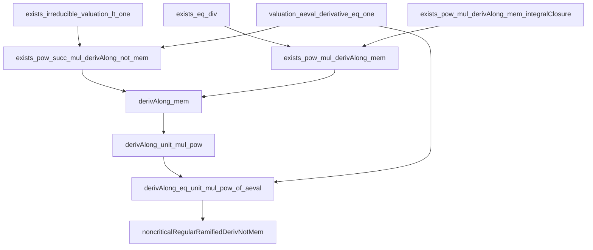

# Canonical source proof draft, version 2

This version reorganizes the previous complete source proof draft for platform node naming.
It preserves the previous candidate at `/tmp/p2m-regular-ramified-obstruction-next-20261114`.
All old candidate hashes still match its `SHA256SUMS`.

There are ten public theorem nodes.
Each `Theorems/Thm_*.lean` file contains exactly one public theorem.
Its filename is the full theorem name with dots replaced by underscores.
Every node name uses conservative ASCII identifiers.
The source theorem names stay unchanged; no wrapper theorem substitutes for a source theorem.

The original target, `AbcAdaptation.Tripod.Fermat.Proper.noncriticalRegularRamifiedDerivNotMem`, stays byte for byte identical.
Its complete proof also stays byte for byte identical to the previous candidate.
The other nine public source declarations retain their complete previous statements and proofs.

The new layout uses one Definitions module.
`Def_FermatCurveFieldUniformizer` contains only the actual source uniformizer definition.
It imports no Theorems module.
All small structural theorem helpers reside in the private proof closures of their actual consumers.

The old candidate contains 34 declarations: one definition and 33 theorems.
Its three Definitions modules contain 15 declarations; its ten Theorems modules contain 19 declarations.
This version emits those same 34 source meanings as 45 declaration instances:

- Ten public theorem nodes.
- One public uniformizer definition.
- Thirty-four private theorem copies from 23 distinct source theorem helpers.

The extra instances are copies for distinct real consumers.
Every private copy has at least one checked consumer in its own module.
The proof text and statement text stay unchanged, apart from the added `private` modifier.
The original namespace, section, variable, `omit`, `include`, and local notation context remains in each selected source fragment.

The canonical import graph is:

The first nine node names have prefix `AbcAdaptation.Tripod.Fermat.Proper.CurveDeriv`.
The final node has prefix `AbcAdaptation.Tripod.Fermat.Proper`.
`canonical-import-dag.json` records every full node name, canonical filename, direct dependency, and import.
`node-inventory.json` records the publication decision for each node and each private closure.

The integral-closure bound does not import the quotient theorem.
Its proof uses only two small structural helpers from the old quotient file.
This version includes those helpers privately in both real consumers.
The final obstruction includes the source chain-rule and place/residue helper closure privately.
It does not publish separate one-line chain-rule wrapper nodes.

`private-owners.json` records each private copy by `(module, userName)` and its exact source origin.
Repeated `userName` values in different modules identify different compiler owners.
`blind-source-bindings.json` maps the 34 source meanings to all 45 emitted instances.
The compiler's private-name indices remain pending root elaboration.
Bind audit facts by `(module, userName)`, not `userName` alone.

`source-consumer.json` retains source pins, hashes, source boundaries, and each new declaration instance.
`static-review.json` records all exact statement/proof comparisons, consumer checks, context checks, and import checks.
`Solutions/Checks_FermatRegularRamifiedObstructionCanonical.lean` prints axioms for the ten public nodes.
Each public node's assumption output covers its consumed private proof closure.

Pinned source: Belyi `9ce4d3f793d3bc831f2fc7214b7dbad90ea012d8`.
The source construction alignment and six source file hashes match the preserved candidate.
`LICENSE` contains the Apache-2.0 license, and every Lean file retains source attribution.

All static checks passed, including canonical filenames, ASCII names, source text, actual consumers, import paths, and whitespace.
These checks do not establish elaborated types, private compiler names, kernel acceptance, or exact platform payload validity.
Use MCP-CI for those checks before publication.
Follow `prove2me_workspace/references/upload_full_project.md:85` and `:87` for canonical names and ASCII rules.
Use the existing declaration extraction tools for the final elaborated graph and upload transformation.

No compiler, MCP-CI job, platform API, main workspace edit, or cache edit occurred in this task.
All new files stay in `/tmp/p2m-regular-ramified-obstruction-canonical-v2-20261114`.
